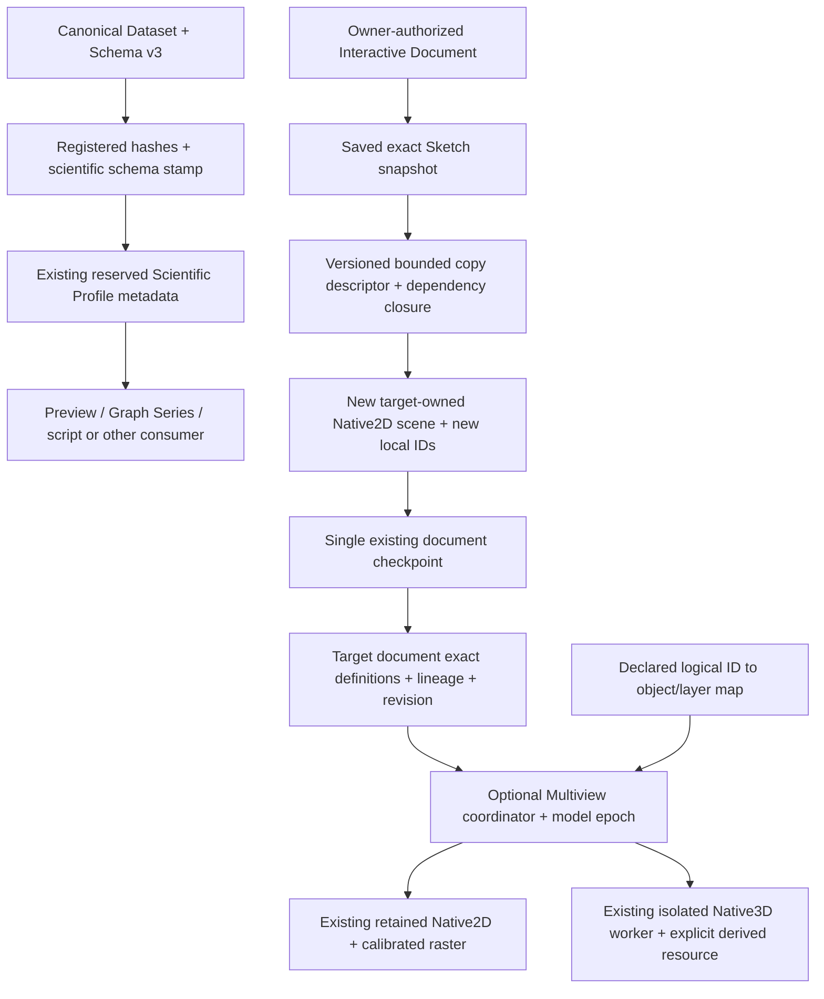

# CORE foundation identity and revision flow — dev075

The three optional services share established scientific authorities. There is no
new scientific registry, scene/model store, GUI engine, or mandatory plugin migration.

A Dataset content/schema change invalidates the derived profile; getters never scan
scientific rows. A model revision invalidates its prior view requests; an explicit
owner procedure restores 2D and generates a justified 3D derived representation.
The descriptor's source identity includes document ID, generation, revision and
payload hash. Each destination local ID carries a source-object lineage record and
exact descriptor hash. Copy edits never use source scene handles or capabilities.

Export/import validate saved authority and scientific dependencies. Unknown owner
formats opt in with pure source/payload adapters. The current Workbench can supply
its existing canonical exporter unchanged; CORE verifies against its saved retained
model, and another owner receives independent geometry. Partial or unsupported
source/resource forms are declined explicitly.

The desktop fixture demonstrates exact Bezier/line on a calibrated image and an
explicit sampled surface extruded between z=-1 and z=+1 mm. The sampling and chosen
extrusion are a labelled scientific view procedure, not an inferred SEM reconstruction
or canonical analytical replacement. Native pick IDs become logical selection only
through the declared map. Selection is reversible; a supported dimension edit is
committed by the owner and then regenerated. Session/document invalidation releases
view resources; persistence is entirely within the existing Interactive Document.
