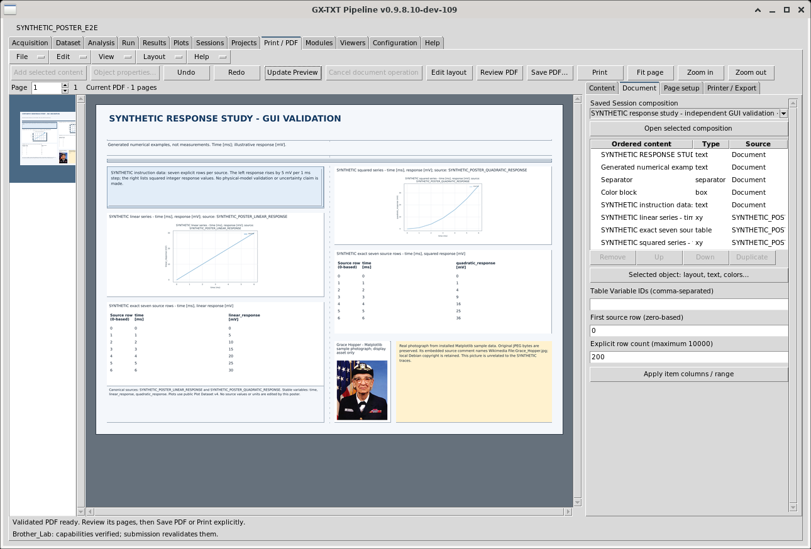
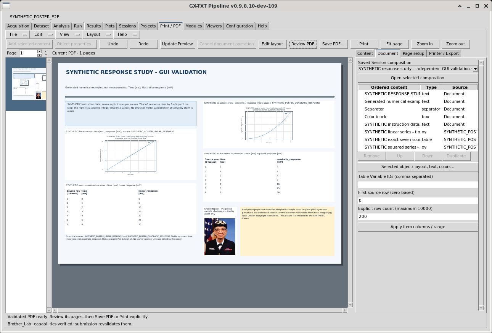
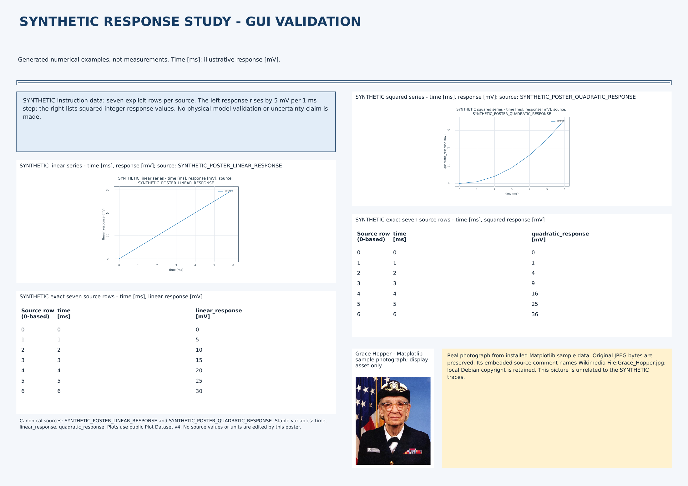

# Print Studio and Print Document API v1

SPDX-License-Identifier: GPL-3.0-or-later

## Compose a scientific poster

Open the main **Print / PDF** tab with the intended Session open. The central
paper is the editable composition; the right dock contains **Content**,
**Document**, **Page setup** and **Printer / Export**. The small pages on the left
navigate the prepared PDF. **Help → Print Studio guide** opens this guide.
Browsing Session content does not add it to the composition or submit a print job.

A new composition uses **Poster** layout: A3 landscape with two column guides.
The guides help arrange content; objects remain freely positioned. The document
title in Page setup names the saved composition and PDF metadata. Insert a
Heading if you want a visible title on the poster itself.

### Choose paper and columns

In **Page setup**, choose Poster, paper size (A4, A3 or LETTER), orientation,
margin, artwork columns, spacing and page background. Changes are accepted when
page settings are applied, including by **Update Preview** or **Save composition**.
The object frames must still fit inside the resulting paper: changing paper size
does not automatically shrink or rearrange an existing poster.

In Poster mode, columns and spacing guide placement of new objects. Existing
objects retain their physical frames. Artwork rows and automatic N-up placement
belong to Grid mode. Poster captions are edited per object; the page-level
Captions switch controls Grid artwork captions.

### Add tables, plots and images

1. In **Content**, select an actual Dataset or published Graph from the current
   Session. Search and Refresh help locate content. Inspect its source Preview
   and source description.
2. Choose an available **Print representation**, then **Add selected content**.
   The new object appears on the paper and in Document. A source thumbnail is a
   browsing aid; final preparation uses the original accepted content.
3. For a table, select its Document row. Enter comma-separated **Table Variable
   IDs**, a zero-based **First source row** and an explicit row count, then choose
   **Apply item columns / range**. The limits are 64 selected columns and
   1–10000 requested rows. Select a range that fits the poster frame legibly.
4. For an image/photo, use a genuine image Dataset already registered in the
   Session, choose **image**, then add it. Print / PDF does not provide a separate
   file-import button. Use the normal Session image-import workflow first.
   Give an illustrative photograph its real source attribution in its caption.
5. For a numeric Dataset with an offered **xy** representation, the initial plot
   uses its first two compatible numeric variables. Published Graphs can carry
   the already configured scientific axes and presentation. Inspect the actual
   prepared graph and its units before export.

Images and charts fit inside their object frames without cropping. Changing the
frame does not alter canonical image pixels, physical image calibration, Dataset
units or scientific Plot values. Unsupported original image modes offer an
explicit metadata representation rather than silently reducing their scientific
precision. A source without a declared original-media transfer may likewise
provide metadata rather than a printable full-resolution image.

A Poster PDF object must contain one explicitly selected source page. A
single-page PDF needs no further page choice. The current Content/Document
controls do not expose a multi-page PDF page picker; do not expect them to insert
an arbitrary multi-page PDF into one poster frame. Grid retains the existing
multi-page document behavior.

### Add authored content

In Content, **Heading**, **Body text**, **Annotation**, **Color block** and
**Separator** insert independent document objects. The equivalent commands are
also in Edit. Heading, body and annotation open their object-properties form;
enter the actual paragraph there and apply it. Text is inert document content,
not a scientific Dataset or executable script.

Use a color block for a section background and a separator to divide sections.
These objects have their own position, size, color and stacking order. A page
background colors the paper as a whole. Authored paragraphs and captions should
state which values are synthetic, illustrative or measured; the Composer does
not turn instructional data into experimental results.

### Select, move, resize and style

Click an object on the paper or its row in **Document**. The selected frame has
a dashed outline and four corner handles. Drag the object itself to move it;
drag a corner to resize its physical frame. During a move the object follows the
pointer. During a resize the new frame is outlined while prepared content stays
visible. Release commits one layout change. **Escape** cancels the provisional
gesture. A frame outside the paper or with an invalid size is rejected.

Choose **Object properties…**, double-click the object, or use Document's
**Selected object: layout, text, colors…** button for precise values:

| Property | Meaning |
| --- | --- |
| Paper page | One-based page containing this object |
| X from left / Y from top | Top-left frame position, in physical paper millimetres |
| Width / Height | Physical frame dimensions in millimetres |
| Caption / source attribution | Single-line source-aware caption, up to 400 characters |
| Font size / weight / paragraph alignment | Authored text layout; size is in points |
| Text / separator color, object background | RGB colors such as `#142334` |
| Border color / width, padding | Border width in points; inner padding in millimetres |

The authored paragraph field is available for text and annotation objects.
Scroll inside the properties form to reach border, padding, weight, alignment
and the paragraph; Apply and Close remain available at its bottom. The table
range fields in the Document dock apply only to table objects, even when those
fields remain visible while another object is selected.
Table and image values remain read-only; their presentation and caption can
change without editing the source Dataset. Keep enough space for captions,
padding, headings and readable content. If a table or paragraph cannot fit,
Update Preview reports overflow: enlarge its frame, reduce the explicit table
range, shorten the paragraph or deliberately choose a readable smaller font.
It does not silently omit rows or hide extra text pages.

Document's **Remove**, **Duplicate**, **Up** and **Down** operate on selected
objects. Order is also stacking order: later rows are painted over earlier ones;
Up moves the first selected object earlier, Down moves it later. Duplicate
initially keeps the original frame, so move the duplicate to separate it.
**Undo / Redo** restores composition edits. Removing the final object leaves an
empty composition; no preview update is needed to complete removal itself.

### Navigate and distinguish draft from final PDF

Use the mouse wheel to scroll the paper, **Ctrl+wheel** to zoom and middle-button
drag to pan. Fit page, Fit width and zoom commands are also available through
View; the toolbar includes Fit page and zoom. Navigation changes the view,
not the physical object size. In PDF review, left-drag also scrolls the page.

Choose **Update Preview** (F5) to accept current scientific source identities
and prepare the current PDF. Wait for **Current PDF** / **Validated PDF ready**.
New or content-changed objects may show a preparation placeholder until then.

After moving or resizing prepared objects, the editable draft can retain their
previous content. Resized draft pixels are scaled asynchronously from the
previously prepared object, so paragraph wrapping, chart proportions and glyph
shapes can temporarily reflect that earlier preparation. **Update required**
means this editable view is not the final output. Choose Update Preview again
to prepare exact content at the new physical frame dimensions.

Choose **Review PDF** to inspect the actual assembled PDF. Check every page:
text wrapping, table values and units, source-row numbers, graph axes, image
aspect, captions, overlap and colors. **Edit layout** returns to individual
objects. The editable draft and frozen PDF are separate views. Layout, content,
source or Session changes invalidate readiness and block PDF export/printing
until a current PDF is prepared. Review the new result before exporting it.

### Save the composition, then export

**File → Save composition** (Ctrl+S) saves the editable recipe and its Undo/Redo
History in the current Session. This is separate from **Save PDF…**. To reopen,
choose File → Open composition (Ctrl+O), select a Saved Session composition in
Document and choose **Open selected composition**. Reopening asks for fresh
source verification and preparation; it does not claim an old PDF is current.

A composition belongs to its original Session. After a Session change, reopen
that Session or choose New/Open composition for the current Session. Unsaved
changes prompt before New/Open. Another editor's saved revision must be reopened
before it can be overwritten; saving does not replace scientific source content.

After updating and reviewing, **Save PDF…** publishes the current PDF to the
chosen report/export location. Confirm replacements in the normal file chooser.
The PDF is checked again against its frozen bytes and scientific sources.
Dataset/analysis source directories are protected from this derived export.
Saving PDF does not submit to a printer and remains independent of printer
query failures.

### Print and diagnose

**Printer / Export** shows actual CUPS queues and the selected printer's
capabilities. **Refresh printers** and **Cancel query** act asynchronously.
Missing CUPS, no queues, authorization, offline, timeout and output-limit errors
are reported distinctly. Duplex, media, color, resolution and tray choices come
from the selected queue; unavailable choices are disabled. The configurable CUPS
timeout is 250–30000 ms per OS command (default 3000).

Only explicit **Print** submits the current PDF. The returned CUPS job ID means
accepted/spooled; it does not prove physical completion. **Job status** and
**Cancel submitted job** act on that actual job. Submission rechecks printer
capabilities, PDF bytes and scientific source identity.

**View → Diagnostics** opens the bottom diagnostic drawer. Dock width, drawer
height and drawer visibility use the existing Configuration preferences.
**View → Show / hide browser** frees paper space when needed. Menus, toolbar,
dock actions and shortcuts use the same command set.

### Existing Grid compositions

Existing saved Grid recipes retain their layout. In Grid, tables and text
paginate independently with repeated column headings, units and source-row
identities; artwork uses N-up cells. Numeric strings are preserved without
intentional rounding, including 64-bit integers. Large projections need an
explicit smaller range. Unsupported glyphs produce a diagnostic. Artwork fits
its chosen cell without cropping; original raster output below 100 effective
PPI produces a resolution notice.

Switch layout deliberately in Page setup. Poster-authored text/annotation/block/
separator objects require Poster mode; a switch to Grid containing them is
rejected rather than dropping them. Keep a saved original composition when
trying a different layout.

## Worked example: two-column SYNTHETIC response poster

This example comes from an actual GUI-authored composition and its exported
PDF. Its numerical series are deliberately generated instruction data, **not
measurements**, a validated physical model or an uncertainty estimate. The
photograph is an unrelated display asset. The illustration shows A3 landscape;
it does not imply support for arbitrary large-format paper or a particular
physical printer.



The real editor after preparation. Dashed column guides help organize the paper;
the two columns have independently positioned objects. The complete internal
plot titles retain their source IDs and wrap onto two lines.

### Source content

The example Session is named `SYNTHETIC_POSTER_E2E`. It contains the following
numeric Dataset identities, with seven rows each:

| Dataset | Stable variables and declared units |
| --- | --- |
| SYNTHETIC_POSTER_LINEAR_RESPONSE | `time` [ms], `linear_response` [mV] |
| SYNTHETIC_POSTER_QUADRATIC_RESPONSE | `time` [ms], `quadratic_response` [mV] |

| Zero-based source row | time [ms] | linear_response [mV] | quadratic_response [mV] |
| --- | --- | --- | --- |
| 0 | 0 | 0 | 0 |
| 1 | 1 | 5 | 1 |
| 2 | 2 | 10 | 4 |
| 3 | 3 | 15 | 9 |
| 4 | 4 | 20 | 16 |
| 5 | 5 | 25 | 25 |
| 6 | 6 | 30 | 36 |

The photograph Dataset `PHOTO_GRACE_HOPPER_DISPLAY_ASSET` holds the unchanged
512×600 JPEG distributed with the installed Matplotlib sample data. Its caption
reads **Grace Hopper - Matplotlib sample photograph; display asset only**. An
adjacent annotation states that its embedded source comment names Wikimedia
`File:Grace_Hopper.jpg`, that local Debian copyright information was retained,
and that the picture is unrelated to the synthetic traces. No public-domain
status or measurement provenance is inferred from this use.

These are example identities, not automatically installed Session templates.
Use an existing authorized Session/publication workflow to prepare equivalent
clearly labelled source Datasets before composing; Print / PDF does not create
scientific measurements or import these fixtures on opening this guide.

### Build the page with the ordinary controls

1. Choose **New composition**. In Page setup use A3, landscape, Poster,
   two columns, 10 mm margin and 5 mm spacing. Use page background `#F4F7FB`.
2. Insert Heading and enter **SYNTHETIC RESPONSE STUDY - GUI VALIDATION**.
   Set 22 pt, bold, foreground `#153B63`. Add Body text for the subtitle:
   **Generated numerical examples, not measurements. Time [ms]; illustrative
   response [mV].** Use 10 pt.
3. Insert a separator and a light-blue Color block (`#E2EDF8`). Add a Body text
   object over the block explaining the seven explicit rows, the 5 mV step in
   the linear series, the squared integer response values, and the absence of
   physical-model validation or an uncertainty claim. Place the block before
   that text in Document so the text remains in front.
4. Select the linear source in Content and add **xy**. Add it again as **table**.
   For that table set Variable IDs `time,linear_response`, first row 0, count 7,
   and apply the range. Set source-aware captions and 9 pt object text.
5. Repeat for the quadratic source, using `time,quadratic_response` for its table.
   Each plot retains its actual time [ms] and response [mV] axes. The two tables
   display all seven values and original zero-based source rows.
6. Select the photo Dataset, choose image and add it. Set its display-only
   caption. Insert the attribution Annotation beside it with pale-yellow
   background `#FFF2CF` and 9 pt text. Add a final 8 pt Body text source note
   naming both Dataset IDs and all three stable variables.
7. Use Object properties to set the physical frames below. Every frame is on
   page 1. Use 2 mm padding unless a different value is listed. These are
   explicit user-entered layout values, not scientific coordinates.

| Object, in Document order | X / Y [mm] | Width × height [mm] | Detail |
| --- | --- | --- | --- |
| Heading | 10 / 8 | 400 × 24 | 22 pt bold; 2 mm padding |
| Subtitle | 10 / 34 | 400 × 12 | 10 pt; 1 mm padding |
| Separator | 10 / 49 | 400 × 3 | 1 pt line; 1 mm padding |
| Color block | 10 / 56 | 195 × 37 | Light blue; 1 pt border |
| Explanatory body | 12 / 58 | 191 × 33 | 10 pt; matching light-blue background |
| Linear plot | 10 / 98 | 195 × 75 | 9 pt caption |
| Linear table | 10 / 178 | 195 × 75 | 9 pt; explicit seven-row range |
| Quadratic plot | 215 / 56 | 195 × 70 | 9 pt caption |
| Quadratic table | 215 / 131 | 195 × 75 | 9 pt; explicit seven-row range |
| Photograph | 215 / 213 | 50 × 73 | 9 pt caption |
| Photo attribution annotation | 270 / 213 | 140 × 73 | 9 pt; 3 mm padding |
| Source note | 10 / 254 | 195 × 32 | 8 pt; page-matching background |

### Edit, save, inspect and export

Choose Update Preview to prepare the twelve objects. Select a table, plot,
photo, heading or annotation; move or resize it using the visible frame and
handles. The changed draft remains visible and becomes Update required.
Undo restores the prior frame; a temporary gesture is cancelled with Escape.
Changing zoom or scrolling leaves the physical recipe unchanged.

To remove a table, select its Document row and choose Remove. Its row and its
paper object disappear immediately. Undo restores it; Redo removes it again.
Return to the intended complete composition before saving.

Save composition stores the editable layout and History. Open the saved Session
composition to continue it, then Update Preview for current output. In this
example, all twelve original object definitions and History were checked on
reopen; the original source Datasets and photo bytes remained unchanged.



Review PDF shows the genuine assembled page. It has no editing handles. Check
the full titles/source IDs, both complete seven-row tables, units, photo aspect,
captions and text blocks. Fit-page is useful for overall placement; zoom in for
reading. Choose Save PDF and use the ordinary file chooser to publish it.



The actual corrected example export is one A3 landscape page. Its SHA-256 is
`8bdf8b743fbba95613f65b8516f5f4e6a761bb70dade534cfa7e446d0bcb1d9c`.
This figure was rendered from those genuine exported bytes, not reconstructed
from editor objects. Recreating or editing the poster may legitimately produce
a different PDF hash. The result demonstrates composition/source fidelity; it
does not establish accuracy of a scientific model, a solver or a measurement.

## Scientific owners and supported sources

Canonical tables use Variable Schema and bounded Table Stream reads, including
accepted remote providers with account-local node configuration references.
Remote media with no declared original-file transfer offers metadata instead
of treating its small Preview as print authority. Source Preview uses the
accepted Session Preview Cache; its default/custom Render ownership is retained.

Original image/PDF/text payloads are verified by Session Inspection and remain
read-only. PDF insertion preserves source vectors and page order. Tables/text
use the existing Matplotlib PDF compositor; pypdf assembles pages and transparent
headers/footers. qpdf checks the final structure. Limits are 200 items/pages,
8 MiB recipe/text, 16 MiB selected table strings, 64 MiB original media and 96 MiB
final PDF. Errors leave the previous reviewed PDF intact.
Prepared content is bounded to 32 MiB and the managed intermediate tree to
384 MiB inside a 768 MiB reservation. Raster headers are inspected asynchronously
through `printDocumentMediaInfo`: single-frame 1/L/LA/P/PA/RGB/RGBA/CMYK images
up to 32 megapixels are supported. High-bit-depth, floating-point and multi-frame
sources offer metadata with an explicit reason; their values are never silently
reduced to an 8-bit image. Table columns use supported rank-one canonical types;
complex or multidimensional columns require another declared representation.
Source selections and late Preview/media results are scoped to the current
Session token and selection generation.

Native 2D Graphs and explicit XY projections use public Plot v4 widget export.
Print Studio never changes Plot Dataset implementation. Native3D Graph capture
uses its existing public scientific snapshot/presentation/render services into
managed private resources, with the frozen camera/axes/legend and 2400×1800
artwork; local source payloads are limited to 64 MiB. Arbitrary CAD/array scenes
without an accepted paper projection have an explicit metadata synopsis.
Graph annotation layers use the existing annotation compositor in the managed
worker; their original artwork and annotation files are never rewritten.

## Host contract

`printRecipeNew` retains the legacy Grid recipe; `printRecipePosterNew` creates
an additive Poster recipe with physical per-object frames and optional inert
authored text/style. Literal objects require Poster mode. They have no fake
Dataset ID, scientific source signature or provenance. Frames must fit inside
their actual page; tables/text that cannot fit require explicit user changes,
not silent omitted rows or automatic reduction. `printRecipePageSize` returns
paper mm; `printRecipeAssetIdentity` describes prepared content/size and
`printRecipeItemLabel` supplies bounded presentation labels.
`printRecipeValidate`, `printRecipeHistoryCreate/Edit` and
`printRecipeDocumentSave/Read` retain the existing History/Interactive Document
authorities. Save checks the expected document generation/revision/SHA.
`printRecipeSourceSignature kind id` and `printContentDescribe kind id` expose
actual source identity and supported presentations, not another source registry.

`printDocumentRequest operation arguments callback` supports compose, page,
object_preview, thumbnails, source_preview, media_info, verify and export.
object_preview accepts the ordinary frozen PDF/source resource arguments plus
an `objects` list of `{id width height}` dictionaries. It verifies the retained
PDF/asset hashes, resamples existing prepared object pixels only and returns
managed PNGs with source asset identity and `prepared_object_layout_draft`
projection. At most 200 unique objects, each dimension 1–6000 pixels and a
total 64 megapixels; no scientific materialization or Plot execution occurs.
The host matches the current Session/PDF/page/dimension key, coalesces pending
requests, copies successful images into Tk and releases their managed allocation.
It allocates through Resource
Management before starting a bounded common Script Job auxiliary request.
Compose arguments contain current Session and inert recipe/configuration/node
reference data. Success returns the managed resource ID plus PDF path/SHA,
source manifest, pages/dimensions and notices. Call `printDocumentRelease id`
when finished. Page requests lease their source resource until their worker is
reaped; cancellation and delayed retirement cannot delete active outputs.
`printDocumentCancel token` cancels owned work, including allocations in flight.
No new scientific scheduler or process-killing engine is introduced.

`printCupsRequest operation arguments callback` is the bounded OS adapter.
`printCupsQuery channel operation arguments callback` coalesces requests on
four channels (discovery/capabilities/submission/status), waits for cancellation
cleanup, and delivers only the newest generation. `printCupsCancel channel`
invalidates pending replies; `printCupsState` exposes scoped diagnostics.
Commands use argument arrays, no shell interpolation. The common Supervisor
owns descendant cleanup. Resources/private node credential references must be
excluded from public evidence; receipts identify hashes and bounded outcomes.

### Tcl host signatures and return values

The following commands belong to namespace `::GX`. They are trusted Tcl host
entrypoints, not unrestricted Python/Octave calls or C++ SDK grants. A command's
presence here does not admit it to a restricted Viewer. Use the registered
language-specific operation and its declared schema where one is available.
Arguments below are Tcl values (dictionaries and lists), never executable source.
Optional arguments are shown with `?…?`; defaults are stated explicitly.

| Exact invocation after `::GX::` | Arguments and result |
| --- | --- |
| `printRecipeNew` | No arguments. Returns a `gxtxt.print_recipe.v1` dictionary with title, A4 portrait Grid page (1 row, 1 column, 12 mm margin, 5 mm gap, captions enabled) and empty `items`. Does not create a document or prepare a PDF. |
| `printRecipePosterNew` | No arguments. Returns that recipe with title `Scientific poster`, A3 landscape, 2 columns, `layout_mode poster` and white page background. |
| `printRecipePageSize page` | `page`: dictionary containing supported `paper` and `orientation`. Returns the two-element list `{width height}` in mm, after orientation. This utility does not validate a complete recipe. |
| `printRecipeAssetIdentity item` | `item`: recipe-item dictionary. Returns an inert key/value list of source kind/ID/signature, presentation, options, caption, style and text (empty defaults), plus frame width/height when present. It describes prepared-content reuse; it is not a canonical Dataset identity or a cryptographic digest. Position and page are not included. |
| `printRecipeItemLabel item` | `item`: recipe-item dictionary with `caption`, `source_kind`, `presentation` and optional `text`. Returns trimmed caption, otherwise a literal object's first text line, otherwise its representation label; labels longer than 100 characters are shortened with an ellipsis. |
| `printRecipeValidate recipe` | `recipe`: inert recipe dictionary described below. Returns a dictionary copy if valid; raises a Tcl error otherwise. Does not resolve or freeze scientific source bytes and does not save or modify the input. |
| `printRecipeHistoryCreate recipe` | Validates `recipe`, registers the existing `framework.printing` History host and returns a Scientific Recipe History dictionary with that recipe as `base`, empty `steps` and cursor 0. Does not persist it. |
| `printRecipeHistoryEdit history recipe description` | `history`: existing printing History; `recipe`: validated new snapshot; `description`: History label string. Returns the appended History dictionary. If its cursor is not at the end, branches at that cursor before appending. Does not itself save a document. |
| `printRecipeDocumentSave recipe history ?id? ?expected?` | `recipe` and `history`: validated printing values. `id` defaults to empty: creates a new current-Session Interactive Document. For an existing ID, `expected` must equal the list `{generation revision sha256}` from its current document metadata; it also defaults to empty, which cannot authorize an ordinary existing-document update. Returns the existing Interactive Document owner's public metadata, including ID, generation, revision and SHA. Owner mismatch or a stale expected list raises an error. |
| `printRecipeDocumentRead id` | `id`: current-Session Interactive Document ID. Requires owner `framework.printing/print_composition` and format `gxtxt.print_composition.v1`. Returns the document dictionary, including `payload recipe` and `payload history`, after recipe validation. Does not make a previously prepared PDF current. |
| `printRecipeSourceSignature kind id` | `kind`: `dataset` or `graph`. For `dataset`, `id` is a canonical Dataset ID; returns the existing Dataset Viewer's scientific identity. For `graph`, `id` is a current Session `analysis/` artwork path (relative or absolute); returns the opaque list of artwork stat identity, Graph reference/metadata, Dataset dependencies and effective presentation spec. Preserve and compare the whole value; do not invent or edit its fields. Missing/stale context raises an error. |
| `printContentDescribe kind id` | `kind`: `dataset` or `graph`; `id`: corresponding ID/path. Returns `source_kind`, `source_id`, `title`, `kind`, `representations`, `default`, `reason`; Dataset results additionally contain `format`, `media_type`, `variables`, `table_variables`, `xy_variables`, `row_count`. Variable lists come from canonical schema. This is representation discovery, not materialization or proof that remote original media can be transferred. |
| `printDocumentApiInfo` | No arguments. Returns `api_id PRINT_DOCUMENT_API_v1`, `api_version 1`, authority `services/printing`, the 21 advertised operation names, transport `SCRIPT_JOB_API_v1`, `cups_lifetime bounded_auxiliary`, and `scientific_authority 0`. Discovery does not invoke those operations or grant language access. |
| `printDocumentRequest operation arguments callback` | `operation`: one of the eight operations below. `arguments`: its inert dictionary. `callback`: Tcl command-prefix list receiving one response dictionary. Returns an asynchronous `print-document#…` token, not a prepared document. Resource allocation precedes worker startup. |
| `printDocumentCancel token` | `token`: request token returned above. Returns 1 after marking an owned live request cancelled, 0 if no longer registered. Cancellation can finish asynchronously; it also covers allocation still in flight. A cancellation response has `ok 0` and an explanation. |
| `printDocumentRelease id` | `id`: successful response's managed `resource_id`, not a document/Dataset ID or filesystem path. Requests retirement; with no active lease it forwards the Resource Management asynchronous request token, otherwise returns an empty Tcl result. Neither is a cleanup-completion receipt. Existing active leases postpone release/cleanup until their workers finish. |
| `printDocumentSourcePreview id callback` | `id`: current Session Graph artwork path, not a Dataset ID. `callback`: response prefix. Captures its current source signature/stat and requests a bounded `source_preview`; returns a request token. Result is a browsing PNG, not print-source authority. |
| `printDocumentMediaInfo id callback` | `id`: canonical image Dataset ID; `callback`: response prefix. Resolves the original payload and recorded SHA, rejects undeclared remote original transfer, and requests `media_info`. Returns a request token; successful result reports actual decoded mode, frame count, width, height, printable flag and reason. |
| `printCupsRequest operation arguments callback` | `operation` and `arguments`: CUPS table below; `callback`: response prefix. Returns the common Script Job auxiliary request ID. Uses configured `printing.cups_timeout_ms`; does not create another scientific Job registry. |
| `printCupsQuery channel operation arguments callback` | `channel`: `discovery`, `capabilities`, `submission` or `status`; remaining arguments as above. Returns `{channel … generation …}`. Only the newest generation on that channel is delivered, with `generation` added to its response. Pending work is coalesced after previous cancellation drains. Channels do not change the operation's argument contract. |
| `printCupsCancel channel` | Channel string. Returns 0 if no channel state exists, otherwise increments its generation, clears pending work and requests cancellation of its current auxiliary request, returning 1. Cancelling a query is not cancelling an already accepted physical print job; use `cancel_job` for that. |
| `printCupsState ?channel?` | Channel defaults to empty. Empty returns `{channels … ignored_stale_responses …}`; a named channel returns its state (`generation`, `request`, `pending`, `last`, and `operation` when established). These are transient diagnostics, not persisted scientific or CUPS-job state. |

### Recipe and item dictionaries

Top-level recipe fields are exactly `schema`, `title`, `page`, `items`. Schema
is `gxtxt.print_recipe.v1`; title is single-line, at most 200 characters. Page
fields are `paper`, `orientation`, `rows`, `columns`, `margin_mm`, `gap_mm`,
`captions`, optional `layout_mode` (default `grid`) and optional `background`.
Paper/orientation follow the workflow above; rows and columns are integers 1–4,
margin/gap finite 0–60 mm, captions boolean, and background `#RRGGBB`.

Every item requires `id`, `source_kind`, `source_id`, `presentation`,
`source_signature`, `options`, `caption`. IDs are unique within the recipe and
match `print_[a-zA-Z0-9_]+`. Source kind is `dataset`, `graph` or `literal`;
presentation is `table`, `xy`, `image`, `pdf`, `text`, `metadata`, `graph`,
`annotation`, `box` or `separator`, subject to the selected source's actual
supported representation. Dataset IDs are canonical IDs. Graph paths belong
to the current Session's `analysis/`. A captured source signature must still
match when materialization occurs; recipe syntax validation alone cannot prove
that compatibility or source lifetime.

Literal items require Poster mode, presentation `text`, `annotation`, `box` or
`separator`, empty source ID/signature/options, and an inert UTF-8 `text` field
of at most 1 MiB. They do not create scientific Datasets. Nonliteral items may
not contain that authored `text` field or use the three authored shape/annotation
representations. Captions are single-line, at most 400 characters.

`options` admits only the following keys; supply those required by the chosen
materializer:

| Representation | Required/optional options |
| --- | --- |
| `table` | `variables`: nonempty ordered list of at most 64 actual Variable IDs; `start`: zero-based nonnegative integer source row; `count`: integer 1–10000. Schema/Stream owners validate actual types/ranges during preparation. |
| `xy` | `x_variable_id`, `y_variable_id`: compatible canonical numeric Variable IDs. Scientific rendering uses Plot Dataset v4. |
| `pdf` | Optional `pdf_pages`: explicit one-based source page list. Poster insertion must resolve to one source page; Grid can preserve multiple pages. |
| Other representations | Normally empty dictionary. No implicit file import or arbitrary render options. |

Poster items require `frame` with exactly `page` (integer 1–200), `x_mm`,
`y_mm`, `width_mm`, `height_mm`. Position is finite and nonnegative; dimensions
are finite, at least 1 mm, and the full rectangle must fit that paper. Optional
`style` accepts `foreground`, `background`, `border` as `#RRGGBB`, `border_pt`
(0–12 points), `padding_mm` (0–30 mm), `font_size` (6–96 points), `weight`
(`normal`/`bold`) and `align` (`left`/`center`/`right`). Unknown recipe, page,
item, options or style fields are rejected. History dictionaries and document
metadata retain their existing owners' schemas; do not replace them with a
parallel recipe log.

### Asynchronous document requests

The callback receives `{ok 1 result RESULT}` on success, or `{ok 0 error TEXT …}`
on failure; transport failures can carry further common Supervisor fields.
Successful `RESULT` also includes `resource_id` and `resource_path` for the
request's allocation. Release **every** successful allocation, including a
late result no longer displayed. Failure/cancellation allocations are retired
by the owner. Keep the supplying document resource leased for dependent
requests: pass its `source_resource` ID in `arguments`. This host-only field is
removed before forwarding to the worker; callers must use the matching owned
resource, not an arbitrary path.

For derived requests, the frozen document fields mean `pdf` (owned absolute
path), `pdf_sha256` (exact frozen bytes), `source_manifest` (owned source-guard
manifest), `page_count` (validated count). They come from the compose receipt.
The worker verifies PDF SHA before all derived operations. `verify` and
`export` also revalidate scientific source guards; page, thumbnail and object
draft operations deliberately display retained frozen content without claiming
that its scientific sources are still current.

| Operation | Arguments beyond optional `source_resource` | Successful result beyond resource fields |
| --- | --- | --- |
| `compose` | `session`: actual Session root; `payload`: inert dictionary with validated `recipe` and optional `nodes` (existing configured Scientific Execution node-reference dictionary). Preserve account-local node configuration; do not put credentials in public recipes/evidence. | `pdf`, `pdf_sha256`, `source_manifest`, `page_count`, `pages` (physical PDF dimensions), `notices`; Poster may also return `objects` with frame, prepared asset identity and owned preview path/SHA/dimensions. Scientific sources are checked during/after materialization and again after assembly. |
| `page` | Frozen document fields plus `page` (1-based, at most page_count ≤200), `width` (integer 200–3000 pixels). | `path` (PNG), `page`, actual pixel `width`, `height`, `pdf_sha256`; optional `objects` with ID, PNG, asset key, frame and dimensions. Page image is limited to 16 megapixels; object images total 64 megapixels. |
| `thumbnails` | Frozen document fields; `page_count` must be 1–200. | `paths`: source-page ordered PNG list, exactly page_count elements; `pdf_sha256`. |
| `object_preview` | Frozen document fields plus `objects`: 1–200 unique `{id width height}` dictionaries, existing prepared object IDs, integer dimensions 1–6000 pixels, total ≤64 megapixels. | `objects`: ID/path/width/height/SHA/asset-key dictionaries, `pdf_sha256`, `projection prepared_object_layout_draft`. Reuses verified prepared pixels, not canonical re-rendering. |
| `verify` | Frozen document fields. | `status verified`, `pdf_sha256`. Does not assemble a new PDF. |
| `export` | Frozen document fields plus `destination` (regular absolute `.pdf` path outside Session datasets/analysis), `session`, optional `replace` (`1` explicitly permits replacement; default create-only). | `path`, `pdf_sha256`, `status exported`. Existing File Publication owns promotion. No printer submission. |
| `source_preview` | Prefer `printDocumentSourcePreview`; underlying fields are Graph `path`, actual `session`, `stamp` list `{size mtime ctime inode}`. | `path` to bounded PNG; source must still match its stat stamp under Session analysis. For PDF artwork, only its first page is a browsing preview. |
| `media_info` | Prefer `printDocumentMediaInfo`; underlying fields are original image `path`, recorded `sha256`. | `printable` boolean, decoded `mode`, `frames`, `width`, `height`, `reason`. Unsupported scientific pixel modes remain unsupported, not converted by this inspection. |

The common worker allocation/root is supplied by CORE; do not provide it as a
Viewer-owned output tree. Compose's selected source signatures must be captured
through their public owners. The host GUI must additionally compare its current
Session token, recipe revision, selection generation and request key before
adopting results; the generic request token alone does not prove they are current.
The Print Studio callback demonstrates that check and releases rejected late
successes. Retained previous PDF content is safe to review as a previous frame;
export/submission requires current verified source state.

### CUPS operations and diagnostics

After a Tk application is destroyed, CUPS completion still clears the request
and records the current response or stale-response count. It does not restart
pending work or deliver a UI callback if checking the Tk root fails or reports
that it is absent. A host without Tk commands retains headless callback delivery.

`arguments` is a dictionary. Unknown keys are rejected by `printCupsRequest`.
Optional `source_resource` is the host-only managed lease described above.
Callbacks use the same success/failure envelope; CUPS errors may include
`error_type` such as `unavailable`, `authorization`, `offline`,
`stale_capabilities`, `stale_document` or `invalid_request`, and Supervisor
timeout/output-limit errors retain their actual category.

| Operation | Arguments | Result |
| --- | --- | --- |
| `discover` | Empty dictionary. | `status available` or `no_printers`, `printers` list, `default` queue (or empty), `diagnostics`. |
| `capabilities` | `printer`: actual CUPS queue name. | `status verified`, `printer`, `options` dictionary (each option has label/choices/default), `groups` for media/color/resolution/tray when actually present, admitted `duplex` choices, capability `fingerprint`, `diagnostics`. |
| `submit` | Required `printer`, `capability_sha256` (returned fingerprint), regular absolute `pdf`, exact `pdf_sha256`, integer `copies` 1–99. Optional `duplex` (default `auto`), `options` (verified option/choice dictionary), `pages` (positive CUPS range, e.g. `1-3,5`), `source_manifest` (frozen scientific guards; supply it for scientific compositions). | `status accepted` when an actual returned ID is parsed, otherwise `submitted_unidentified`; `printer`, `job_id` (possibly empty), `diagnostics`, `physical_completion unknown`, `pdf_sha256`. Capabilities and bytes are rechecked before submission; scientific guards are rechecked when supplied. |
| `job_status` | `printer`, `job_id`: actual queue-job identity returned by CUPS. | `status queued`, `completed_reported_by_cups` or `not_listed`; `job_id`, `physical_completion unknown`, `diagnostics`. Not-listed does not prove success. |
| `cancel_job` | `job_id`. | `status cancel_requested`, `job_id`, `diagnostics`. A requested cancellation is not a physical completion receipt. |

For example, in a trusted printing host with an existing event loop:

```tcl
proc ::MyPrintDiscoveryDone {response} {
    if {![dict get $response ok]} {
        puts stderr [dict get $response error]
        return
    }
    puts [dict get $response result printers]
}
::GX::printCupsQuery discovery discover {} ::MyPrintDiscoveryDone
```

This queries configured queues only. It neither prepares scientific content
nor submits a print job. In a restricted Viewer, use only the officially admitted
typed UI/printing operations instead of copying this host callback as a bypass.
