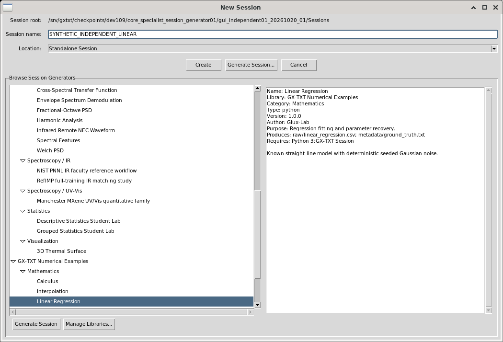
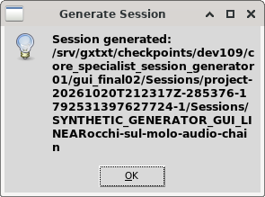
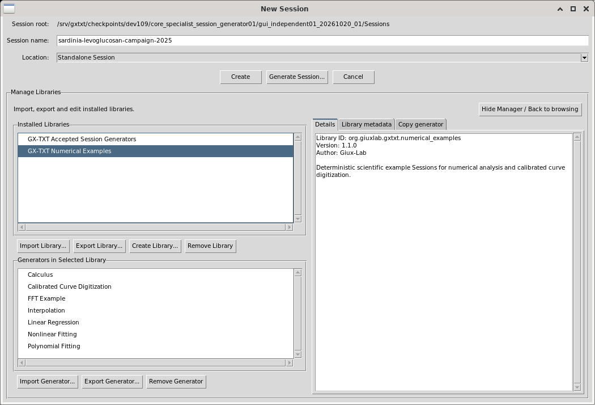
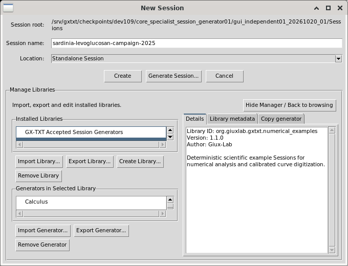

# Session Generator: browse, generate and manage libraries

This Help edition covers the existing New Session dialog in the reviewed dev109 candidate. Its images are unaltered real Debian GUI captures. The offline HTML edition is `docs/session_generator_dev109/index.html`; open that file in a normal browser after extracting the guide package. Help uses this Markdown edition.

## Open the browser

1. If New Session asks for a Session root, open Configuration → Storage, create a named Storage Profile, set New Session root to an existing directory, then choose Save & Apply.
2. Open Sessions → Session → New Session....
3. Confirm Location: Standalone Session or the intended Project.
4. Choose the upper Generate Session... button. It opens browsing; the lower Generate Session button executes the selected generator.

Use Create with an explicit name for an ordinary empty Session. Generator browsing is optional.

## Choose a generator

Expand a library/category using disclosure arrows or native arrow keys. Select a generator to read its name, library, category, version, purpose, output files and requirements in the right-hand description.

Select a library or category to inspect its browsing information. The lower Generate button stays disabled until a generator is selected.

Check Session name after choosing a generator. An empty name may receive a suggestion; existing text stays when switching generators. Edit it explicitly to the intended final name.

Drag the vertical divider to change the tree/description proportions. Use the tree's horizontal scrollbar for long names and vertical scrollbar for more rows. The description has independent scrolling.

## Generate the numerical example

1. Select GX-TXT Numerical Examples → Mathematics → Linear Regression.
2. Enter an explicit Session name and confirm Location.
3. Choose the lower Generate Session button.
4. Acknowledge Session generated. The new Session opens normally.

The bundled example produces raw/linear_regression.csv and metadata/ground_truth.txt. Its41 rows follow y=2.5x+1.2 plus Gaussian noise, standard deviation0.12, seed1971. These are deterministic numerical examples, with no physical measurement units implied. Generation is distinct from running a fit or analysis.

Library/generator identity, version and type are recorded in metadata/session_generator.ini.

This original generation image is reused from the completed author run. It was not regenerated for the guide. MAIN separately repeated genuine generation and checked the exact41-row scientific content.

## Manage libraries

Choose Manage Libraries... in the browser. The left side lists libraries and generators in the selected library. The right side has Details, Library metadata and Copy generator tabs.

- Inspect: select a library or generator and open Details. Changing libraries clears the previous generator selection.
- Edit metadata: select a library, open Library metadata, edit Name/Description/Version/Author, then Save Metadata. The stable library ID stays the same.
- Create a library: choose Create Library..., enter its name and metadata, then Create. The new library starts empty.
- Whole library: Import Library... opens a package chooser. Select a library before Export Library.... Importing an already installed identity reports the conflict.
- One generator: select the destination library before Import Generator.... Select both source library and generator before Export Generator....
- Copy: select source library and generator, open Copy generator, choose destination library, then Add Generator to Library.... Copying does not execute the generator.
- Cancel removal: Remove Library/Remove Generator confirms the selected identity. No keeps it. The illustrated checks used a disposable synthetic library and cancelled both confirmations.

Return using Hide Manager / Back to browsing or the upper Generate Session... button. Browser selection, expanded branches, scrolling and useful window/divider geometry return. Browser and Manager retain separate divider proportions.

Closing ends the dialog interaction. Reopening starts without an active generator; installed libraries and generated Sessions remain available.

## Reproduce the browsing check without generating

1. Open the browser and select Linear Regression. Read its description; lower Generate is enabled.
2. Select Mathematics, then its library row. Description changes and Generate is disabled.
3. Collapse/expand a different branch, then reselect the intended generator. Drag the divider and note the window size and selection.
4. Open Manager and return using Hide Manager / Back to browsing. Check identity, divider, window size and keyboard focus.
5. Open Manager again and return using the upper Generate Session... button. Check the same state.
6. Make the window narrower; scroll a long name/description, open Manager and visit its three tabs. Controls remain reachable.
7. Cancel, reopen New Session and show the browser. Generate stays disabled until a generator is selected.

## Contract and provenance

[Return to Session Generator Library API v1](../api/SESSION_GENERATOR_LIBRARY_API_v1.md)

The offline HTML guide and IMAGE_PROVENANCE.json share these exact real images. All source/evidence and first failures remain preserved. Source owner SHA256:33f3010c0366e5273135868fabd6498abf9a12d3f013d8aaa847c6bd75f4dae7. Family evidence is separate from MAIN's sole acceptance and full15-workstream release decision.

## Scoped family acceptance

MAIN accepted SESSION-GEN-BROWSER-01 through -07 on 2026-10-21 at unchanged CORE source33f301. See the seven-criterion matrix and acceptance provenance. Receipt: `MAIN_FAMILY_ACCEPTANCE87.json`, SHA256 `69e24c09bb11406cb7f35028f563747192607981ba7876a3c056af6edad687e8`. Whole workstream6 and all15 release remain OPEN. This docs-only reconciliation awaits MAIN integration; the original native review receipts remain unchanged.
