# Circuit Workbench: dev108 native worked examples

GNU GPL-3.0-or-later. Final restricted-author package: Circuit Workbench1.9.3,
SHA256 `b58b06f9198a0e7609668e3a29788c0231aa5dc1d52aaf8b75aa4332dad5b4c6`.
This documentation revision preserves the1.9.2 C++, binary, SDK, grants, all203
controls and every image/icon asset. The earlier actual1.9.2 figures/scientific
receipts below retain that honest source scope. The final integrated manual is
104856 bytes; its seven unchanged illustrations remain explicitly historical.
This supplement records the current actual Debian workflow. The earlier1.9.2 integrated guide and its export-time notes remain archived;
new1.9.3 instructions cover wire Properties, AC selection and the five examples.
The current figures here have individual original-capture SHA records in
`IMAGE_ORIGINS.json`. Source code/design/package are the author's normal public
Builder/Development export; this supplement does not replace that source.

## Build and install through the public authoring tools

Open the source project in Viewer Development Workspace. Its source browser
shows admitted `handlers.cpp`, project metadata and the fixed SDK. Interface
Builder owns all declarative layout, properties, icons, menus and profiles.
Use its Icon Library to inspect/change an owned resource and native state
preview. Keep stable command IDs and declared scientific references intact.
Choose Validate, then Build/F6, Test and the normal Demo preview. Export candidate
revalidates/rebuilds a standard ZIP; it does not install. In ordinary Plugin
Manager choose Install/Update, review module/version and dependency report, then
honor restart-required status. A still-open old Viewer is not a test of newly
installed code. Reopen the same installed module after normal restart.

For actual C++ trouble use public `debug`, `debug_status`, `debug_control` with
source/token guards, real source breakpoints, stepping, stack and locals. This is
an optional development tool, not a required exercise. No arbitrary GDB console,
shell, private CORE or alternate compiler is exposed. Report reproducible
`CPP_DEBUGGER_BUG` infrastructure defects to the shared owner; retry the original
operation after correction. Graphical debugger validation is separate QA work.

## Create and wire a physical RC circuit

Create a private new Session and open Circuit Workbench. Tools supplies original
licensed icon-plus-text buttons. Place a resistor, capacitor, independent voltage
source and ground. Select/double-click each symbol to set a unique name and typed
base-unit numeric values: R=1000 Ohm, C=1e-6 F, source pulse amplitude1 V. The
current provider accepts numeric base-unit input; `1k` is refused rather than
silently interpreted. Set the source waveform and its actual pulse timing fields.
Rotate/move using the native controls and keyboard; Undo/Redo operate on canonical
History. A valid edit from an older step requires branch confirmation. Cancel
preserves the exact source and redo; invalid properties do not discard redo.

Choose Wire, click an actual terminal, optional empty-grid bends, and the target
terminal. Backspace removes a pending bend; Escape cancels the pending route.
Create explicit connection dots with Junction; geometric crossings alone do not
connect. Ground must be explicit and all supported device pins must be connected.
Select a wire and Properties to edit ordered bends or reconnect existing typed
Start/End terminals. Apply creates one source-guarded canonical edit with the same
wire ID. Close discards a draft. An intervening source edit requires reopening
the dialog. At its minimum size scroll the body; Apply/Close stay visible.

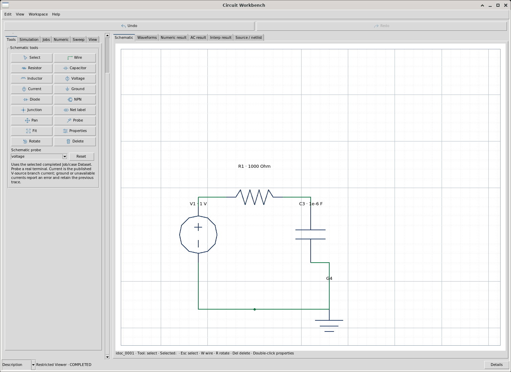
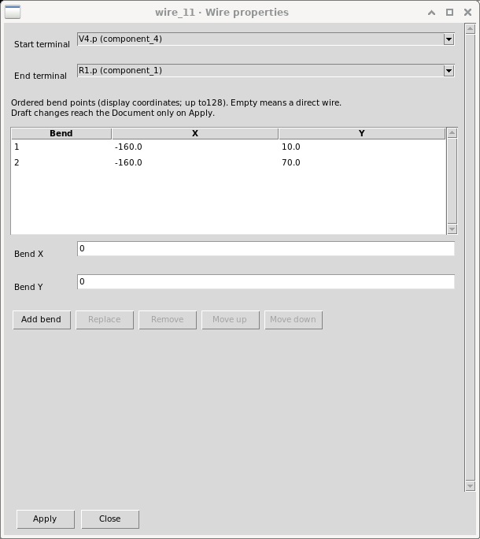
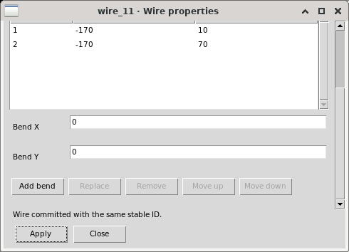

Open Source/netlist and Refresh. This uses the registered provider's deterministic
converter and current canonical source. The text is read-only: arbitrary `.include`,
`.control`, solver paths or user netlist directives cannot be injected. Missing
ground, open pins, duplicate names and disconnected islands have explicit errors.
Correct the diagram and Refresh/Prepare again. Old Jobs and plots remain separate
from a newly edited source; no result is silently relabeled current.

## Local simulation, canonical results and waveform exploration

In Simulation choose local and transient, time step1e-5 s and stop0.005 s. Prepare
validates the typed circuit/options and records its source identity. Submit creates
an actual existing CORE Script Job. Jobs shows the durable ID/status; Refresh,
Read log and Reconnect use that same Job. Wait for actual COMPLETED before Publish
Dataset. Publication is asynchronous; verify its returned current Dataset identity
rather than assuming an earlier selector value is the new result.

In Waveforms choose the published Dataset, Discover variables, then time(s) and
the capacitor-net voltage(V), and Bind waveform. Source row probes show canonical
Dataset/Variable, exact row, source values and units. Native Fit/Zoom and declared
scale controls change presentation; they do not resimulate. Schematic probing uses
stable electrical endpoints and the current source/result guard. The View menu
shows checked native pane commands; hiding/restoring a pane retains its contents.

For an analytical RC reference use the declared Numeric form and its public
expression `vin*(1-exp(-t/(R*C)))` with physical parameter units. Count1 means one
row, not an implicit full vector. Set the actual full count to compare all rows.
Statistics and comparison produce canonical typed results; Publish Numeric
creates a separate Dataset, preserving the observed solver result. Add the
reference and local/remote traces through View/Traces. Choose their own Dataset,
X/Y, units, panel and axis, then Add/Update. Incompatible unit/axis requests are
refused while retaining the previous valid plot.

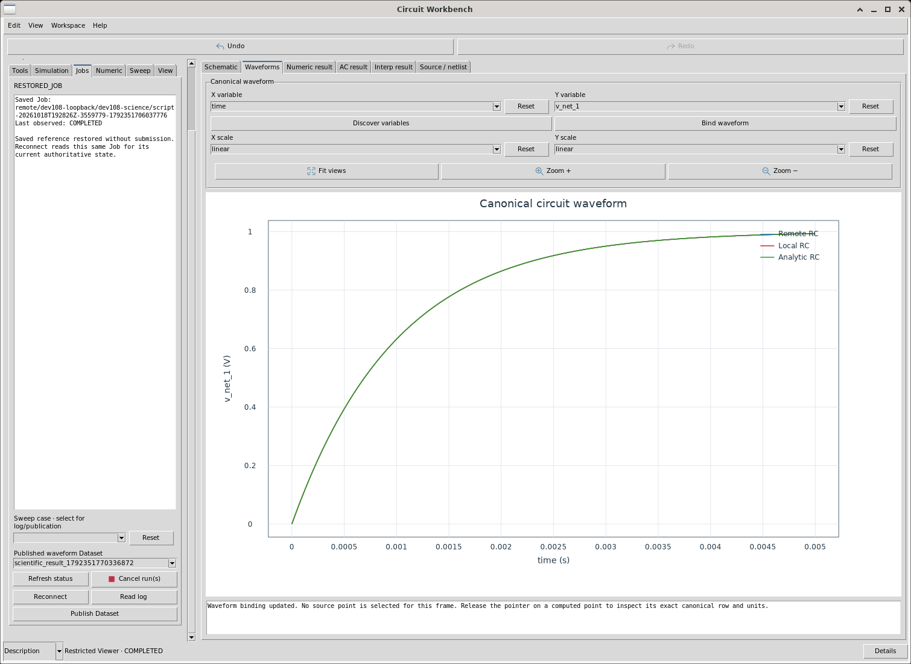
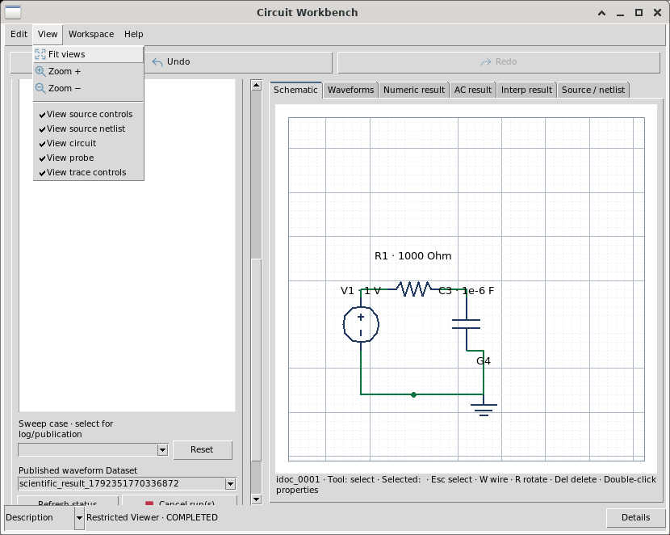

Primary independent full526-row public Numeric review found maximum RC error
2.8583657987191202e-6 V for each destination, within the declared1e-4 V tolerance.
Full time and output-voltage local/remote parity error was0, within1e-12. These
numbers came from public Numeric/Statistical APIs, not external numerical code.
They apply to source SHA `a34bc78e87565a5a7f49e722befb7566d9926eb17dca2756d460e3e04d6e5e46`.

## Authenticated remote execution

Use the same typed source/options with the registered destination
`dev108-loopback`, endpoint `https://localhost:43835/rpc`. This dedicated Compute
Agent binds127.0.0.1 and uses separate test-only CA/server/client certificates:
`_private_dev108/compute-node/tls/ca.pem`, `server.pem`, `client.pem` in the task
workspace. Private key contents are never part of this guide or delivery.
The existing public Scientific Execution node configuration owns registration,
authentication and capability discovery; restricted author code cannot replace
its transport, choose arbitrary executables or create another scheduler.

The actual registered solver is ngspice44.2 through `core.ngspice.circuit`.
Installed Xyce7.10 was not executed because that registered provider admits
ngspice control semantics. This is a real authenticated HTTPS/mTLS remote protocol
on one physical Debian server; it does not prove operation across independent
computers. Reconnect/Read log/Publish resolve the same durable remote Job. Test
cancellation/offline failures through the actual protocol; never relabel a local
fallback as remote success. Preserve the previous published Dataset on error.

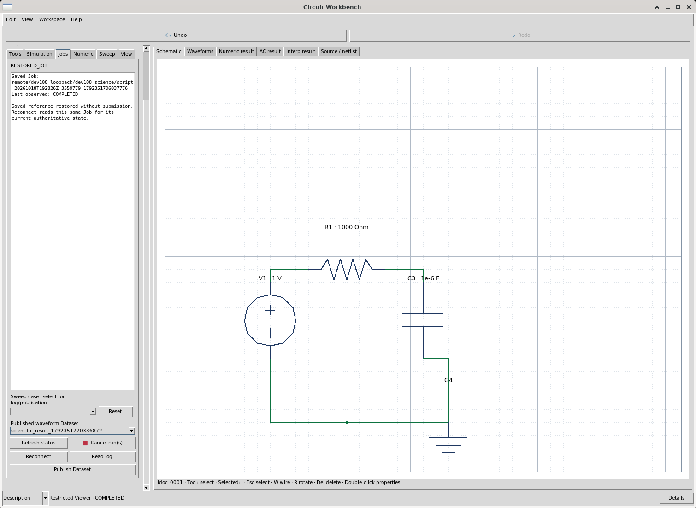

Parameter sweeps use the declared Sweep controls and existing CORE Scientific,
Script Job and Parallel Execution services, with effective worker/memory policy,
explicit cases, source/override provenance and per-case results. The retained
physical2x2 R/C campaign observed two concurrent real Jobs at each destination.
Its Parallel coordinator admitted cases serially; actual Script Job workers
provided observed overlap. No private worker pool or numerical library is used.

## RLC frequency response

The actual saved RLC circuit uses R100 Ohm, L0.01 H, C1e-6 F and V1 AC1 V;
series R/L feed the capacitor upper net, with explicit common ground. Choose AC,
decade grid30 points/decade,10..100000 Hz. Local and remote publication each
produced121 real rows with split real/imaginary voltage/current variables.

For capacitor voltage the physical transfer is
`H(f)=1/(1-(2*pi*f)^2*L*C+i*(2*pi*f*R*C))`.
Public Numeric evaluated the dimensional real/imaginary reference on every
actual frequency row. Maximum real error was2.4980018054066022e-16 V and imaginary
error3.3306690738754696e-16 V at both destinations, within1e-10 V. Full frequency,
real and imaginary local/remote parity error was0 within1e-12. These apply to source
SHA `53a17f3603b3d9ca4af30a3b69a256e40ad8d46403321b960ca3b9255bb561fc`.

In AC result choose the actual split voltage pair, explicit count121 and public
magnitude/phase projection. Publish those as separate canonical Numeric Datasets.
In Traces use frequency(Hz), magnitude(V) on left and phase(deg) on right, with
logarithmic X. The selected row61 magnitude receipt was1.1534882314470782 V at
1079.7751623277095 Hz. Do not label amplitude in V as normalized gain/dB; a
normalized transfer requires its own documented public operation/expression.

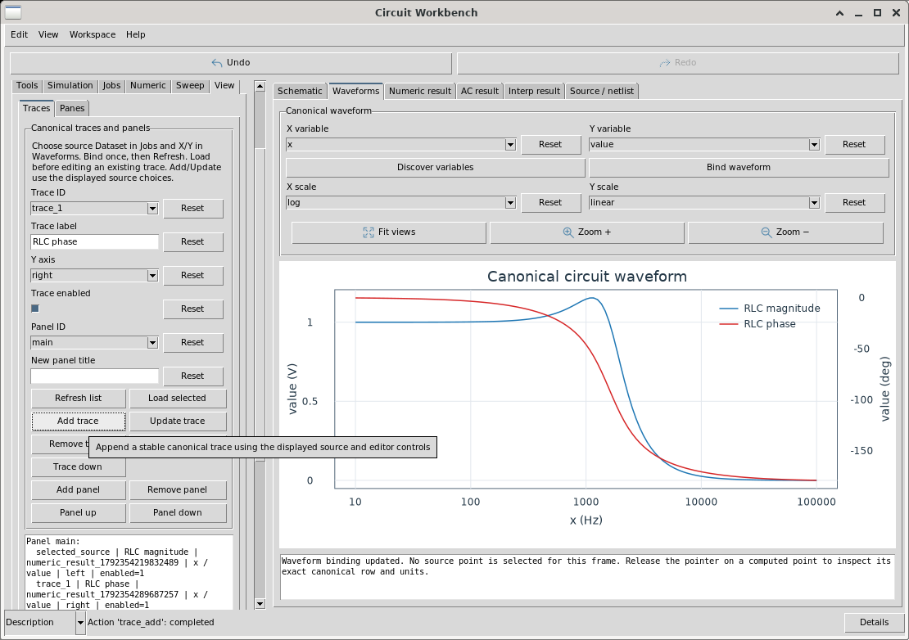

## Diode rectifier and model provenance

The saved diode fixture (source `idoc_0013`, Workspace `idoc_0014`) connects a
5 V,1000 Hz sinusoidal independent voltage source to diode D1, then R3=1000 Ohm
to ground. Use the actual generic educational diode card
`.model GXTXT_D_GENERIC D(IS=1e-14 N=1)`. The provider owns this original explicit
GPL-3.0-or-later parameter card; it is not a certified manufacturer model.
The real solver log reports TEMP=TNOM=27 C. Local and remote transient
publications each contain508 rows; full time/input/output/source-current parity
is0 within1e-12. This model intentionally demonstrates a nonlinear forward drop.

Independent public Numeric/Statistics checks found KCL residual
2.1163626406917047e-16 A (limit1e-10 A), sinusoidal-input error
1.7763568394002505e-14 V (limit1e-12 V), reverse-output leakage
5.009226236101721e-9 V (limit1e-7 V), and rectified peak4.3063429942297837 V
(expected4..4.5 V). A declared1 mV forward-voltage backward-error check passed
with maximum0.00063654349672526145 V. Earlier stricter absolute-current and
per-row convergence-bound diagnostic attempts failed and remain recorded;
these results do not certify an arbitrary nonlinear solver residual tolerance.
All physical formulas, logarithms, masks, comparisons and statistics were
performed through the public GX-TXT Numeric/Mathematical/Statistical APIs.

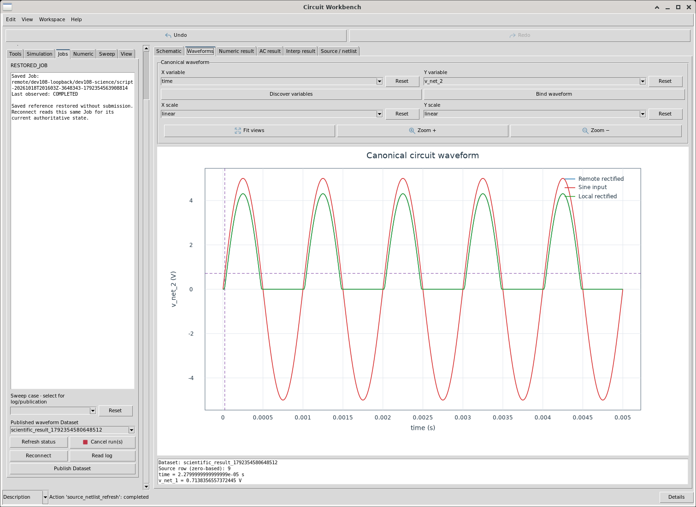

## A six-component ladder and explicit AC endpoint probing

The ladder (source `idoc_0015`, Workspace `idoc_0018`) uses V1 AC1 V,
R1=1000 Ohm, R2=2000 Ohm, C4=1e-6 F, C5=5e-7 F and G6. Wire V1→R1→R2,
with C4 from the first node to ground and C5 from the output node to ground;
use the explicit first-node junction and common return shown below. Its exact
source SHA is `2a4046309df9b79ffcfba409b5a48467685169561529ed021e1c9570d0ec212c`.
Both real local and remote AC publications have121 frequency rows.

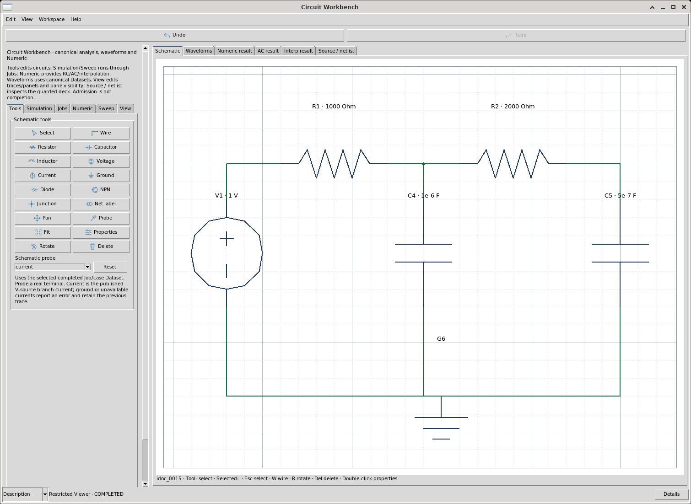

For the output, the physical transfer is
`H2=1/(1+s*(R1*C4+R1*C5+R2*C5)+s^2*R1*R2*C4*C5)`;
the first-node transfer is `H1=(1+s*R2*C5)*H2`, with `s=i*2*pi*f`.
Public dimensional Numeric expressions checked all four real/imaginary voltage
columns: maximum error3.3306690738754696e-16 V within1e-10 V. Six real/imaginary
KCL residuals were at most3.1848438816761693e-19 A within1e-12 A.
All nine frequency/voltage/current columns agree locally/remotely within1e-12
(actual maximum0). No external mathematical validation library was used.

Select the completed raw AC Dataset in Jobs. In Tools select Probe and choose
voltage, then click C5.n. The CORE resolves the actual `v_net_3_real` and
`v_net_3_imag` pair in V and frequency in Hz into the declared AC result form.
It shows AC_SOURCE_SELECTED, the original Job and exact Dataset/Variable IDs.
The existing row start/count and projection remain explicit; selection performs
no calculation or publication and retains the previous result and Plot.
Choose current and click V1.p for the actual `i_v1_real`/`i_v1_imag` pair in A.
Ground voltage and unavailable currents on non-voltage-source devices report a
precise error and retain the earlier valid frame. Split real values never
masquerade as magnitude.

In AC result explicitly choose the row range and magnitude/phase projection,
then Evaluate and Publish through public Numeric. In Traces add the new
publication with frequency/Hz on X; use V on left and A on right for unlike units.
The restricted author evaluated121 source-current magnitude rows, published
`numeric_result_1792357100847321`, and added it beside the two voltage curves.
A genuine native current row119 readout was92611.872812879345 Hz and
0.0009999970467326673 A. The same Workspace18 revision2 reopened with exact
source, PlotSpec, scientific state and History52/52. The primary independently
used its Source, Jobs, Plot, guarded netlist and real row probe at two sizes.

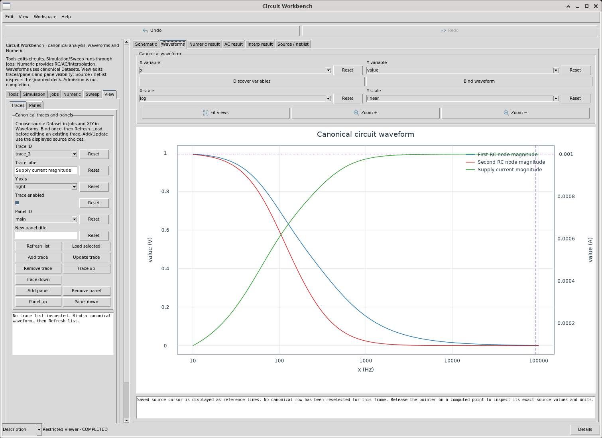

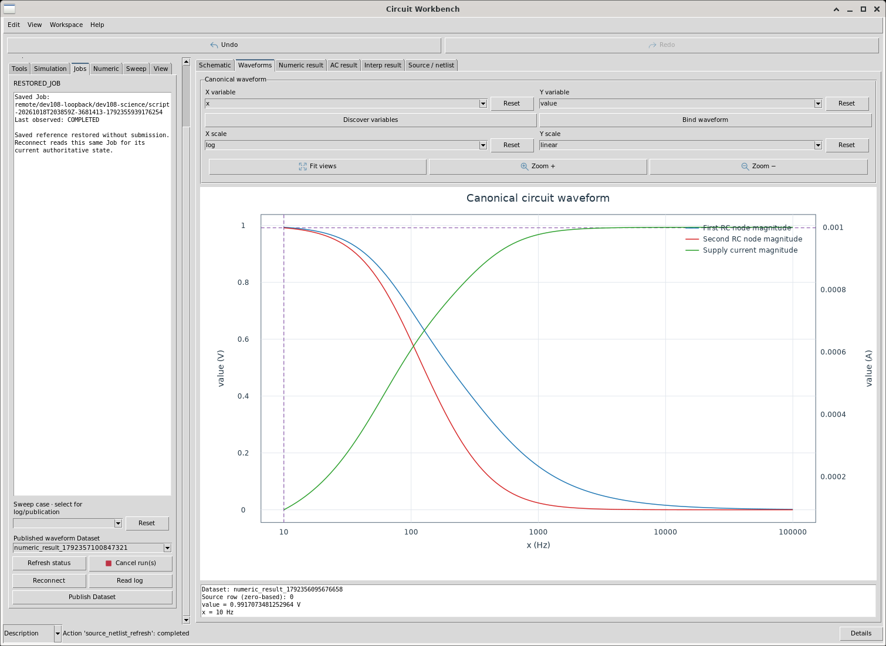

## Negative fixture and cancellation recovery

The saved negative fixture (source `idoc_0019`, Workspace `idoc_0020`) contains
R1 and G2 without wires. Prepare reports `Open terminal: R1` and creates no Job.
Correct the actual source topology before trying Prepare again. Invalid values
such as `2k` are rejected by the provider's base-unit numeric contract; enter2000
for2000 Ohm. Invalid properties and cancelled drafts retain their previous source.

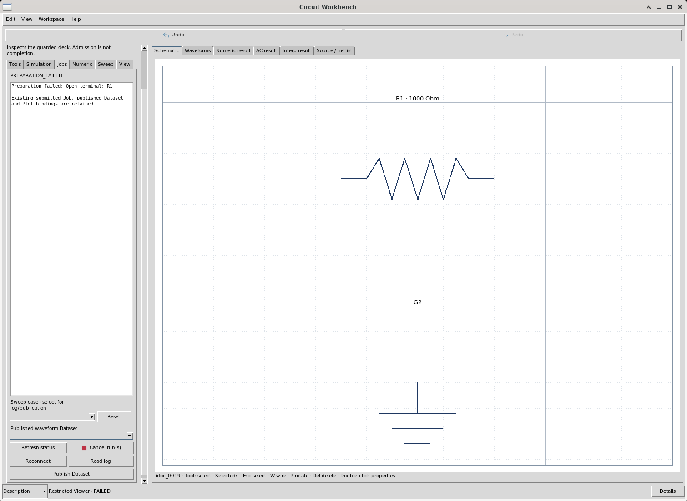

For remote Cancel, inspect the actual Job state. Independent current192 GUI QA
ran one four-case R/C campaign through CORE services: case4 genuinely reached
RUNNING→CANCELLED, while three completed cases kept their results. Its allocated
temporary resources were released; the cancelled case had no completed output
or published Dataset. Native Save/Close/Manager reopen and Reconnect retained all
four original Job IDs and source/parameter identities without resubmission.
Three earlier single-Job cancellation clicks arrived too late; they remain timing
misses, never relabelled cancellation successes. The primary independently used
Reconnect and the cancelled-case Log and inspected the real frames below.

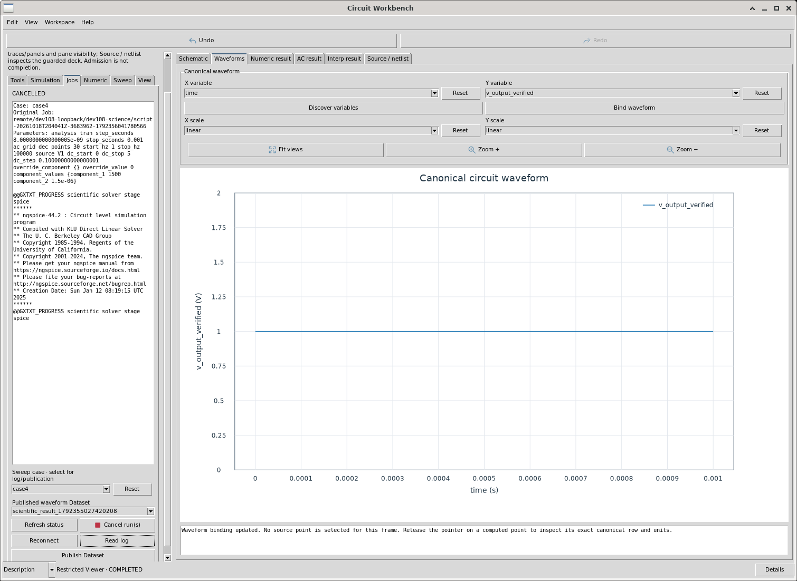

During a separate GUI offline test, the private endpoint temporarily referenced
an unused loopback port. Reconnect, Log and Prepare reported Connection refused
and retained source/Job/Dataset/Plot. Restoring the exact real node descriptor
recovered the same Job. This was an actual protocol failure, not local fallback.

## Save, reopen and recovery

Use Workspace Save; a successful returned canonical ID is the receipt. Close the
assigned window normally and reopen the saved Workspace. Source identities, full
History including redo, original Jobs/Datasets, Numeric results, trace/panel
PlotSpec, panes, notes and C++ state restore. Restoring does not submit Jobs or
recalculate science. Current192 RC Workspace idoc_0006 retained45/45 steps and
three traces. RLC Workspace idoc_0012 retained39/39 steps and its dual-axis plot.
Saved cursor context is identified as saved, without inventing a fresh row hit.
Window geometry is not claimed to be part of those source/result receipts.

If a compiled presentation request fails after a solver completed, inspect its
public bounded host_error/error_code. Correct the actual infrastructure defect,
then retry Poll/Publish on the original Job. A brief integration-time missing
shared CORE file caused exactly that failure in the retained RLC evidence; the
same Job published successfully after correction without resubmission.

## Scope and delivery status

This is a current worked-example guide, not final dev108 release certification.
The independent root full-vector science receipts are in
`_private_dev108/current192-numeric01/`; root GUI RC receipts and original images
are in `gui_icons192_01/`, with independent wire tests in `qa_circuit192_03/`.
The four positive examples and saved open-terminal fixture now have real author
Save/reopen receipts; independent RC/RLC/diode/ladder physics and critical native
GUI checks passed in the stated scopes. Same-author039 and040 retries passed.
Fresh independent public-import restoration and AC metadata/negative checks
passed after the existing Dataset owner carrier-path correction; the final
example archive is delivered separately as
`circuit_workbench_examples.gxtxt-session.zip`, SHA256
`b67466c12bc6809eedb7e5565aa148e9ddcbee88b86d2d1c077340f35c06340c`.
Use public Session Import, then normal Workspace Manager IDs6/12/14/18/20.
Independent clean public final-archive import under1.9.3 and normal Manager
reopening of all five items passed with the original369 files preserved and
zero automatic scientific calls; the expanded Help/About and32 native frames
were independently inspected. Final104 review,
sealed framework and activated installed checks remain separate until recorded.
The original dev107 WordPress debugger publication remains a separate external
deliverable; it is not embedded into this framework guide or installed runtime.
