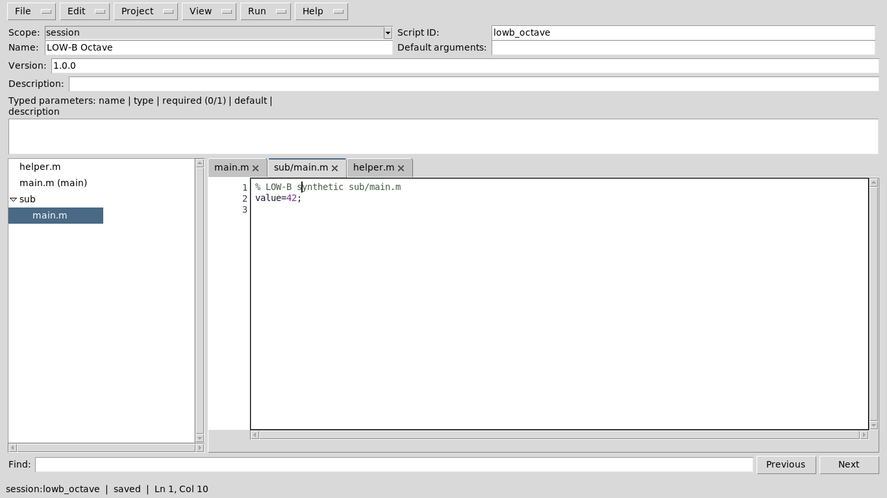
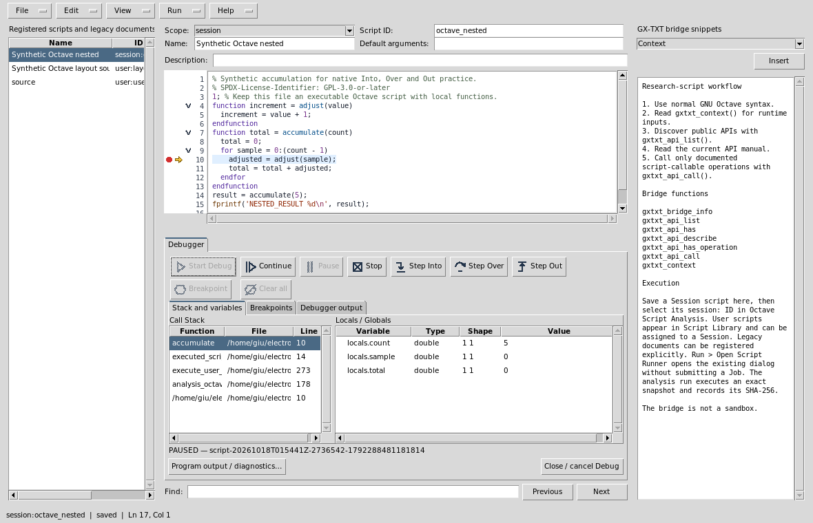
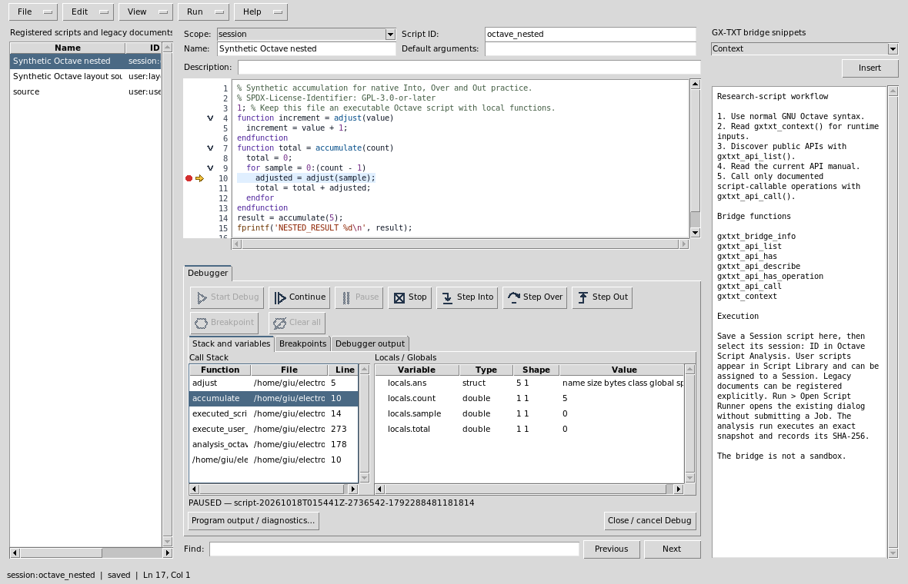
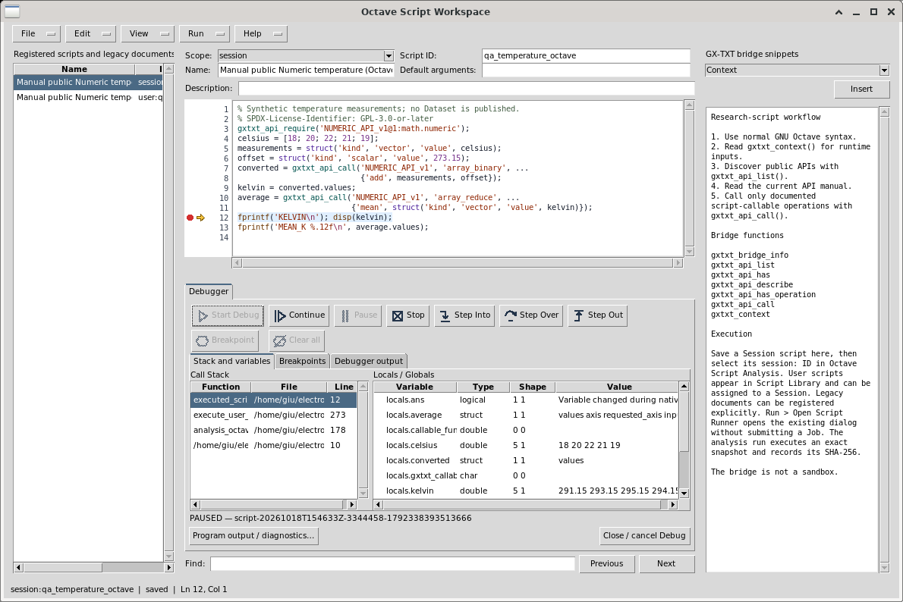
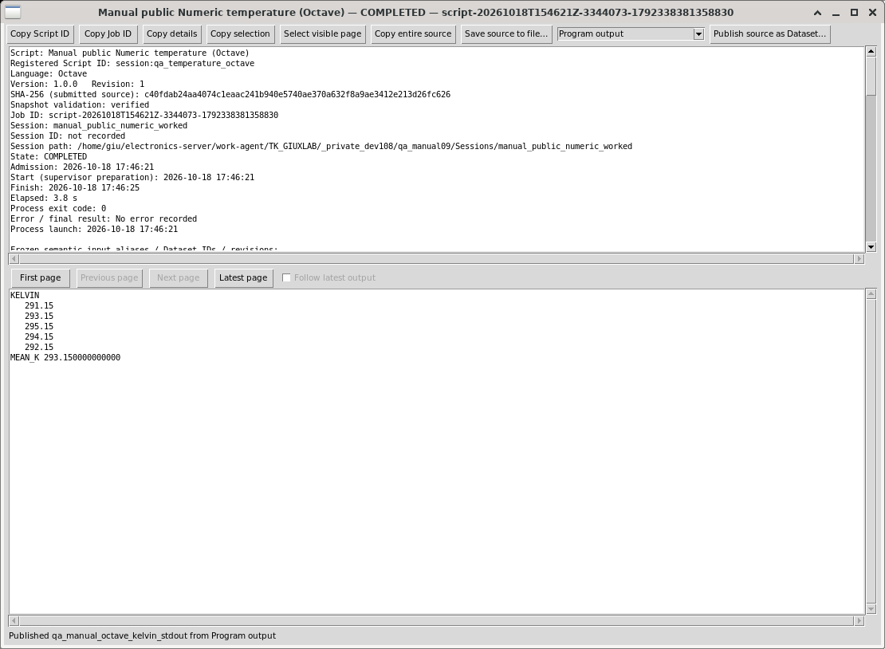
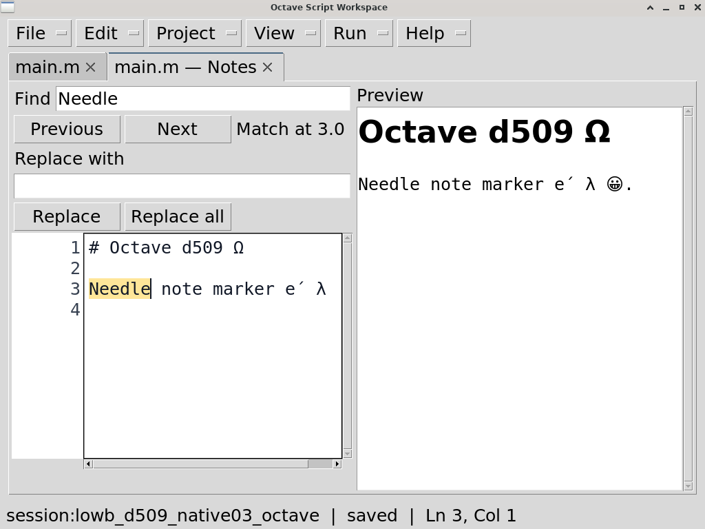

# GX-TXT Octave Script — Manual

## Script Projects and independent source tabs

In **Script Library**, choose the intended scope/language, **New Project**, enter
an ID/name and **Save**. **Open Workspace** opens its real entrypoint. The project
file tree navigates the project. The **Project** menu opens/adds files, renames
or moves paths, removes non-entrypoint files and selects the main entrypoint. Source subfolders are
supported. Python projects import admitted helpers/packages; Octave helper
functions use their actual matching `.m` filenames.

Each file has its own source buffer, dirty star, Undo/Redo, caret, scroll and Find.
The primary menu is **File / Edit / Project / View / Run / Help**. Use the
**Project** menu for project file operations; the file tree navigates sources.
F10 focuses the primary menu row; Left/Right choose a menu and Space/Down open
it. Alt+F/E/P/V/R/H open File/Edit/Project/View/Run/Help directly. Escape returns
to the source. The same arrows navigate adjacent open primary menus.
**File → Save** saves the active Script or its complete Project transaction;
**File → Save All** (Ctrl+Shift+S) saves every writable dirty Script/Project.
Separate Scripts remain independent records, and a stale source or metadata
revision refuses saving while preserving unsaved buffers.

Click the **×** at the right of a source tab to close that exact file, including
an inactive tab. Dirty sources offer Save / Don't Save / Cancel. Cancel preserves
the original active file and focus. **File → Close tab** (Ctrl+W) closes the active
tab; **File → Close** closes the Workspace. Closing the final source tab creates
a fresh unsaved draft. No extra toolbar or source selector is needed.

Ctrl+Tab/Ctrl+Shift+Tab cycle all open files. When tabs exceed the available
width, the tab strip's **…** menu lists their complete qualified identities;
Alt+Down on the notebook opens that same list. Selecting a hidden file brings
its tab into view. Duplicate paths in separate Scripts show their distinct
references. The project file tree remains available. On small screens or at
large fonts, use **View → Focus source / restore panes** or hide optional side
panes and script properties; these commands preserve their contents.

**Assign to Session** freezes every admitted source. **Export** writes one
integrity-checked Project ZIP, including source and saved parameter/API metadata;
**Import Project ZIP** creates a new reviewed identity. Run and Debug use the
existing Runner/Job supervisor and freeze the entire tree again. Helper-file
breakpoints and native stack navigation use physical file/line and the frozen
whole-project SHA. Job details **Open source files** opens verified historical
sources in read-only tabs, separate from today's editable Registry record.



## Source declarations and invocation parameters

Declare typed parameters directly in source using literal arguments:

```octave
gxtxt_parameter_declare('gain', 'double', 'default', 2.0, ...
                       'min', 0.0, 'description', 'Signal multiplier');
ctx = gxtxt_context();
gain = ctx.parameters.gain;
```

Saving inspects declarations without running imports or scientific source,
including every admitted project helper. Distinct source and editor metadata
names combine; conflicts and nonliteral declarations refuse saving. Change a
source-declared definition in its source. The runtime declaration has no side
effects and does not assign the effective value to a language variable.

The shared Runner always offers **Add parameter**, including an empty schema.
Invocation-only rows have typed values, **Edit** and **Remove**, and do not change
saved declarations. Optional **Save parameters as Dataset** / **Load parameters**
preserves mixed definitions and exact typed values; loaded values remain editable
before Run. No declaration or Dataset is required merely to add an invocation
parameter. Source/revision, effective schema, origins and values remain in the
immutable Job provenance.

See [Project contract](../../../docs/api/SCRIPT_PROJECTS_v1.md) and
[source declaration contract](../../../docs/api/SCRIPT_PARAMETER_DECLARATIONS_v1.md)
for exact path, type, constraint, runtime and host API rules.


SPDX-License-Identifier: GPL-3.0-or-later

Module: `analysis.octave_script`. Editor: `OCTAVE_SCRIPT_EDITOR_API_v1`.
Execution uses CORE Script Registry, Script Execution and
`OCTAVE_SCRIPT_BRIDGE_API_v1`.

## Source identity and saving

Open **Viewers → Octave Script Workspace**. The editor works without an open
Session: New defaults to User scope. A User script belongs to Script Library;
a Session script belongs to the current Session. Assigning a User script to a
Session creates a separate source identity. Later User edits do not change that
Session copy. Script Registry owns executable source, revision, metadata and SHA.
The editor's name “Workspace” does not create a scientific Session Workspace.

Choose New, a stable Script ID, Name, Scope and Description, then edit and Save.
Save updates the selected registered identity after a held source-SHA check.
Save copy creates a new identity. Delete requires confirmation and respects
active dependencies. Copy ID copies the registered reference. Scope/ID of an
existing record cannot change in place. Use a copy or Library assignment.

Session scripts appear as `session:<script_id>` in Library, Session Script
Explorer and the ordinary Octave Analysis selector. User-only scripts do not
appear in that Session selector. Save/reopen preserves the registered source;
a run uses a verified immutable snapshot and records its SHA in provenance.

Obsolete Interactive Document editor Workspaces cannot be read, restored,
registered, converted or written by this editor. Metadata-only Session inspection
and explicitly confirmed resource-safe deletion remain available in the common
Workspace manager. New source is saved only through Script Registry.

**Import .m / Ctrl+O** loads UTF-8 source into an unregistered editor buffer.
Choose scope/ID and Save to register it. **Export .m** writes the current buffer
through the save chooser, without execution or Registry assignment. Source
import/export retains BOM/newline information represented by that contract.
Unsupported encodings or metadata errors require correction. A stale buffer can
be exported before reopening the actual registered identity.

The Octave metadata panel has Scope, Script ID, Name, Default arguments and
Description. Version, additional API requirements and typed parameter schemas
are edited in **Run → Script Library**. Reopen the editor identity after a
Library metadata change. Default arguments is inert single-line UTF-8 text,
at most 4096 bytes without NUL. It is available as `gxtxt_context().arguments_raw`,
not interpreter `argv()` or a shell command. Typed named values are in
`ctx.parameters`. Literal `gxtxt_api_require('API_ID')` requirements are discovered
on Save; additional requirements/version constraints belong to Library.

## Editing and layout

File, Edit, View, Run and Help form the compact menu row. Explorer opens
registered identities, source is central and Bridge Snippets is at the right.
Insert places the selected public example at the insertion point; it does not
execute it. Review source and required APIs before running.

| Control | Behavior |
|---|---|
| Ctrl+N / Ctrl+S | New buffer / save checked Registry revision. |
| Ctrl+A / C / X / V | Select/copy/cut/paste in the focused editable control. |
| Ctrl+Z / Ctrl+Y | Local undo/redo in multiline source/Text controls. Entry fields have no undo history. |
| Ctrl+F / F3 / Shift+F3 | Find / next / previous literal source match. Escape returns to source. |
| Ctrl+G | Go to physical source line, including a folded line. |
| F9 / Ctrl+Shift+F9 | Toggle breakpoint / clear all breakpoints. |
| F1 | Open this integrated searchable manual. |

Pasting over selected source is one local undo transaction. Copying/selecting
read-only values does not mark source dirty or write a Registry revision.
Line numbers and reference text are read-only.

View independently controls Explorer, Snippets, Debugger, Call Stack, Variables,
Debug Output and Breakpoints. Focus source is reversible; Reset layout restores
standard panes and proportions. Script properties collapses other metadata. View → Parameters independently
hides/restores declarations without changing values, source, dirty state or debugger state. Drag splitter sashes to resize. Visibility
and proportions are user presentation preferences. Font changes apply after
restarting GX-TXT. Narrow debugger buttons retain icons and tooltips. Tab/Shift+Tab
moves focus; Space/Return invokes an enabled focused control.



## Run and Analysis

**Run → Open Script Runner** opens review for a clean saved identity; it does not
submit a Job. With a dirty registered buffer, Yes saves first, No reviews the
last saved revision while keeping edits, and Cancel returns to editing. Unsaved
anonymous source must be registered first. The Runner identifies the actual
scope, ID, version and SHA. A changed source is identified and stale saves fail.

Review typed invocation values and saved inert argument text. Each **Add input
Dataset** row has its own **Namespace** and **Dataset ID** selectors, a unique
semantic alias and optional display label. Namespace changes clear only that
row; Session Current and other rows stay unchanged. Selection captures the
Dataset revision; changed or moved inputs require explicit reselection. **Remove
input** removes only that request. Parameter-only scripts need no Dataset.

**Parameter Dataset** accepts a canonical preset ID in this Session. **Save
parameters as Dataset** creates a new typed canonical Dataset; **Load parameters**
checks Script/schema/source/revision and payload integrity before applying all
values. Numeric, string, boolean and choice types and stable Variable IDs are
preserved. Loaded values remain editable. Neither action changes Registry
metadata or executes a Job. A changed preset or Script requires fresh review.

**Output request** declares an optional ID/label and deliberate owned replacement.
Publication defaults to the script producer's private namespace; input namespaces
grant no write rights. Only an actual Publication commit creates output.
**Validate review** checks without execution; **Run Job** submits the immutable
Script/input/parameter snapshot. **Close** dismisses review and does not cancel
an admitted Job. The actions/status remain visible while the form scrolls;
Tab/Shift+Tab reaches fields, Ctrl+Return submits and Escape closes review.
Script Jobs reports actual completion, cancellation and committed outputs.

In ordinary Analysis choose `source_mode=registered_script`, select the Session
script, input aliases and parameters, then Run. `external_file` intentionally runs
a standalone `.m`. Optional working directory defaults to the Session; Include
script directory opts into neighboring external helpers. Required APIs add
preflight constraints. Each Analysis run retains `executed_script.m` and
`octave_script_run_report.txt`, identifying its exact source.

Scripts use `gxtxt_context()`, `gxtxt_api_list()`, `gxtxt_api_describe()`,
`gxtxt_api_require()` and `gxtxt_api_call()`. Arguments/results follow the public
Bridge typed-node contract. Native scientific Workspaces use
`NATIVE_WORKSPACE_API_v1`, explicit node kinds and held generation/revision
receipts. Missing required APIs fail before execution. Scripts run as trusted
researcher code with the local user's permissions.

## Native debugging

Debug requires an open Session and clean saved Session source. Open View →
Debugger or Run → Debug Session script, set a valid breakpoint and press
Start Debug. Debug runs the immutable registered source/SHA. The gutter has
independent breakpoint, execution-arrow and fold lanes plus physical line
numbers. Filled red dots are enabled, hollow dots disabled, yellow arrows show
the selected paused native frame. Folding does not edit source or toggle a
neighboring breakpoint. Non-executable breakpoint targets are refused.
Editing invalidates old source positions; breakpoint changes are locked during
an active managed Debug Job.

Continue resumes. Step Into enters a language function, Step Over completes the
statement, and Step Out returns to a caller. Select Call Stack rows to inspect
that native frame and its locals; this does not change the interpreter's top
execution frame. Locals/Globals are bounded read-only type/shape/value summaries,
not a Watch/eval console. External frames show their own path and line. Folded
current source is revealed. The script editor does not bind F5/F10/F11 to stepping;
use the named toolbar controls or Tab/Space.

GNU Octave asynchronous Pause is unsupported and disabled with an explanation;
use breakpoints and steps. Stop requests owned-Job cancellation. Hiding Debug
retains the Job; Close/cancel Debug asks before cancelling an active one.
Completion, cancellation and failure clear the active stack/arrow. Both native
language adapters have a 600-second inspection lease; inspect the actual terminal
state and diagnostics instead of assuming every failure is a time limit.

Caught Octave user errors retain their actual message and native origin stack
through Step Over/Continue and durable Job failure. An unwound origin frame is
not a selectable live frame. “Last paused” variables are the last observed
snapshot, not live post-error values. This does not promise pre-unwind exception
locals. Changed source prevents a stale source highlight and stepping.



## Jobs, output and publication

Library organizes User/Session scripts, assignments and canonical metadata.
Jobs Manager opens existing durable Jobs and logs. Reconnect/Refresh reads the
same execution; explicit Rerun reviews and creates another Job while preserving
the historical one. Cancellation is asynchronous. A closed window does not
resubmit or erase a completed Job.

Manager History hides/restores finished rows reversibly; Include hidden shows
them. View selects scope, filters, columns and pages of at most 500 Jobs.
Manager Workspace saves its presentation filters/scope/layout only. Settings
opens the shared admission policy. These actions do not modify scripts,
scientific outputs, execution state or retained logs.

Execution details show source/Job identities, parameters, runtime, resource
policy/usage, diagnostics and committed publication IDs. Program output selects
stdout, Program stderr its separate stream, Diagnostic log trusted runtime
messages, and Legacy combined stream an available older combined log. Debug
Output contains debugger control receipts, distinct from program streams.

| Output control | Operation |
|---|---|
| Copy Script ID / Job ID / details | Copy the named identity or complete displayed upper details. |
| Copy selection / Select visible page | Copy selected text / select the current lower page and suspend following. |
| Copy entire source | Copy the selected retained stream across pages, up to 32 MiB. Here “source” means the output stream. |
| Save source to file… | Atomically export the complete selected stream; use this for larger output. |
| First / Previous / Next / Latest | Navigate 64 KiB byte pages with actual byte ranges. |
| Follow latest output | Follow new output; selection, scrolling or manual navigation suspends it. |
| Publish source as Dataset… | Review and explicitly publish the selected stream as a canonical TEXT Dataset with original Job provenance. |
| Close | Release owned readers/transfers; retain the durable Job and output. |

Replacement/shrinkage interrupts a transfer with an error; an interrupted export
is incomplete. Publishing stdout as TEXT does not invent numerical columns or
units. Use public Dataset/File Publication APIs with explicit schemas and
completed-result guards for numerical tables. Reopen existing output from Jobs
Manager and published text from Results without running the script again.

Concurrency/resource policy controls concurrent Jobs, active+queued admission,
threads, memory MiB, temporary disk MiB, processes and time seconds. Review actual
effective limits. Saved policy applies to newly admitted Jobs, not retroactively
to a running execution. Existing CORE supervision owns enforcement.

## Worked example and help

Import `examples/debug_temperature.m`, save/assign it as Session source, and
require `NUMERIC_API_v1@1:math.numeric`. It converts 18, 20, 22, 21, 19 °C with
273.15 K to 291.15, 293.15, 295.15, 294.15, 292.15 K, mean 293.15 K. Review and run
it normally, then debug its immutable saved revision with a breakpoint before
output. Inspect `celsius`, `kelvin`, `average` and compare normal/debug stdout.
`examples/debug_nested.m` practices Step Into/Out/Over; adjusted values 1–5 sum
to 15. Neither example publishes scientific data automatically.




New/Import binds Session scope to the current Session lifetime. A buffer from A
cannot save/delete/run into B; returning to A's path is still a new lifetime.
Export unsaved source, reopen the intended Session, then New/Import or select its
current registered identity. Changing scope is not implicit adoption of a stale
buffer. Closing the editor protects unsaved edits and an owned active Debug Job.

Help → Viewer manual / Debugger guide and F1 open the rendered guide with Find,
section links, Back/Forward and full-size images. Source examples are imported
through File. About reads the installed module/provider/version/license/API
metadata. For missing scripts check Session scope/language/module availability;
for stale saves reopen the record; for disabled Debug check clean saved Session
source and SHA; for lost panes use View/Reset. Inspect retained diagnostics and
resolve missing public APIs through their documentation.


## Per-file Markdown Notes — DEV111-P030

Use the primary **Edit → Edit Notes** command for the selected source file.
**View → Show Notes** hides or shows the same adjacent note page; it retains the
draft and its Undo/search state. Notes use the shared Markdown editor with Source,
Rendered, Outline, Properties and Resources views. Insert images through its
existing image command. Source and Rendered have independent selection and copy.
Find and Focus Source act on the selected note. Python/Octave temporarily give
Notes the source region and restore the prior code panels when returning to code.

Explicit Save publishes the note as a canonical Markdown Dataset in the current
Session. Without a Session, Save retains an explicit local note; attach it when a
Session is available. Save All and portable Project export preserve per-file
notes and their PNG resources through the existing source-owner snapshot.
Save As/Save Copy create fresh source/note identities and preserve the original.
Notes do not change source code, build inputs or scientific execution hashes.
If another editor changes the source or note, saving refuses and retains the
draft; review the current revision or use Publish New to preserve a separate copy.

Opening an associated note from the Dataset Browser returns to that exact file's
Notes page when its source remains available. Otherwise Documents opens the same
canonical Dataset. Associated Source is read-only and shows only the exact
matching source, with an explicit diagnostic if it has changed or disappeared.



Octave per-file Notes with independent Source and Rendered panes at font18.

Formatting is in **Edit → Note format**, including headings, emphasis, code,
lists, tables, links, quotes, rules and text color. **Edit → Note images** opens
the shared PNG chooser and provides Replace/Remove for the selected managed
resource. **View → Note panes and zoom** controls Source, Rendered preview,
Outline, Properties and Resources independently, with zoom and layout reset.
These groups act on the currently selected note and are unavailable on code
pages. Portable images remain read-only until explicit Session attachment.

## Optional projects inside the Workspace (DEV111-P033)

**File → New Script** starts an ordinary standalone source immediately; a project
is optional. **Project → New Project…** opens the temporary project canvas inside
the same window. Enter a display name, stable ID, User or current Session scope
and language-specific entrypoint. Create uses the authoritative Script Registry
and opens that project's entrypoint in the existing source tabs. Other dirty
source tabs stay available with their own identity and Undo.

**Project → Open Project… / Manage Project…** lists saved projects for the active
language. Open entrypoint returns to the existing code view. **Return to code**
or Escape leaves the temporary canvas and restores its original widgets, focus,
scrolling and layout. Validation or identity conflicts retain the project form
and explain the refusal; Return to code restores the unchanged editor. No source
is silently converted from standalone into a project. Existing project file
operations, Save All, Source Notes, Runner and Debugger keep their existing owners.

User projects work without a Session. Session-scope actions are bound to the
Session active when the canvas opened; a changed/closed Session requires a fresh
review. A stale saved-project listing must be refreshed before opening.
