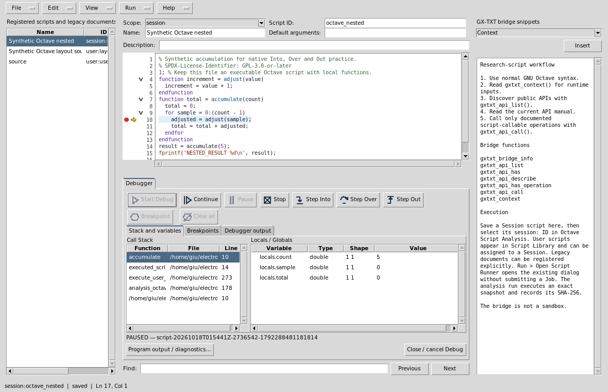
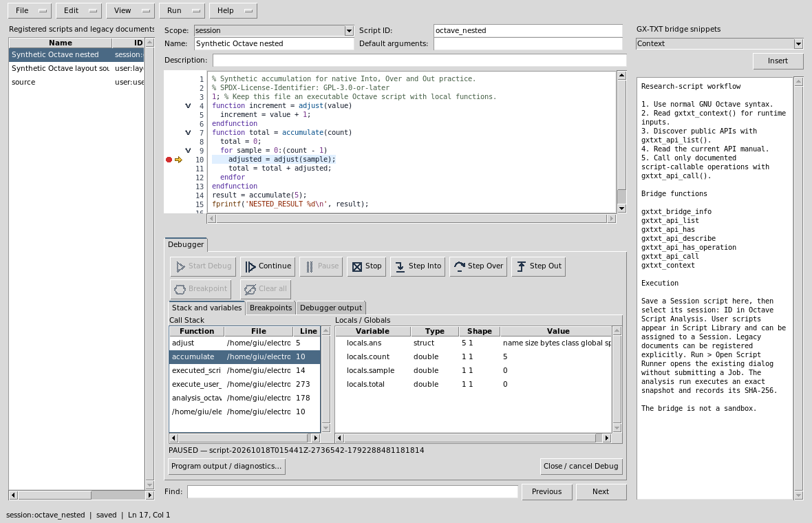
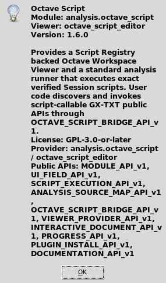
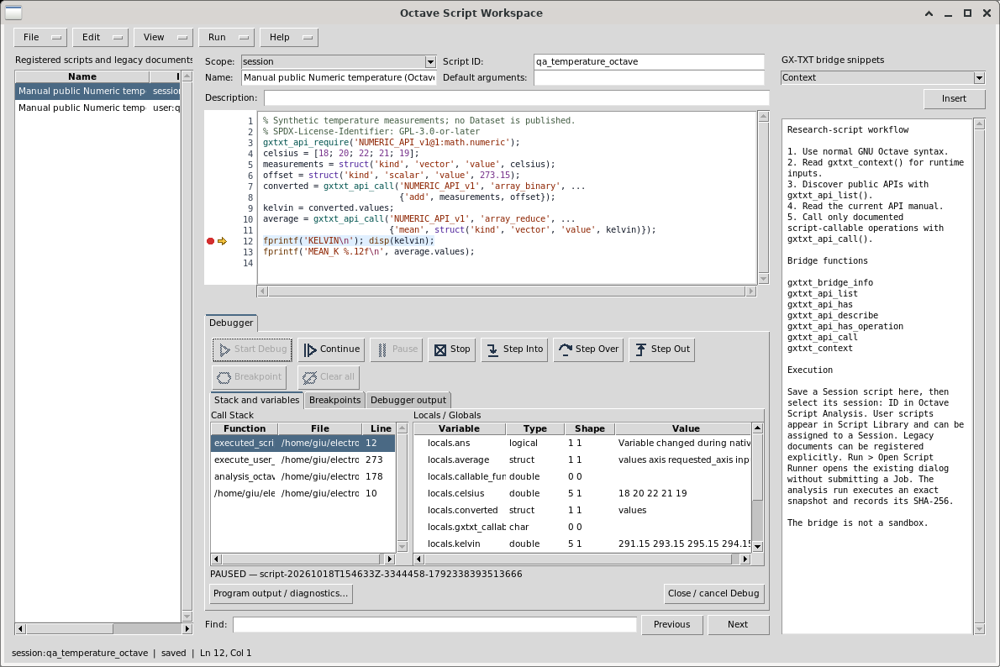
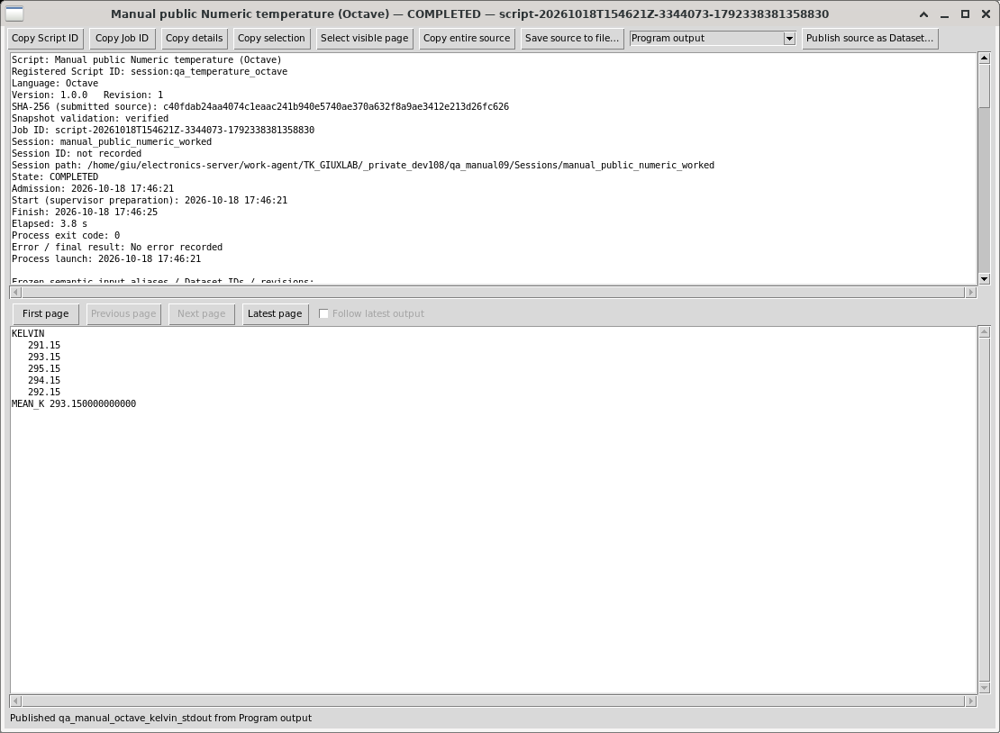
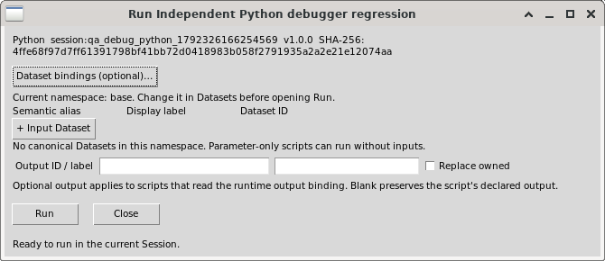
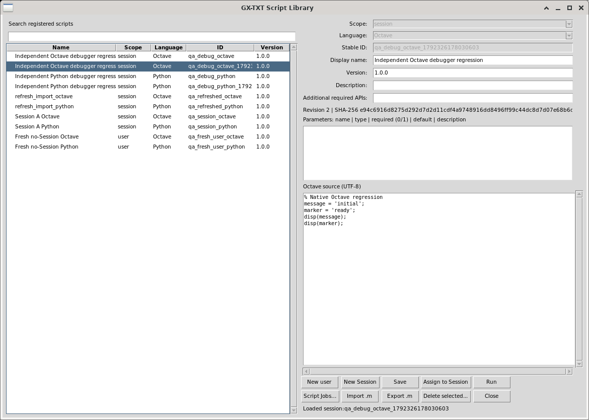
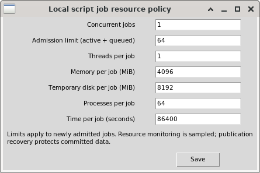
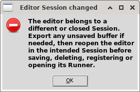

# GX-TXT Octave Script — Manual

SPDX-License-Identifier: GPL-3.0-or-later

**Module:** `analysis.octave_script`
**Editor API:** `OCTAVE_SCRIPT_EDITOR_API_v1`  
**Execution:** CORE Script Registry and `OCTAVE_SCRIPT_BRIDGE_API_v1`

## Purpose

The Octave Script Workspace edits GNU Octave `.m` programs that run against registered GX-TXT public APIs. Script Registry is the authoritative executable identity. The Workspace, Script Library, Session Script Explorer and normal Octave Analysis selector see the same registered source.

The bridge is not a sandbox. Scripts run as researcher-authored code with the current user's local permissions. Use trusted source and review its required APIs and input parameters before execution.

## Create and run a Session script

1. Open a Session and enable the **Octave Script** module.
2. Open **Viewers → Octave Script Workspace** and choose **New**.
3. Choose **Session** scope, enter a stable Script ID and name, write the source, then choose **Save**.
4. The saved script is immediately listed as `session:<script_id>` in Script Library, Session Script Explorer and the normal `analysis.octave_script` registered-script selector.
5. In Analysis choose `source_mode=registered_script`, select the Session script, set any input aliases and parameters, then run.
6. Save and reopen the Session to reuse the same identity and source. A run uses an immutable verified copy and records its source SHA-256 in execution provenance.

Choose **User** scope for a reusable `user:<script_id>` Library script. A user script is separate from Session identity. Assign it to a Session through Script Library when it should become a Session input. Editing a user script never silently rewrites a Session copy.

## Edit, copy and remove

Selecting a registered script in the Workspace loads its current name, description and code. **Save** updates that exact registered identity and its ordinary revision and SHA-256. Metadata such as language, semantic version, required APIs and typed parameters remains under Script Registry authority. Concurrent edits are checked against the previously loaded SHA-256; reload before retrying a stale save.

**Save copy** creates a new Script ID. **Delete** removes the selected registered record after confirmation. Script Library and Session Script Explorer reflect normal registry changes. Scope and stable ID of an existing record cannot be changed in place; create a copy or assign a user script to the Session.

## Legacy Workspace documents

Documents saved by older versions through `INTERACTIVE_DOCUMENT_API_v1` remain visible in the Workspace with a `legacy:` reference. They are readable without changing their Session identity. Select one and choose **Register as Session Script** or **Register as User Script** to create a new executable registry record from its source. The legacy document remains until explicitly deleted. New Workspace saves use Script Registry and do not create a legacy Interactive Document.

## Import and export

**Import .m** loads UTF-8 source into the editor. Choose a scope and Script ID, then Save to register it. **Export .m** writes the current source as an external Octave file. Import/export is useful for interchange and is not required between Workspace and Analysis. The Analysis `external_file` mode can run a standalone `.m` when intentionally selected.

## Workspace editing controls

The editor provides line numbers, syntax coloring, search next/previous, go-to-line, undo/redo, UTF-8 source, a bridge template and snippets. Its list shows registered Session and User scripts plus readable legacy documents. The Workspace requires an open Session for Session scope; user scope uses the user's Script Registry library.

## Script source and public APIs

A script can call `gxtxt_context()` to inspect Session context and aliases. Use `gxtxt_api_list()`, `gxtxt_api_describe()`, `gxtxt_api_require()` and `gxtxt_api_call()` for public API discovery and invocation. The editor and runner contain no private Dataset, Plot Dataset, numerical or publication adapter. API arguments and results use the documented Script Bridge typed-node contract.

Example:

```octave
ctx = gxtxt_context();
api = gxtxt_api_require('NUMERIC_API_v1@1:math.numeric');
value = gxtxt_api_call('NUMERIC_API_v1', 'array_unary', ...
  {'abs', struct('kind','scalar','value',-2)});
disp(value);
```

Required API preflight combines the registered script's declared required APIs with the optional Analysis configuration list. Missing or incompatible APIs fail before the script runs. Script Library can edit semantic version, description, required APIs and typed parameter declarations for the same Script Registry identity.

## Analysis configuration

- **Script source mode:** `registered_script` for a Session record, or `external_file` for a standalone `.m`.
- **Session registered script:** `session:<script_id>`; the selector lists current Session Octave scripts.
- **Working directory:** optional explicit execution directory. Leave empty to use the Session directory.
- **Include script directory:** opt in when helper `.m` files beside an external script are needed.
- **Arguments:** module-specific text passed to the script execution context.
- **Required APIs:** optional additional API preflight.

The runner writes `executed_script.m` and `octave_script_run_report.txt` for each Analysis run. The snapshot and report identify the exact source used. Script Library Run and Session Script Explorer Run use CORE Script Execution with the same registry identity rules.

## Troubleshooting

If a new Workspace script is absent from Analysis, check that its scope is **Session**, its language is Octave and the module is enabled; the selector intentionally excludes user-only scripts. If Save reports a changed source SHA-256, reopen the record and reapply the edit. A legacy document must be explicitly registered before it is an Analysis input. If public API preflight fails, inspect required API IDs and versions in Script Library.

## References

- `OCTAVE_SCRIPT_EDITOR_API_v1.md` for the Workspace activation and persistence contract.
- CORE `SCRIPT_REGISTRY_API_v1`, `SCRIPT_EXECUTION_API_v1`, `OCTAVE_SCRIPT_BRIDGE_API_v1` and `VIEWER_PROVIDER_API_v1` documentation.
- `examples/` for executable Bridge examples.

## Editing menus and saved revisions

File, Edit, View, Run and Help share one compact menu row. Ctrl+A and Edit → Select All
select the focused editable control, including multiline UTF-8 source and metadata.
Ctrl+C/X/V keep that focus. Pasting over selected source replaces it as one local
undo transaction; Ctrl+Z undoes it and Ctrl+Y redoes it. Selection and copying do
not mark the document modified or write a Script Registry revision. Ctrl+S saves;
Ctrl+F, F3/Shift+F3 and Ctrl+G retain find and go-to-line; Escape in Find returns
to the source. Disabled line numbers and Bridge reference text are not editable.

Run → Open Script Runner opens the existing CORE Runner without submitting a
Job. A dirty registered buffer prompts: Yes saves it and opens the Runner, No
opens the last saved revision while retaining edits, and Cancel returns to editing.
The Runner shows its actual scope, ID, version and SHA, and requires its own Run
command to execute. A source changed elsewhere is explicitly identified; stale
saves remain rejected. Run also opens the existing Script Library and Jobs Manager.

An unregistered buffer must first be saved. Legacy Octave documents require the
explicit Run → Register legacy as Session/User action; merely opening a Runner
never converts them. Existing documents and execution snapshots retain their
identities. An editor bound to another or subsequently closed Session cannot perform
Session-scope save, delete, register or Runner operations there: export any unsaved source if needed,
close it, and reopen the workspace in the intended Session.

## Authoring without a Session

[Layout](#workspace-panes-and-layout) · [Breakpoints](#source-gutter-folding-and-breakpoints) · [Debugging](#start-and-inspect-a-real-debug-job) · [Worked examples](#worked-examples)

Open **Viewers → Octave Script Workspace** even when no Session is open.
New scripts default to **User** scope. Edit, import, export and Save work in
the User library without creating a Session. Session registration, scientific
execution and Debug require a real open Session. Use Script Library to assign
a User script to that Session; this creates a distinct Session identity.

## Workspace panes and layout

The menu row is **File, Edit, View, Run, Help**. Explorer selects registered
scripts on the left; the editable source is central; public Bridge snippets
remain on the right. **View** independently controls Explorer, Snippets,
Debugger, Call Stack, Variables, Debugger Output and Breakpoints. Opening Debug
adds a lower assistant; it preserves both side panes. Drag the horizontal and
vertical splitters to allocate space. Closing Debug restores the source area.
Five repeated open/close cycles do not require rebuilding the editor.

**View → Focus source** is reversible; **Reset layout** restores the default
proportions. Pane visibility and splitters are presentation settings saved in
the user's configuration. **View → Script properties / parameters** collapses
metadata without changing its values, source or dirty state. This is useful
with a 900 × 560 window and a large GUI font. **Show script properties / parameters** expands it again. Appearance font settings apply when GX-TXT
starts; restart after saving a different GUI font size.



## Source gutter, folding and breakpoints

The narrow gutter has independent lanes for breakpoints, the current execution
arrow and folding, followed by physical line numbers. A filled red dot is an
enabled breakpoint; a hollow red dot is disabled. A yellow arrow marks the
selected paused native frame. Small chevrons collapse a function or block;
folding never edits the source. Clicking a fold chevron does not toggle a
neighboring breakpoint. Digits widen as the file grows beyond 99, 999 or 9999
lines. Scrolling and folding retain physical line identities.

Click the breakpoint lane on an executable line. **F9** toggles the current
line; **Ctrl+Shift+F9** clears all breakpoints. The gutter context menu and
Breakpoints tab offer Enable, Disable, Remove and Clear all. Blank lines,
comments and non-executable targets are refused. Breakpoints are associated
with the exact source identity/SHA; editing invalidates their old positions.
Set them again after editing. Breakpoint changes are locked during a managed
Debug Job so the display cannot pretend that the running snapshot changed.

## Start and inspect a real Debug Job

1. Open a real Session. Save or assign a Session script and select it in Explorer.
2. Save source edits. Debug always runs the immutable registered source and SHA.
3. Choose **View → Debugger** or the Debug command in **Run**.
4. Place a valid breakpoint, then click the **Start Debug** play icon.
5. Inspect STARTING, RUNNING and PAUSED feedback. At PAUSED, compare the yellow
   source arrow with the selected Call Stack row, file, line and local values.
6. Use **Step Into**, **Step Over** and **Step Out** for genuine interpreter
   stepping. Selecting a caller row requests that native frame and its locals;
   it does not move the interpreter's actual execution frame.
7. **Continue** resumes the program. **Pause** uses Python native tracing while
   running. The managed GNU Octave CLI adapter does not support verified
   asynchronous Pause: its button is disabled with an explanation. An interrupt
   can terminate an Octave loop, so use native breakpoints and steps instead. **Stop** cancels the managed Job. Completion clears the arrow
   and active stack/variables before another run.



Toolbar icons have pointer and keyboard-focus tooltips. At narrow widths their
labels collapse to icons; the functions remain available. Disabled buttons
reflect actual Job state. Locals / Globals are bounded read-only summaries
with type, shape and value; this is not an expression Watch or arbitrary eval.
An external stack frame shows its actual path/line, with no misleading arrow
in unrelated source. Folded current source is revealed for inspection.

**Debugger output** contains bounded native command/status receipts.
**Program output / diagnostics** opens the ordinary Script Job details with
stdout, stderr and immutable execution provenance. These are distinct streams.

## Closing, source revisions and Session changes

Hiding Debug through View preserves its managed Job. **Close / cancel Debug**
asks before cancelling an active Job; Cancel keeps it open. Closing the editor
also protects unsaved edits and an active owned Job. A closed or changed
Session blocks stale scientific operations; export an unsaved buffer before
reopening in the intended Session. Debug refuses unsaved, unregistered or
externally changed source. Editing while paused does not alter the running
snapshot: source stepping controls are disabled until the saved identity agrees.

## Worked examples

`examples/debug_temperature.m` uses only
public `NUMERIC_API_v1` calls for conversion and reduction. Input temperatures
are 18, 20, 22, 21 and 19 °C. Add the exact Celsius-to-kelvin offset 273.15 K.
Expected output is 291.15, 293.15, 295.15, 294.15 and 292.15 K; mean 293.15 K.
Declare `NUMERIC_API_v1@1:math.numeric` in required APIs. Import the example,
save it as a Session script, and place a breakpoint on the first output line
after the reduction. Inspect `celsius`, `kelvin` and `average`.

`examples/debug_nested.m` deliberately
uses ordinary language arithmetic for stepping practice. The five adjusted
values are 1, 2, 3, 4 and 5; the final total is 15. Break on the call to
`adjust`, Step Into, inspect `value`, Step Out, then Step Over the addition.
Select the caller to compare its `sample` and `total`. Continue to completion,
then run the saved script normally through Script Runner. No example publishes
a Dataset or modifies scientific source data.

## Integrated help and troubleshooting

**Help → Viewer manual / Debugger guide…** and **F1** open this independent rendered guide with
embedded real GUI images. Use Find / Find next, the section links and Back /
Forward. The manual remains available without a Session and after closing the
editor. Source example links are supplied in the module's `examples/` folder;
import them through File rather than executing a documentation hyperlink.

If Start is disabled, read the IDLE explanation: check Session, Session scope,
saved source and registered SHA. If panels seem missing, inspect View checkmarks
and Reset layout. If values seem stale, compare the selected native frame and
the Job source identity before interpreting them. Missing required APIs fail
preflight; use the public API documentation rather than a private fallback.

## Complete workspace control reference (dev108)

The Workspace writes source independently of any scientific Session. A **User**
script belongs to your Script Library; a **Session** script is a separate saved
identity owned by the currently open Session. Assigning a User script to a
Session snapshots its source and metadata. Editing the User copy later does not
change the saved Session revision. A loose imported file is an editor buffer,
not automatically a registered script or a runnable Job.

### File and document identity

| Control | Operation and result |
| --- | --- |
| New / Ctrl+N | Protect unsaved work, then start an unregistered source buffer. Choose User scope when no Session is open. |
| Import .m / Ctrl+O | Open the native file chooser and load language source. Review it before Save. Import does not execute the file. |
| Save / Ctrl+S | Validate the language-specific metadata below, then save a Registry revision/SHA. An external revision change is refused; reopen before editing it. |
| Save copy | Create a new Registry identity/copy while retaining the original. Check the resulting ID, scope and name before running it. |
| Export .m | Write the current source buffer through the native save chooser. This is source export, not a Registry assignment or result publication. |
| Delete | Delete the selected registered script through the common lifecycle. Active dependencies can prevent deletion. This does not delete an unrelated imported file or scientific Dataset. |
| Copy ID | Copy the exact registered reference for Runner/Analysis/Library use. Unsaved anonymous source has no execution identity. |
| Close | Protect unsaved source and confirm cancellation of an owned active Debug Job. Cancel returns to the editor. |

Source files use UTF-8. GX-TXT preserves imported source identity, BOM/newline
information where represented by the source import/export contract; changing
the text intentionally creates a new SHA. Do not infer equality from what is
visible on screen: compare the saved source/Registry revision. Unsupported
encodings, malformed source or invalid metadata require correction before
execution. Export a copy before resolving a stale or changed-Session buffer.

The Octave metadata panel contains Scope, Script ID, Name, Default arguments
and Description. It has no Version, Additional APIs or typed parameter-row
editor. For those canonical properties open Run → Script Library, select the
registered identity, edit Version / Additional required APIs / Parameters and
Save there; reopen the editor identity before continuing edits.

Default arguments is inert single-line text (at most4096 UTF-8 bytes, no NUL).
Save and Save copy preserve it in canonical Registry metadata. The Runner review
shows saved nonempty text. A script reads the exact text with
`ctx = gxtxt_context(); disp(ctx.arguments_raw);`; it is not the trusted Octave
runner's `argv()` and is not parsed/executed as a shell command. Typed named
parameters are separate and live at `ctx.parameters`. To declare a required
public API in source use its literal `gxtxt_api_require('API_ID')` call; the
Registry discovers it on save. Explicit additional requirements/version and
parameter schemas are available in Script Library, not this Octave panel.


The left **Registered scripts / Explorer** list opens existing identities. The
right **GX-TXT Bridge Snippets** selector and **Insert** button insert the chosen
public client example at the editor insertion point. Review inserted code and
requirements. Snippets are not hidden private APIs and do not execute on insert.

### Edit, source surface and clipboard

| Control / shortcut | Behavior |
| --- | --- |
| Undo Ctrl+Z / Redo Ctrl+Y | Local edit history for editable source/multiline Text controls; independent of scientific Session History. Single-line Entry fields have no Undo/Redo history and these commands are disabled when an Entry has focus. |
| Cut Ctrl+X / Copy Ctrl+C / Paste Ctrl+V / Select all Ctrl+A | Operate on the focused source or metadata control. Copying a read-only value does not mark source dirty. |
| Find Ctrl+F | Focus the source Find entry. Enter a literal search string. |
| Find next F3 / Find previous Shift+F3 | Search forward/backward using the same entry; the Previous/Next buttons provide identical directions. |
| Go to line Ctrl+G | Select a physical source line, including lines presently inside a fold. |
| Fold current / Fold all / Unfold all | Hide or reveal source presentation. Folding changes neither text nor scientific source identity. |
| F9 / Ctrl+Shift+F9 | Toggle the current executable breakpoint / clear all breakpoints while not locked by an active Debug Job. |

Register legacy as Session / Register legacy as User explicitly converts an opened legacy document into a new Registry entry. Merely viewing, exporting or opening Runner does not register it.

Line numbers are physical source lines. Separate gutter lanes hold a filled red
enabled breakpoint, hollow disabled breakpoint, yellow native-frame arrow and
fold chevrons. Use the gutter context menu or Breakpoints panel to
Enable/Disable/Remove/Clear. Blank, comment and unsupported executable targets
are rejected. A source edit invalidates previous revision-bound breakpoints;
set them on the new source. Appearance uses shared Source Surface themes and
configuration; highlighting, selection, scroll and fold never rewrite source.

### Every View action

| View item | Effect |
| --- | --- |
| Script Explorer / Registered scripts | Independently show or hide the saved-script list. |
| GX-TXT Bridge Snippets | Independently show or hide the public client assistant. |
| Debugger | Show/hide its assistant; hiding retains the managed active Job. |
| Call Stack | Show actual native frames; select one to inspect that frame's line/locals without changing program execution. |
| Variables / Locals | Bounded typed values/shapes for the selected native frame. This is not an arbitrary expression Watch/eval console. |
| Debug Output / Console | Native debugger status/command receipts; separate from program stdout. |
| Breakpoints | Show saved line, enablement, function, source and exact revision information. |
| Focus source / restore panes | Temporarily prioritize source, then restore the previous side panes. |
| Reset editor layout | Restore the standard visible panes/proportions. |
| Script properties / parameters | Collapse/restore metadata without changing any field value. |

Drag horizontal/vertical splitter sashes to size panels. Visibility and
proportions are user presentation preferences. Reopen to restore them; use Reset
if a pane became too small. Font-size changes follow the framework's restart
policy. Narrow windows retain the compact menu row; debugger buttons may show
icons with tooltips. Keyboard Tab/Shift+Tab moves focus, and Space/Return invokes
the focused enabled native control.

### Run, Debug and Job lifetime

**Run → Open Script Runner** opens the ordinary reviewed execution dialog for
the saved identity; opening it does not run source. Check parameters, source SHA,
input/output request and required APIs, then use Runner's
own Run action. The **Script Library** organizes User scripts and assignments;
**Script Jobs Manager** tracks actual durable Jobs/logs and cancellation. A lost
Viewer window does not convert a completed Job into an unsaved execution.
This ordinary Runner submits a local Script Job and has no destination selector.
Registered remote destinations belong to the separate Scientific Execution
workflow; opening an ordinary Runner is not remote execution evidence.

**Debug Session script** needs an open Session and clean saved Session source.
**Start Debug** creates the actual native interpreter Debug Job. **Continue**
resumes; **Step Into** enters a called language function, **Step Over** completes
the current statement without entering it, and **Step Out** returns to a caller.
The current source arrow and selected stack frame can differ from the program's
top execution frame after inspection. **Pause** is real native Python tracing;
GNU Octave asynchronous Pause remains unsupported and is visibly disabled.
**Stop** requests owned-Job cancellation. **Breakpoint** toggles the current
source line; **Clear all** removes editable breakpoints before a new run.

The script Workspaces do not bind F5/F10/F11 to stepping: use their actual named
toolbar controls (keyboard Tab/Space is supported). F1 opens this manual;
F3/Shift+F3 search and F9 manipulates breakpoints. C++ Workspace shortcuts belong
to its separate manual; do not assume they apply to a language interpreter.

At a native pause inspect bounded locals/globals, types, shapes, function and
physical file/line. A not-yet-assigned local can be unavailable; external frames
are shown truthfully rather than highlighted in unrelated source. Output panels
allow selection/copy of their displayed bounded text. **Program output /
diagnostics** opens ordinary Job details with stdout/stderr/provenance; Debug
Output is the control log. Truncated summaries are not complete arrays or full
program output. Read the actual Job logs when diagnosing failures.

Session switch/close, changed Registry source, unsaved source or stale debug
snapshot blocks unsafe stepping or Session operations. Export unsaved source,
select/reopen the intended Session identity, and start a fresh Debug Job. Use
Jobs Manager to inspect durable status after reconnect; do not resubmit a Job
merely because its old window closed. Failed API requirements are errors to
resolve through installed public documentation, never a private fallback.

### Help, About and a complete worked path

**Script Bridge help** explains public client discovery and execution context.
**Viewer manual / Debugger guide / F1** opens the integrated searchable manual
with Back/Forward, local figures and full-size screenshot links. **About** calls
the common Documentation Browser About owner, showing the current installed
module/provider/version/license/API references read from its descriptor.
The publishing-only WordPress article is delivered separately from the runtime.



1. With no Session open, choose New and User scope. Enter `temperature_reference` as ID and an explanatory name. Leave Default arguments empty; this example declares its public Numeric requirement in source. Set a custom version/additional requirements in Run → Script Library if needed. Copy the complete
   public CORE example below and Save.
2. Export a UTF-8 `.m` copy. Reopen its registered User identity from
   Explorer and check the unchanged source/metadata. Use Script Library to assign
   it to a new synthetic Session; choose the resulting `session:` identity.
3. Open Runner, review its exact revision/SHA and required API, then explicitly
   Run. Open its actual output/details. The example prints five kelvin values
   and a public Numeric mean; it does not create a Dataset.
4. Reopen the same Session script, set a breakpoint before the final output,
   open Debug and Start. Inspect `celsius`, `kelvin` and `average`, step and
   Continue. Compare debugger values with the normal Job's output, then Stop or
   finish. Save/close/reopen and verify the same registered revision remains.
5. In the completed normal Job's details select **Program output**. Choose
   **Copy entire source** to copy its complete stdout, or **Save source to file…**
   to export that selected stream to a new `.log` file. These actions operate on
   execution output, not the editor's source code. Compare the saved stdout
   with the Debug Job's stdout; both contain the five kelvin values and mean.
6. With the synthetic Session open, choose **Publish source as Dataset…**, review
   a new Dataset ID, then **Publish as canonical text Dataset**. This preserves
   the selected stream and original Job provenance as TEXT. It does not turn
   the five printed values into a typed numerical table or assign physical
   column units. For numerical result tables use the separate public Dataset/
   File Publication APIs with explicit schema/units and completed-result guards.
7. Copy the original Job ID, close its details and reopen the Session and Jobs
   Manager. Select that same durable Job (use Session scope/filter if needed)
   and double-click it; Program output must still show the same stdout. Open
   the published text Dataset from Results and verify its retained output/Job
   identity. This reads existing results; do not press Run to reopen them.
   Reopen the registered script from Explorer separately to inspect its saved
   revision. Source Save/export and result publication are separate operations.




```octave
% Synthetic temperature measurements; no Dataset is published.
% SPDX-License-Identifier: GPL-3.0-or-later
gxtxt_api_require('NUMERIC_API_v1@1:math.numeric');
celsius = [18; 20; 22; 21; 19];
measurements = struct('kind', 'vector', 'value', celsius);
offset = struct('kind', 'scalar', 'value', 273.15);
converted = gxtxt_api_call('NUMERIC_API_v1', 'array_binary', ...
                           {'add', measurements, offset});
kelvin = converted.values;
average = gxtxt_api_call('NUMERIC_API_v1', 'array_reduce', ...
                         {'mean', struct('kind', 'vector', 'value', kelvin)});
fprintf('KELVIN\n'); disp(kelvin);
fprintf('MEAN_K %.12f\n', average.values);
```

If Import or Export fails, check the chosen path/encoding/permissions and retain
the current buffer. If Save fails, correct the precise Registry metadata error.
If Debug Start is disabled, check Session scope, clean saved source and immutable
revision. If Stop is pending, inspect the owned Job instead of assuming it has
already ended. If a pane is lost, restore its View checkmark/Reset layout. A
visible error or an untested remote endpoint is never a successful remote run.

### Runner inputs, outputs, history and resource policy

Open Run → Open Script Runner for the saved identity. Check its revision/SHA,
named parameter values and any saved default argument text.
Expand **Dataset bindings (optional)**. The namespace is fixed when the review opens; change it
in Datasets and reopen Run if needed. **+ Input Dataset** adds a row: choose a
canonical Dataset, a unique semantic alias and optional display label; **Remove**
removes that request row. No available Dataset is needed for a parameter-only
script. An optional Output ID/label and **Replace owned** declare a requested
publication; the scientific publication API still validates ownership and must
actually commit the output. Run submits a new local Job; Close dismisses review.
An expanded review is not a remote destination selector.




Script Library lists stable User/Session identities. Select the intended row
before changing metadata, assigning/copying to a Session, opening an editor or
Runner, or removing an entry. Assignment creates a separate Session copy; keep
the original User identity for reusable source. Saving a Session copy does not
modify the User record. Library parameters and API requirements are canonical
metadata, not text added invisibly to researcher source.

The Jobs Manager exposes these ordinary menus and controls:

| Menu | Operation |
| --- | --- |
| Jobs | Refresh/reconnect durable records; open execution details; cancel selected running Jobs; recover interrupted state through the existing owner; rerun only after explicit review. Rerun creates a new Job with the current registered source and reviewed inputs, preserving the historical execution. |
| History | Hide finished selected executions; restore selected hidden executions; Include hidden makes reversible hidden rows visible. Hiding changes the user's presentation, not scripts, logs, Datasets or output files. |
| View | Choose all/current/specific Session scope, filters, previous/next page and visible columns. Each page contains at most500 Jobs; counts cover full stored history. |
| Workspace | New/Open/Save/Save As or Duplicate/Rename/Manager/Close save and restore this Manager's filters, scope and layout. They do not change Job state, scripts, logs, outputs or resource policy. |
| Settings | Concurrency and resource policy opens the existing shared admission controls below. |
| Help | History and Workspace help explains reversible hiding and presentation-only Workspaces. |

Double-click an execution for details. Read actual source/Job identity, runtime,
stdout/stderr, resource usage, diagnostics and committed publications. A bounded
preview can be incomplete: open its full log/details before drawing conclusions.
Cancellation is asynchronous; wait for terminal state and cleanup. Reconnect
reads the same durable Job instead of submitting a replacement.

### Execution details: every output control

The upper pane shows exact execution identity, source revision, runtime,
parameters, input bindings, resource policy/usage, diagnostics and committed
publication IDs. The lower pane displays the selected execution stream.
Here **source** means that output stream, not the editor's script source.

| Control | Actual behavior |
| --- | --- |
| Copy Script ID / Copy Job ID | Copy the registered script reference or this exact durable execution ID. |
| Copy details | Copy the complete displayed upper execution-details text. |
| Copy selection | Copy selected text from the focused details/log pane. Native Ctrl+C and the text context menu also copy selections. |
| Select visible page | Select only the current lower log page; it also suspends output following. |
| Copy entire source | Read the selected stream across pages into the clipboard, up to32MiB. Use Save for a larger stream. |
| Save source to file… | Choose a normal destination and atomically export the selected complete retained stream. It does not save or alter the script. |
| Program output | Select stdout from this exact execution. |
| Program stderr | Select the separate stderr stream when available. |
| Diagnostic log | Select trusted execution/runtime diagnostics. |
| Legacy combined stream | Read an older execution's combined log; unavailable streams have explicit diagnostics. |
| First / Previous / Next / Latest page | Navigate64KiB byte pages; status shows the actual byte range and total. Disabled Previous/Next indicates a boundary. |
| Follow latest output | Follow new output in an active execution; pointer selection, manual scrolling/navigation suspend following so selected text remains stable. |
| Publish source as Dataset… | Review a new Dataset ID, then explicitly publish the selected stream as a canonical TEXT Dataset with original execution provenance. It creates no typed numerical columns. |
| Close | Close this inspection window and its owned readers/transfers; the durable Job and retained output remain available in Jobs Manager. |

Copy/save use the original stream identity; replacement or shrinkage interrupts
transfer with a useful error. A stopped transfer is not a complete export. The
visible64KiB page is a bounded view, while complete-stream transfer reads the
retained output through the existing Job owner. Closing and reopening details
does not submit an execution. Splitter positions affect presentation only.

Settings → Concurrency and resource policy has seven requested limits:
**Concurrent jobs**, **Admission limit (active + queued)**, **Threads per job**,
**Memory per job (MiB)**, **Temporary disk per job (MiB)**, **Processes per job**
and **Time per job (seconds)**. Review effective detected limits; save only an
intentional policy. These settings apply to newly admitted Jobs and do not
retroactively change a running execution. Queued Jobs, owned children and
supervisor enforcement remain the existing CORE execution services.



### Changed Session recovery and terminal debugger states

New and Import record the current Session lifetime. A Session-scoped buffer
from A cannot Save, Save copy, Delete or Run into B. Returning to A's same path
creates a new lifetime and still refuses that old buffer. First Export the
unsaved source if needed, then open the intended Session and **New/Import** or
reopen its registered identity from the refreshed list. Review metadata/scope
and Save a current revision. Choosing a different scope on a stale anonymous
buffer is not implicit adoption into another Session. User-scoped authoring
remains independent of a Session.



Normal Debug completion is **COMPLETED**; an explicit Stop is **CANCELLED**;
interpreter/source errors are **FAILED**. The Python and Octave native debug
adapters have a600-second inspection lease; expiry/Job supervision may stop an
execution. Read the actual terminal state and diagnostic, rather than assuming
every failure means a time limit. Stack, locals and current-line arrow clear
after terminal completion/cancellation. Debugger control output and program
stdout/stderr are different views. Close or source/Session changes require the
owner's cancellation/stale checks before another run.

### Native user errors after Step Over (next candidate)

The managed debugger preserves the actual Octave caught-error message and native
origin stack before the runner rethrows it. The user-source error line remains
primary after Step Over/Continue and durable Job failure. Runner catch frames
remain in Debug Output as technical detail. A user frame that has unwound is an
origin trace, not a selectable live frame. Variables labelled **last paused** are
the last genuinely observed user snapshot, never live post-error values. Unsaved
editor changes still prevent a stale snapshot highlight; Session/source SHA guards
remain enforced. GNU Octave's local help says caught-error stopping is not yet
implemented, so this does not promise pre-unwind live exception locals.
