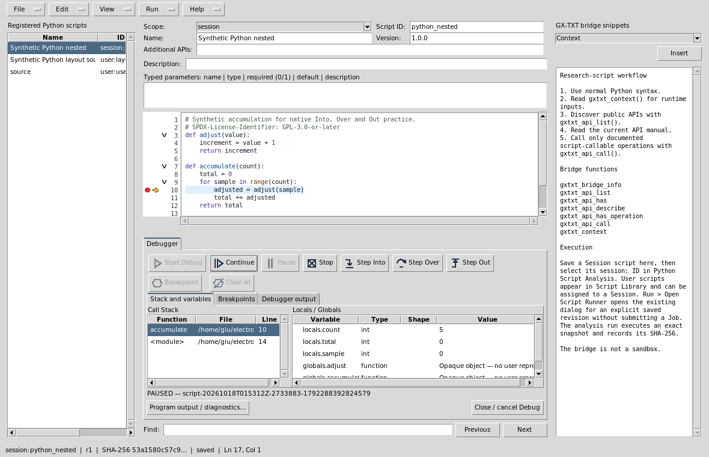
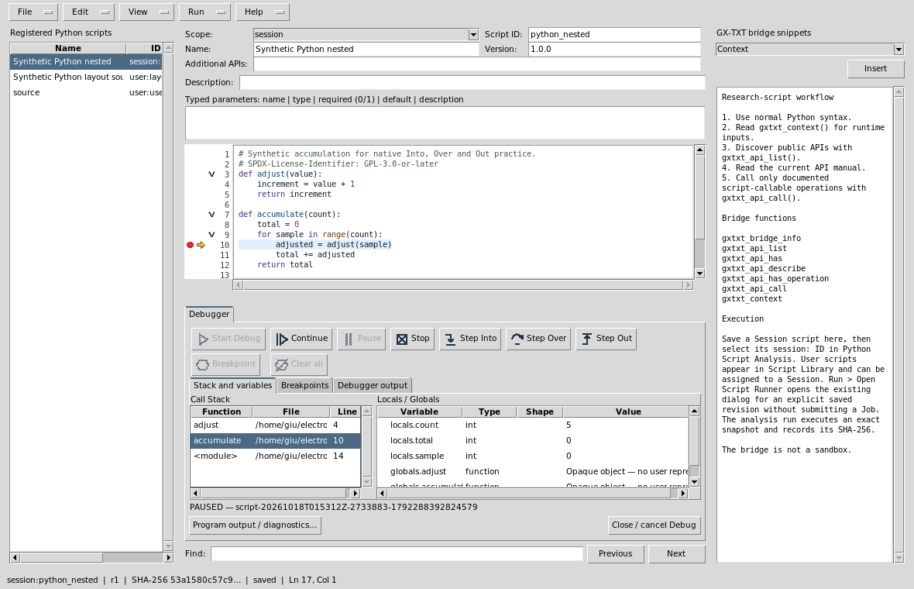

# Python Script Workspace

## Python Script Workspace

Open **Viewers → Python Script Workspace** with or without a Session. Choose **New**, select User or Session scope, enter a stable script ID, name, semantic version, description, required APIs, and optional typed parameters, then edit the Python source and **Save**. The Script Registry records revision and SHA-256. **Save As** creates another ID. The editor has line numbers, Python highlighting, undo/redo, search in both directions, go to line, UTF-8 `.py` import/export, and public `gxtxt` bridge help. Closing an unsaved edit prompts to save or discard it.

Select a registered Python script in the left list to reopen it. **Run → Open Script Runner...** opens the existing CORE dialog with the exact registered identity, saved revision, SHA and typed parameters; it does not submit a Job. Session scripts also appear in Session Script Explorer and the `analysis.python_script` selector; User scripts appear in Script Library and can be assigned to a Session. Deletion uses the common resource lifecycle and refuses active Analysis dependencies. Execution snapshots remain in the Session.

Python Script is a normal GX-TXT Analysis module for researcher-authored
scientific data processing. Create or import a `.py` file in Python Script Workspace or Script Library,
assign it to a Session, select the `session:<id>` entry in Analysis > Python
Script, enable the module, and run it through the normal Run page. Registered
Session scripts retain their own source snapshots; a later user-library edit
does not change the Session copy. Execution snapshots and provenance are under
`analysis/scripts/` in the Session.

The configured `runtime.python` supplies Python and any scientific libraries.
The public `gxtxt` client discovers and calls the same provider-owned public
Script Bridge bindings as Octave. Declare required APIs for preflight before
scientific code runs. The execution context includes a framework-owned
`output_dir`; completed files there can be published through
`DATASET_FILE_PUBLICATION_API_v1`. Use
`PARALLEL_EXECUTION_API_v1/resources` to bound worker pools.

See [the shared scripting guide](../../../docs/help/scripting.md),
[the client reference](../../../docs/api/PYTHON_SCRIPT_CLIENT_v1.md), and
the [parallel policy](../../../docs/api/PARALLEL_EXECUTION_API_v1.md).

## Editing menus and saved revisions

File, Edit, View, Run and Help share one compact menu row. Ctrl+A and Edit → Select All
select the focused editable control, including multiline UTF-8 source and metadata.
Ctrl+C/X/V keep that focus. Pasting over selected source replaces it as one local
undo transaction; Ctrl+Z undoes it and Ctrl+Y redoes it. Selection and copying do
not mark the document modified or write a Script Registry revision. Ctrl+S saves;
Ctrl+F, F3/Shift+F3 and Ctrl+G retain find and go-to-line; Escape in Find returns
to the source. Disabled line numbers and Bridge reference text are not editable.

Run → Open Script Runner opens the existing CORE Runner without submitting a
Job. A dirty registered buffer prompts: Yes saves it and opens the Runner, No
opens the last saved revision while retaining edits, and Cancel returns to editing.
The Runner shows its actual scope, ID, version and SHA, and requires its own Run
command to execute. A source changed elsewhere is explicitly identified; stale
saves remain rejected. Run also opens the existing Script Library and Jobs Manager.

An unregistered buffer must first be saved. Legacy Octave documents require the
explicit Run → Register legacy as Session/User action; merely opening a Runner
never converts them. Existing documents and execution snapshots retain their
identities. An editor bound to another or subsequently closed Session cannot perform
Session-scope save, delete, register or Runner operations there: export any unsaved source if needed,
close it, and reopen the workspace in the intended Session.

## Authoring without a Session

[Layout](#workspace-panes-and-layout) · [Breakpoints](#source-gutter-folding-and-breakpoints) · [Debugging](#start-and-inspect-a-real-debug-job) · [Worked examples](#worked-examples)

Open **Viewers → Python Script Workspace** even when no Session is open.
New scripts default to **User** scope. Edit, import, export and Save work in
the User library without creating a Session. Session registration, scientific
execution and Debug require a real open Session. Use Script Library to assign
a User script to that Session; this creates a distinct Session identity.

## Workspace panes and layout

The menu row is **File, Edit, View, Run, Help**. Explorer selects registered
scripts on the left; the editable source is central; public Bridge snippets
remain on the right. **View** independently controls Explorer, Snippets,
Debugger, Call Stack, Variables, Debugger Output and Breakpoints. Opening Debug
adds a lower assistant; it preserves both side panes. Drag the horizontal and
vertical splitters to allocate space. Closing Debug restores the source area.
Five repeated open/close cycles do not require rebuilding the editor.

**View → Focus source** is reversible; **Reset layout** restores the default
proportions. Pane visibility and splitters are presentation settings saved in
the user's configuration. **View → Script properties / parameters** collapses
metadata without changing its values, source or dirty state. This is useful
with a 900 × 560 window and a large GUI font. **Show script properties / parameters** expands it again. Appearance font settings apply when GX-TXT
starts; restart after saving a different GUI font size.

## Source gutter, folding and breakpoints

The narrow gutter has independent lanes for breakpoints, the current execution
arrow and folding, followed by physical line numbers. A filled red dot is an
enabled breakpoint; a hollow red dot is disabled. A yellow arrow marks the
selected paused native frame. Small chevrons collapse a function or block;
folding never edits the source. Clicking a fold chevron does not toggle a
neighboring breakpoint. Digits widen as the file grows beyond 99, 999 or 9999
lines. Scrolling and folding retain physical line identities.

Click the breakpoint lane on an executable line. **F9** toggles the current
line; **Ctrl+Shift+F9** clears all breakpoints. The gutter context menu and
Breakpoints tab offer Enable, Disable, Remove and Clear all. Blank lines,
comments and non-executable targets are refused. Breakpoints are associated
with the exact source identity/SHA; editing invalidates their old positions.
Set them again after editing. Breakpoint changes are locked during a managed
Debug Job so the display cannot pretend that the running snapshot changed.

## Start and inspect a real Debug Job

1. Open a real Session. Save or assign a Session script and select it in Explorer.
2. Save source edits. Debug always runs the immutable registered source and SHA.
3. Choose **View → Debugger** or the Debug command in **Run**.
4. Place a valid breakpoint, then click the **Start Debug** play icon.
5. Inspect STARTING, RUNNING and PAUSED feedback. At PAUSED, compare the yellow
   source arrow with the selected Call Stack row, file, line and local values.
6. Use **Step Into**, **Step Over** and **Step Out** for genuine interpreter
   stepping. Selecting a caller row requests that native frame and its locals;
   it does not move the interpreter's actual execution frame.
7. **Continue** resumes the program. **Pause** uses Python native tracing while
   running. The managed GNU Octave CLI adapter does not support verified
   asynchronous Pause: its button is disabled with an explanation. An interrupt
   can terminate an Octave loop, so use native breakpoints and steps instead. **Stop** cancels the managed Job. Completion clears the arrow
   and active stack/variables before another run.

Toolbar icons have pointer and keyboard-focus tooltips. At narrow widths their
labels collapse to icons; the functions remain available. Disabled buttons
reflect actual Job state. Locals / Globals are bounded read-only summaries
with type, shape and value; this is not an expression Watch or arbitrary eval.
An external stack frame shows its actual path/line, with no misleading arrow
in unrelated source. Folded current source is revealed for inspection.

**Debugger output** contains bounded native command/status receipts.
**Program output / diagnostics** opens the ordinary Script Job details with
stdout, stderr and immutable execution provenance. These are distinct streams.

## Closing, source revisions and Session changes

Hiding Debug through View preserves its managed Job. **Close / cancel Debug**
asks before cancelling an active Job; Cancel keeps it open. Closing the editor
also protects unsaved edits and an active owned Job. A closed or changed
Session blocks stale scientific operations; export an unsaved buffer before
reopening in the intended Session. Debug refuses unsaved, unregistered or
externally changed source. Editing while paused does not alter the running
snapshot: source stepping controls are disabled until the saved identity agrees.

## Worked examples

`examples/debug_temperature.py` uses only
public `NUMERIC_API_v1` calls for conversion and reduction. Input temperatures
are 18, 20, 22, 21 and 19 °C. Add the exact Celsius-to-kelvin offset 273.15 K.
Expected output is 291.15, 293.15, 295.15, 294.15 and 292.15 K; mean 293.15 K.
Declare `NUMERIC_API_v1@1:math.numeric` in required APIs. Import the example,
save it as a Session script, and place a breakpoint on the first output line
after the reduction. Inspect `celsius`, `kelvin` and `average`.

`examples/debug_nested.py` deliberately
uses ordinary language arithmetic for stepping practice. The five adjusted
values are 1, 2, 3, 4 and 5; the final total is 15. Break on the call to
`adjust`, Step Into, inspect `value`, Step Out, then Step Over the addition.
Select the caller to compare its `sample` and `total`. Continue to completion,
then run the saved script normally through Script Runner. No example publishes
a Dataset or modifies scientific source data.

## Integrated help and troubleshooting

**Help → Viewer manual / Debugger guide…** and **F1** open this independent rendered guide with
embedded real GUI images. Use Find / Find next, the section links and Back /
Forward. The manual remains available without a Session and after closing the
editor. Source example links are supplied in the module's `examples/` folder;
import them through File rather than executing a documentation hyperlink.

If Start is disabled, read the IDLE explanation: check Session, Session scope,
saved source and registered SHA. If panels seem missing, inspect View checkmarks
and Reset layout. If values seem stale, compare the selected native frame and
the Job source identity before interpreting them. Missing required APIs fail
preflight; use the public API documentation rather than a private fallback.
