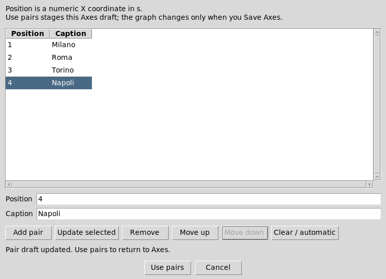

# Scientific Dataset Plot — 4.3.0

## Custom numeric X tick captions

Select the existing Plot or Variant in **Plots**, then open **Axes…**. In
**Custom X tick captions**, choose **Edit pairs…**. Enter each displayed numeric
X position and its caption, then **Add pair**. Select a row to update or remove
it; **Move up/Move down** preserves the pair. **Clear / automatic** removes the
custom map. **Use pairs** stages the Axes draft; existing **Save** or
**Save and rerender** publishes it. Cancel retains the stored graph unchanged.

For numeric X values 1, 2, 3, 4, captions Milano, Roma, Torino, Napoli label those same
positions; they do not replace the scientific numbers or reorder source rows.
Positions must be finite and numerically distinct (1 and 1.0 are duplicates).
Captions retain Unicode, case, punctuation and outer whitespace. Semicolons are
the pair separator and cannot occur inside one caption; empty/mismatched pairs,
newlines, excessive text and nonpositive logarithmic positions are refused.

Positions use the displayed X unit shown in the editor. Changing units converts
an inherited map once through UnitRegistry, including offsets. Explicit new
positions are already in the requested unit. Shared-X panels use one consistent
map/direction/unit, while Y/right-Y controls remain independent. Manual ranges,
log/reverse axes, graph/Variant identity and scientific source values retain
existing behavior. Histogram/box-whisker own their derived X semantics; clear
custom pairs before using those modes. Direct string-column X categorization is
not added: use explicit numeric positions/captions or the existing declared
family/group/filter operations when appropriate.

The module-owned Python/Octave v2/v3 bridge exposes shared_x_axis_get and
shared_x_axis_set plus set_panel_axis through the same public owner. Native v4
inherits those semantic operations. PNG/SVG/PDF export retains the stored map.
The retained GNUplot path uses its existing Cairo device for non-ASCII custom
captions; all ordinary/default exporter calls keep their prior device.

Version 4.3.0 requires the matching DEV111-P031 CORE helpers. Standalone module
use with an earlier patch is not qualified; install the matching framework/module
release through the existing owner workflow. No source Dataset is rewritten by
caption editing or display-unit projection.

## Series representation options

Histogram and box/whisker activate their own options in the shared series editor;
incompatible controls are disabled. Their inactive values remain drafts in that
open editor, including while saving and switching back on the same source-bound
series. Loading another series or committed source binding starts a fresh draft; closing the editor
does not publish inactive settings. Existing compatible Cartesian error bars,
bands and bar bounds remain available.

Kind/style edits retain the existing Dataset/variable bindings, row filters,
source-row selection and family grouping. Distribution modes cannot silently
discard grouping or conflicting source bindings: the normal strict PlotSpec
validator refuses them. Invalid active options leave the saved graph and source
unchanged.

## Dev102 retained visibility

The public native widget host adds `widgetVisibility path panelId seriesId boolean`.
It changes the existing native series display flag without rebuilding buffers,
refitting axes or reading scientific source data. Picking ignores hidden series.
Source/session revision guards remain owned by the existing Plot widget; registry
notifications and cached file stamps trigger exact source validation only when
needed. Pure visibility retains native model token, point buffers and view bounds.
