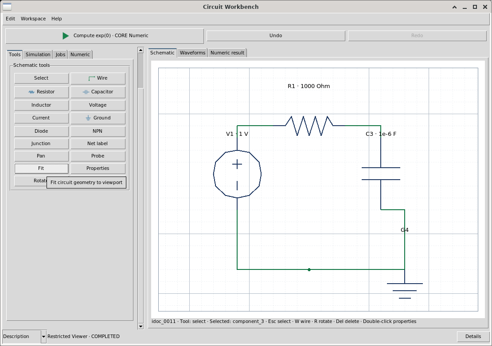
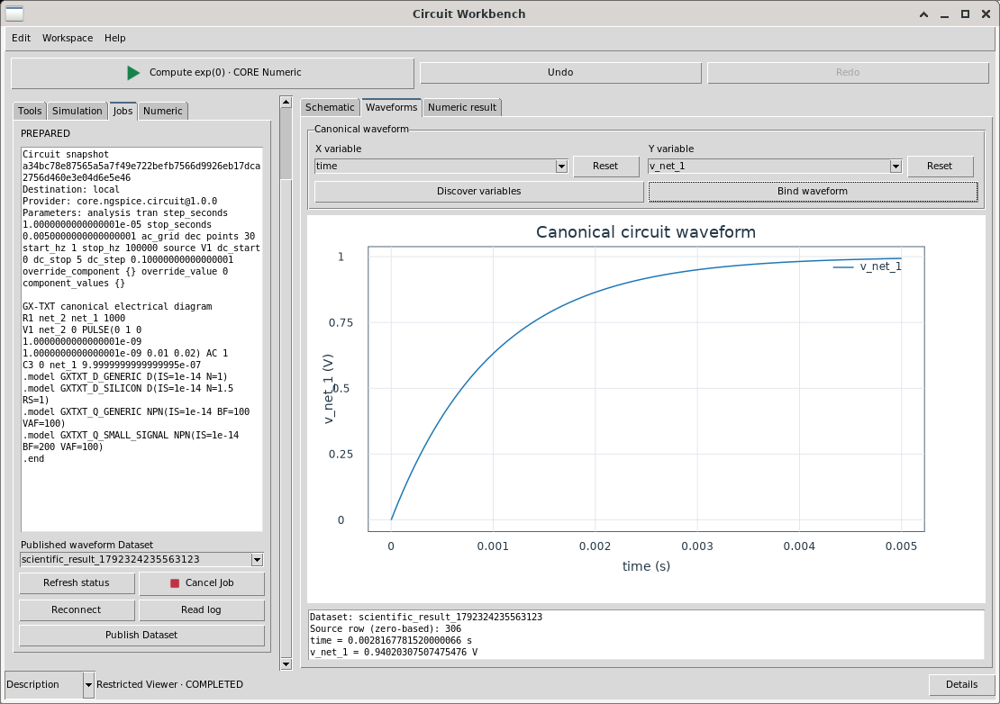
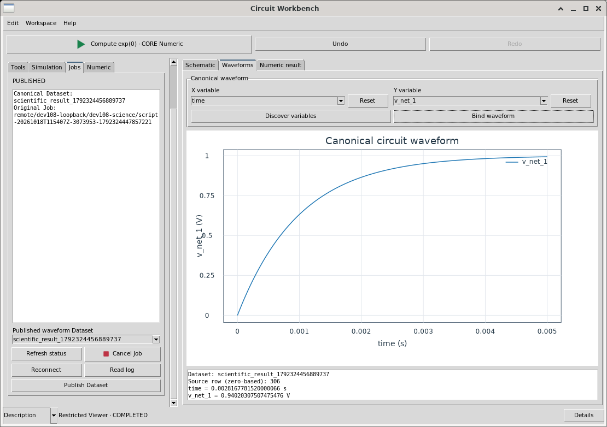
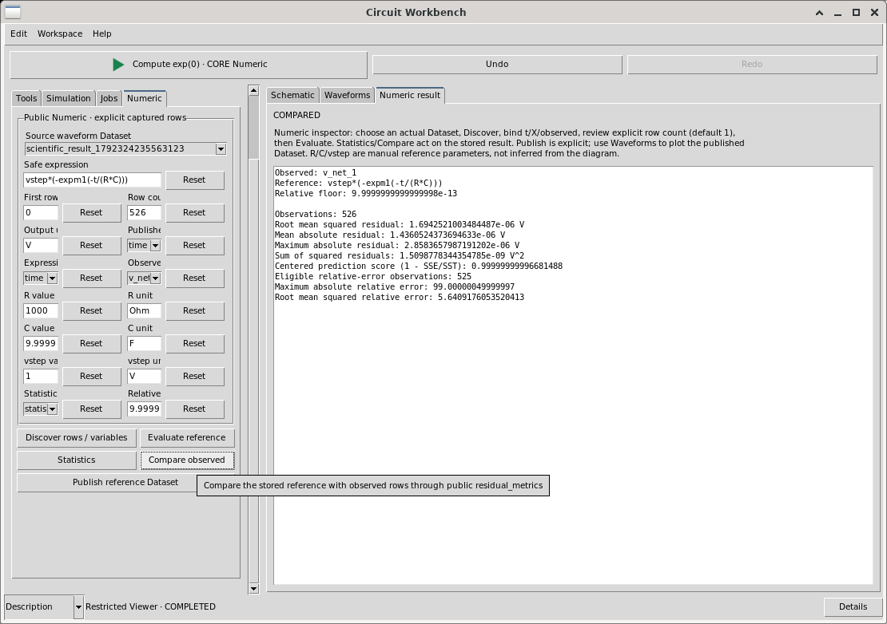
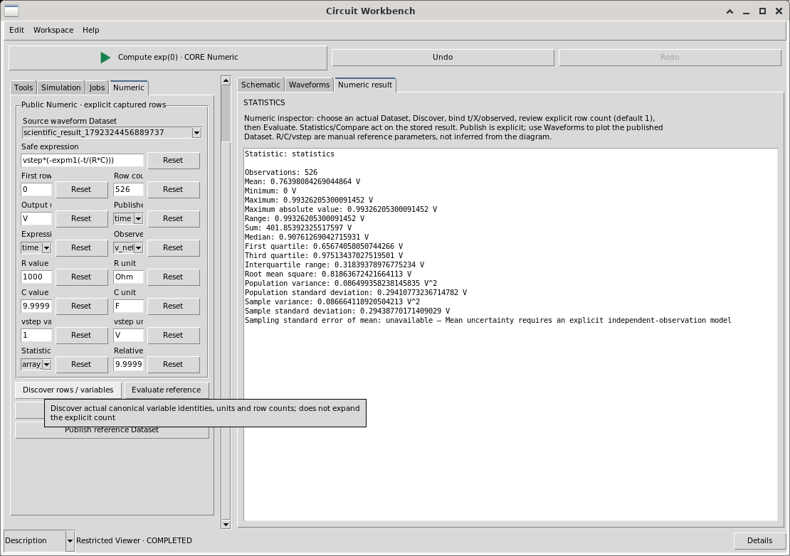
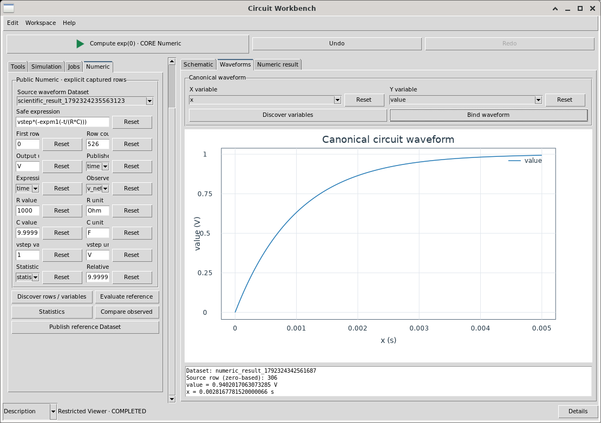

# Circuit Workbench 1.9.3

Circuit Workbench is a restricted C++ Viewer authored through Interface Builder and Development Workspace. Existing public GX-TXT owners provide documents, Native2D, History, Workspace, Scientific Execution, Script Jobs, Parallel execution, canonical Datasets, Plot and every calculation. No private solver launcher, scheduler, renderer, Dataset store or numerical implementation is included.

Installed author evidence covers editing, local/authenticated remote analyses, RC reference/statistics, AC projections, independent-grid interpolation, physical sweeps, schematic voltage/current probing and native Plot navigation. Detailed instructions and scoped evidence follow. Persistent source cursors use the existing Plot owner. Installed 1.9.0 author and independent tests cover checked pane controls, guarded canonical source/netlist inspection and multitrace/panel editing. Version 1.9.1 corrected obsolete startup wording. Version 1.9.2 adds complete declared palette, Undo/Redo and navigation icon coverage through Interface Builder. The actual installed 1.9.2 icon palette, toolbar/menu enablement and two-size presentation were independently reviewed. Fresh source-bound RC, RLC, diode and larger-ladder local/authenticated-loopback examples, public Numeric validation and a separate negative fixture are documented under Current worked examples. Version 1.9.3 updates this manual only, with ordinary package-version/provenance metadata; source, scientific declarations, controls, icons and grants remain unchanged. Framework release-wide acceptance, portable-delivery evidence and individual historical test scopes remain separate from a working Viewer feature.

## Start and orientation

Open Circuit Workbench through the normal installed Viewer entrypoint in an open Session. Schematic edits its canonical electrical Document; Waveforms displays published output. The inspector has Tools, Simulation, Jobs, Numeric, Sweep and View. View contains nested Traces and Panes tabs. Numeric contains RC, AC and Interpolate tabs; the corresponding central Numeric result, AC result and Interp result tabs display reports. Inspector and central notebook selections are independent. Scroll the inspector to reach lower controls; resize the window or drag its normal splitter as needed.

The circuit slot main_circuit starts empty intentionally. Open never inserts an example or fabricates scientific data. The top toolbar and Edit menu provide Undo/Redo. Numeric > RC places the SDK scalar exp(0) diagnostic below scientific actions; it is not a simulation or scientific correctness test. The footer Help and Help menu use the integrated Documentation owner. Scientific History, Description and standard Workspace controls belong to this same Viewer.

Follow the explicit Prepare/Submit/Job/publication workflow before plotting solver results. Numeric evaluates only the reviewed Dataset, Variables, rows, units and parameters; discovery never implicitly selects every row. Reconnect saved Jobs explicitly. Evidence scopes below distinguish actual author GUI use, independent primary review and checks still outstanding.

## Tools and selection

Tools provides Select, Wire, Resistor, Capacitor, Inductor, Voltage, Current, Ground, Diode, NPN, Junction, Label, Pan and Probe. It also exposes Fit, Properties, Rotate and Delete. Choose a symbol tool and click in the Schematic viewport to place a symbol. Choose Select to select existing items. Stable component identifiers are separate from editable displayed names. Rename through Properties; do not assume a renamed symbol receives a new identity.

The native document owner supports Esc for Select/cancel, W for Wire, J for Junction, P for Pan, R for Rotate, Delete for deletion and F for Fit. These are native viewport commands. A focused text control retains ordinary text editing. Use the named buttons if a key is consumed by the focused control. The declarative Undo/Redo shortcuts use canonical stored Ctrl+z and Ctrl+y (conventionally displayed as Ctrl+Z and Ctrl+Y). Uppercase stored letters imply Shift in the Configuration owner and must not be substituted. Native diagram Ctrl+z/Ctrl+y has actually passed the restricted-author 1.4.0 Undo/Redo test. Text-entry focus exclusion remains a separate GUI check.

Select a symbol and use Properties, or double-click it, to open its actual native properties dialog. Select and drag a symbol to reposition it. Moving a connected symbol maintains its endpoint identities. Rotate applies the existing native rotation operation, and Fit adjusts the shared viewport to its content. Selection and pin hit targets differ; a click near a terminal can be more precise than the center of a small glyph. Do not interpret a toolbar transport success as proof that a particular item was selected or changed: inspect the document or visible result.

## Wires, junctions, labels and topology

Use Wire and click an actual pin or junction to start. Click blank grid positions to insert orthogonal route bends, then click the destination pin or junction to finish. A route admits at most 64 bend points. During a pending route, Backspace removes the most recent bend and Esc cancels. Changing tool also cancels the pending route. The shared Native2D scene supplies the temporary orange preview; the canonical document changes when the connection is completed. A direct pin-to-pin route remains supported.

Crossing lines do not by themselves connect. Use explicit endpoint connections and junctions. Ground is an actual electrical endpoint, not a decorative mark; the provider joins ground references to net 0. Explicit labels on endpoints join same-named nets ignoring case during netlisting. Label first requires clicking an actual endpoint or junction; the Explicit net label dialog accepts a net name beginning with an ASCII letter or underscore, followed by letters, digits or underscore, with a total length of 1 through 32 characters. Apply commits it. Actual label creation/Properties and invalid-name retention have scoped1.6.0 author evidence below. The installed 1.8.0 author verified node voltage and independent-voltage-source current mapping with error retention; the complete label/probe matrix remains distinct.

Probe uses the declared Scientific-to-Plot bridge in1.8.0. Choose voltage/current in Tools, then Probe and a real terminal; a matching completed canonical publication is required. The detailed guarded workflow and current limitations are described below. Plot's exact source-row probe remains a separate interaction.

For electrical.basic symbols, resistor, capacitor, inductor and independent voltage/current sources have local terminals p=(-30,0) and n=(30,0). Ground has g=(0,0), even though its glyph extends below the pin. Diode terminals are a=(-30,0) and k=(30,0); NPN terminals are b=(-30,0), c=(30,22), e=(30,-22). Existing rotation and translation transform these offsets; positive 90 degrees maps p to (0,-30) and n to (0,30). These are public catalog coordinates, not positions inferred from screenshots. Actual endpoint metadata is authoritative.

## Existing wire endpoints and ordered bends

Choose Select, click an existing wire's visible stroke and use Properties, or double-click that wire in Select mode. A pin or junction is a different hit target; inspect the actual selected wire identity. The native dialog is titled WIRE_ID · Wire properties. Start terminal and End terminal are typed choices showing current symbol names together with stable component IDs, or an actual junction ID. Reconnecting changes that selected wire's canonical terminal references while retaining its stable wire ID. It does not join unrelated crossings or infer a terminal from a coordinate or display name.

The ordered bend table shows each stored X/Y display coordinate. Select a row to fill Bend X and Bend Y. Add bend inserts after the selected row; with no row selected it appends. Replace changes the selected row, Remove deletes it, and Move up / Move down change its order. Disabled buttons indicate a missing selection, a route boundary or the bounded route size. Coordinates must be finite and within -1000000..1000000 in the viewport's display-coordinate system. Existing-wire editing admits at most 128 points; initial interactive drawing retains its separate64 pending-bend limit. An empty bend list means a direct endpoint-to-endpoint wire. Draft coordinate fields are not electrical values or unit-bearing component parameters.

These controls edit a draft. Apply validates both actual endpoints and the entire route, then commits one canonical edit through the existing Document and scientific History. Close discards unapplied draft changes; closing after Apply does not undo the applied edit. Invalid endpoints, identical start/end, invalid coordinates or excessive points leave the original source and redo tail intact. If another edit changed the source while the dialog was open, close and reopen the dialog rather than overwriting that newer revision. A committed reconnection or bend edit changes source revision/SHA and invalidates an old prepared circuit context; an old result is not automatically a simulation of the edited wire. Use normal Undo/Redo for committed topology/route edits, with explicit History branching when applicable.

The author retried the original RC wire_7 at its actual stroke point (45,40). Properties exposed R1.n / C3.n and bend(60,40); changing the draft to(60,50) and choosing Close preserved the exact canonical source receipt/payload and History 45/45. Its owned native dialog was personally inspected. Independent GUI QA separately covers Apply, endpoint retargeting, invalid/Cancel retention, ordering, Undo/Redo, narrow layout and cold reopening. These independent tests are not relabelled as author commits. Rapid consecutive wire clicks at a shared junction now reach the routing owner; the second click opens Properties only in Select mode.

## Properties, names and units

The dialog title is NAME · Symbol properties. Its first field is Name, followed by the selected catalog kind's attributes. Apply commits the values; Close dismisses the dialog. Unit labels identify the expected base SI units. Use finite decimal or scientific notation, for example 1000, 1e3 and 1e-6. Engineering suffixes and unit text inside numeric fields are not accepted: 1k, 1uF and 1000 Ohm are invalid entries. NaN and infinity are invalid.

Resistance is in Ohm and must be at least 1e-15; capacitance is in F and at least 1e-18; inductance is in H and at least 1e-15. The canonical unit spelling is case-sensitive Ohm. In a properties field enter only the number, because the field already declares the unit.

Independent voltage/current source fields include value, waveform dc/pulse/sine, ac amplitude, initial value, delay, rise, width, period and frequency as applicable. Voltage amplitudes are V and current amplitudes A; time fields are s and frequency is Hz. For a transient step example use a pulse voltage source with initial 0, value 1, delay 0, a small positive rise, width greater than the simulated interval and a suitable period. For AC analysis set an appropriate nonzero AC amplitude. Source parameters belong to the canonical diagram and are captured by Prepare.

Use valid unique SPICE component names with the appropriate kind prefix: R, C, L, V, I, D or Q. Names are compared ignoring case. DC sweep names refer to the actual source name, for example V1. A matching display label alone is not a guarantee of valid topology. Diode and NPN use provider educational model cards. They are not manufacturer model guarantees. Inspect the actual execution provenance when assessing model-dependent results.

## History, Undo and Redo

The declared scientific History component records canonical document changes using the existing public History owner. Circuit Workbench 1.3.1 adds ordinary reserved undo and redo actions in the toolbar and Edit menu, with conventional Ctrl+Z and Ctrl+Y shortcuts, stored canonically as Ctrl+z and Ctrl+y. The uppercase-letter declaration in 1.3.1 requested an implicit Shift and was corrected through ordinary Builder properties in 1.4. There is no C++ shadow history, private snapshot stack or direct document mutation loop. Earlier 1.3.0 had History but did not declare these shortcut actions; transport acceptance of Ctrl+Z in that version did not undo the document and was not a pass.

For the 1.3.1 acceptance sequence, change a resistor property, use Undo and verify the actual prior value and document revision, then use Redo and verify restoration. Repeat with symbol placement, movement, rotation and a wire. Check the start/end-of-history behavior. Canonical restoration preserves allocated identifier high-water marks, so compare actual electrical objects and stable identities; restoring a prior visible circuit does not guarantee byte-identical whole-Document SHA after intervening allocations. While a text entry is focused, verify ordinary text undo remains local to that entry and does not unexpectedly navigate scientific History. Actual restricted-author 1.4.0 placement Undo/Redo passed using the canonical chords and exact electrical objects/stable IDs. The full property/movement/wiring/history-boundary and native entry-focus matrix remains distinct; package design validation alone does not establish it.

A saved Workspace can reopen at an older History entry with a real Redo tail. Editing from that position requires explicit branch confirmation through the existing History owner. Without confirmation, the owner rejects the edit and restores that saved state, including its tab selection. A delivered click is not proof of a committed change. Use Redo deliberately to reach the retained latest state if that is your intent; otherwise use the normal explicit branch workflow. Never manufacture confirmation or rewrite saved History. The1.9 author encountered this guard at46/47; native Redo reached47/47 and the same pane/netlist operations then succeeded.

## Analysis controls

Simulation uses the public core.ngspice.circuit provider. Choose the analysis kind, fill the relevant controls and choose an explicit destination. Unused analysis fields remain visible but do not replace the selected analysis's parameters.

- op: operating point; no transient, AC or DC interval is required.
- tran: Step is the requested time step in seconds, initially 1e-5; Stop is the stop time in seconds, initially 0.005.
- ac: grid is dec, lin or oct; Points initially 30; Start initially 1 Hz and Stop initially 100000 Hz. A useful source AC amplitude must be set in the diagram.
- dc: Source initially V1; Start initially 0, Stop initially 5 and Step initially 0.1. The named independent source must exist, and the nonzero step must progress toward the stop value. Voltage and current source sweeps follow the source's physical units.

Use finite numeric values with valid ranges. The public provider validates analysis parameters, names, topology, component support and source identity. Open pins and floating islands are errors. The Viewer supplies no arbitrary netlist, include path, solver directive or raw process arguments. The currently exposed catalog is broader than a claim that every nonlinear model/example is scientifically accepted; inspect errors and retained logs.

## Prepare, submit and monitor

1. Build a valid circuit, set source and component properties, select the analysis and destination.
2. Use Discover nodes to refresh the available admitted execution destinations. Choose local or a configured authenticated remote node explicitly. Discovery does not authorize silent fallback to another node.
3. Use Prepare. The trusted existing provider creates a validated circuit snapshot and preparation context. Read Job status and log; a failed Prepare is a real error and is not a submission.
4. Use Submit after successful Prepare. The public Scientific Execution and Script Job owners submit the job. CLI author Run only emits admitted plans; it is not a real solver run. Actual solver execution occurs through the trusted GUI owner.
5. Use Poll to obtain the actual canonical job state. Use Read log for bounded retained solver output. Submission is asynchronous; accepting a button click does not mean the job completed successfully.
6. Wait for COMPLETED before publishing output. Failed, canceled and incomplete jobs are not accepted as completed results.

Prepare is tied to the current diagram and form parameters. Changing these invalidates the scientific source context; prepare again rather than treating an old token as current. Preparation tokens are RAM-only. Durable canonical job references and provenance have a different lifetime from the window.

The status and log preserve the existing owners' states and errors. A missing DC source, for example Vmissing, must be corrected in the source field before Prepare can succeed. Existing completed job and Dataset references are not overwritten by a failed attempt. A usable old Plot is not evidence that the new attempted simulation passed. Correct the error, prepare again and inspect the new state and provenance.

## Remote jobs, cancellation and reconnect

Remote execution uses the configured public Compute Agent protocol with authentication and existing trust policy. Circuit Workbench does not create certificates, alter node identity, write node configuration or launch remote commands. During development the dedicated dev108-loopback node is a genuine authenticated HTTPS instance on the same physical machine. This validates transport and durable job handling; it is not evidence of execution on a second physical host.

Choose a discovered remote destination before Prepare and Submit. Keep its canonical job reference. Poll, Read log and Reconnect act through the public job owners. Closing a Viewer detaches presentation from a durable submitted job; it does not imply cancellation. Reopen a matching Workspace and use Reconnect to reattach to the retained reference, rather than submitting a duplicate job. Reconnect is not Prepare or Submit.

Cancel sends a cancellation request. Poll afterward to learn whether cancellation won the race with completion and what terminal state actually resulted. A disconnected node, authentication error or missing durable job is an explicit error; do not claim a local rerun is remote recovery. Node restart, TLS negatives and offline recovery are tested separately by the framework owner; the full corresponding authored Viewer matrix remains to be completed.

## Physical sweeps: explicit controls

The Sweep inspector tab extends the same declared Scientific form and its existing eight methods. Enable physical sweep is initially off: ordinary single-run behavior remains available. The appended Discover nodes / axes, Prepare run(s) and Submit run(s) actions call the same compiled methods as the original Simulation actions. No alternate queue, process launcher, solver loop, array implementation or Dataset store is authored.

1. Build a valid circuit and set analysis/destination in Simulation. Use Discover nodes / axes to discover actual eligible R/C/L and independent voltage/current components. Choices are canonical component IDs, separate from editable SPICE names. Select two distinct existing components for A and B; read their actual catalog SI units. Numeric fields contain finite base-SI numbers only, with no suffixes or unit text.
2. Review A/B start, stop and point counts. Each explicit count is1..4; the bounded Cartesian product has at most 16 cases. Defaults are A500..2000 with2 points and B1e-6..2e-6 with2 points, intended for a deliberately selected resistor/capacitor, not arbitrary newly discovered kinds. Defaults do not prove the selected component or unit is suitable. For one varying parameter, hold the other selected component fixed with equal start/stop and count 1; this remains an explicit two-axis profile with one fixed value. Never select the same canonical component for both axes.
3. Enable the sweep deliberately. Prepare validates finite bounds, physical minima, source topology, all merged cases and the exact source generation/revision/SHA before any submission. Public Numeric uniform_grid generates each grid in count mode. The Viewer does not compute a step or mutate the original diagram values. Inspect prepared cases and exact parameters; a failed Prepare admits no solver Job.
4. Set requested admission workers1..4 and Stop admitting after failure deliberately. Existing Parallel policy validates the request. The current in-process admission callback actually executes with worker_count1 and reports its serial fallback if more workers were requested. This does not serialize the scientific processes: existing Script Job supervision and each destination's CPU/RAM/worker policy own true simulation concurrency. This Viewer neither increases remote policy nor claims that requested workers equal active solvers.
5. Submit only a successful current preparation. Admission finished is not simulation completed. Refresh status in Jobs and inspect expected/admitted/completed counts and every case's actual canonical Job state. A partial admission failure retains successful child references and explicit failed/not-executed cases; it must not appear as full success or erase the earlier published Dataset/Plot.
6. In Jobs select an actually admitted Sweep case before Read log or Publish Dataset. Log reads that real child; publication requires its genuine COMPLETED state/output. Canonical publication retains original case ID, physical overrides, Job/provider/source identity and destination. Select the new canonical Dataset, Discover real Variables and Bind in Waveforms. Publication is per selected case; no automatic multi-trace overlay or private reduction is implemented.
7. Cancel run(s) requests cancellation of every admitted nonterminal sweep child. Refresh actual states afterward: already completed cases remain completed, and a cancellation request is not proof that all children became canceled. Stop admitting after failure concerns further admission, not rollback of already admitted simulations.
8. Save through the standard Workspace owner. Restored sweep state is explicitly RESTORED_SWEEP with original child associations and last-observed states. It does not resubmit, compute, automatically contact nodes or silently claim that restored observations are current. Reconnect explicitly fetches actual states from the same Jobs. Read log/Publish remain selected-case operations after recovery.

Source edits or changes to axes, bounds/counts, analysis, destination or admission settings invalidate preparation; Prepare again rather than submitting an obsolete or uncertain context. If a remote admission outcome is uncertain, retain original canonical references and receipts and use owner recovery; do not blindly create a replacement preparation or duplicate Job. Closing a Viewer detaches presentation, and preparation handles are ephemeral; durable child Jobs retain their original owner.

The provider does not accept arbitrary netlist/include/process arguments. Negative/too-small physical values, duplicate/missing components, excessive counts and incompatible source context must produce real errors. Correct controls and inspect retained source/Job/publication identities. Example R/C bounds are scientific inputs for a suitable circuit, not universal recommended values. Statistics on one case's ordered waveform is not an independent repeated-measurement uncertainty model or a reduction across a sweep family.

The declarative axis keys are lowercase stable identifiers a/b, distinct from displayed A/B labels and existing component IDs. An initial uppercase-key assignment failed atomically; the primary clarified the public grammar and improved the existing validator diagnostic. No nested JSON serializer or scientific implementation replacement was needed.

Primary existing-owner tests established local/loopback four-case execution, scoped partial-admission/cancellation/cold behavior and physical reference checks. Authored1.7.0 native tests now cover two local and two authenticated remote cases, actual per-case logs/publications, Plot/probes, duplicate-axis rejection with retention, correction, reconnect and two-size review. Primary separately checked physical Numeric references and cold persistence. Partial admission and running cancellation remain owner-scoped evidence, not author-performed cases. Design validation or CLI plans are not GUI/scientific tests.

## Publish a canonical Dataset

Use Publish after the selected job reaches COMPLETED and its output is available. The trusted public publication owner imports the retained result into the current Session as a canonical Dataset and records source-job provenance. The Dataset selector displays the published identity. This is explicit publication; displaying log rows is not Dataset creation.

The Viewer uses the canonical Dataset identity and actual variable metadata. It does not parse raw solver files in restricted C++, construct substitute arrays or copy values into a private table. A stale source guard, missing result, incompatible output or import error must be corrected and reported. Preserve the original job receipt and error rather than silently replacing them.

## Waveforms and exact data probe

Select the completed canonical Dataset through the shared published Dataset selector in Jobs. Open Waveforms, use Discover variables, choose actual X/Y Variable IDs and Bind waveform. Discover requires a valid selected Dataset; it is not unconditionally called on an empty selector at Open.

For transient output use time for X and a real voltage/current Variable for Y. Names such as v_net_1 and i_v1 are examples, not hardcoded node inference. Plot derives axis labels and units from canonical metadata. Missing Variables or invalid scale domains report errors and retain the previous valid binding/frame. An old visible curve is not the rejected attempt's result. Use explicit Numeric > AC projections for split-complex data, then publish and bind their canonical x/value output.

Release the pointer on a computed data point to read its exact zero-based canonical source row and original X/Y values/units. Axis, panel and line-only hits are distinguished from an actual source point; raster pixels are not a scientific measurement. An actual source-row hit also selects the persistent reference cursor described under Native fit and zoom commands. A failed/non-source hit leaves its reference coordinates unchanged even if the hit readout changes.

Ordinary Bind initially displays one selected Y; Traces adds canonical series and panels explicitly. RC references, AC projections, interpolated outputs and individual physical-sweep cases can each be explicitly published and selected. The new Traces editor permits explicit simultaneous canonical curves, including separately published references; automatic case trace families remain unfinished. All curves use public Plot directly; restricted C++ neither transforms vectors nor renders another graph.

## Schematic voltage/current probing

Use an actual completed solver case and its explicitly published canonical Dataset. In Jobs select the intended case; its source diagram generation/revision/SHA, original Job/provider/parameters and Dataset provenance must agree. A manually selected unrelated Dataset, older circuit or derived Numeric result is not automatically a solver publication for this bridge.

In Tools choose Schematic probe = voltage or current, select Probe, then click an actual terminal or junction. Open Waveforms to inspect the resulting binding/readout if it is not already visible. Voltage resolves the exact provider-mapped electrical node and actual canonical V Variable. Current selects the actual independent-voltage-source branch Variable in A. The published sign follows the provider/ngspice convention; selecting another terminal does not justify an authored sign inversion. This initial bridge does not provide a resistor/capacitor/inductor/current-source current when that current is absent from the completed output. Unsupported currents and ground-reference voltage are explicit errors, not invented zero traces.

The existing Scientific owner supplies typed probes and terminal net_mapping. No v_net_N or i_name is inferred from display names, declaration order or pixels. Exact Dataset/Variable IDs, units, original completed Job, selected sweep parameters and source guard remain scientific identity. Probe selection changes presentation only: it does not solve, poll a remote node, run Numeric, create a Dataset or edit the diagram. Ordinary History captures the accepted selection/Plot together; Workspace keeps canonical references and mode.

Missing variables, foreign publication, unavailable current, ground and stale source must report a useful error and retain the previous valid waveform selection/frame. Correct the source/case/Dataset/mode and retry. A retained old frame is not evidence that the rejected target was plotted. Changing topology/names/properties invalidates the old source context; use the genuine updated simulation/publication workflow when appropriate rather than bypassing its guard.

For a completed AC publication, the same endpoint selection now resolves the exact canonical frequency and matching real/imaginary pair into the existing Numeric > AC form. It does not try to bind a nonexistent unsplit v_net_N Variable. Voltage selects the mapped voltage pair in V; an available independent-voltage-source current selects its actual i_name_real / i_name_imag pair in A. The readout identifies the selected terminal, pair, frequency, form and requirement to Evaluate / Publish explicitly. AC_SOURCE_SELECTED means metadata selection, not a computed projection or a new published curve.

1. Select the original completed AC solver Dataset/case in Jobs; a derived Numeric Dataset is not a substitute for that original publication guard.
2. In Tools choose voltage/current, choose Probe and click the actual terminal. Verify the displayed pair and units. The old valid Plot and immutable result remain retained; no solver, remote polling, Numeric calculation or publication occurs at this step.
3. Open Numeric > AC and inspect Dataset, frequency X, real and imaginary Variables. The selected endpoint populates these choices but preserves the explicit start, count and projection. Review them deliberately; neither a source change nor Discover means all rows. Choose magnitude, phase_rad or phase_deg as appropriate.
4. Use Evaluate. Public Numeric captures a new immutable projection with actual V/A/rad/deg units. Until Evaluate succeeds, an old restored result still belongs to its original captured source, even when the editable choices now describe a different terminal.
5. Use Publish explicitly. Select its canonical x/value Dataset in Waveforms, Discover variables and Bind waveform, or use View > Traces Add/Update to preserve an existing collection. Use separate V/A axes or panels; phase ordinarily needs linear Y. A genuine Plot source-row release is separate from the schematic endpoint selection.

Circuit Workbench has one compatible declared AC form, so the host selects it without a new C++ method or design edit. Ambiguous, missing or incompatible forms in another Viewer must fail explicitly; authors can declare the existing optional scientific_probe_ac_form reference rather than guessing a target. Save retains the selected form values and original result references without implicit evaluation or submission on reopen.

The same-author GAP040 retry on the saved six-component ladder selected C5.n as v_net_3_real / v_net_3_imag(V), then V1.p current as i_v1_real / i_v1_imag(A), both against the same completed121-row remote publication. Start 0/count 121/magnitude and prior Plot/result were retained until explicit actions. The author then evaluated/published current magnitude through public Numeric, bound it on the right A axis beside two retained V magnitude traces and selected an actual canonical current row. Save/reopen retained the source, PlotSpec, domain references and History 52/52. The original missing-unsplit-Variable failure and later History-helper argument failure remain recorded; they are not successful tests. Independent fresh/native/negative and portability verification remain separately scoped.

Earlier installed 1.8.0 author tests used retained genuine RC publications: two different terminals selected v_net_2/V and v_net_1/V, and the voltage-source terminal selected signed i_v1/A. Capacitor current and ground voltage errors retained the exact prior binding. The AC metadata path adds no current for an unsupported device and does not silently take a real part, absolute value or sign inversion.

## Explicit Plot scales and error recovery

Waveforms provides X scale and Y scale choices, each exactly linear or log, initially linear. Select the canonical Dataset and actual X/Y Variables, choose scales, then press Bind waveform. A choice alone does not apply a new frame or recalculate data. For an AC magnitude or phase publication choose x frequency in Hz, value for Y, X scale log and Y scale linear. Positive frequency spans multiple decades more usefully with logarithmic X presentation. Canonical frequency/value samples, units and exact source-row probes remain unchanged; authored C++ calculates no logarithm or transformed Dataset.

Public Plot validation requires a valid positive logarithmic domain. Time starting at zero, zero samples, negative phase or signed current can make a requested log axis invalid. Use linear Y for the usual negative low-pass phase and signed signals. Do not add offsets, drop samples, take absolute values or relabel data merely to force a log frame.

If Bind rejects a scale/domain, inspect the actual owner error. The existing Plot preserves its exact prior valid frame/spec/binding; an old visible waveform is not evidence that the rejected new bind applied. Correct the relevant choice to linear, or deliberately select a scientifically suitable positive-domain canonical binding, and press Bind waveform again. Successful scales and native scientific axis domains persist through existing Workspace capture/restore. Pixel rectangles and tick positions may change on resizing/reopening and are not scientific samples.

The two ordinary Builder fields are referenced by plot_x_scale and plot_y_scale on the existing form. Discover/Bind methods and the explicit Plot capability are unchanged. Primary independent existing-owner native tests passed scale validation/retention, two sizes and cold restoration. Authored1.6.0 native scale/error-recovery and exact probes passed at the sizes recorded below. Primary Workspace/cold verification remains a separate evidence scope.

## Native fit and zoom commands

Waveforms provides Fit views, Zoom + and Zoom −, also listed in View. These presentation actions delegate to the Host's existing fit/zoom_in/zoom_out owners before authored C++ dispatch. They navigate supported bound displays together. Tools > Fit is the separate circuit-only command. Fit restores complete scientific extent; zoom changes view limits without changing canonical values, units or series bindings.

Over the actual Plot, use the mouse wheel to zoom around the pointer, the middle mouse button to pan (press, drag, release), and double-click to fit. These native gestures and declared navigation actions were exercised by the restricted author on the installed 1.8.0 Viewer, including actual public axis changes and Fit restoration. Native receipts/pixel rectangles may differ after resizing; scientific identities remain unchanged.

Release on a real computed point to select two purple dashed reference lines through that source point's displayed X/Y, alongside its exact source-row/unit readout. These are ordinary canonical Plot reference annotations, not a new data trace or numerical calculation. Wheel zoom, pan, Fit and resize preserve their coordinates. A non-source hit does not move the cursor. Escape while the Plot has focus clears only these two reference lines; Undo/Redo restores/clears the cursor through ordinary scientific History. Rebinding a Dataset or Variable clears the old cursor to prevent assigning it to another trace. Focused text controls retain their own normal editing semantics.

Save the Workspace to preserve its canonical cursor annotations and view. On reopening, a saved reference cursor is presentation context: its previous point text must not masquerade as a newly selected canonical row. Select an actual point again for a fresh row readout. Primary/independent tests cover saved cursor restoration. The initial reopen discrepancy was a primary validation-helper input issue: it sent Escape to the focused Plot before Save, correctly clearing the cursor. After focusing the top-level window before menu dismissal, native Save on the same idoc_0005 verified exact canonical cursor annotations and complete History, with original source/campaign unchanged and no scientific calls. The earlier failure receipt remains retained; this was not a Viewer persistence defect. The initial constrained Plot-Escape denial is retained as GAP-SPICE-032. After the existing test owner's scoped correction, the identical native Escape cleared the cursor; visible Undo restored its exact PlotSpec/reference coordinates and truthful no-row-selected text, and Redo cleared it again.

View declares checked pane controls, with actual installed 1.9.0 author adoption and independent review. Source/netlist/trace controls retain their existing owners. Invalid/stale sources must preserve the valid frame and expose useful errors.

## Checked panes and canonical source / netlist

View > Panes in the inspector and the checked View menu control Source / analysis controls (the existing Simulation inspector tab), Source / netlist (its separate central tab), Circuit (Schematic tab), Probe readout, and Trace editor. All initialize visible for a new Viewer. A checkbox indicates declared presentation visibility, not whether that notebook page is currently selected. Unchecking hides the existing pane without destroying its widgets, source binding, Dataset or results; checking restores its retained order/content. Hide/show does not stop Jobs, cancel work, recompute Numeric or inspect a circuit. Focus leaves hidden content; showing does not steal it. These declarations and native checked-menu synchronization use existing UI Field/Configuration owners.

Use the View menu or inspector View > Panes to restore a hidden page. The visibility controls, Help, Workspace and History remain available. A hidden selected notebook page is restored consistently by Workspace; saved visibility wins over new-window defaults. Each accepted visibility change is an ordinary History step, so Undo/Redo and Save/reopen retain it. Do not infer a scientific deletion from a temporarily unmapped tab.

Source / netlist is separate from Jobs' retained solver log and from the Plot/probe readout. Select the intended admitted sweep case in Jobs, then open Source / netlist and choose Refresh source / netlist explicitly. With an existing Job/campaign, inspection uses that case's actual canonical parameters, original Job/Dataset association and exact source generation/revision/SHA. Editing displayed analysis fields does not silently relabel an old Job. Without a Job, inspection uses the current declared analysis parameters. The separate Source / analysis controls toggle merely shows/hides Simulation; it is not another source-text authority.

Read the complete inspection header: canonical source identity, provider/version, parameters, original Job, selected case and Dataset identify which deck is shown. The deck is reconstructed and validated by the same registered converter/version through public CircuitInspect. It is not a remote artifact download, an independent parser, a raw editable solver script or a new simulation. No alternate netlist may be typed/imported through this read-only pane. The complete deck is bounded to32KiB; oversize is rejected, not silently truncated.

Changed source/provider, invalid circuit, foreign case/publication or mismatched canonical payload must fail with a useful error and preserve scientific state. Correct the actual source/case/selection rather than bypassing the guard; an old displayed deck is not proof the new inspection succeeded. Editing topology after a completed Job normally requires a genuine new preparation/simulation/publication for that new source. Inspection does not poll/reconnect remote Jobs.

Workspace/History retains the validated cached deck and its exact context under the existing Scientific owner. Reopen displays it only if that source/selected Job/parameters/Dataset still match; otherwise it explains stale/unavailable state. Restore never silently reconstructs a deck, calculates, submits or contacts a node. Refresh remains explicit. Hiding/showing the pane retains its guarded content.

## Multiple canonical traces and stacked panels

Inspector View > Traces edits the accepted canonical PlotSpec through the existing Plot owner; it does not create private vectors or a second graph. Before editing, choose a legitimate published source Dataset in Jobs, open Waveforms, Discover variables, select actual X/Y and use Bind waveform once. Bind is the original single-source operation: using it again replaces that one Plot binding and clears its old source cursor. To preserve an existing collection, use Add trace or Update trace instead of using Bind as an append command.

Open inspector View > Traces and choose Refresh list to derive current stable Trace ID and Panel ID choices and a bounded summary from the accepted PlotSpec. Refresh does not add a curve or compute data. Trace labels are editable display names; stable trace_N IDs remain distinct scientific presentation identities. The original selected_source trace remains a normal existing trace. Controls use full-width inspector rows; scroll to reach lower actions/status.

To inspect/edit an existing trace, select its Trace ID and Load selected first. Load puts that trace's canonical Dataset/X/Y and editor values into the ordinary controls without changing the Plot. Check the actual Dataset selector in Jobs and X/Y in Waveforms before a later edit. Selecting a different Dataset alone does not retarget the already plotted trace. Discover its actual Variables and choose the intended X/Y before Add or Update.

For a new curve, choose its canonical source Dataset and discover/select X/Y, enter a single-line Trace label, choose left or right Y axis, set Trace enabled deliberately and choose the target Panel ID. Add trace preserves existing curves, appends a new stable trace_N ID and validates the entire resulting binding. Update trace changes only the selected stable trace's requested Dataset/X/Y/label/axis/enabled state and panel membership; its stable ID, style and unrelated canonical fields survive. A changed control is not itself an accepted Plot edit.

Use Trace enabled with Update to hide/show that trace without deleting its canonical references. Trace up/down reorders the selected trace within its present panel. Remove trace deletes the selected presentation series; the final remaining trace cannot be removed. Labels are single-line, at most 160 characters. The editor admits at most 32 traces. Removing a trace does not delete its source Dataset, original Job or immutable Numeric result.

All traces retain their own Dataset/Variable IDs and original unit/provenance metadata. Public Plot validates shared X semantics, physical units/conversion and native model before replacing the frame. Put voltage and current on distinct left/right axes or separate panels; incompatible units on one axis are rejected with the prior accepted frame/spec intact. Choosing an axis is not an authored unit conversion or current-sign inversion. Distinct real Datasets may be compared visually only with appropriate coordinate semantics; the editor does not align or interpolate them secretly. Use the explicit Numeric interpolation/comparison workflows for scientific calculations. Selecting a reference Dataset beside a solver Dataset is not itself a tolerance test.

To create stacked displays, enter New panel title and Add panel. The owner creates a stable panel_N ID. Select that panel, Load the intended trace if needed, choose its destination Panel ID and Update trace to move it. Panel up/down reorders whole panels with their traces. Remove panel accepts only an empty, unannotated, non-final panel; move/remove its series first. Persistent cursor annotations may also make a panel nonempty: clear the actual Plot cursor with focused Escape before attempting to remove that otherwise empty panel. The editor supports at most 8 panels. Panel titles are single-line and bounded to160 characters; the title field is for creating a panel, not an unimplemented arbitrary rename command.

Exact source-point probes continue to return the actual selected series' canonical Dataset/row/Variables/units; a panel/axis/line hit is not a source-row observation. Cursor annotations remain existing canonical Plot presentation. Each coherent accepted trace/panel edit records one History step; failed edits retain the last valid spec/frame and leave source Jobs/results intact. Undo/Redo and normal Workspace Save/reopen retain traces, panels, controls and annotations without recomputation. Keep an eligible saved Workspace before large changes and use its normal source identity guards/reviewed-copy workflow.

Installed 1.9.0 author tests exercised all eleven series/panel operations, native pane toggles, selected-case netlists, incompatible-axis and nonempty-panel retention, exact source probes, two sizes and normal Save/reopen. The primary separately reviewed native checked menus and fresh normal-manager restoration. These presentation checks reused four genuine prior sweep Datasets without rerunning science. The separate final1.9.2 source-bound examples and primary physical checks are documented below; these older presentation tests are not substituted for them.

## Workspace persistence and source identity

Use the standard Workspace control to Save, then reopen through the normal Workspace manager. The installed descriptor supplies the normal factory; it revalidates source/design/project identities and reconstructs genuine compiled callbacks. Successful restoration includes canonical diagram, declared controls, History, bounded16-value C++ state/counter, Job/case/Dataset references and Plot context. Geometry alone is not successful restoration. Preparation tokens are RAM-only; they are not durable after closing. Reconnect retrieves current states of the same saved Jobs, without resubmission.

Ordinary reopening requires the saved package snapshot. An older Workspace is not automatically source-identical after installing a semantically extended design. Preserve the original package and Workspace; never edit payloads, guards, source identity or generated adapters to force admission.

For an eligible reviewed additive upgrade, close the assigned Viewer and use Develop > Review saved Workspace upgrade…. Select the original saved Workspace, choose Review selected, inspect the report, and only then Create upgraded copy. Review checks unchanged compiled source/capabilities and all preserved component ordinals, lists appended controls/defaults and admitted bindings, and examines every retained History state including redo. It does not run a solver or Numeric, fetch remote states or change original scientific data. A changed compiled contract, incompatible declaration or unsupported old identity must be refused rather than silently migrated.

Create upgraded copy makes a separately named canonical Workspace using existing export/import. It preserves original source Documents, Jobs/Datasets, notes/preview/nested resources, History, native presentation and C++ values/counter; only reviewed additive defaults are introduced. Export may add a managed archive resource to the existing resource store; the original Workspace payload/revision remains unchanged. Open the returned new item through the normal Workspace factory. A newer review invalidates the prior review token; tokens last only in their issuing GUI process/Session. Keep the original for rollback.

The constrained author used this exact review/copy/open path from 1.7 idoc_0002 to1.8 idoc_0005. The report preserved161 prior ordinals, appended seven declarative controls, retained source idoc_0001 revision 16 and all38 saved History states with counter28, and defaulted the new probe mode to voltage. The restored campaign, original Jobs, four Datasets and waveform remained canonical. These example IDs belong to that test Session; select your own saved item.

Installed 1.9.0 was adopted by an explicit reviewed copy from idoc_0005 to idoc_0006, preserving168 prior component positions and appending35 inert declarations. The author subsequently saved idoc_0006 through the approved existing Workspace owner, closed it and reopened that same canonical ID. Typed controls, three traces/two panels/cursor, cached case 1 deck, source binding, C++ state and History 105/105 were exact; the primary independently cold-opened it through the normal Manager. Reopened point text correctly identified saved reference lines rather than claiming a newly selected canonical row. Native top-level size reopened at the design's1100x720 default despite the1500x1040 pre-Save size; native window-size persistence is not claimed. Resize normally as needed; canonical axis domains and bindings remain retained.

Version 1.9.1 changes restricted C++ source even though its only functional presentation change is startup wording. Keep old1.9 packages and Workspaces historical. Their callbacks are not hand-migrated, and the exact-source guard remains strict. Open a fresh current-version Viewer/Workspace for the final source-bound cycle. Canonical circuit Documents and Datasets remain owned by their original services and may be selected through supported controls with their original provenance; do not replace source identity or Job references to force old callbacks into the new package.

## Help and package identity

The explicit Help component delegates to the public integrated Documentation owner. The package exports this manual byte-for-byte as MANUAL.md and source/MANUAL.md. Help opens the installed manual through the owner; it is not a custom browser or file reader written in restricted C++. Primary native Help/About/manual rendering checks are separate installed GUI evidence, including the seven preserved historical illustrations. Framework About dialogs and their own manuals belong to the corresponding tools, not to an invented Viewer-specific debugger.

Package version is1.9.3. This documentation-only revision changes this manual and ordinary top-level version/provenance metadata. All203 component identities/ordinals, parents, handlers, component properties, scientific contracts, capability grants, tests and icon/resource bytes remain exact1.9.2. Version 1.9.2 added licensed project resources and typed button/menu icon bindings. C++ bytes, SDK and compiled dispatch remain exact1.9.1. That earlier wording patch changed the startup literal and matching description, so old1.9 Workspaces retain their historical exact-source identity; no source guard is weakened. Reserved fit/zoom handlers have presentation effect and use the existing Host before authored C++ dispatch. This semantic profile addition does not promise automatic migration of an earlier Workspace. Normal source/design/Result guards remain authoritative. The package declares its dev108 minimum through normal package metadata and retains GPL-3.0-or-later licensing.

## Numeric expression, statistics and comparison

All scientific calculations use the public GX-TXT Numeric, Mathematical and Statistical owners. NumPy is forbidden. Authored C++ passes declared component indices to fixed void SDK methods. It receives no scientific arrays and performs no reference formula, reduction, statistics or interpolation. The Numeric > RC inspector's SDK scalar check exp(0) is only an API admission diagnostic, not validation of a circuit waveform. It displays 1 through the public exp operation and does not run a simulation.

The Numeric > RC inspector provides these full-width ordinary controls in sequential rows. Scroll the existing inspector to reach later values and actions; the reset control remains owned by the standard field. Short labels preserve space for the actual selected value. The central Numeric result report remains separate:

- Source waveform Dataset: choose an actual canonical Dataset. This selector is separate from the Jobs/Plot published Dataset selector, so publishing a reference does not change the captured source selection.
- Safe expression: initially vstep*(-expm1(-t/(R*C))). Public Numeric parses the safe expression; this is data, not a C++ expression or executable script.
- First row (0-based): initially 0. Row count (explicit): initially 1, explicitly bounded 1 through 65536 and by the real source interval.
- Output unit: initially V. Publish X variable: an actual canonical Variable ID used for reference publication.
- t variable: the canonical Variable bound to symbol t. Observed Y: the actual response Variable compared with the reference.
- R value/unit: initially 1000 and Ohm. C value/unit: initially 1e-6 and F. Step value/unit: initially 1 and V. These are editable scalar reference parameters, not inferred from component names or automatically synchronized with the diagram.
- Statistic: actual catalog ID statistics, array_reduce.rms, array_reduce.minimum or array_reduce.maximum.
- Relative floor: initially 1e-12, passed explicitly to the public residual comparison. It prevents an implicit relative-error convention being substituted by the Viewer. Interpret the public metric and its unit/status, including unavailable reasons.

Open Numeric > RC in the inspector and the central Numeric result tab. Choose Source waveform Dataset and use Discover rows / variables. Read the actual variable identities, units and available row counts in the genuine report. Discover updates available choices and preserves the explicit row count; it never silently expands the default 1 to a full waveform. Choose t, Published X and Observed comparison variable from actual choices. For transient RC output, t and X will normally be time and the observed variable the capacitor voltage. Inspect the actual prepared netlist to identify it: in the retained author circuit C3 connects net_1 to ground, so v_net_1 is observed and v_net_2 is the input source. Other circuits may assign different net IDs; do not select a variable solely because its name resembles an earlier example.

Review the row interval explicitly. To evaluate a 526-row source from its beginning, choose First row 0 and Row count 526 only after discovery reports those rows. A count of 1 intentionally evaluates exactly one row; it is not a full-waveform reference check. Other valid intervals require matching source bounds. No cross-Dataset row alignment is inferred. Numeric publication uses the actual X rows at this same interval.

Review R/C/vstep and their units against the intended physical reference. The default expression represents the ideal zero-initial-voltage series-R/shunt-C step response for a source changing from 0 to vstep at time zero, with positive R and C. It does not describe arbitrary topology, source delay/rise behavior, initial charge, nonlinear devices or AC analysis. A real pulse with finite rise and a numerical solver's integration choices can differ from that ideal model; inspect errors using the public comparison report. Do not interpret any finite residual as automatically passing a scientific tolerance. The retained 1.4.0 RC validation uses an explicitly reviewed maximum absolute residual criterion of 1e-4 V. Public residual_metrics reports 2.8583657987191202e-6 V locally and remotely for that specific circuit, source and 526-row interval. That passes the stated absolute criterion for that test; it is not a relative-error pass or a universal model tolerance. The near-zero early pulse samples produce maximum absolute relative error about 99 and RMS relative error about 5.64, which remain visible and must not be hidden. The ideal response assumes an instantaneous step, whereas the actual source has finite 1e-9 s rise. Choose an explicit scientifically justified sampling window and relative floor if examining relative error away from that transition. First row/count are sample indices, not time bounds: discover actual rows, inspect canonical time values, and document the selected interval. Raising the floor or excluding rows merely to obtain a preferred number is not scientific validation.

Use Evaluate reference to request public Numeric expressionDatasetCaptured over the declared Dataset Variables, scalar parameters, interval and output unit. The trusted owner checks units, Dataset source revisions, Session identity and the optional current graphics Document generation/revision/SHA. An incompatible output unit, invalid expression, out-of-range interval or stale source is an explicit error. Numeric creates an immutable evaluation Document containing the reviewed request, capture receipt and existing Managed Resource descriptor. The actual vector remains a Managed Resource, not C++ state or a private array.

After a successful evaluation, Statistics invokes the selected public operation on that stored vector. The report uses validated Statistical Result Semantics fields, physical units, availability/status and reasons. Undefined or unavailable quantities are not silently reported as zero. The pointwise expression vector itself has no fabricated statistical profile. The full validated result is persisted through the existing Interactive Document owner as an immutable gxtxt.statistical_result.v1 Document. It retains the original Numeric request, source Result Document/SHA, operation and, for comparison, observed Variable and relative floor. Domain state and Workspace retain only its guarded identity. Restore renders the saved facts without recalculation. A successful new Evaluate clears the active statistics reference; earlier Documents remain available to their earlier saved snapshots. The primary independently verified cold restoration without a public Numeric computation call; the restricted author verified actual stored statistics identities during this GUI phase.

Compare observed captures the selected observed Variable over the stored reference's exact original rows and units and invokes the public residual_metrics owner once. The stored reference request is authoritative even if visible form controls later change. Use Evaluate reference again when a different reference request is intended. Reading a fresh control value does not relabel an older immutable evaluation. This RC Compare action does not infer cross-grid alignment. Use the separate explicit Interpolate profile to publish values on a reviewed canonical query grid; a subsequent comparison still requires the exact appropriate canonical observations.

Publish reference Dataset is a separate explicit action using Dataset Publication v2. The current successful result is published as canonical x/value Variables with actual X rows, value bytes, units, original expression/parameters, source revisions and result SHA in structured provenance. Publication does not rerun the expression. The existing published Dataset selector receives the new canonical identity. Open Waveforms, discover its variables, select x and value and Bind waveform using the same canonical Plot owner as simulation output. This produces a reference plot, not an automatic multi-trace overlay.

Successful evaluations are immutable: a later successful Evaluate creates a different evaluation Document, while old Workspace/History snapshots retain the earlier descriptor. A failed evaluation discards only its uncommitted candidate and preserves the previous successful result. Publication failures abort the new writer and retain prior successful data. Do not mistake a still-visible prior report or Plot for success of a failed new request. Workspace stores only canonical evaluation descriptor identities; the result/Managed Resource remains owned by the Session. The selected immutable Statistical Result Document is also retained by its guarded identity. Do not infer that a later displayed report changed or recomputed an earlier saved result.

Discover with an empty or invalid Dataset, invalid units, a wrong variable, unsupported expression or excessive interval must fail visibly. Correct the controls, inspect the stored/result identity and retry the appropriate action. The author does not bypass a failure using scalar loops, direct numerical libraries, log parsing, script execution or private vector copies. Public generic form and restricted compiled-plan tests establish owner admission. Separate restricted-author 1.4.0 native GUI tests now establish the local/remote expression/statistics/comparison workflow described under Verification; the separate1.5.0 pointwise evidence below does not prove every layout or the complete acceptance matrix.

## AC magnitude and phase from actual solver output

The Numeric > AC profile uses actual canonical Dataset Variables and the existing public split-complex Numeric operations. Its visible controls are AC source Dataset, Frequency X, Real Variable, Imaginary Variable, First row (0-based), Row count (explicit), Projection and Statistic. The initial count is exactly 1. Projection offers the actual admitted operations magnitude, phase_rad and phase_deg. Output units come from the operation and source metadata; there is no editable unit label that can relabel a stored calculation.

1. Build a valid circuit, set the independent source's nonzero AC amplitude in Properties, and choose ac in Simulation. Select dec, lin or oct, Points, Start Hz and Stop Hz. Choose local or a discovered authenticated remote destination explicitly.
2. Prepare and inspect the real netlist/source identity, Submit, poll to COMPLETED and Publish the actual AC Dataset. Record its identity. Changing the Inspector's profile does not create or rerun a simulation.
3. Open Numeric > AC and central AC result. Choose that AC source Dataset, then Discover AC variables. Read actual IDs, units and row counts. Discovery preserves the explicit row count. Choose the actual frequency Variable and a matching real/imaginary pair for the same desired node voltage or branch current. Names come from the actual Dataset; do not assume a previous example's net number or guess an imaginary suffix.
4. Set the explicit start/count after reviewing the discovered bounds. A count of 1 evaluates one frequency point. Set the actual full row count only when a full sweep projection is intended and it fits the 65536-row bound.
5. Choose magnitude, phase_rad or phase_deg and use Evaluate projection. Read the genuine result/error in AC result. Public Numeric reads the same rows of both parts, converts compatible imaginary-part units to the real-part units, and executes the selected complex operation. Incompatible dimensions, invalid rows or stale sources are rejected.
6. Statistics describes the stored vector using the actual chosen public operation and validated fields. It does not infer independent repeated measurements from an ordered frequency sweep. Missing uncertainty assumptions remain unavailable rather than zero.
7. Publish projection explicitly. The existing published Dataset selector receives the new canonical x/value Dataset. Open Waveforms, Discover variables, choose x and value and Bind waveform. X uses the actual selected source frequency rows/units; magnitude retains the channel's V or A unit, and phase uses rad or deg. Publish a different projection separately and select its canonical Dataset to inspect it.

Magnitude is the magnitude of the selected complex channel, not automatically a normalized transfer gain or decibels. A 1 V source may make the numerical voltage magnitude resemble a dimensionless gain, but its unit remains V. The profile does not divide by another channel, compute a dB reference or silently unwrap phase. Phase is the public operation's channel phase; phase near a vanishing magnitude requires physical care. The rad/deg result labels do not grant a general angle-conversion service. Log-frequency presentation, multi-trace overlays and other Bode conventions must be verified through the existing Plot owner; no private PlotSpec or renderer is constructed in C++.

A successful projection creates an immutable gxtxt.numeric_pointwise.v1 result Document with its full request, source revisions and existing Managed Resource descriptor. Changing Projection or Variables afterward does not relabel or recompute that result. Evaluate again to create the intended new result. Failed evaluation retains the previous successful result/publication. The optional current-diagram guard is captured as additional workbench context; the canonical Dataset and original Job provenance remain authoritative for the actual source data.

The new profile uses Discover/Evaluate/Statistics/Publish. It intentionally has no misleading Compare button between an arbitrary real part and magnitude/phase: such quantities are different observables. Scientific reference comparisons must bind compatible physical quantities and explicit matching grids through the admitted reference workflow. Actual installed 1.5.0 author tests exercised magnitude/radian/degree, publication/Plot units and the error-recovery cases below. Generic owner tests alone are not substituted for author evidence; installed 1.8.0 probe/navigation evidence is scoped below.

## Bounded interpolation on a canonical query grid

Numeric > Interpolate uses two explicit canonical Dataset references. Source and query may be the same Dataset or different real published Datasets. The controls are Source Dataset, Source X, Source Y, Source first row, Source rows (explicit), Query Dataset, Query X, Query first row, Query rows (explicit), Method, Extrapolation and Statistic. Source first row and Query first row initially 0; source count initially 2 and query count initially 1. Each count is explicit, bounded 1 through 65536 and checked against its own actual source bounds.

The source defaults admit the minimum linear case, not an automatic full waveform. Linear needs at least two valid source samples; pchip needs at least three. Choosing pchip with only two is an error, not permission for an implicit fallback. Extrapolation is fixed to the explicit public error policy. No GUI control silently changes it to nearest, nan or linear continuation.

1. Have a legitimate canonical source Dataset and a canonical Dataset containing desired query X values. For a first identity-grid smoke check, select the same real waveform Dataset for both roles and its time Variable for both X selections, with a source interval containing the chosen query row. This checks public wiring only; it is not evidence of between-sample interpolation accuracy.
2. For a meaningful different-grid transient example, retain a completed published RC waveform, then run the same actual circuit with a different requested transient step through the ordinary Simulation/Job/publication workflow. Retain both Dataset IDs. Adaptive solver samples need not be uniform or have a guessed count: discover and inspect the actual source/query rows. Alternatively use a legitimate existing canonical query Dataset. The author does not create query vectors in C++, write raw Session files or synthesize a fixture outside the approved tools.
3. Open Numeric > Interpolate and central Interp result. Choose both Dataset selectors, then Discover both grids. Select actual Source X/Y and Query X Variables. Read their true units and row counts. Discovery does not expand either interval.
4. Set source and query starts/counts independently. For a full-grid evaluation choose the actual source support and reviewed query interval, not hardcoded counts from another circuit. Every query must lie within the selected source X domain under error extrapolation. Ordered source X must satisfy the existing Numeric operation's finite, unique, monotonic-coordinate rules. Do not sort, merge duplicate X or drop values privately to force acceptance.
5. Choose linear or pchip and use Evaluate interpolation. The existing public Numeric owner materializes bounded source X/Y and query X, converts query X into compatible source X units, then calls the shared interpolation algorithm. The returned vector follows original query row order and has query row count and source Y units. Incompatible dimensions and out-of-domain queries fail explicitly.
6. Statistics applies an eligible public operation to that stored interpolated vector. It does not infer independent observational uncertainty or prove interpolation accuracy merely because values are finite.
7. Publish interpolation explicitly. Canonical output x retains the original query X values/units; value has source Y units. The full source/query Dataset IDs, Variable IDs, row intervals/revisions, method, extrapolation policy, result identity and any selected Statistical Result identity remain provenance. In Waveforms select its new published Dataset, Discover variables, choose x/value and Bind through the existing Plot owner.

For example, a real query time Variable in ms can be compatible with source time in s: the public Numeric wrapper performs the conversion before interpolation and publication preserves the original query units. The Viewer never treats a unit-name edit as numerical conversion. A voltage query X against a time source X is incompatible and must be rejected. This unit-conversion contract is owner behavior and still needs the candidate's own actual mixed-unit GUI test before author acceptance is claimed.

Each successful interpolation is an immutable pointwise result Document and existing Managed Resource. A failed attempt leaves the earlier successful result and published Dataset identities intact. Changing the two selectors or method does not rewrite an old stored request. Both Dataset revisions, Session lifetime, result Document identity and optional current-diagram context are guarded before/after calculation and during publication. Workspace/History stores only the canonical descriptors and restores stored facts without invoking Numeric again. No hidden row alignment, extrapolation, output decimation or source replacement is performed by authored C++.

The candidate exposes interpolation plus statistics/publication, not an arbitrary cross-Dataset residual comparison button. A physical comparison must explicitly choose suitable observables and aligned canonical rows; finite interpolated values alone are not a validation tolerance. Installed 1.5.0 author tests exercised linear/PCHIP on distinct local151-point and remote11-point grids, range/type errors, exact prior-result retention, publication and native Plot/probes. Compatible-unit conversion and cold restoration were independently tested by the primary; those scopes do not become author tests. Further matrix cases remain distinct from the scoped1.6.0 scale evidence below.

## Icons and resources

Version 1.9.2 declares original GPL-3.0-or-later icons on all18 Tools palette actions: Select, Wire, Resistor, Capacitor, Inductor, Voltage, Current, Ground, Diode, NPN, Junction, Net label, Pan, Probe, Fit, Properties, Rotate and Delete. Undo/Redo toolbar buttons and their Edit menu rows also have matching icons; Waveforms Fit/Zoom+/Zoom- buttons and View navigation rows use the corresponding originals. Labels remain visible: icons supplement the actual named command and never replace electrical values, units or scientific identity.

The project owns25 logical resources. Seven earlier resources remain byte-identical;18 additional original sources were selected from the bounded public shared catalog, imported through Builder and assigned through typed properties. Fit is reused by circuit and waveform navigation, while each command retains its original callback. Submit/Cancel and the separate scalar SDK diagnostic keep their earlier appropriate resources. Palette, toolbar and navigation buttons use16px icon-plus-text, left placement and 4px spacing; native menu bindings use the supported normal/disabled icon-plus-text presentation without unsupported custom spacing or hover behavior. Scientific command enablement continues to belong to the existing owners.

These control pictograms are presentation resources, not replacements for the Native2D electrical document renderer or another symbol/physics catalog. Imported originals retain licensed SVG bytes/SHA and canonical PNG identities; ordinary Module export includes resources and their catalog hashes. No author filesystem asset writer, alternate renderer or arbitrary process tool was used. The shared catalog is read-only and limited to admitted originals; imported resources are owned by the project.

The earlier blank-stroke baseline remains in immutable GAP016 evidence. GAP035 documented absence of approved shared-source discovery; the same ordinary Builder catalog request subsequently returned29 original licensed sources. GAP036 then recorded16 transparent new imports caused by inherited paint handling in the existing SVG decoder. The primary corrected its bounded normalization while preserving original source bytes and explicit opacity/paint semantics. The author reimported the same 18 originals with the same logical IDs through ordinary Builder import, retaining bindings. All18 original SHA/license records matched the public catalog, all corrected PNG hashes were distinct, and the author personally inspected the full returned glyphs. This is owned-resource inspection, not an installed native button/menu test.

The last standard import initially hit the existing Builder history size bound, recorded as GAP037. Its owner correction preserved the existing50-snapshot retention contract and coherent bounded writes; no author history cleanup was used. The identical Zoom-out import and ordinary inspection then succeeded. Actual Builder Undo restored the exact previous design; Redo restored the exact corrected design. Original failed PNG/import/history receipts and earlier packages remain preserved.

The actual normally installed 1.9.2 palette/toolbar, legibility, labels, enabled Undo/disabled Redo and waveform navigation were personally inspected by the restricted author at820x600 and 1500x1040 client sizes. The primary independently reviewed actual native View menus and all18 palette actions, waveform/Jobs presentation and two sizes. Independent Icon Library owner tests remain separate evidence; they did not replace these installed checks. The seven genuine1.4.0 illustrations below remain historical and do not silently become screenshots of the1.9.2 icons or layout.

## Portable Session and Workspace examples

Use the delivered complete portable Session for the five-example collection below. Open/import it through GX-TXT's normal Session facilities, then use Session > Workspaces to select the actual Circuit Workbench provider item and Open it. Keep the original delivery for rollback. The identifiers below identify the original evidence Session; use the imported inventory and original provenance instead of assuming that the same ID in an unrelated Session is the same scientific object. No example is silently inserted into a fresh empty Viewer.

The normal Workspace manager also provides Export/Import for an individual Workspace, with provider/schema checks, nested resource/hash verification and explicit collision-safe naming. An isolated Workspace package is not a promise to carry every external source Document, canonical Dataset and durable remote Job store. The complete portable Session is the intended reproducible scientific bundle here. Never copy private files, rewrite source IDs, replace Dataset records or remove identity checks to make a detached Workspace open. Install a compatible Circuit Workbench/framework through the normal Plugin Manager before opening its provider; missing or mismatched callbacks must be refused.

After import/open, verify the canonical circuit, Dataset IDs/units, original Job/provider/source metadata, immutable Numeric/Statistics reports and Plot references. Restore displays saved facts and the last observed Job state; it does not calculate, submit, regenerate a deck or refresh a remote node. Select an actual plotted point for a fresh source-row observation; a restored cursor is only saved presentation. Use Reconnect explicitly when you want current durable Job states. A closed/offline/missing authenticated destination is not permission to replace its original remote Job with a local result. The development dev108-loopback label denotes a real HTTPS/mTLS service on the same physical host; no second-machine claim or transfer of private credentials is implied by the examples.

The current existing Numeric restore owner accepts a complete unchanged Dataset record/metadata and scientific source/result identity after ordinary portable Session relocation. A different carrier directory alone no longer makes a saved Numeric vector foreign. Restored immutable results are not rewritten or recomputed. Subsequent explicit Statistics, Compare or Publish uses the current Session's guarded request; changed source, Dataset metadata or result identities still fail. The primary corrected the earlier token-path restore defect and owns the separate portable-import acceptance evidence. The restricted author performed ordinary Save/close/reopen in the original Session and does not claim to have independently executed that import matrix. If import fails, preserve the archive and precise error, check required framework/provider versions and release evidence, and use the supported import/recovery owner; do not bypass the guard or rerun science just to hide a restore failure.

Version 1.9.3 changes documentation and ordinary version/provenance metadata while keeping1.9.2 C++/declarations/grants/resource bytes. Existing Workspace callback compatibility still revalidates the original source, component/capability contract and canonical scientific references. It is not a blanket source migration. Old1.9 Workspaces with different C++ remain historical; the reviewed-copy rules above still apply to genuine eligible design extensions.

## Current five worked examples and validation scope

These examples were actually authored through the restricted public native GUI with the unchanged1.9.2 C++ source (SHA256 2d640a1126647b9c5645ebb6951bf26dcf5e99baa2756fdee67af32ff4c1f202). Each has a separate canonical circuit Document and normal saved Workspace. The four positive circuits have one genuine local and one authenticated dev108-loopback Job on that same circuit/source and analysis; no scientific result was fabricated or reassigned to another circuit. The negative example admits no Job. Source/code equality does not make these Jobs interchangeable: inspect each source revision, Dataset and original Job provenance.

| Example | Original Workspace | Circuit Document/revision | Saved History | Actual analysis/result |
| --- | --- | --- | --- | --- |
| Pulse RC | idoc_0006 | idoc_0001/rev16 |45/45| tran,526 rows per destination; local/remote/analytic V traces |
| Series RLC | idoc_0012 | idoc_0007/rev18 |39/39| AC,121 rows per destination; capacitor magnitude V and phase deg |
| Half-wave diode rectifier | idoc_0014 | idoc_0013/rev14 |32/32| tran,508 rows per destination; input/output V traces |
| Two-stage RC ladder | idoc_0018 | idoc_0015/rev24 |52/52| AC,121 rows per destination; two node magnitudes V and supply-current magnitude A |
| Open-terminal negative | idoc_0020 | idoc_0019/rev3 |3/3| Prepare refuses Open terminal: R1; no Job, output or scientific Plot |

Source SHA256 values in that same row order are a34bc78e87565a5a7f49e722befb7566d9926eb17dca2756d460e3e04d6e5e46; 53a17f3603b3d9ca4af30a3b69a256e40ad8d46403321b960ca3b9255bb561fc; feecae217d8873ea9cc1a4c5c745f156b905268acd273e8e63640a3fc5105136; 2a4046309df9b79ffcfba409b5a48467685169561529ed021e1c9570d0ec212c; and 2f6db735afe9a7457c43dcfbcebadb5005456de3ecf709ee45a55ae6f07b28d3. The complete public Source / netlist header is the usable in-Viewer identity check; shortened screen labels or a reused component name are not substitutes.

### Pulse RC: analytic comparison and error recovery

The canonical circuit has R1=1000 Ohm, C3=1e-6 F and V1 pulse initial 0/value 1 V, delay 0, rise 1e-9 s, width 0.01 s and period 0.02 s, with explicit routed endpoint connections, ground and a junction. Transient Step is1e-5 s and Stop 0.005 s. The author edited properties/rotation/name through the actual controls. An invalid1k entry was refused with the original source retained; the initially unwired topology failed Prepare with Open terminal: R1 and no Job, then the actual wires corrected it.

Local scientific_result_1792351579169115 and remote scientific_result_1792351770336872 each contain526 rows. Public Numeric used vstep*(-expm1(-t/(R*C))) with explicit R1000 Ohm, C1e-6 F, vstep1 V, t/time and observed v_net_1. It evaluated default count 1 first, then the reviewed526 rows, Statistics and residual_metrics, and explicitly published numeric_result_1792351960338904. The saved Plot overlays those three canonical publications. The independently checked maximum absolute residual is2.8583657987191202e-6 V, below the declared1e-4 V criterion. Full-column local/remote parity was independently checked through public Numeric/Statistics, not inferred from coincident curves.

This compares a finite-rise physical pulse to an ideal analytic step. The relative report remains unfavorable near zero: maximum relative fraction99 with eligible count 525 and explicit floor1e-12. That is not a relative-tolerance pass or a solver error guarantee. Inspect the full report/window/floor and units rather than hiding a large metric. A genuine local row 523 probe read time0.0049867781519999654 s and 0.99317265307760105 V; a genuine remote source-current row 522 read-6.8959634743829927e-6 A at0.0049767781519999658 s. Those are actual different observations, not an assertion that different rows share a time.

### Series RLC: physical AC and exact source provenance

The circuit has R1=100 Ohm in series with L2=0.01 H, then C4=1e-6 F to ground; V1 has AC amplitude 1 V. Explicit wires close the return path. AC dec30 spans10..100000 Hz. Local scientific_result_1792354060534400 and remote scientific_result_1792354119303769 each contain121 rows. The guarded netlist maps capacitor output to net_3; the author used that actual mapping, not a guessed Variable name.

Numeric > AC explicitly evaluated matching v_net_3_real / v_net_3_imag at default 1 row and then121 rows, Statistics, magnitude and phase_deg. Magnitude publication numeric_result_1792354219832489 has V; phase publication numeric_result_1792354289687257 has deg; both retain frequency Hz. The saved Plot uses log X, magnitude on the left and phase on the right, linear Y. A real magnitude row 61 probe read1079.7751623277095 Hz and 1.1534882314470782 V. Save/reopen retained the exact source, PlotSpec/domain references and History 39/39.

The primary independently computed the physical series-RLC response through public dimensional Numeric expressions, using the actual R/L/C and source values. Maximum real and imaginary errors were2.4980018054066022e-16 V and 3.3306690738754696e-16 V, below the declared1e-10 V criterion on all121 rows, on both destinations. Local/remote full-column parity was0 under the stated1e-12 criterion. The author did not repurpose RC parameter fields as inductance or implement another RLC solver. The initial completed-Job Poll/Publish failures were a temporary missing CORE wire-properties dependency during integration; retrying the original Job succeeded without a second simulation. Original failed receipts remain recorded.

### Diode rectifier: real model, input/output and qualified nonlinear checks

V1 is SIN(0 5 1000 0), a0 V offset/5 V amplitude/1000 Hz source. Its positive terminal feeds D1 anode; D1 cathode drives the1000 Ohm R3 load to ground. The selected provider model is GXTXT_D_GENERIC, with educational D(IS=1e-14 N=1), at the solver's nominal27 C in the reviewed run. This is a reusable GPL educational model origin, not a manufacturer's measured device guarantee. Transient Step 1e-5 s and Stop 0.005 s produce508 rows per destination.

Local scientific_result_1792354535916047 and remote scientific_result_1792354580648512 are genuine publications of that same canonical source. The saved Plot compares actual input v_net_1 and rectified output v_net_2, plus the separate local output. Native row 30 on the remote output read time0.00023279999999999999 s and 4.2781169917911077 V. The author inspected actual source/model netlist, normal/narrow native Plot and Save/reopen with exact source/Plot/domain state and History 32/32.

Primary independent public Numeric/Statistics review checked all508 rows on both destinations. KCL maximum residual was2.1163626406917047e-16 A under 1e-10 A. A declared1 mV forward-voltage backward-error criterion gave maximum 0.00063654349672526145 V; sine-input residual was about 1.776e-14 V, reverse output about 5.009e-9 V and output peak4.3063429942297837 V. Full-column local/remote parity was0 under 1e-12. Earlier stricter10 microampere current and per-row convergence-bound diagnostics failed and remain retained. These scoped accepted criteria do not turn failed stricter diagnostics into passes or establish a uniform solver-precision/convergence guarantee.

### Six-component RC ladder: edits, junction, AC probing and two-pole output

V1 AC1 V feeds R1=1000 Ohm to the first node; C4=1e-6 F shunts that node to ground. R2=2000 Ohm connects it to the second node; C5=5e-7 F shunts the second node to ground. This is a separate six-component circuit with an explicit junction and eight routed wires. The author changed R2 from its default 1000 to2000 through Properties after rejecting2k with the exact source retained, and changed the second capacitor through the same actual controls. Before wiring, Prepare reported Open terminal: R1 and admitted no Job; the successful simulation used the corrected actual topology.

AC dec30 spans10..100000 Hz. Local scientific_result_1792355915866900 and remote scientific_result_1792355948310733 each contain121 rows. The actual netlist identifies first node net_1, output net_3 and source net_2. Public Numeric explicitly published first-node magnitude numeric_result_1792356046734669 and output magnitude numeric_result_1792356095676658, both Hz/V, and the original two-voltage Plot was saved before later probing.

GAP040's corrected schematic C5.n voltage selection chose the actual net_3 real/imaginary pair; V1.p current mode chose i_v1_real / i_v1_imag. It retained start 0/count 121/magnitude and the previous Plot/result until explicit Evaluate/Publish. Current magnitude publication numeric_result_1792357100847321 is Hz/A, from immutable Numeric Document idoc_0021 revision 2. It was added through the ordinary Traces owner on the right A axis beside the retained two V traces. An actual point returned row 119,92611.872812879345 Hz and 0.0009999970467326673 A. A preceding attempt that hit only the panel is retained as a non-row observation, not relabelled a pass. Save/reopen retained source idoc_0015/rev24, exact three-trace PlotSpec/domain references, cursor and History 52/52; restored cursor text truthfully says no new row has been selected.

The primary independently evaluated the physical two-pole response and KCL through public Numeric/Statistics on both genuine121-row results. Four transfer-component errors were at most 3.3306690738754696e-16 V and six KCL residuals at most 3.1848438816761693e-19 A. Full-column local/remote parity was0 under 1e-12. These are computations on the actual published data, not author arithmetic or visual agreement. No extra solver run was needed for the probe, projection, physical review or Save/reopen.

### Open-terminal negative fixture and recovery

Open Workspace idoc_0020 in the example Session. Its separate source idoc_0019 has R1=1000 Ohm at display(0,20), G2 at(0,-60), and no wires, junctions or labels. With ordinary analysis defaults, Prepare must refuse Open terminal: R1 and show PREPARATION_FAILED. There is no submitted Job, completed output, Numeric result or scientific Plot for this fixture. A delivered click, a neutral restored DISCOVERED control state or the visible ground glyph is not a successful simulation.

The author actually invoked Prepare, inspected the precise error and empty scientific Job state, saved through the normal Workspace owner, then closed/reopened the same Workspace with exact source, empty Plot/domain state and History 3/3. On reopen the ordinary Open discovery refresh shows control metadata; it does not retry the failed preparation or invent an error-free result. Press Prepare explicitly to reproduce the failure. To explore a correction, keep this negative saved example intact and create a separate new circuit through supported tools; do not overwrite a positive circuit's source or old Job metadata. This openable negative complements the six-symbol unwired reprograph and invalid1k/2k properties receipts.

### Independent cancellation and evidence boundaries

The author ran the above short Jobs to completion and does not claim a successful cancellation from those simulations. Independent dev108 GUI QA obtained an actual terminal CANCELLED state for case 4 of a real four-case authenticated remote campaign. Three earlier single-Job cancellation clicks were too late and are explicitly retained as misses, not cancellation passes. This is independent owner QA, not an author-performed campaign or evidence that every cancellation wins a race. Continue using Cancel followed by actual Poll/Reconnect; completed cases remain completed. The same-host loopback limitation, worker/resource policy and distinction between admission concurrency and active solver concurrency remain as documented above.

Original failed public calls, corrected same-operation retries, source snapshots, canonical publications and genuine native captures remain evidence. The framework's worked-examples guide supplies the current1.9.2 illustrations and full independent numerical receipts; the seven embedded1.4.0 images below retain their original historical captions and bytes. No pending result, untested import matrix or framework release gate is called complete merely by changing this manual.

## Remaining scientific capabilities

Public Numeric expression/statistics, interpolation and split-complex profiles, declared physical sweeps, guarded schematic probes, pane controls and multitrace presentation have scoped evidence below. The current five worked examples include genuine source-bound RLC, diode and larger-circuit results and independent public Numeric checks; the final1.9.2 scientific cycle is no longer listed as unperformed. Automatic case trace families and normalized transfer/dB interfaces are not claimed merely because individual canonical traces and physical magnitude/phase are available. Historical full matrices, framework release-wide packaging/portable validation and each independent acceptance scope must be assessed from the release evidence and remaining-work TODO. No unsupported feature is enabled or called complete by this manual.

All further work must use the same public Numeric/Statistics, Scientific, Parallel, Dataset and Plot owners. Direct mathematical libraries, C++ vector loops, private queues, solver calls or alternate renderers are not accepted substitutes. Documented feature closure and the five example checks are not a substitute for complete framework release acceptance.

## Verification and remaining work

Evidence scopes remain separate. Author native tests1.3/1.4 cover real circuit placement/properties/routed wires, movement/rotation/removal, local and authenticated transient publication/Plot/source probes, error correction/reconnect, explicit one/full526-row RC Numeric/statistics/comparison/publication, invalid-unit identity retention and electrical Ctrl+z/y. Primary independently tested all four analyses on both destinations, callbacks/Workspace, detailed layout, About and integrated Help. Transport acceptance alone is never a pass. Historical failed inputs and owner corrections remain in original receipts/packages.

Author1.5 projection/interpolation and 1.6 axis/label evidence is detailed below. Author1.7 built a fresh pulse RC circuit and executed two local then two authenticated remote cases serially: R500/2000 Ohm, C fixed1e-6 F,526 rows each. All four original Jobs completed; each case Log and canonical publication retained exact overrides/source/Job. Plot/probes, two sizes, duplicate-axis Prepare rejection retaining campaign/Dataset/Plot, correction and explicit reconnect passed. Boolean on/off input passed after the existing GUI-test owner correction. A long case caption clipped; primary corrected the existing responsive caption owner.

Primary public Numeric review of those actual four publications reports maximum absolute RC errors1.1663547811902042e-5 V at R500 and 6.7636600442622097e-7 V at R2000, each below the explicit 1e-4 V criterion, and local/remote parity0 at five explicitly shared times through public interpolation/Statistics. These are independent owner computations, not author arithmetic. Primary also checked partial admission, running cancellation and cold persistence. Author resumed saved Workspace idoc_0002 through the approved factory, retaining original idoc_0001/campaign/Jobs/Plot and RESTORED_SWEEP last-observed status without resubmission.

Installed 1.8.0 author used an explicitly reviewed upgraded Workspace, retained source/campaign/Jobs/Datasets and tested voltage/current endpoint mapping, unavailable-current/ground retention, Fit/zoom, wheel, middle pan and double-fit. Exact canonical source-row probes and genuine820x600/1500x1040 captures were inspected. Persistent cursor selection, navigation, resize and the corrected native Escape/Undo/Redo path were subsequently retested through the same public owner. The initial saved-cursor discrepancy was resolved as the validation-helper input issue described above. No new solver or Numeric calls were required. Remaining work is listed under Remaining scientific capabilities; this is not complete release acceptance.

## Installed 1.9.0 author panes and multitrace evidence

After explicit reviewed Workspace copying, all five native Panes toggles hid/restored their retained targets; attempting a hidden Schematic tab was denied. Guarded Source / netlist Refresh showed the original case 2 Job/Dataset with R1=2000 Ohm, then case 1 with R1=500 Ohm, both against original source idoc_0001 revision 16. Complete read-only headers and decks were visually inspected. No solver, Numeric or remote reconnect was invoked for these presentation operations.

The author loaded/renamed the existing R2000 voltage trace and added the actual R500 voltage Dataset. Exact row 523 probes reported0.91737095370259869 V at0.0049867781519999654 s for case 2, and 0.99995313249455031 V at0.0049839276796584935 s for case 1. Adding A on their left V axis failed with byte-exact prior PlotSpec retention and a visible incompatible-unit error. Correcting to the right axis admitted the genuine signed current. Trace enabled0/1 plus Update hid/restored a trace without deleting its source references, and trace up/down preserved stable IDs.

A new current panel accepted trace_2 with A units; an actual case 1 source probe returned row 523,-9.3735010899421295e-08 A at0.0049839276796584935 s. Panel up/down worked; removing the occupied panel was rejected with exact prior spec. Native Undo/Redo restored exact pre/post panel-order specifications. Adding/removing an empty spare panel and a temporary trace exercised both removal operations without deleting scientific Datasets. All eleven declared operations were exercised. Genuine820x600/1500x1040 captures were personally inspected. A point near overlapping traces initially selected a different actual canonical series; that receipt was not mislabeled as a current observation.

GAP-SPICE-034 recorded the then-missing constrained Workspace Save action. Its existing-owner extension saved idoc_0006 revision 4; same-ID close/reopen preserved all typed values, canonical PlotSpec/context, source, C++ state, cached netlist and History 105/105. The primary independently reviewed fresh normal-manager reopening and the same retained campaign/Jobs/Datasets. Original failure receipts and historical packages remain retained. The displayed obsolete multitrace-pending startup literal was a wording defect corrected in1.9.1, not a numerical or series-edit failure.

## Installed 1.5.0 author pointwise evidence

The restricted author built a real RC circuit (R1=1000 Ohm, C3=1e-6 F, V1 DC1 V/AC1 V, ground/junction/routed endpoint wires). Serial local dec AC and authenticated same-host remote lin AC Jobs completed with151 and 11 rows over1..100000 Hz.

Matched actual frequency/real/imaginary Variables were evaluated with explicit one/full-row magnitude, radian/degree phase, Statistics and canonical publication. A native degree probe returned row 150,100000 Hz,-89.90881101171665 deg. An A imaginary channel against V real data and 12 rows against the11-row remote Dataset failed, retaining exact result/statistics/publication identities; corrected requests succeeded.

Interpolation used the distinct real local151-row magnitude and remote11-row frequency grids: linear2/1 and full151/11 evaluation/statistics passed. Initial Publish failed on multiline portable metadata; after the primary's existing UTF-8/base64 metadata correction, unchanged Publish succeeded with the same stored Documents and no recomputation. This was not a query/solver error.

PCHIP with2 source points, voltage query units against Hz, and out-of-domain queries each failed with exact prior identities retained. Correcting151/11/frequency/pchip produced evaluation/statistics/publication. Native row 10 read x99999.999999999985 Hz, value 0.0015915474152018814 V. Genuine approved previews were inspected; earlier chart/axis hits and blind pointer attempts remain non-passes.

Primary separately checked physical references, compatible ms/s and V/mV and cold restoration; these are not author mixed-unit/cold tests. Author1.5 ran at1100x720; later scales, labels, sweeps and multitrace require their own evidence. GAP022 recorded its then-missing constrained label popup; no desktop bypass occurred. Original detailed receipts and historical packages remain retained.

## Installed 1.6.0 author presentation and label evidence

Author reused validated1.5 magnitude/degree Datasets for presentation; the new1.6 diagram was not their producing circuit. Degree linear/log X and magnitude log X preserved canonical units/values. Actual row 150 probes returned100000 Hz,-89.90881101171665 deg and 0.0015915474152018811 V. Negative phase on log Y failed with exact native frame/binding retention; after the primary corrected error visibility, the unchanged negative Bind showed useful guidance and linear Y recovered without recomputation.

Initial resize failed because the owner targeted a Tk child without native size hints. Corrected existing-window-manager retry900x650 passed, followed by1500x1040 and 820x600. Approved previews showed readable scale choices/units/axes.900/1500 probes selected row 150;820 selected actual nearby row 149,92611.872812879345 Hz,-89.90153640916745 deg. Fixed normalized pixels do not guarantee the same source sample.

On separate unsimulated idoc_0021, author placed a resistor, created out on its n endpoint, rejected1bad with exact prior payload retention, and canceled the popup. Properties renamed it out_edited and set display offsets15,20. Invalid Apply retained exact canonical state; Close dismissed it, and typing into an unopened dialog was denied. This does not cover every label/type/hit/topology case. Earlier failure receipts remain; existing-owner fixes used no desktop bypass. No1.6 captures replaced the seven historical1.4 illustrations.

## Illustrated native workflow

These are genuine approved native captures from source-identical Circuit Workbench 1.4.0, admitted by live capture receipts. They illustrate actual scientific interactions and retain the earlier paired-field clipping; they are not screenshots of later1.4.1 through 1.9.3 layouts and do not prove those layouts passed. Normal export carries original PNG bytes plus source snapshot and capture provenance. The Documentation Browser scales each image and offers Open screenshot at full size.

1. Build the canonical electrical circuit with actual palette, source properties and routed endpoints. The retained example uses R1=1000 Ohm, C3=1e-6 F and a0-to-1 V pulse; names are shown as actually assigned, not rewritten for presentation.

2. Choose local explicitly, Prepare, Submit, wait for COMPLETED and Publish Dataset. Discover actual waveform variables and select the capacitor voltage using its real prepared netlist mapping. The native probe returns the exact canonical row and units.

3. Repeat through the genuinely authenticated dev108-loopback destination. It is a dedicated HTTPS agent on the same physical machine, not a second-host claim.

4. In Numeric, discover rows, bind t/X/observed explicitly and review the count. Evaluate the typed reference and Compare; both the absolute and unfavorable near-zero relative metrics remain visible.

5. Statistics uses the actual public operation and its validated fields, units and availability reasons. It is distinct from a pointwise expression result and persists in its own immutable Statistical Document.

6. Explicitly Publish reference Dataset, choose x/value in Waveforms and bind the existing canonical Plot. Probe its real source rows; this is a separate reference trace, not an unimplemented automatic overlay.

## Recovery checklist

If a palette click has no effect, select the Schematic tab, check focus and actual selection, and inspect the genuine owner error. If Prepare fails, read its precise error, correct topology/name/units/analysis fields and prepare again. If Poll or Reconnect fails, retain the canonical job reference and investigate the selected node or durable state; do not resubmit without deciding whether a duplicate is intended. If Publish fails, verify COMPLETED and output/source provenance. If Plot is empty, verify a valid Dataset, refresh variables and bind real X/Y choices. If a log bind fails, inspect the domain error and retry an appropriate linear axis; the preserved old frame is not the rejected bind's result. If an AC endpoint selection fails, verify the original completed solver publication and actual terminal; do not replace an unavailable current with a guessed signal. AC_SOURCE_SELECTED only fills Numeric controls. If an AC projection fails, verify a matched real/imaginary pair, actual frequency X and explicit compatible rows, then Evaluate and Publish explicitly. If interpolation fails, verify both Dataset identities and units, source support, valid source-point count and the independent query interval; do not change extrapolation or discard troublesome data silently. If Workspace reopen rejects identity, restore the matching package or use the explicit eligible Review saved Workspace upgrade / Create upgraded copy workflow; never bypass guards. Record the failed public operation and evidence when a capability is genuinely absent.
