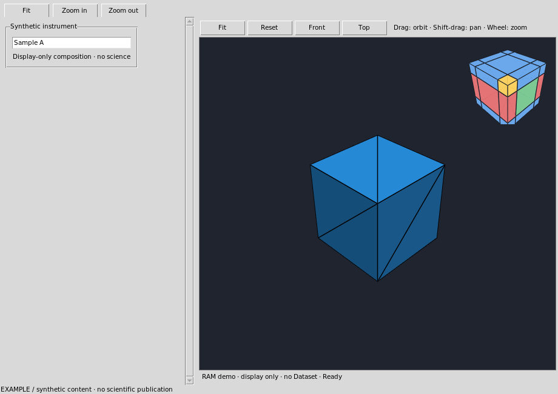
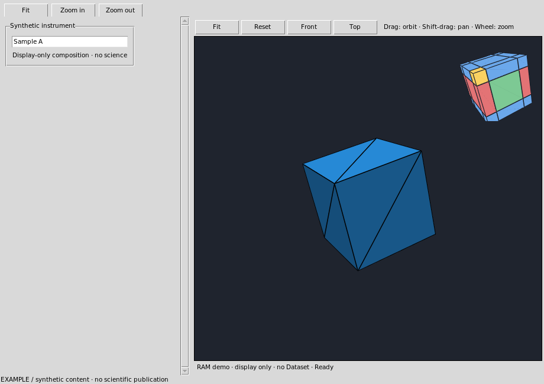

# GX-TXT synthetic example · native3d embedded

This Viewer is composed by the public CORE Viewer GUI Host.
Unbound actions report not_connected and do not start scientific Jobs.
Help displays this installed module’s manual and metadata.

## Developer handlers

Edit handlers.tcl. Each declared handler receives (window, action).
Read component values with ::GX::viewerGuiDesignValues. Use the public
Source/Plot setters, Script Job and Dataset publication services for domain work.
Keep scientific operations inside explicit handlers, never at file top level.
Regeneration preserves handlers.tcl byte for byte.

## Embedded Native3D viewport

This design requires the public `NATIVE_3D_GUI_HOST_API_v2` contract, version 2,
provided by CORE in GX-TXT dev107. The generated connector declares that capability;
it does not depend on an exact unrelated Analysis or Viewer module release.

Open this installed Viewer from the standard Viewers catalogue. Its `native3d`
component is a child of the Viewer, with an independent scene, camera and worker.
Drag the viewport with the left pointer button to orbit. Shift-drag pans. The
mouse wheel zooms. Use the native Fit, Reset, Front and Top controls to recover
a useful view. Arrow keys orbit; F fits and R restores the isometric view when
the viewport has keyboard focus. The orientation cube is a rendered orientation
indicator; direct cube-face clicking is not an exposed interaction contract.

A short pointer click performs actual native geometry hit testing. Selection
receipts identify the layer and native world/local hit; no scientific edit or
Dataset publication follows from selection. Resize or hide/show a containing tab
without transferring the camera to another Viewer. Closing this Viewer releases
only its own worker and callbacks.

### Presentation properties

Builder exposes bounded width/height, perspective or orthographic projection,
camera position/target/up, world axes and orientation-indicator visibility.
Apply these in the normal property inspector, then Save/Open the design. These
are presentation settings, not scientific coordinate calibration.

### Explicit demonstration and scientific bindings

A component with `demo=1` renders a deterministic RAM cube and axes. This is
explicitly synthetic, display-only content, with no Session, Dataset or files.
A component without that flag starts empty until an authorized handler explicitly
binds a source through the public CORE host. Gallery and Runtime Test are distinct
modes; an ordinary unconnected scientific action remains `not_connected`.

For real data, obtain the opaque viewport handle from the public Viewer host
and call `native3DViewportBind` with `kind scientific`, the registered module
and provider. CORE resolves the current Dataset identity, units and Session
revision through its public provider and Dataset owners. No raw user-file path
or private renderer state is accepted by this binding. Stale scientific identity
blocks interaction until an explicit valid rebind. `native3DViewportUnbind`
returns the component to its empty state.

The full contract is in the installed public API guide
`NATIVE_3D_GUI_HOST_API_v2`: create/configure/bind/unbind/update, navigation and
camera, command/pick, subscribe/unsubscribe, inspect and release. Native rendering
errors are reported visibly; rebind only after correcting the source or runtime
problem. This guide does not claim unsupported mesh editing or scientific output.

## Installed example walkthrough

This complete example uses an explicitly synthetic cube and axes in RAM. It
requires no scientific Session or input file. Open **Viewers → Designed Viewers
→ Native3D example**. The outer Fit/Zoom controls,
View menu and context menu use the same public embedded host as its native
Fit/Reset/Front/Top controls. Press F1 for this installed guide.

Drag in the dark viewport to orbit, Shift-drag to pan and turn the wheel to
zoom. The example inspector is ordinary local presentation state. Closing the
Viewer releases its own worker. Reopen it to obtain the deterministic initial
scene; no canonical Dataset, scientific output or Workspace is published.

The editable declaration is shipped with Viewer Interface Builder at
`examples/native3d_embedded.gxtxt-viewer`. Its independent `handlers.tcl` is
preserved byte for byte by generation. The example's native view actions are
CORE presentation commands; no scientific handler is falsely reported connected.
