# Viewer Development Workspace

Create and edit a restricted C++ Viewer without opening a scientific Session.
Open **Viewers → Interface Tools → Viewer Development Workspace**. The adjacent
Viewer Interface Builder remains the visual design owner; its Component Gallery
supplies display-only examples through the same public native constructors.

## Project workflow

1. Choose **New project** and an existing parent directory. The environment creates
   a new project directory, source skeleton, inert Builder design, facility
   requests and provenance. An existing nonempty project is never overwritten.
2. Edit **C++ handlers** in the shared source editor. Native selection, Copy/Paste,
   Undo/Redo, Find, syntax colors, physical lines and supported folds belong to
   Source Surface. The separate C++ debugger runs admitted source through the fixed compiler and real GDB/MI backend.
3. Save source with **Save / Ctrl+S**. A dirty close asks Save, Discard or Cancel.
   The Builder design and generated reports are read-only here; edit visual
   hierarchy/properties with the existing Interface Builder.
4. Choose **Validate** (Develop menu or toolbar; F5 starts/continues Debug). This runs the real Clang raw lexer, then resolved AST
   admission and project/facility checks. Validation does not produce object code.
   Diagnostics identify file, physical line, column and reason; double-click a
   diagnostic to select its source line.
5. Choose **Build / F6**. The same validation runs again before a fixed compiler
   command creates the author object and trusted adapter, then links a bounded
   native library. Source, SDK, policy, design, compiler and binary SHA are retained.
6. Choose **Demo / Preview / F7**. Policy is checked before constructing the
   declared interface. C++ events execute in a separate bounded worker. The
   public CORE applies only typed admitted UI operations to the actual Viewer.
   The default Open event creates the same Native2D RAM fixture used by Gallery.
7. Invoke **Run C++ handler** in Preview. The sample uses public Numeric
   `array_binary.add` to convert the synthetic value 18 to 291.15 kelvin, updates
   a numeric readout, writes a constant explanatory label and increments state.
   It creates no scientific Dataset, Workspace or publication.
8. **Test / F8** exercises the compiled handler through the same backend. Inspect
   its explicit event/state/output receipts; a passing source-policy result alone
   is not a native GUI or scientific correctness result.
9. **Export candidate** revalidates/rebuilds and creates a normal Viewer ZIP with
   source, Builder design, trusted facade, SDK contract, native binary, provenance,
   validation/build reports and checksums. Export does not install. Review and
   promotion use the ordinary Plugin Manager.

The bottom notebook separates diagnostics from bounded build/runtime output.
Complete JSON receipts remain in `derived/`; the GUI truncates very long display
logs explicitly. **Cancel** terminates only the request's owned process tree.
Closing a Preview cancels its own native request and releases native children.
Another Preview or the original scientific data is not its cleanup target.

## Files and preservation

- `handlers.cpp`: original hand-authored C++; regeneration/build never replaces it.
- `project.json`: inert identity, language/profile, approved capability requests
  and provenance. Extra compiler, policy, include, dependency or adapter flags fail.
- `design.gxtxt-viewer`: the existing inert Builder schema, not executable Tcl.
- `derived/validation.json`, `build.json`, `run.json`: independently produced
  reports. Editing a report cannot authorize a future build, run or export.
- `derived/viewer.so` and `trusted_adapter_v1.cpp`: generated artifacts, separate
  from original source. Stale binaries are never run after source rejection.
- `candidates/<package-hash>/`: ordinary review packages and SHA-256 files.

Project imports first pass the actual Clang raw lexer/resolved AST and facility
checks; rejected imports do not replace the editor buffer. Source Save uses the
same project-write tool grant as CLI. Invalid C++/JSON can be saved for repair,
but cannot pass future Build/Run admission. No code runs on import. The compiler/AST policy must admit source before any
native execution. No authored Tcl hook, build script, external header or alternate
compiler command is accepted. Reopening the same project preserves its original
source bytes. A changed source/design during validation or execution is refused
rather than silently applied to another revision.

## Configure a real event test

`project.json` contains `tests` with 1–8 typed `events`, an `expected_counter` and
an `expected_values` map whose keys are scalar slot indices0–15. The generated
sample runs Open, Invoke18 and Invoke20; expected counter2 and slot0=293.15.
Test compiles and executes those events in order, carrying returned state into
the next bounded worker invocation. Inspect `derived/tests.json` for every
actual event and public Numeric receipt. These developer expectations cannot
change the source policy or replace independent GUI/native acceptance.

## Exact C++ SDK v1

CORE automatically supplies `gxtxt_viewer_sdk_v1.hpp`. Authors write no includes.
The SDK exposes `gx::Host`, `gx::State`, `gx::Event` and `gx::EventKind`. State has
sixteen bounded scalar slots (`values[0]` through `values[15]`) and a uint32
counter. Event has a kind, declared component index and finite scalar value.
The GUI delivers Open(kind0), action Invoke(kind1) and explicitly declared numeric
change_action(kind2) events with the real component index and finite scalar
value. For legacy template compatibility, an exact design field ID `temperature`
still supplies its current value to Invoke. New generic projects should use
declared action `event_value` and explicit numeric change_action controls;
without that legacy field, an unvalued action receives0. Other enum values are reserved/test inputs; native picks
remain public host event traces rather than automatically delivered C++ events.
The strict entrypoint is:

```cpp
void on_event(gx::Host& host, gx::State& state, const gx::Event& event) {
    if (event.kind == gx::EventKind::invoke) {
        state.counter += 1;
        state.values[0] = host.numeric_add(event.value, 273.15);
        host.number(1, state.values[0]);
        host.text(2, "Synthetic temperature in kelvin; display only.");
    }
}
```

The automatically supplied Host methods are:

| Method | Exact effect |
| --- | --- |
| `text(unsigned component, const char* value)` | Set declared label/status text, bounded UTF-8 literal. |
| `number(unsigned component, double value)` | Set a compatible presentation value; finite scalar only. |
| `flag(unsigned component, bool value)` | Set a compatible boolean presentation control. |
| `numeric_add(double left, double right)` | Public Numeric array_binary.add; finite scalar result. |
| `numeric_sqrt(double value)` | Public Numeric array_unary.sqrt; explicit grant and nonnegative scalar. |
| `numeric_exp(double value)` | Public Numeric array_unary.exp; explicit grant and finite scalar. |
| `diagram_open(unsigned component)` | Bind/create a declared canonical diagram through the existing document owner. |
| `diagram_tool(unsigned component, const char* tool)` | Select an explicitly admitted catalog/edit tool in the shared viewport. |
| `diagram_command(unsigned component, const char* command)` | Invoke bounded existing properties/rotate/delete/fit and editing commands. |
| `scientific_discover(unsigned form)` | Read approved local/registered destination capabilities into the declared form. |
| `scientific_prepare(unsigned diagram, unsigned form)` | Validate the canonical diagram and form; retain deterministic netlist/source receipt. |
| `scientific_submit(unsigned form)` | Submit that guarded preparation through existing Scientific Execution/Script Job. |
| `scientific_status(unsigned form)` | Read the exact current Job state/progress. |
| `scientific_cancel(unsigned form)` | Request cancellation of the exact owned Job; completion is asynchronous. |
| `scientific_reconnect(unsigned form)` | Reconnect the same durable Job without resubmitting. |
| `scientific_log(unsigned form)` | Read bounded actual Job/provider log; offline errors remain visible. |
| `scientific_import(unsigned form, unsigned dataset_selector)` | Publish completed result through canonical Dataset services and set its selector. |
| `plot_discover(unsigned form)` | Read canonical Dataset/Variable metadata for declared waveform controls. |
| `plot_bind(unsigned plot, unsigned form)` | Bind explicit X/Y variables to the existing public Plot owner. |
| `numeric_discover(unsigned form)` | Read actual canonical variables/units without changing explicit row counts. |
| `numeric_evaluate(unsigned form)` | Use declared public Numeric profile; retain immutable canonical result. |
| `numeric_statistics(unsigned form)` | Run the explicitly selected public reduction/statistics and persist its result. |
| `numeric_compare(unsigned form)` | Compare selected observed/reference rows with explicit relative floor via Numeric. |
| `numeric_publish(unsigned form, unsigned dataset_selector)` | Publish captured values/X/units/provenance into the canonical Dataset owner. |
| `demo(unsigned component, unsigned fixture)` | Display-only RAM fixture:0 Native2D,1 Plot,2 Native3D; no scientific source. |

Indices identify components in the exact validated design declaration order,
starting at one. Unknown components, incompatible types, undeclared facilities
and nonfinite/bounded-output violations fail the event. No raw widget path,
framework pointer, Dataset file path, Tcl command or generic expression reaches
the author. SDK implementation pointers remain private and live only in the
isolated worker; no authored library is loaded into the Tk process.

Supported syntax is deliberately small: automatic scalar locals, ordinary scalar
expressions, if/switch/loops, scalar helper functions, fixed event/state references
and enumerated SDK member calls. Array indices must be literal 0..15. Recursive
call graphs, globals, namespace/type definitions, external declarations, function
pointers, casts/address-taking, allocation, lambdas, assembly, exceptions and
unrecognized AST forms are rejected. This is not the full C++ standard library.

There is no authored `#include`, macro/pragma, module/import, precompiled header,
include search path, linker flag, dynamic loading, native GUI toolkit, I/O,
filesystem/network/process facility, stdio/iostream, standard math library or
private scientific fallback. Use approved public numerical facilities for
scientific operations. A missing SDK facility requires CORE review.

## Profiles and API Explorer

**Public APIs** lists the actual installed module API descriptors and registered
CORE discovery entries. It shows provider, version, availability, exposed SDK
subset, allowed operations, request/result shapes and exact authorization reason.
An API may be installed and still be outside the SDK. No generic Invoke-any-API
button is provided.

`synthetic_view_v1` grants the approved GUI/native-demo subset.
`numeric_view_v1` adds the explicitly declared public numerical subset.
Projects request only operations already present in the trusted policy; project
metadata cannot expand that policy. Canonical Workspace/History effects are
outside these initial read-only author profiles; their inert Gallery samples
remain available in Builder. The explicitly admitted `document_view_v1` and
`scientific_view_v1` profiles add declared canonical diagram or Numeric-form
Workspace/History contracts; they require exact public capabilities and source
guards. Existing read-only profiles retain their restrictions. Python authoring
is disabled independently of the ordinary Python Script Workspace.

For missing/disabled/version-mismatched public capabilities, validation creates
`derived/CORE_API_GAP.json` with the requested API/version/operations, closest
known owner and a CORE-maintainer contract request. An installed but unauthorized
operation is **CAPABILITY_DENIED**. Neither condition adds a dependency or uses a
private fallback. After an authorized CORE SDK extension, revalidate explicitly.

## Shared CLI for human developers and agents

The CLI executes the identical policy, compiler, runner, public broker and package
writer as the GUI. Run from the framework directory with an absolute project path:

```sh
core/bin/gxtxt-viewer-dev init /absolute/projects/thermometer --module-id viewer.thermometer
core/bin/gxtxt-viewer-dev validate /absolute/projects/thermometer
core/bin/gxtxt-viewer-dev build /absolute/projects/thermometer
core/bin/gxtxt-viewer-dev run /absolute/projects/thermometer --event '{"kind":1,"component":4,"value":18.0}'
core/bin/gxtxt-viewer-dev test /absolute/projects/thermometer
core/bin/gxtxt-viewer-dev export /absolute/projects/thermometer
core/bin/gxtxt-viewer-dev api /absolute/projects/thermometer
```

JSON results are machine-readable. GUI transport uses `--tcl` over the existing
managed-request protocol, with the same underlying result fields and hashes.
There is no looser agent mode. The packaged Clang 19.1.7 driver requires the tested
Debian libclang-cpp19/LLVM19 and ordinary native system runtime libraries. Its
compiler SHA, package provenance and copyright are under `core/development/toolchain`.
No private task-workspace compiler path is required by a distributed project.

A trusted launcher can give an external author this explicit process-tree grant:

```sh
core/bin/gxtxt-viewer-dev grant /absolute/projects/thermometer -- /bin/bash --noprofile --norc
```

The kernel Landlock grant permits file-content writes, creates/removes and
truncation only beneath that real project directory, while retaining necessary
read access to the fixed SDK/compiler/runtime. Symlinks, hardlinks, special files
and protected project roots are refused. Tested writes to CORE, SDK/policy,
canonical archives and restore assets return EACCES. No sudo or new system
account is required. The GUI backend uses the same grant for build/run work.

This is an explicit tool grant on that process and its descendants, not a claim
that every shell of the existing account is restricted. Landlock does not cover
all filesystem metadata operations; no hostile-native-code certification is
claimed. Compiler/native processes also have finite time, address-space, output
and process-group cleanup limits. See the independent release evidence for the
actual denial/crash/timeout cases, rather than treating source-policy PASS as an
absolute operating-system security guarantee.

The implementation uses the real [Clang AST](https://clang.llvm.org/docs/IntroductionToTheClangAST.html)
and Linux [Landlock](https://docs.kernel.org/userspace-api/landlock.html) interfaces;
its guarantees remain limited to the exact tested project/profile and mechanisms.

## Native GUI walkthrough

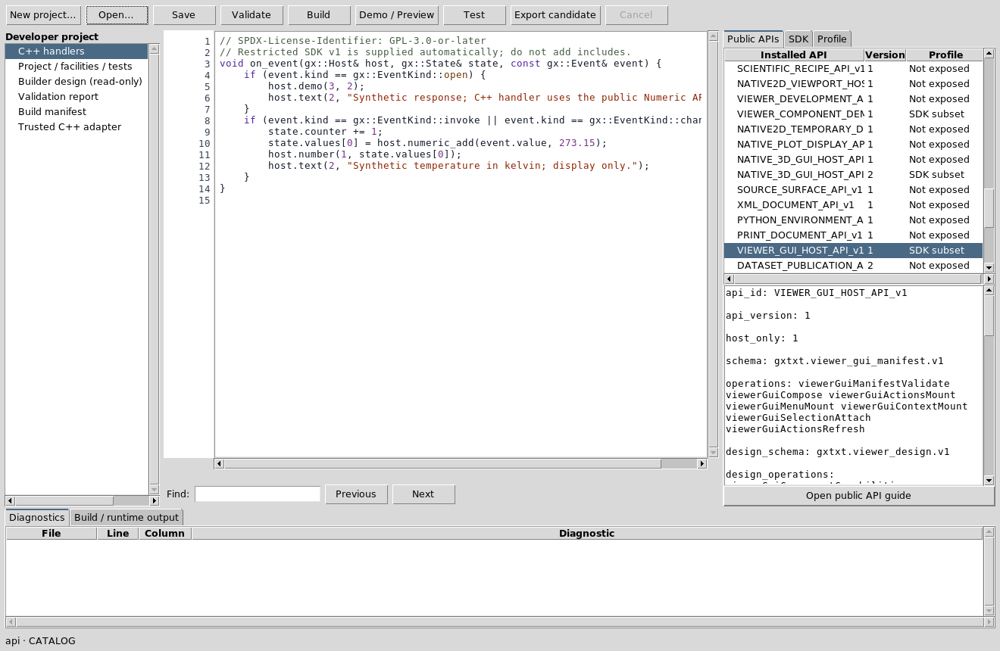

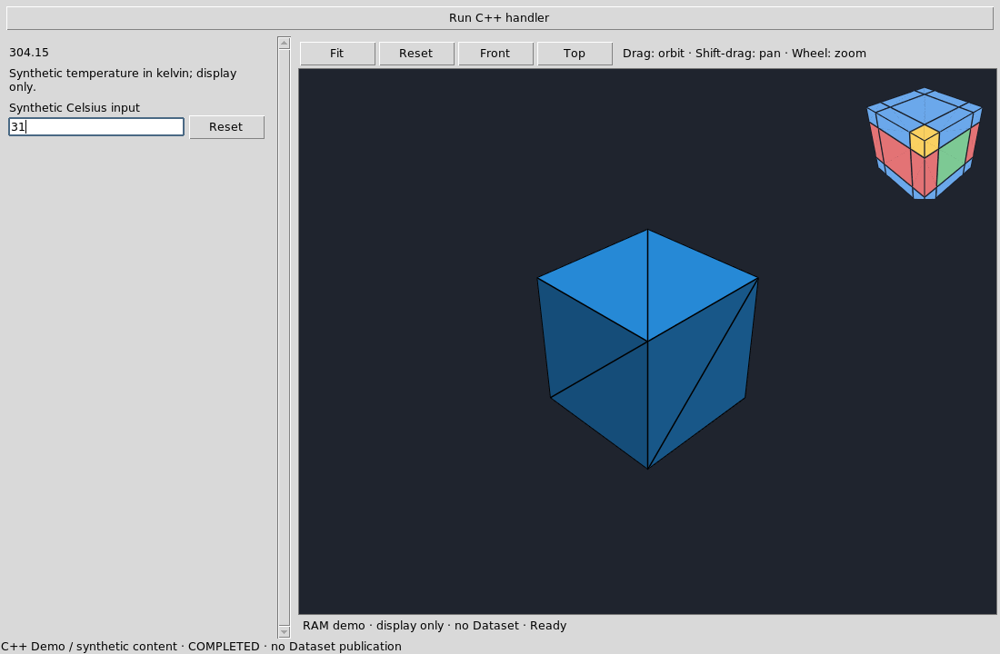

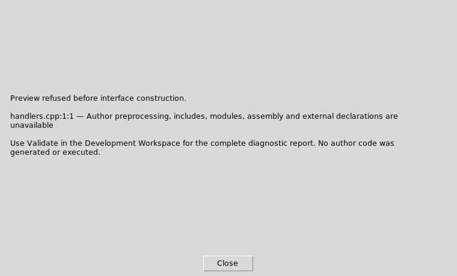

The Native3D example receives a real numeric change event for31°C and displays
304.15K through public Numeric. Its C++ Open event binds fixture2 through the
same public v2 host used by Gallery/Builder. Orbit/pan/zoom remain native.
The runtime retains exact C++/design/project fingerprints; changing any source
requires reopening Demo. CLI and GUI revalidate before build/run and discard
incomplete/stale output. The common footer distinguishes compiled-event state
from the native viewport's separate rendering state.

## Complete copyable source projects

The installed `examples/temperature_native2d/` and
`examples/temperature_native3d/` directories each contain the original
`handlers.cpp`, inert `design.gxtxt-viewer` and exact `project.json` facility/test
manifest. Copy a directory into your writable workspace before opening it.
Both use the same public Numeric conversion and actual renderer owners described
above; neither publishes a Dataset. Read each README for the expected first value.

For a generated catalogue tile, choose a concise design title or set the normal
Viewer descriptor's `short_title` during authorized package review. The full
Viewer name remains available in its title, catalogue tooltip and module metadata.
The official examples use concise captions; their original source designs and
C++ handler bytes remain intact.

## Real restricted C++ debugging (dev108)

The debugger controls **actual admitted `handlers.cpp`**, compiled by the same
fixed Clang19/SDK/AST owner as normal Build/Run. Debug uses `-O0 -g3 -fstandalone-debug` and explicit
source path mapping; GDB/MI runs the same separate native ABI worker. Numeric and
SDK calls retain the exact normal admission/public broker contracts. Debugger
execution and its returned operation plan are distinct from a scientific GUI
submission; no scientific Job is implied by inspecting a scalar event. There is no arbitrary GDB
console, expression evaluator, compiler option or author process permission.

Open/save `handlers.cpp`, wait for source structure, set a breakpoint in the
compact red-dot gutter or with F9, then choose Start Debug. A yellow arrow marks
the actual selected native source line; its lane is separate from folding and
physical line numbers. A hollow red dot is disabled. Blank/comments are refused;
GDB may relocate a requested non-executable C++ line to its actual instruction.
Check the native stop line rather than assuming every source line has code.
Breakpoints are locked during the active immutable Debug snapshot; Stop before
changing them. Source/design/facility changes cancel stale binary execution.

| Control / shortcut | Native meaning |
| --- | --- |
| Run / Ctrl+F5 | Execute the admitted event through the normal bounded worker. On the tested Debian XFWM desktop Ctrl+F5 is reserved for workspace5: use the native Run button or focus it and press Space. The intercepted shortcut is not certified here. |
| Start Debug / F5 | Admit/build the current source and start genuine GDB; while paused F5 continues. |
| Continue | Resume to the next actual breakpoint, failure or completion. |
| Pause | Asynchronously interrupt the running native inferior through GDB/MI. Very short events can finish before Pause arrives. |
| Step Into / F11 | Execute the next source step, entering a real called function. |
| Step Over / F10 | Execute the current statement without entering a called function. |
| Step Out / Shift+F11 | Finish the actual selected executing function and stop in its caller. |
| Stop / Shift+F5 | Cancel the owned managed debugger/native process tree. |
| F9 / Ctrl+Shift+F9 | Toggle / clear editable source breakpoints before a Debug Job starts. |
| Build F6 / Demo F7 / Test F8 | Existing authoring stages; distinct from scientific execution. |

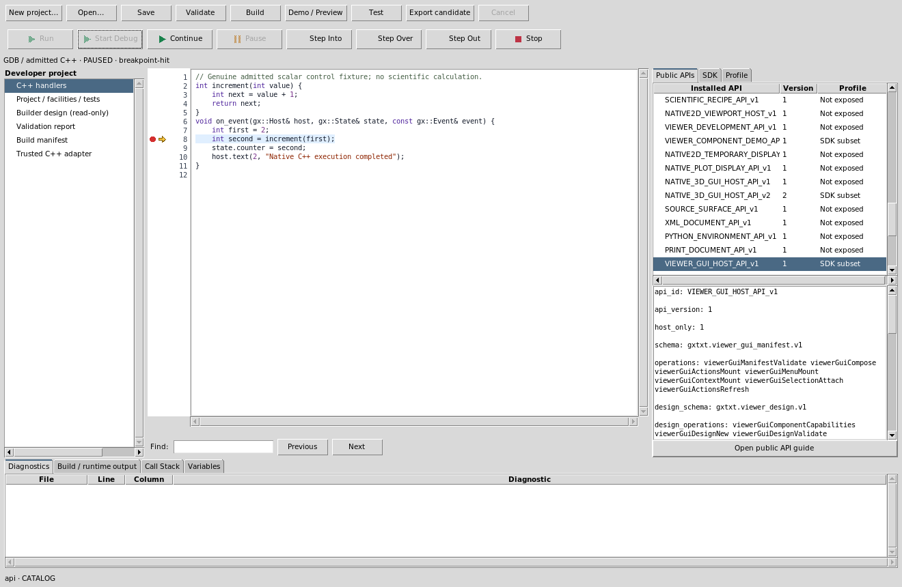

The lower **Call Stack** contains actual native function/file/line identities.
Select a permitted frame to inspect its genuine local values and source line;
inspection is not program execution. **Variables** shows bounded values from
GDB, not invented source evaluation. A value before assignment can be unavailable
or uninitialized; Step Over the assignment before interpreting it. Trusted ABI
and interpreter frames can appear in the native stack. The **Build / runtime
output** tab retains actual structured diagnostics and execution receipts;
**Diagnostics** rows still navigate the source.

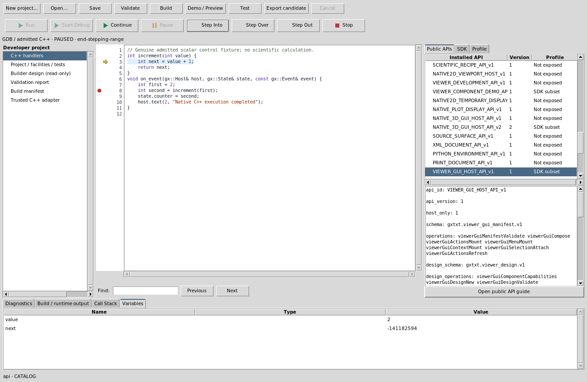
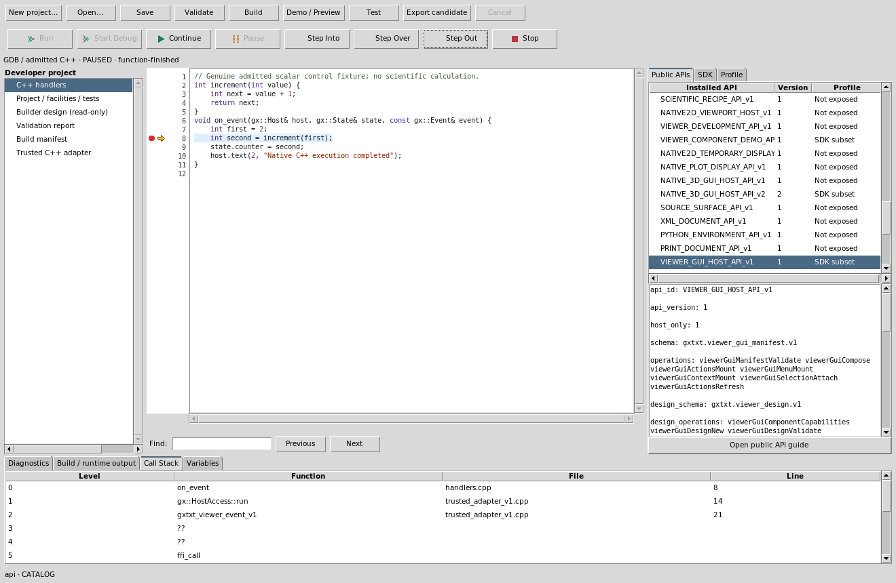

Use **View** to hide/reopen Debugger toolbar, Call Stack, Variables, Output and
Diagnostics without destroying source. Source and API panes remain ordinary
splitter panels. Resize or use a narrow window, then restore panels before
claiming layout recovery. Closing cancels the owned active backend. Active
execution remains bounded by the existing CPU/wall policy; paused inspection is
limited to 15 minutes. Stop/timeout/crash discards partial authored UI operations.

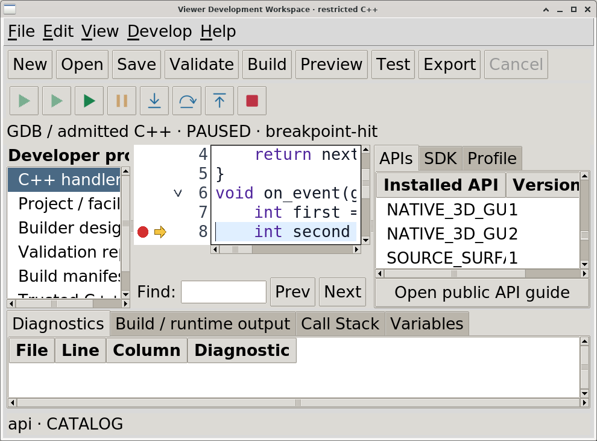

### Worked restricted C++ project

Create a project, use Builder to declare a status/label at component2, then save:

```cpp
int increment(int value) {
    int next = value + 1;
    return next;
}
void on_event(gx::Host& host, gx::State& state, const gx::Event& event) {
    int first = 2;
    int second = increment(first);
    state.counter = second;
    host.text(2, "Native C++ execution completed");
}
```

This scalar control fixture demonstrates debugger mechanics, not scientific
computation. Break on the call to `increment`, Start, Into, inspect `value`,
Over, Out, then Continue. Observe `state.counter=3` in the actual native result.
For scientific work, use only explicitly admitted public Numeric/Math/Stats SDK
operations; no direct numerical library or arbitrary imports are exposed.

### Author SDK, Builder and CORE-gap handshake

The same approved CLI supplies `api`, `save`, `check_source`, `validate`, `build`,
`run`, `test`, `export`, `builder`, `facility_request`, `debug`, `debug_status`,
`debug_control`. All post-init stages enforce the existing Linux Landlock
project-write tool grant. This is actual process-tree write confinement, not an
account-wide or hostile-code guarantee. The current allowlist is authoritative;
installed public APIs not admitted to this SDK are discovery only.

`builder` reads typed JSON operation/arguments on stdin and invokes the same
public model/validation/Undo/Redo as the GUI. For example:
`{"operation":"metadata","arguments":["title","Circuit Workbench"]}`.
Icon import uses the same bounded safe PNG/SVG resource owner; logical IDs,
hashes/license and bytes survive export as relative `resources/icons` assets.
For command toolbars, menus and context menus, select the existing command in
Builder's typed Icon Library **Command target** control, then Assign. The
container's `command_icons` dictionary binds resources to its existing action
IDs; icon edits retain those callbacks and true enabled/disabled state. Use the
Builder integrated manual's command-icon walkthrough for supported native menu
states, presentation restrictions, previews and generated/installed examples.
Action `event_value` is an optional explicit finite scalar payload. Unvalued
actions deliver0; changed scalar fields deliver their normalized current value.
The temperature template explicitly declares18; its retained exact-ID
`temperature` field compatibility supplies the current value when present.
Generic projects without that legacy field use explicit payloads/default0.

A missing admitted function must produce a real denied call and a project
`CORE_API_GAP` via `facility_request`. The public API manual defines all required
fields. Requests under `requests/` are immutable and include source/design hashes;
same-ID identical submissions are idempotent, altered submissions are rejected.
The CORE maintainer investigates existing owners, extends the minimal shared
contract and allowlist, then the same author reruns the same failure. Do not
write private Tcl, files, solver processes, math, renderer or queue fallbacks.

Help → Developer manual / F1 opens this integrated reference. Help → About uses
the common documentation service and current installed descriptor metadata.

### Native worker limits, failures and Session scope

The current trusted native worker policy is3 CPU seconds,256MiB address space,
1MiB file output and zero core dump. Debug adds12 seconds of active wall time
and a900-second paused inspection lease. CPU can terminate an admitted busy loop
before the active-wall limit. The actual snapshot/Build-runtime output records
effective policy, state and backend reason. A SIGKILL alone proves a signal,
not which resource limit caused it; the GUI states this explicitly. Read the
diagnostic instead of relabeling every signal a timeout. COMPLETED means normal
completion, CANCELLED means managed Stop/close, REJECTED means source admission
failed before execution, FAILED carries native/backend errors; TIMED_OUT requires
an actual recorded timeout. Stop waits for owned worker/backend cleanup; old
stack/locals/arrows clear and reopening starts neutral.

The scalar C++ debug project is independent of a scientific Session. Switching
Sessions does not turn its admitted local scalar run into a scientific callback.
Installed scientific Viewer operations remain separately Session/source guarded.
The debugger does not grant a GDB console, arbitrary evaluation or direct I/O.

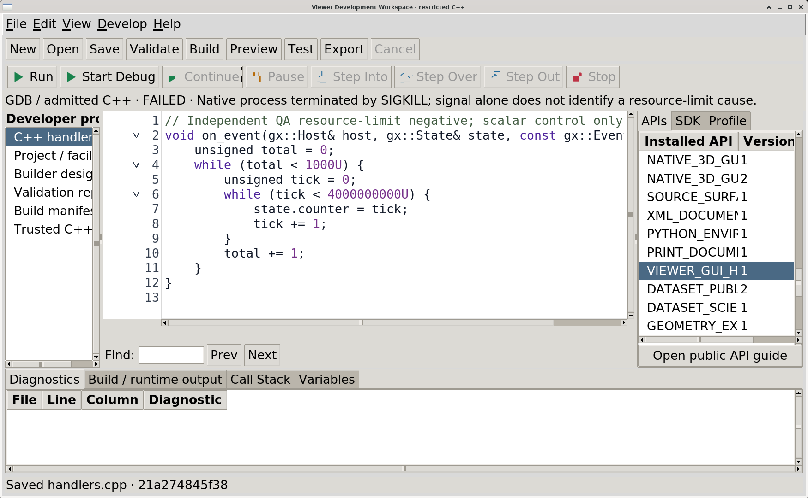

### Read-only inspection, installed native testing and illustrated export

The Source browser opens project files and the supplied SDK. Approved CLI
`inspect --target` accepts only `handlers.cpp`, `project.json`, `MANUAL.md`,
`design.gxtxt-viewer`, or `sdk_v1`; it returns exact UTF-8/bytes/SHA and never
executes the inspected text. `api --document VIEWER_GUI_HOST_API_v1` reads a
catalogued public manual without an arbitrary path. Discovery is not a runtime
capability grant; required public operations must also be explicitly admitted
in project metadata and the current SDK/AST policy.

The fixed Numeric companion is available through
`api --document NUMERIC_EXPRESSION_OPERATIONS` (optional `.md` suffix). It returns
the exact installed `NUMERIC_API_v1` expression-operation manual, including
grammar, functions, units and constants such as `pi/e`. The existing fixed
`VIEWER_GUI_DESIGN_v1` companion likewise belongs to its GUI Host owner. These
are enumerated public documents, not new API identities or arbitrary linked-file
readers; unknown/private paths remain denied.

Ordinary C++ troubleshooting can use approved `debug`, `debug_status` and
`debug_control` directly: set practical breakpoints, inspect actual execution
state/stack/locals and step/continue through the documented structured operations.
Wait for actual PAUSED/command completion and keep the source/token guards. A
Viewer author need not manipulate or capture the graphical debugger to diagnose
their own C++ problem. A reproducible infrastructure failure belongs to the
Development Workspace owner; retry the original public operation after its fix.
Public GUI status also returns bounded `host_error/error_code` for an early
compiled-request failure, so a completed scientific Job is not mistaken for a
solver failure. After a diagnosed presentation/infrastructure correction, retry
Poll/Publish on the original Job rather than submitting another simulation.

1. Save/Validate/Build/Test the restricted project, then Export its ordinary ZIP.
   Use normal Plugin Manager Install/Update and honor restart-required status.
2. In a dedicated new private GUI-test Session open the same project in
   Development Workspace. Develop → **Enable installed native GUI testing**
   explicitly attaches only its source-identical normally installed Viewer.
   Fixture designation is a trusted administrator/GUI-laboratory action; author
   code cannot designate original user Sessions or global desktop access.
3. Approved `gui_test` JSON operations include open/status/close, capture,
   logical component click/tab/choice/text, bounded diagram pointer/key/property
   and public Plot-point probing. They perform real native input, guarded by
   source/design/project hashes, attachment identity and Session lifetime.
   Focus scrolling reveals notebook headers/controls before clicking. Hidden,
   clipped, occluded, unrelated or stale targets fail explicitly; no raw Tcl,
   widget path, arbitrary desktop coordinate or outside-Viewer input is admitted.
4. `gui_test capture` returns a genuine PNG capture UUID with owner/Session/source
   receipt. `gui_test` request `{"operation":"capture_preview","capture_id":"UUID"}`
   verifies that live RAM-issued capture and delivers its original PNG as bounded
   `image_content` MIME/base64, SHA, dimensions, source/Session and geometry.
   Preview accepts no file path and is limited to2MiB/4096px; it renders original
   pixels without image processing. Unknown/stale/changed captures fail. While
   that attachment is live and unchanged, add a manual image with
   `manual_asset` JSON `{"operation":"add","asset_id":"circuit-native","capture_id":"UUID"}`.
   Only RAM-issued matching native receipts are accepted; manually forging a
   project receipt cannot admit a file. `list` inspects admitted inventory;
   `remove` removes a binding while retaining historical content bytes.
5. Save inert UTF-8 MANUAL.md through approved `save --file MANUAL.md` (at most
   256KiB, no NUL; ordinary C++ source/project metadata remain64KiB), referring
   to a Markdown reference to an installed-module image path `images/circuit-native.png`. Allowed PNGs are bounded to4096²,
   8MiB each,32 images/16MiB aggregate; symlinks, altered SHA/codec, stale sources
   and external references fail. Historical admitted images keep original
   capture source/version provenance; captions must state that version honestly.
6. Export normally. Existing Module packaging includes exact guide/PNG resources,
   inventory/provenance and license. Install/update with Plugin Manager; restart
   and open Help to inspect figures, full-size links and narrow rendering. A
   packaged image is not evidence that the updated GUI itself has been tested.

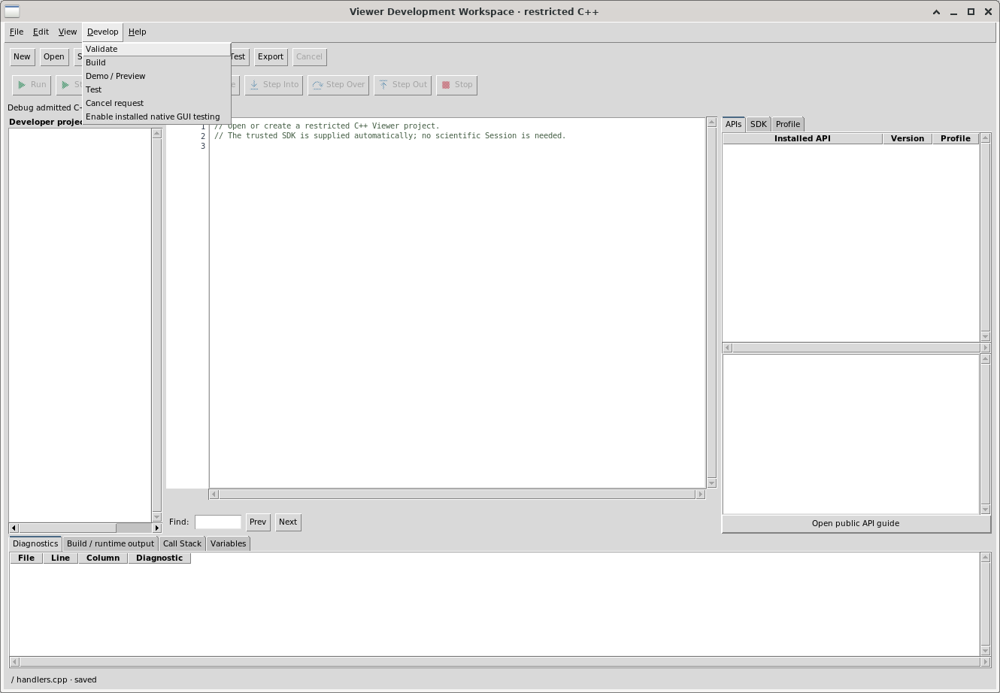

Project reparent preserves all existing SDK declaration positions, including a
control moved into a later-declared parent. Builder hierarchy/Preview derive
construction order; duplicate appends new identities, remove changes indices,
and sibling reorder is a signed layout step. Review structural changes before
building. Existing Numeric sections support explicit expression/interpolation/
complex-projection profiles through the same five methods; API manuals define
typed controls, operation grants, units, explicit row ranges, immutable results,
statistics/comparison/publication and saved restore without recomputation.

Plot forms can reference typed `plot_x_scale`/`plot_y_scale` choices linear/log;
the existing Plot owner validates domains and preserves the last valid frame on
failure. No authored logarithm is needed. Existing source-bound GUI status exposes
bounded native Plot axes/rectangle/tick metadata for real pointer interpretation.
Scientific forms can declare one/two physical sweep axes (component,start,stop,
count,read-only SI unit), enabled/case/admission-worker/fail-fast controls. Public
Numeric creates bounded grids and existing Scientific/Parallel/Script Job services
own actual cases, progress, cancellation and canonical publication. Request the
explicit documented sweep grants; no C++ worker pool or raw array API is exposed.
Restored Job panels identify saved references/last-observed states; Reconnect
reads the same authoritative Jobs without resubmitting. See the public GUI Host
contract for every typed reference and limit.

Use `debug`, `debug_status`, `debug_control` programmatically when they simplify
real C++ troubleshooting. Keep the long-lived Debug request running, poll actual
state/sequence, then send an admitted step/frame/continue/pause/stop with exact
source SHA and optional matching run token. Stack/locals are real backend values.
Report a concise reproducible `CPP_DEBUGGER_BUG` to the CORE owner for correction
and retry of that same operation. Ordinary troubleshooting requires no artificial
exercise or graphical-debugger screenshot; independent GUI QA stays separate.

### Review a saved Workspace after an additive project upgrade

Use **Develop → Review saved Workspace upgrade…** with a saved project and open
Session. Select the earlier canonical Workspace and click **Review selected**.
Inspect the original ID, preserved component count and exact appended controls.
**Create upgraded copy** is enabled only after successful review; it creates a
separately named Workspace, leaving the original payload/revision unchanged.
Close exits the dialog; changing selection disables Apply until another review.
No simulation runs. Normal Workspace export/import copies notes, preview and
nested resources; its archive is added to the original managed resource store.

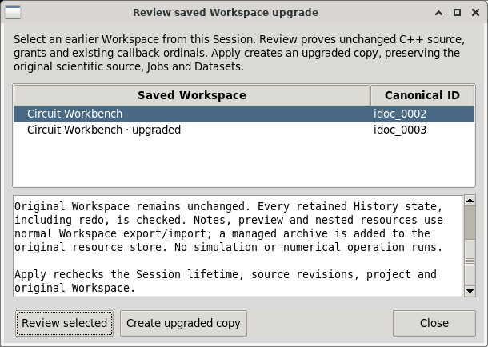

This intentionally narrow policy requires unchanged C++ bytes, profile, grants,
existing declaration ordinals, defaults and callback/scientific semantics. It
currently admits explicit existing Diagram/Plot probe links with a new inert
voltage/current selector, inert presentation controls and reserved navigation
commands. Every retained History state, including redo, is checked; C++ values
and counter remain intact. Changed source, unknown forms/bindings, stale Session,
changed original/source, malformed History or a resource/commit failure rejects
the copy. Any failed new allocation is removed. Older scientific states retain
their provenance and any legitimate stale status; copying never certifies old
results against an edited source.

Open the new ID through normal Session Workspaces. Restricted authors use the
same public `gui_test` operations `workspace_review` with `workspace_id`, then
`workspace_upgrade` with the returned live `review_id`, then `workspace_open`
with the returned new ID. An old exact-mismatch `workspace_open` still rejects.
Tokens belong to the current GUI process/Session/project/original revision; a
new review of that pair replaces its prior token. No author migration scripts,
private payload rewrites or new scientific jobs are required. General C++ source
changes need an independently supported compatibility path.

New saved native states include a trusted callback-contract digest. Icon/layout/
version-only changes can preserve Workspace identity and callbacks; actual C++,
grants, action payload, scalar defaults or component identities remain strict.
Live edited projects still require Close/reopen; old Workspaces without the
digest retain exact-snapshot compatibility. No scientific source guard is removed.

## Declared visibility, canonical source inspection and waveform editing (dev108)

These controls compose existing public Builder, GUI Host, Configuration, Plot,
History and Workspace owners. A declared presentation handler is dispatched by
the existing host; it does not need an authored C++ pane/series renderer, a new
SDK method, arbitrary Tcl, file access or another execution framework. Existing
scientific/diagram grants still apply to the source and result being inspected.
See `VIEWER_GUI_HOST_API_v1` for exact admission and `VIEWER_DEVELOPMENT_API_v1`
for the constrained author tools. API discovery alone grants no operation.

### Typed wire editing and uninterrupted History branches

Select an existing wire stroke and open Properties. Start/End terminal choices
refer to existing stable component pins or explicit junctions. The ordered bend
table exposes typed X/Y fields, Add/Replace/Remove and Move up/down. Add inserts
after the selected row, or appends without a selection. Close discards unapplied
draft changes; Apply commits one guarded canonical route edit with the same wire
ID. The body scrolls and buttons wrap at the480x320 minimum dialog size.
The canonical route supports128 finite bends within+/-1000000 display units;
initial wire drawing retains its64 pending-point bound. Crossings and bends
cannot create implicit electrical junctions. An external source change while
Properties is open requires closing/reopening before Apply.

Invalid values, duplicate component names, invalid endpoints/equal endpoints,
malformed routes and stale sources are refused before a History branch can
discard redo. A valid older-state edit still asks to branch; accepting preserves
the current native editor, selection and focus so the next keyboard edit works.
Cancelling preserves the exact source/History and produces no Tk background
error. Ordinary Undo/Redo/navigation continue to restore their snapshots and may
clear transient selection. Rapid wire end/start clicks at a common explicit
junction remain routing input; only Select-mode double-click opens Properties.

Approved author CLI `gui_test` uses the same public `property` fields `start`,
`end`, `point_x`, `point_y`. `wire_route` accepts `component` and `command`
`add/replace/remove/up/down`, or `command:select` with integer zero-based
`index:0..127`. It clicks the actual owned controls/Tree row and accepts no widget
path or arbitrary route payload. `status.properties.COMPONENT` reports only the
mapped owned wire editor's source receipt, stable ID, typed draft/choices and
visible error. `properties_commit` and `properties_close` click Apply/Close.
Undo/Redo and normal saved Workspace restore retain committed bends/topology.
See `NATIVE_2D_GEOMETRY_API_v1`, `NATIVE2D_VIEWPORT_HOST_v1` and
`VIEWER_DEVELOPMENT_API_v1` for exact operations and source guards.

### Builder checked View controls and retained layout

Select the declared component in Builder and edit its public properties. A
`toggle` or native `checkbutton` declares `component_visibility TARGET_ID` and an
explicit boolean `default`; omit `change_action`. An ordinary `action` can use
the same property with its own distinct presentation handler. For a `menu`,
`context_menu` or `command_toolbar`, declare `visibility_commands` as a mapping
from an existing action ID to the target component ID. Every mapped action must
occur in that surface's `actions`, and its handler must have `effect presentation`.
For example, declare a panel `source_panel`, a toggle with
`component_visibility source_panel` and `default 1`, and a View menu containing
`view_source` with `visibility_commands {view_source source_panel}`. Declare
`view_source` as a presentation handler accepting `{window action}`. The public
Builder JSON route uses the same property validator; inspect its capabilities
before supplying typed property values.

A command has one consistent target even when presented in multiple surfaces.
Multiple booleans for the same target must agree on their default. References to
undeclared/foreign targets, mutating handlers, reserved Undo/Redo/Fit/Zoom IDs or
Workspace/History/Help/command surfaces are rejected. A contradictory declaration
is an error, not a hidden preference. Ordinary command icons, callbacks and true
native enablement retain their behavior; check state means declared visibility,
not command enablement or whichever notebook tab currently happens to be mapped.

Preview and the generated/installed host synchronize boolean values and checked
View/context rows. Hide/show retains the same grid/pack children, notebook pages
and split-pane members in their original order. It keeps widget/native handles,
field values, bindings and scientific source authority. Hiding moves focus out
of hidden content; showing does not steal focus or select an optional notebook
tab unnecessarily. An accepted native boolean/action/menu input records one
ordinary History step. Programmatic restoration synchronizes the committed field
baseline without an authored callback or an extra History step. Undo/Redo and
normal Workspace Save/Open retain visibility; saved state takes precedence over
new-design defaults. Keep a reachable control outside hidden content to show it
again, then test both narrow layout and keyboard focus.

The corresponding public host calls are
`viewerGuiDesignComponentVisible window component boolean` and
`viewerGuiDesignComponentVisibleGet window component`. The latter reports
explicit presentation visibility even for an unselected notebook page. Normal
Module generation marks these declarations as requiring dev108, including a
design without icons.

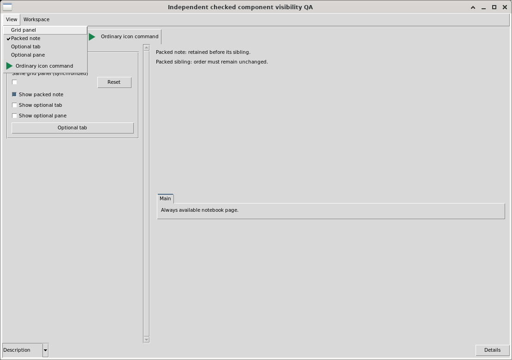

### A distinct canonical source/netlist pane

For an existing circuit Scientific `section` with
`scientific_provider core.ngspice.circuit`, declare all three references:

| Section property | Required declared control |
| --- | --- |
| `scientific_netlist` | A separate read-only `log`; it must differ from the changing scientific Job log. |
| `scientific_netlist_diagram` | The existing `electrical.basic` Native2D component supplying canonical source identity. |
| `scientific_netlist_action` | Its own presentation handler, bound to an ordinary action/menu control. |

The host intercepts that handler and calls
`viewerGuiDesignScientificNetlist window form` through public
`scientificExecutionCircuitInspect`. Press the declared Inspect action explicitly.
With an admitted Job/sweep, it reconstructs the **selected case's** actual
parameters using the same registered converter/version. It checks original
source ID/generation/revision/SHA, provider, Job/case and published canonical
Dataset association/integrity. Current form edits do not relabel a completed
case. Without a Job, inspection uses current declared form parameters. The pane
identifies source/provider/version, parameters, Job and Dataset; its deck is a
validated canonical reconstruction, not a fetched remote artifact or simulation.

The complete deck is limited to32KiB; excess is rejected rather than silently
truncated. Foreign/missing case/publication, changed source/provider or invalid
circuit produces an explicit error while retaining scientific identities. A
changed selection makes an older cache stale until explicit Inspect. The bounded
`scientific_netlists` domain record stores validated context and full text through
normal Workspace/History. Restore displays it only if current canonical context
still matches, otherwise a stale/unavailable explanation. Undo to a state with no
saved inspection clears the old deck; Redo can restore its valid saved cache.
Save/Open, Undo/Redo and hide/show never call the converter, Numeric, submission,
status polling or remote protocol automatically. Keep this read-only pane and
its visibility independent of the Job log and waveform.


### Complete declared Plot series/panel profile

Start with a normal Plot form and its canonical Dataset/X/Y/Discover/Bind controls.
Add the following complete profile on its `section`; partial profiles reject:

| Property | Type / role |
| --- | --- |
| `plot_series` | Choice/combobox of current stable trace IDs. |
| `plot_series_label` | String field/entry for the selected trace label. |
| `plot_series_axis` | Choice/combobox with exactly `left right`. |
| `plot_series_enabled` | Toggle/checkbutton selecting trace enablement. |
| `plot_panel` | Choice/combobox of current canonical panel IDs. |
| `plot_panel_title` | String field/entry for a new panel title. |
| `plot_series_target` | The declared Plot whose `plot_form` points back to this section. |
| `plot_series_commands` | Existing action ID to one fixed operation below. |
| `plot_series_status` (optional) | Separate read-only log/label/status with exact canonical IDs and summary. |

All editor controls must be distinct from each other and Dataset/X/Y/probe/
axis-scale controls. Omit their `change_action`: edits stage choices until an
explicit command. Each command is a unique fixed operation with a distinct
presentation handler; it cannot collide with visibility/netlist handlers or
reserved Undo/Redo/Fit/Zoom. Ordinary action/menu/toolbar controls present those
handlers. `viewerGuiDesignPlotSeries window form operation` uses the existing
bound PlotSpec; it has no separate trace store.

| Fixed operation | Exact workflow |
| --- | --- |
| `refresh` | After first Bind, derive current trace/panel choices and summary. It does not add or replace a trace. |
| `load` | Select a stable trace ID and load its actual Dataset/X/Y, label, axis, enabled state and panel into controls; the plotted trace is unchanged. |
| `add` | Select a canonical Dataset, Discover actual variables, choose X/Y, target panel, label, axis and enabled state; retain earlier traces and allocate a distinct `trace_N` ID. |
| `update` | Apply staged source/label/axis/enabled/panel values to the selected ID, preserving its style and unrelated fields. Choose a different target panel here to move the trace. |
| `remove` | Remove the selected trace; removal of the final trace is refused. |
| `up` | Move the selected trace one place earlier within its current panel; the boundary rejects. |
| `down` | Move the selected trace one place later within its current panel; the boundary rejects. |
| `panel_add` | Use the supplied title to append a distinct `panel_N`; select it and Update a trace to populate it. |
| `panel_remove` | Remove only an empty, unannotated panel while another panel remains. |
| `panel_up` | Move the selected complete panel earlier; the boundary rejects. |
| `panel_down` | Move the selected complete panel later; the boundary rejects. |

A changed Enabled checkbox alone stages a value; **Update** applies it to the
selected trace. This differs from `component_visibility`, whose boolean input
immediately hides/shows its target. Refresh/Load can change saved editor controls
and use ordinary History, while coherent trace edits are one accepted History
step. Normal Save/Open preserves the PlotSpec and editor controls; Undo/Redo uses
the same authoritative state. Limits are32 traces,8 panels and single-line
labels/titles of at most160 characters, without newline/NUL.

Plot v4 validates real canonical Dataset/Variable IDs, shared X semantics,
physical unit conversion and the native model before accepting a replacement.
Put voltage/current on different left/right axes or separate panels; incompatible
same-axis units fail without replacing the prior valid specification/frame.
Automatic axis labels derive from actual variables/units, including `i_v1 (A)`;
explicit PlotSpec presentation remains owned by the existing Plot APIs. Keep
Dataset/variable IDs in the summary when two traces use the same display label.
Source-point probes continue to return exact canonical row/values/units; they do
not infer rows by reading screen pixels. These edits do not calculate vectors,
submit Jobs, retrieve remote results or admit arbitrary author scripts.


### Canonical schematic-to-waveform selection

A complete circuit Scientific section can declare `scientific_probe_diagram`,
`scientific_probe_plot` and `scientific_probe_mode`: the existing electrical
Native2D component, canonical Plot with its `plot_form`, and choice/combobox with
exactly `voltage current`. Use the admitted Diagram Probe tool and click a real
terminal/junction. The shared host verifies current source generation/revision/
SHA, selected completed Job/case, registered CircuitInspect mapping and published
Dataset/Variable provenance. Voltage maps the actual node to V; current uses the
actual independent-voltage-source branch in A. Ground voltage, unavailable device
current, missing variables, foreign publications and stale source report errors
and retain the earlier waveform. Split-complex AC requires an explicit public
Numeric projection; the probe does not compute magnitude/phase implicitly.

For a completed AC publication, the same endpoint click now resolves the actual
frequency and split real/imaginary pair into the existing AC Numeric form.
`AC_SOURCE_SELECTED` identifies its Dataset, original Job, physical unit and
exact Variable IDs. The previous Plot/computed result stays valid. In **AC result**
review the preserved explicit row start/count and projection, then choose
Evaluate, Publish and Bind to display that selected signal. Magnitude is V/A;
phase is rad/deg. Selection itself performs no calculation or publication and
does not relabel a real part as magnitude. With one compatible complex form
the reference is inferred; multiple forms need the typed optional Scientific
`scientific_probe_ac_form` reference to the intended `complex_projection`
section. Missing/ambiguous forms, incompatible pair/frequency units or shapes,
ground/unavailable current and stale source retain prior valid selections.

Portable Session import preserves immutable Numeric results. Reopen the imported
Session normally in the Workspace Manager: restoration checks the same Dataset
ID, complete persisted record and metadata checksum, result owner and immutable
Document identity, plus the scientific source guard. Only the carrier directory
may change. No vector is recalculated and no Job is submitted. Changed inputs
still require a new explicit Evaluate. Subsequent statistics, comparison and
publication bind a temporary operation request to the current Session and keep
strict current-source checks; the original stored result/provenance is untouched.

The existing scoped grants are `SCIENTIFIC_EXECUTION_API_v1.circuit_prepare`,
`NATIVE2D_VIEWPORT_HOST_v1.diagram_command` and
`PLOT_DATASET_API_v4.widgetCreate`. History/Workspace retain canonical source,
Job, Dataset, Variable and mode; no new endpoint/vector accessor, process or
scientific authority is granted.

### Native source cursor, view navigation and recovery

Declare ordinary presentation handlers with reserved IDs `fit`, `zoom_in` and
`zoom_out` to expose existing Fit/Zoom actions. The host navigates compatible
retained views, including canonical Plot panels; these are view commands, not
scientific callbacks. A Plot with a declared form uses the same native source hit and canonical one-row
read as ordinary probing. Release on a real computed point to show exact row,
values and units and place a persistent crosshair. The host stores two existing
PlotSpec `reference_line` annotations, `__gx_source_cursor_x` and
`__gx_source_cursor_y`, on that series' actual left/right axis; no authored overlay
or numerical calculation is used. Non-source/blank hits leave it unchanged.
Wheel zoom, middle-button pan, declared Fit/Zoom and resize retain the cursor.
Focus the Plot and press **Escape** to clear only these two reserved annotations;
Undo restores and Redo clears them. An ordinary new Dataset/variable **Bind**
clears the old cursor as part of the new binding. Invalid logarithmic domains
retain the previous valid frame and report the reason; correct controls and Bind
again rather than assuming a blank frame is a new scientific result.

Save/Open retains canonical cursor lines and current Plot binding. On cold
restore, the readout explicitly says no canonical row has been reselected;
release on a computed point to inspect current exact source text. Saved lines
alone are not proof that a row was freshly inspected. Public trusted callers use
`viewerGuiDesignPlotCursor window plot device_x device_y` and
`viewerGuiDesignPlotCursorClear window plot`. Restricted authors use the existing
declared presentation controls and bounded source-bound `gui_test` gestures;
only Escape is admitted for a mapped, unobscured, bound declared Plot, with no
active pan. Other Plot keys/foreign/hidden/stale targets remain denied. A warm
GUI owner receipt does not certify fresh external CLI projection of every field.


### Discover shared original icons through the approved tools

In **Icon Library → Add shared icon…**, choose a declared original source from the shared
catalog. Its category/license come from the distributed catalog and the actual
source SHA is checked before import. **Import** remains available for other
owned PNG/safe-SVG files. Assign a normal icon and optional state variants using
the existing typed controls; imported images become ordinary project resources.
The library includes electrical devices, selection/wiring/junction/probe tools,
Undo/Redo, Fit/Zoom and debugger controls. Preserve accessible action text and
tooltips, and inspect actual normal/disabled/selected states at the target size.

Restricted authors discover these same sources with this exact Builder request:

```json
{"operation":"icon","arguments":["catalog"]}
```

Read `builder.catalog.icons` for IDs, titles, category, license, admitted source
paths, SHA256, format and dimensions. Use a returned path with the existing
five-argument `icon_import`, then apply typed component icon properties.
Discovery takes no path or extra argument and changes no design/Undo/Redo file;
the ordinary request provenance receipt is retained. It grants no filesystem
reader or new C++ capability. Invalid/missing/linked catalog assets fail clearly.

Builder retains its existing50-step Undo/Redo model. The complete persisted
history has a separate512MiB ceiling so a legal icon-rich design is not mistaken
for an oversized single design; each design remains bounded to4MiB. Normal
Builder inspection and Undo/Redo preserve every retained state. Before committing
an edit, CORE checks the design, history and response sizes; ordinary write
failures restore the original design/history files and report the error. There
is no crash-atomicity claim or manual history-deletion recovery step. Restricted
Builder response limits are16MiB at CORE/64MiB through the GUI request transport;
ordinary source/C++ limits and runtime SDK permissions remain unchanged.

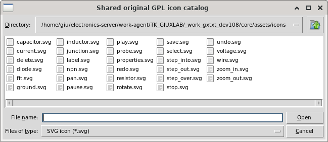

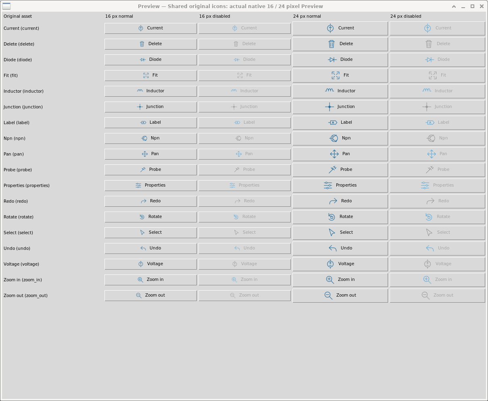

Safe SVG group paint is normalized before the existing bounded decoder, including
inherited fill/stroke and paint opacity; group opacity and transforms retain
their meaning. Original source bytes/SHA remain exact. Previously imported blank
PNGs are persisted resources: reimport the same source through ordinary Import
and replace its existing logical resource via the public icon owner, retaining
bindings. A repaint or theme change does not repair an already admitted PNG.

### Reviewed additive Workspace copies and validation scope

An exact-snapshot mismatch still refuses ordinary Open. For supported additive
presentation changes use Development **Develop → Review saved Workspace
upgrade…**, inspect **Review selected**, then **Create upgraded copy**. Review is
read-only; Apply creates a separate canonical Workspace with lineage. Close the
assigned Viewer before source-bound `workspace_review`, `workspace_upgrade` and
`workspace_open` requests. The full Development manual describes unchanged
source/profile/grants/ordinals, all retained History states, live review-token
lifetime, stale-source/resource failures and explicit managed archive side
effects. Arbitrary C++ evolution is not an automatic compatible upgrade.

### Save only the assigned Workspace through approved tools

After editing a restored Viewer, finish any compiled callback and pointer/pan
gesture, then pass this exact JSON object to `gui_test PROJECT`:

```json
{"operation":"workspace_save"}
```

There are **no extra fields**. Do not supply a target Workspace ID, title, notes,
path, serialized payload, widget, provider or foreign window. The source/Session-
bound Development owner calls the same public
`sessionWorkspaceViewerAction ... save` as the assigned Viewer's ordinary
Workspace menu. A declared normal Session Workspace lifecycle must already
exist; this operation does not create another persistence service or bypass its
normal confirmation, changed-source, stale-Workspace, History-branch and commit
checks. Busy execution, an unfinished pointer gesture, stale attachment/Session
or foreign target fails explicitly. No new C++ runtime capability is granted.

Inspect the returned `workspace_id` and canonical `workspace_stamp` (ID,
generation, revision and SHA), alongside actual values/bindings/domain state.
The stamp comes from the saved canonical Workspace, not from submitted author
content. To check persistence, close this assigned Viewer with the existing
`close` operation, use `workspace_open` with that returned canonical ID and wait
for the real compiled restored state. Verify exact source/Job/Dataset/Plot,
visibility, netlist cache, cursor, C++ and History identities; reopening reads
saved results rather than resimulating or submitting again. A Save failure is
not a completed commit; retain the error and recover through the normal owner.

### Inert manual bounds and exact illustrated export

Approved `save --file MANUAL.md` and `inspect --target MANUAL.md` allow at most
**256KiB** of inert UTF-8 without NUL. `handlers.cpp` and `project.json` source/
metadata transfers remain bounded to **64KiB**. Ordinary-file/no-link/project-
write guards and the existing admitted relative PNG rules remain unchanged.
Oversize, invalid encoding/NUL, links or arbitrary targets reject while retaining
the earlier saved guide. Normal export preserves exact guide bytes in installed
`MANUAL.md` and `source/MANUAL.md`; the inert guide does not grant runtime I/O or
execute source. The SDK contract adds `manual_limit_bytes=262144`, so its policy
bytes change even though runtime header/calls/grants are unchanged. The actual
formerly denied73976-byte author guide passed identical retry; final1.9 guide
74071 bytes and seven admitted assets were exported through the normal owner.

The illustrations above retain their genuine Debian capture/source provenance.
Independent `qa_plot_series04/INDEPENDENT_MULTITRACE_CORRECTION_QA` now passes the
empty-panel shared-X correction with native binary `17ce56ba`, exact source and
four Dataset identities, two sizes, occupied-panel denial, and fresh normal
factory restore of all50 History states with no science/converter/protocol calls.
The original failure report and earlier images remain historical evidence. That
is a scoped generic public-host PASS, not proof of an arbitrary authored Viewer.

Separately, the restricted Circuit author1.9 has adopted the declared panes,
netlist and series profile and used approved public Save/close/reopen on canonical
Workspace `idoc_0006`: three traces/two panels, cursor, C++ state,105/105 History,
netlist and original campaign/Jobs were retained. This actual author workflow is
distinct from the generic fixture correction. Independent current installed GUI,
remaining focus/layout cases and final release gates retain their own acceptance
scope. No screenshot or successful Save certifies all scientific, security or
release requirements.
