# Viewer Interface Builder

The Designer edits a versioned Viewer design. The separate Preview window uses
the real public CORE constructors. Choose a component, select a region or
container and Add. Select it in the hierarchy or layout map to edit properties
and grid constraints. Undo, Redo and Duplicate affect the design model.

Save/Open preserves component IDs, properties, hierarchy and action contracts.
Unconnected actions report `not_connected`; an empty graphics slot contains no
scientific result. API / owner shows the public construction contract. Analyze
inspects actual mounted objects, source bindings, focus, grab and scoped timers.
Unsupported capabilities remain explicit CORE gaps.

Drag hierarchy entries onto compatible containers, or drag layout-map elements
onto siblings to swap grid cells. A corner drag changes responsive minimum
dimensions with a 16 px snap. Properties provides precise grid, span, alignment,
padding and size constraints. Copy/Cut/Paste retains component subtrees; native
text fields keep their standard clipboard keys. Palette and map support scrolling.

File → Generate installable Viewer builds an ordinary Viewer module through the
existing Script Module Builder. Choose a separate source project and new package
folder. Generated assets can change; existing `handlers.tcl` bytes are preserved.
The generation report lists changed assets. Plugin Manager installs the resulting
ZIP through the normal owner; an existing package destination is never overwritten.
Cancel generation stops its owned worker group. Opening a generated Viewer does
not invoke its scientific action handlers.

Use Import Existing Viewer to choose a registered module/provider. A fully
declared design can be edited, saved and regenerated under a separate module ID.
Legacy manifests expose only what they declare: unrepresented custom inspectors
or science interfaces are reported as boundaries. A declaration/import status is
not a full fidelity PASS. Compare opens the original alongside Preview at matching
sizes; inspect structural and behavioral differences with the same safe fixture.
The original module is preserved.

Events shows correlated command/result traces with component/event glob filters
and a capture switch. Field values and scientific payloads are redacted. API /
owner includes the actual constructor, version, supported parents and limitations,
with a link to its CORE guide. Native3D uses the public v2 component host, with independent scene/camera/worker
lifetime. Add Native3D to Canvas to see a real display-only RAM cube. Its properties
control dimensions, projection, default camera, axes and orientation cube. Drag
orbits, Shift-drag pans, wheel zooms; Fit/Reset/Front/Top use native camera services.
The demo flag is explicit and survives Save/Open and package generation. Disable
it for an initially empty scientific source slot; bind through
`viewerGuiDesignNative3DSet` with a registered public module/provider. See
[NATIVE_3D_GUI_HOST_API_v2](../../../docs/api/NATIVE_3D_GUI_HOST_API_v2.md).

Automated Tests lets you select families, inspect the finite case list, run it,
rerun selected cases and export a new JSON receipt. Each case reports its actual
assertion and scope. Mount/readiness tests do not prove scientific correctness or
all navigation behavior. Record captures command/result transitions; Stop places
the inert scenario in the editable text area. Save/Open retains scenarios. Replay
uses queued Tk pointer events on actual mapped controls and bounded state waits;
unexpected results and dialog timeouts are FAIL. Independent official acceptance
uses real Debian X11 input. Completed in-memory runs are bounded; export evidence
before creating many further runs.

For explicit scientific handler testing, first install the generated module that
matches this design. Design → Connect installed test handlers asks for a marked
private test root containing `.gxtxt-gui-test-fixture` and the current private
Session. Only this explicit operation connects the installed handler factory;
each action still requires user invocation. Runtime replay is restricted to that
fixture. Disconnect returns to safe design mode. Import/Open/New disconnect custom
handlers automatically. These developer tests must use synthetic or copied private
sources, never an authoritative user Session.

Workspace and History controls use the existing owners. A stale Session or a
Workspace changed in another editor cannot be saved over silently. Graphics are
views of exact public sources; zoom, pan and fit do not publish a Dataset.

The Analyzers panel can measure two seconds of actual event-loop responsiveness
while you resize or navigate Preview. It reports native-owner counters and
process-wide memory/I/O observations with their attribution limits. Cancel stops
the finite measurement; closing Preview removes its monitor. Command timing is
the synchronous callback duration, separate from subsequent Jobs and paint.

Input fields can bind an explicit change contract from Events. Return followed
by FocusOut commits once. Grid and pack layouts preserve minimum sizes, spacing
and constraints; the parent must have room for a minimum. Drag the Preview's
native splitter to enlarge the inspector. Packed components use Move up/down;
direct cell swaps are for grid siblings. Workspace availability follows the
Viewer's presentation policy, independently from Analysis selection.

Importing a designed Viewer also captures its declared live source state. Save
and reopen the editable design before generating. Generation preserves an
existing local handwritten handler file; if absent, it seeds the file from the
installed designed Viewer's declared handler source. Other imported Viewers
require a separate module identity and explicit domain handler connections.


## Component Gallery and Synthetic Demonstrations

Open **Component Gallery / Demo** in the Designer toolbar or Design menu. The
Workspace mode selector distinguishes **Design**, **Demo** and **Runtime Test**.
Choose any of the28 current public capabilities; the Gallery shows its actual
API ID/version, constructor/owner, typed properties, events, legal parents and
limits. **Show example / Try interaction** opens real controls, not an image of
an interface. The instructions explain a meaningful action for that component.
**Reset** reconstructs deterministic local state. **Open public API guide** opens
its registered public documentation. Events are bounded synthetic receipts.

Choose standalone for a minimal legal example or composite for a laboratory
inspector composition. A tab always has a real tabs parent; menu and command
components use their legal Viewer shell. Sample state offers default, selected,
disabled, empty and invalid where meaningful: invalid is a typed numeric field
example, not a claim every component has an invalid state. Table is read-only;
Workspace/History are visibly inert owner-provided samples, with real save/Undo
commands disabled. Dataset selector has fixed demo choices and does not consult
scientific Datasets. Labels/progress/logs are illustrative, not measured results.

Try entry text with Return, boolean controls with Space, choices with arrows,
row selection, notebook tabs, a native splitter and synthetic toolbar/menu actions.
**Advance demo state** changes only the local counter/progress. A normal Preview
with an unconnected domain action still reports not_connected. The DEMO footer
always identifies display-only sample content. Return to Design closes the
fixture, retaining the exact model, revision, component IDs, dirty flag and Undo/
Redo; no demo values are silently saved into a project.

### Real Native2D interaction

Select Native2D and Show example with no Session open. The real native owner
shows axes, a curve, point markers and an orange closed shape. Select / Move:
drag a shape vertex and inspect actual object/device/world/phase receipts. Pan
uses a separate mode so moving the view does not change geometry. Try wheel
zoom, Fit, Escape to cancel an active move and Reset. Closing/switching mid-drag
releases the native scene and pending callbacks. Reopen starts at the same fixed
geometry. These demo units and movements do not edit any canonical Dataset.

Plot similarly uses a prepared RAM model through the actual public Plot v4/
native Cairo owner; wheel zoom, middle drag pan, double-click Fit and click hit
selection remain display operations. Protected Plot scientific code is unchanged.

### Embedded Native3D tutorial

Add **Native3D embedded viewport** to Canvas. Inspect the typed width/height,
projection, camera triples, world axes, orientation cube and explicit demo flag.
Preview renders a genuine native cube inside the declared slot. Drag orbit,
Shift-drag pan, wheel zoom, Fit/Reset/Front/Top and keyboard arrows use actual
camera services. A short click picks geometry and reports its real native layer/
point/cell receipt without publishing an edit. Two windows retain independent
camera/scene/worker lifetimes; close one and continue navigating the other.

Save the design, reopen it and use File → Generate installable Viewer with a
separate source project/output directory. Review the generated declaration and
API requirement NATIVE_3D_GUI_HOST_API_v2@2; handwritten handlers.tcl is preserved.
Install the ZIP with Plugin Manager and open the installed provider. The explicit
RAM scene renders through the same public host. Disable demo for an initially
empty scientific source slot; trusted clients bind registered public sources
with viewerGuiDesignNative3DSet. A changed Session/source blocks stale interaction
until explicit rebind. Missing render services show a visible recoverable error.

### Four complete examples and extension

The installed examples/ folder contains toolbar_inspector.gxtxt-viewer,
table_selection.gxtxt-viewer, native2d_interaction.gxtxt-viewer and
native3d_embedded.gxtxt-viewer, plus a public-API synthetic launcher and README.
Open each in Builder; run_demo.tcl shows its full transient sample composition.
Dev108 adds the typed project Icon Library described below. Supported native
controls share the same persisted icon binding in Preview and installed output;
menu/command-toolbar support requires its separately documented capability gate.

The public Component Demo registry extends an existing real capability with a
bounded inert properties/instructions/states specification. It does not admit
author Tcl callbacks, private file loaders or another widget engine. See
VIEWER_COMPONENT_DEMO_API_v1 for the component-by-component inventory, owner,
contract and restrictions. Scientific runtime bindings, example content, layout
and demo state remain separate authorities.


## Project Icon Library (dev108)

Open **Design → Icon Library / Manager** or its toolbar action. The library is
part of the existing `gxtxt.viewer_design.v1` model, not an independent global
asset registry. Search category/name/ID; actual thumbnails accompany each
project-owned logical resource. The scrollable inspector displays native normal,
disabled, hover and selected control previews, source codec, dimensions, alpha,
SHA and license/ownership. Typed state choices select existing project icons.

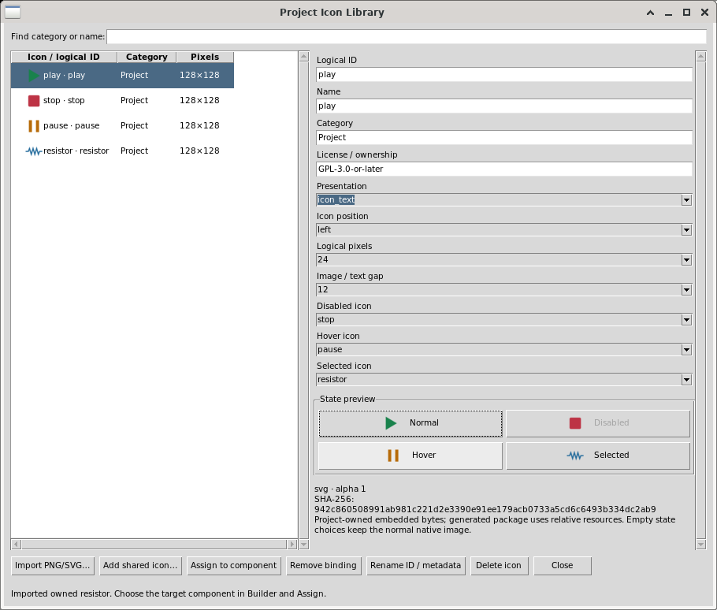

Import an original/properly licensed PNG or safe SVG. Import validates ordinary
non-symlink files, bounded dimensions/bytes, PNG chunk/pixel checksums and a
strict non-executable SVG subset. Scripts, entities, remote references, fonts,
styles and external resources are rejected. The native rendering adapter uses a
fixed bounded rasterizer in the granted project scratch directory; author
metadata never selects a decoder, executable or shell command.

Choose a compatible component in Builder, then choose the icon, presentation
(icon+text, icon only, text only), position (left/right/top/bottom), logical size
(16/24/32/48), actual image/text gap and optional disabled/hover/selected images
using typed controls. The native label element owns relative spacing; outside
button padding stays unchanged. Assign retains the command ID and
callback. Unsupported components refuse the binding. Native ttk owns actual
hover/pressed/disabled appearance and keyboard control, rather than fake action
enablement. Preserve accessible text and tooltips when displaying icon only.

Rename logical ID updates bindings transactionally. Duplicate bytes select the
existing asset. Remove binding changes presentation only; Delete icon refuses a
still-referenced resource. Save/Open, Undo/Redo, duplicate/reparent and package
generation retain logical IDs and embedded exact source/raster hashes. Generated
packages include relative resources and catalog provenance through the normal
Module packaging owner; a local absolute import path is not a runtime resource.
The original GPL shared catalog is under `core/assets/icons` with its license;
importing one copies it into the project rather than depending on that source
pathname at runtime.

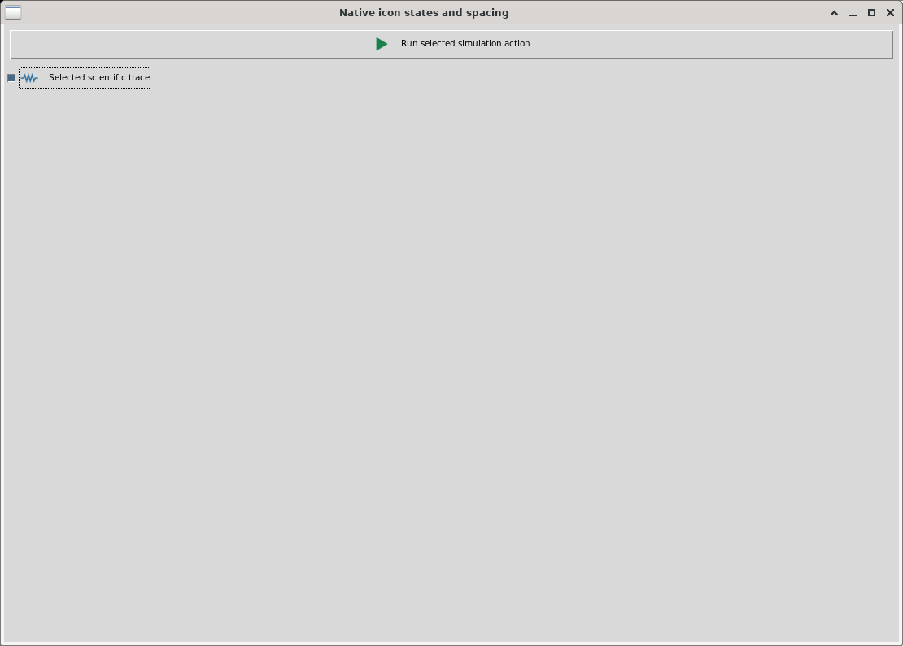
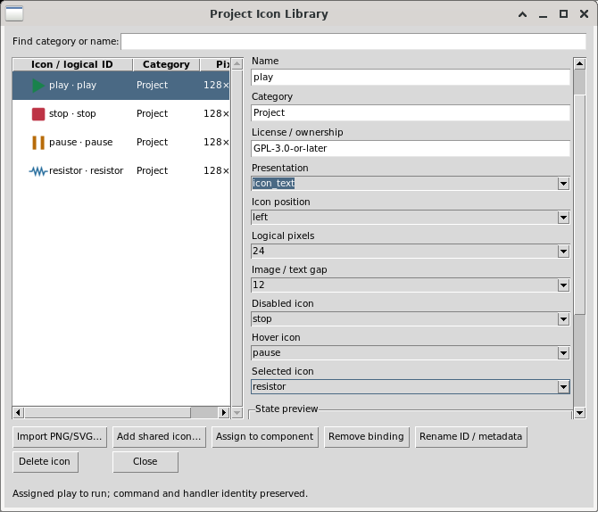

State image precedence is disabled, then selected, then hover/active. A plain
action does not automatically become a toggle; selected images follow actual
native selection. Empty state choices preserve normal native fallback. Icon-only
controls retain accessible text and tooltip behavior. Rename preserves all four
resource bindings; Remove binding clears them together. Legacy controls without
icons retain their original behavior.

For command toolbars, menus and context menus choose the actual container in
Builder, open Icon Library and choose an existing **Command target**. Select an
owned icon and presentation, then Assign. Each container's `command_icons` maps
existing action IDs to those resources; command IDs/handlers stay unchanged.
Changing target loads that command's current binding. Remove binding clears only
that target; rename updates nested normal/state references. Referenced Delete
refuses visibly in the front Icon Library, preserving the design. Undo/Redo and
native Save/Open preserve the same logical mappings and resource hashes.

Toolbar buttons reuse native state images, placement, size and relative spacing.
Menus/context menus support normal/disabled images, image+text/text, placement
and logical sizes. Their typed controls clearly exclude unsupported hover/selected
image variants, custom spacing and icon-only tooltips. Native menu command
selection is not toggle state. Real Preview posts the native menu; generated and
normally installed Modules use the same command owner. Runtime disablement comes
from the handler's true enabled state, so changing an image never enables a
disabled action. Keyboard navigation/shortcuts keep their existing command IDs.

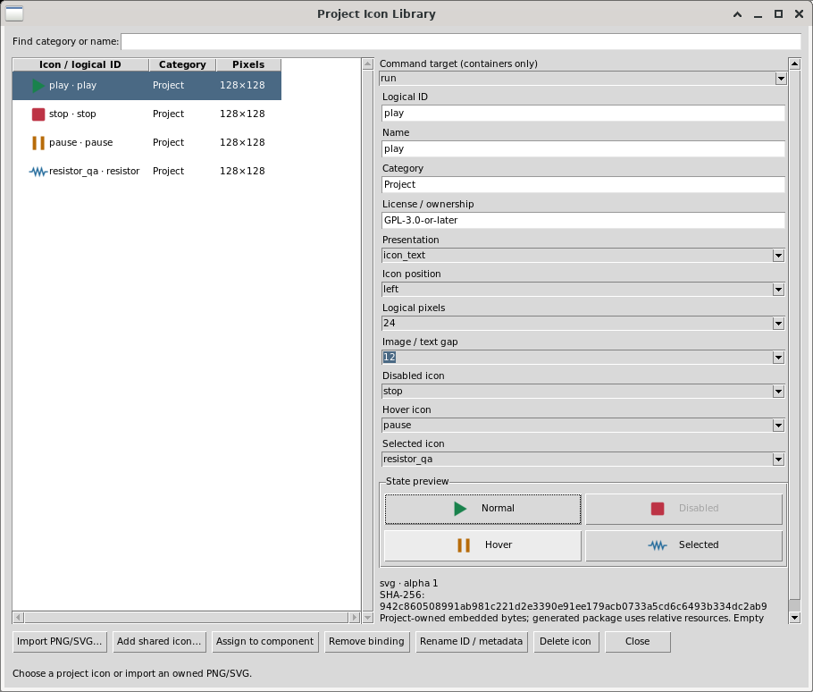
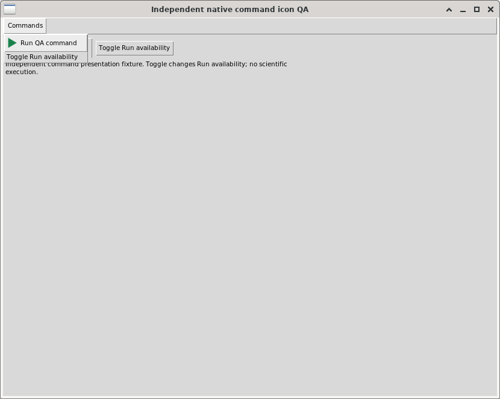
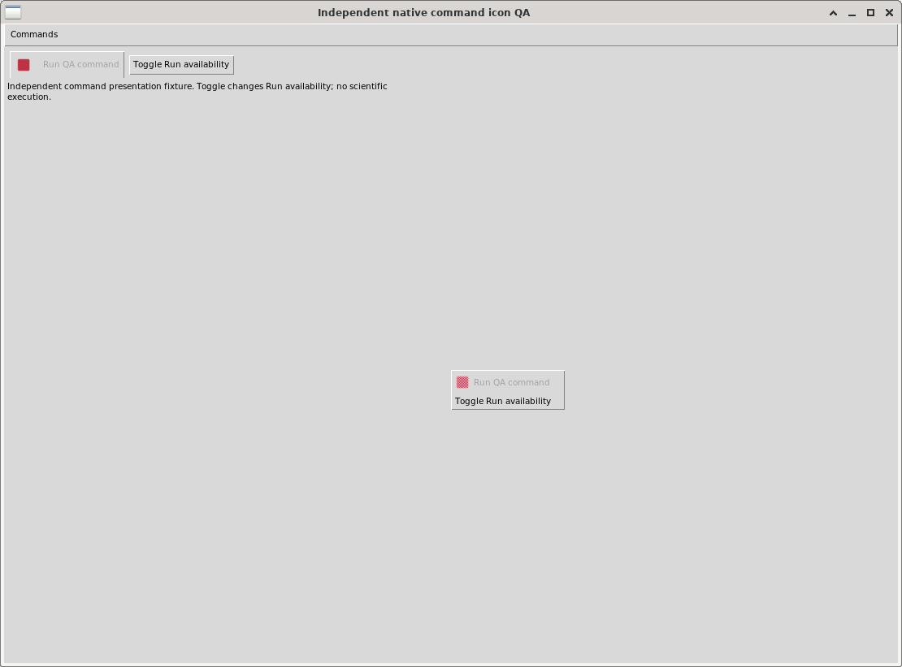

Final release integration/keyboard/theme/HiDPI conformance remains subject to
its named acceptance checks; scoped independent native evidence is not a release.
Simulated Tk scaling is not physical HiDPI hardware evidence. The snapshots above
demonstrate the actual reviewed native controls. The doubled-scaling capture uses
logical Tk scaling on Debian; it does not certify physical HiDPI hardware.

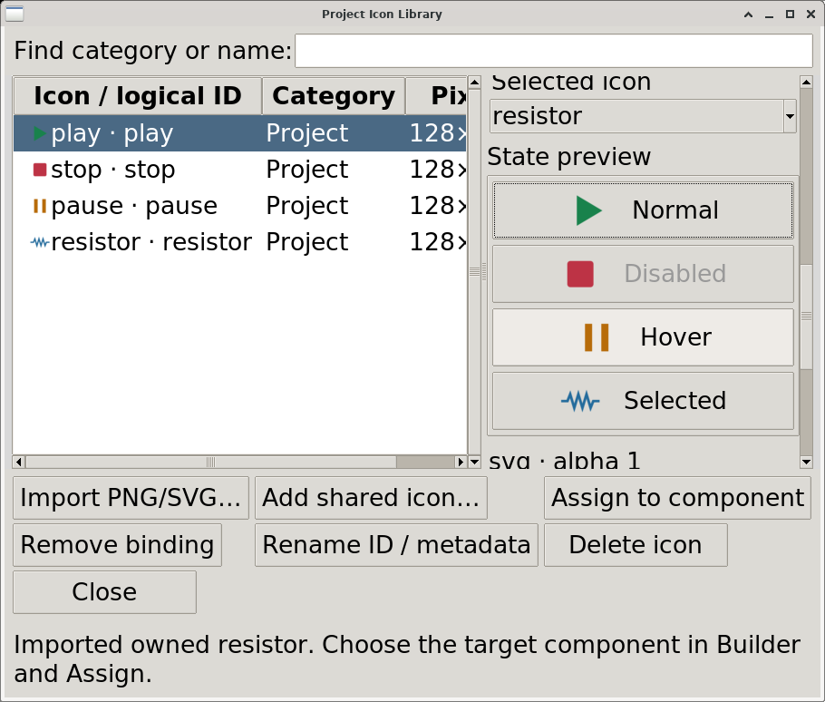

## Declared visibility, canonical source inspection and waveform editing (dev108)

These controls compose existing public Builder, GUI Host, Configuration, Plot,
History and Workspace owners. A declared presentation handler is dispatched by
the existing host; it does not need an authored C++ pane/series renderer, a new
SDK method, arbitrary Tcl, file access or another execution framework. Existing
scientific/diagram grants still apply to the source and result being inspected.
See `VIEWER_GUI_HOST_API_v1` for exact admission and `VIEWER_DEVELOPMENT_API_v1`
for the constrained author tools. API discovery alone grants no operation.

### Typed wire editing and uninterrupted History branches

Select an existing wire stroke and open Properties. Start/End terminal choices
refer to existing stable component pins or explicit junctions. The ordered bend
table exposes typed X/Y fields, Add/Replace/Remove and Move up/down. Add inserts
after the selected row, or appends without a selection. Close discards unapplied
draft changes; Apply commits one guarded canonical route edit with the same wire
ID. The body scrolls and buttons wrap at the480x320 minimum dialog size.
The canonical route supports128 finite bends within+/-1000000 display units;
initial wire drawing retains its64 pending-point bound. Crossings and bends
cannot create implicit electrical junctions. An external source change while
Properties is open requires closing/reopening before Apply.

Invalid values, duplicate component names, invalid endpoints/equal endpoints,
malformed routes and stale sources are refused before a History branch can
discard redo. A valid older-state edit still asks to branch; accepting preserves
the current native editor, selection and focus so the next keyboard edit works.
Cancelling preserves the exact source/History and produces no Tk background
error. Ordinary Undo/Redo/navigation continue to restore their snapshots and may
clear transient selection. Rapid wire end/start clicks at a common explicit
junction remain routing input; only Select-mode double-click opens Properties.

Approved author CLI `gui_test` uses the same public `property` fields `start`,
`end`, `point_x`, `point_y`. `wire_route` accepts `component` and `command`
`add/replace/remove/up/down`, or `command:select` with integer zero-based
`index:0..127`. It clicks the actual owned controls/Tree row and accepts no widget
path or arbitrary route payload. `status.properties.COMPONENT` reports only the
mapped owned wire editor's source receipt, stable ID, typed draft/choices and
visible error. `properties_commit` and `properties_close` click Apply/Close.
Undo/Redo and normal saved Workspace restore retain committed bends/topology.
See `NATIVE_2D_GEOMETRY_API_v1`, `NATIVE2D_VIEWPORT_HOST_v1` and
`VIEWER_DEVELOPMENT_API_v1` for exact operations and source guards.

### Builder checked View controls and retained layout

Select the declared component in Builder and edit its public properties. A
`toggle` or native `checkbutton` declares `component_visibility TARGET_ID` and an
explicit boolean `default`; omit `change_action`. An ordinary `action` can use
the same property with its own distinct presentation handler. For a `menu`,
`context_menu` or `command_toolbar`, declare `visibility_commands` as a mapping
from an existing action ID to the target component ID. Every mapped action must
occur in that surface's `actions`, and its handler must have `effect presentation`.
For example, declare a panel `source_panel`, a toggle with
`component_visibility source_panel` and `default 1`, and a View menu containing
`view_source` with `visibility_commands {view_source source_panel}`. Declare
`view_source` as a presentation handler accepting `{window action}`. The public
Builder JSON route uses the same property validator; inspect its capabilities
before supplying typed property values.

A command has one consistent target even when presented in multiple surfaces.
Multiple booleans for the same target must agree on their default. References to
undeclared/foreign targets, mutating handlers, reserved Undo/Redo/Fit/Zoom IDs or
Workspace/History/Help/command surfaces are rejected. A contradictory declaration
is an error, not a hidden preference. Ordinary command icons, callbacks and true
native enablement retain their behavior; check state means declared visibility,
not command enablement or whichever notebook tab currently happens to be mapped.

Preview and the generated/installed host synchronize boolean values and checked
View/context rows. Hide/show retains the same grid/pack children, notebook pages
and split-pane members in their original order. It keeps widget/native handles,
field values, bindings and scientific source authority. Hiding moves focus out
of hidden content; showing does not steal focus or select an optional notebook
tab unnecessarily. An accepted native boolean/action/menu input records one
ordinary History step. Programmatic restoration synchronizes the committed field
baseline without an authored callback or an extra History step. Undo/Redo and
normal Workspace Save/Open retain visibility; saved state takes precedence over
new-design defaults. Keep a reachable control outside hidden content to show it
again, then test both narrow layout and keyboard focus.

The corresponding public host calls are
`viewerGuiDesignComponentVisible window component boolean` and
`viewerGuiDesignComponentVisibleGet window component`. The latter reports
explicit presentation visibility even for an unselected notebook page. Normal
Module generation marks these declarations as requiring dev108, including a
design without icons.


### A distinct canonical source/netlist pane

For an existing circuit Scientific `section` with
`scientific_provider core.ngspice.circuit`, declare all three references:

| Section property | Required declared control |
| --- | --- |
| `scientific_netlist` | A separate read-only `log`; it must differ from the changing scientific Job log. |
| `scientific_netlist_diagram` | The existing `electrical.basic` Native2D component supplying canonical source identity. |
| `scientific_netlist_action` | Its own presentation handler, bound to an ordinary action/menu control. |

The host intercepts that handler and calls
`viewerGuiDesignScientificNetlist window form` through public
`scientificExecutionCircuitInspect`. Press the declared Inspect action explicitly.
With an admitted Job/sweep, it reconstructs the **selected case's** actual
parameters using the same registered converter/version. It checks original
source ID/generation/revision/SHA, provider, Job/case and published canonical
Dataset association/integrity. Current form edits do not relabel a completed
case. Without a Job, inspection uses current declared form parameters. The pane
identifies source/provider/version, parameters, Job and Dataset; its deck is a
validated canonical reconstruction, not a fetched remote artifact or simulation.

The complete deck is limited to32KiB; excess is rejected rather than silently
truncated. Foreign/missing case/publication, changed source/provider or invalid
circuit produces an explicit error while retaining scientific identities. A
changed selection makes an older cache stale until explicit Inspect. The bounded
`scientific_netlists` domain record stores validated context and full text through
normal Workspace/History. Restore displays it only if current canonical context
still matches, otherwise a stale/unavailable explanation. Undo to a state with no
saved inspection clears the old deck; Redo can restore its valid saved cache.
Save/Open, Undo/Redo and hide/show never call the converter, Numeric, submission,
status polling or remote protocol automatically. Keep this read-only pane and
its visibility independent of the Job log and waveform.

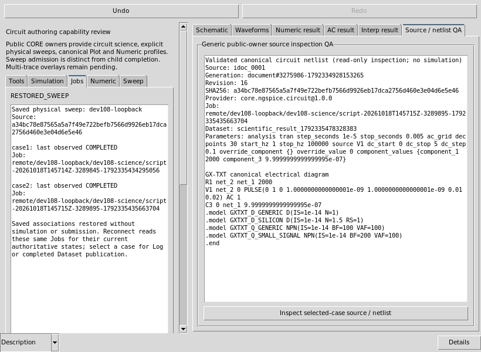

### Complete declared Plot series/panel profile

Start with a normal Plot form and its canonical Dataset/X/Y/Discover/Bind controls.
Add the following complete profile on its `section`; partial profiles reject:

| Property | Type / role |
| --- | --- |
| `plot_series` | Choice/combobox of current stable trace IDs. |
| `plot_series_label` | String field/entry for the selected trace label. |
| `plot_series_axis` | Choice/combobox with exactly `left right`. |
| `plot_series_enabled` | Toggle/checkbutton selecting trace enablement. |
| `plot_panel` | Choice/combobox of current canonical panel IDs. |
| `plot_panel_title` | String field/entry for a new panel title. |
| `plot_series_target` | The declared Plot whose `plot_form` points back to this section. |
| `plot_series_commands` | Existing action ID to one fixed operation below. |
| `plot_series_status` (optional) | Separate read-only log/label/status with exact canonical IDs and summary. |

All editor controls must be distinct from each other and Dataset/X/Y/probe/
axis-scale controls. Omit their `change_action`: edits stage choices until an
explicit command. Each command is a unique fixed operation with a distinct
presentation handler; it cannot collide with visibility/netlist handlers or
reserved Undo/Redo/Fit/Zoom. Ordinary action/menu/toolbar controls present those
handlers. `viewerGuiDesignPlotSeries window form operation` uses the existing
bound PlotSpec; it has no separate trace store.

| Fixed operation | Exact workflow |
| --- | --- |
| `refresh` | After first Bind, derive current trace/panel choices and summary. It does not add or replace a trace. |
| `load` | Select a stable trace ID and load its actual Dataset/X/Y, label, axis, enabled state and panel into controls; the plotted trace is unchanged. |
| `add` | Select a canonical Dataset, Discover actual variables, choose X/Y, target panel, label, axis and enabled state; retain earlier traces and allocate a distinct `trace_N` ID. |
| `update` | Apply staged source/label/axis/enabled/panel values to the selected ID, preserving its style and unrelated fields. Choose a different target panel here to move the trace. |
| `remove` | Remove the selected trace; removal of the final trace is refused. |
| `up` | Move the selected trace one place earlier within its current panel; the boundary rejects. |
| `down` | Move the selected trace one place later within its current panel; the boundary rejects. |
| `panel_add` | Use the supplied title to append a distinct `panel_N`; select it and Update a trace to populate it. |
| `panel_remove` | Remove only an empty, unannotated panel while another panel remains. |
| `panel_up` | Move the selected complete panel earlier; the boundary rejects. |
| `panel_down` | Move the selected complete panel later; the boundary rejects. |

A changed Enabled checkbox alone stages a value; **Update** applies it to the
selected trace. This differs from `component_visibility`, whose boolean input
immediately hides/shows its target. Refresh/Load can change saved editor controls
and use ordinary History, while coherent trace edits are one accepted History
step. Normal Save/Open preserves the PlotSpec and editor controls; Undo/Redo uses
the same authoritative state. Limits are32 traces,8 panels and single-line
labels/titles of at most160 characters, without newline/NUL.

Plot v4 validates real canonical Dataset/Variable IDs, shared X semantics,
physical unit conversion and the native model before accepting a replacement.
Put voltage/current on different left/right axes or separate panels; incompatible
same-axis units fail without replacing the prior valid specification/frame.
Automatic axis labels derive from actual variables/units, including `i_v1 (A)`;
explicit PlotSpec presentation remains owned by the existing Plot APIs. Keep
Dataset/variable IDs in the summary when two traces use the same display label.
Source-point probes continue to return exact canonical row/values/units; they do
not infer rows by reading screen pixels. These edits do not calculate vectors,
submit Jobs, retrieve remote results or admit arbitrary author scripts.

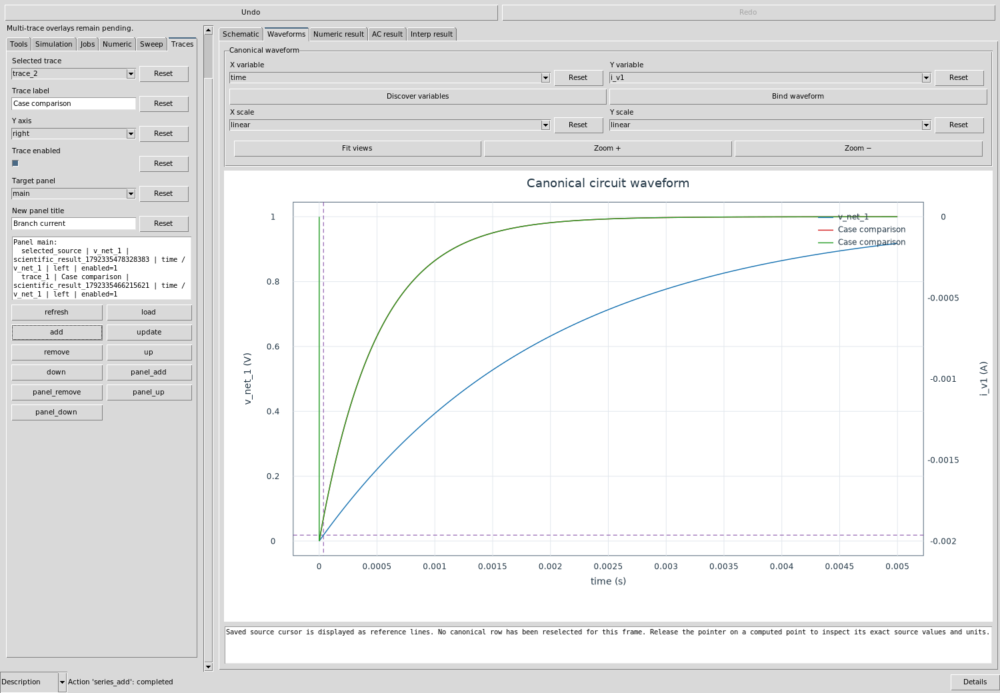


### Canonical schematic-to-waveform selection

A complete circuit Scientific section can declare `scientific_probe_diagram`,
`scientific_probe_plot` and `scientific_probe_mode`: the existing electrical
Native2D component, canonical Plot with its `plot_form`, and choice/combobox with
exactly `voltage current`. Use the admitted Diagram Probe tool and click a real
terminal/junction. The shared host verifies current source generation/revision/
SHA, selected completed Job/case, registered CircuitInspect mapping and published
Dataset/Variable provenance. Voltage maps the actual node to V; current uses the
actual independent-voltage-source branch in A. Ground voltage, unavailable device
current, missing variables, foreign publications and stale source report errors
and retain the earlier waveform. Split-complex AC requires an explicit public
Numeric projection; the probe does not compute magnitude/phase implicitly.

For a completed AC publication, the same endpoint click now resolves the actual
frequency and split real/imaginary pair into the existing AC Numeric form.
`AC_SOURCE_SELECTED` identifies its Dataset, original Job, physical unit and
exact Variable IDs. The previous Plot/computed result stays valid. In **AC result**
review the preserved explicit row start/count and projection, then choose
Evaluate, Publish and Bind to display that selected signal. Magnitude is V/A;
phase is rad/deg. Selection itself performs no calculation or publication and
does not relabel a real part as magnitude. With one compatible complex form
the reference is inferred; multiple forms need the typed optional Scientific
`scientific_probe_ac_form` reference to the intended `complex_projection`
section. Missing/ambiguous forms, incompatible pair/frequency units or shapes,
ground/unavailable current and stale source retain prior valid selections.

Portable Session import preserves immutable Numeric results. Reopen the imported
Session normally in the Workspace Manager: restoration checks the same Dataset
ID, complete persisted record and metadata checksum, result owner and immutable
Document identity, plus the scientific source guard. Only the carrier directory
may change. No vector is recalculated and no Job is submitted. Changed inputs
still require a new explicit Evaluate. Subsequent statistics, comparison and
publication bind a temporary operation request to the current Session and keep
strict current-source checks; the original stored result/provenance is untouched.

The existing scoped grants are `SCIENTIFIC_EXECUTION_API_v1.circuit_prepare`,
`NATIVE2D_VIEWPORT_HOST_v1.diagram_command` and
`PLOT_DATASET_API_v4.widgetCreate`. History/Workspace retain canonical source,
Job, Dataset, Variable and mode; no new endpoint/vector accessor, process or
scientific authority is granted.

### Native source cursor, view navigation and recovery

Declare ordinary presentation handlers with reserved IDs `fit`, `zoom_in` and
`zoom_out` to expose existing Fit/Zoom actions. The host navigates compatible
retained views, including canonical Plot panels; these are view commands, not
scientific callbacks. A Plot with a declared form uses the same native source hit and canonical one-row
read as ordinary probing. Release on a real computed point to show exact row,
values and units and place a persistent crosshair. The host stores two existing
PlotSpec `reference_line` annotations, `__gx_source_cursor_x` and
`__gx_source_cursor_y`, on that series' actual left/right axis; no authored overlay
or numerical calculation is used. Non-source/blank hits leave it unchanged.
Wheel zoom, middle-button pan, declared Fit/Zoom and resize retain the cursor.
Focus the Plot and press **Escape** to clear only these two reserved annotations;
Undo restores and Redo clears them. An ordinary new Dataset/variable **Bind**
clears the old cursor as part of the new binding. Invalid logarithmic domains
retain the previous valid frame and report the reason; correct controls and Bind
again rather than assuming a blank frame is a new scientific result.

Save/Open retains canonical cursor lines and current Plot binding. On cold
restore, the readout explicitly says no canonical row has been reselected;
release on a computed point to inspect current exact source text. Saved lines
alone are not proof that a row was freshly inspected. Public trusted callers use
`viewerGuiDesignPlotCursor window plot device_x device_y` and
`viewerGuiDesignPlotCursorClear window plot`. Restricted authors use the existing
declared presentation controls and bounded source-bound `gui_test` gestures;
only Escape is admitted for a mapped, unobscured, bound declared Plot, with no
active pan. Other Plot keys/foreign/hidden/stale targets remain denied. A warm
GUI owner receipt does not certify fresh external CLI projection of every field.

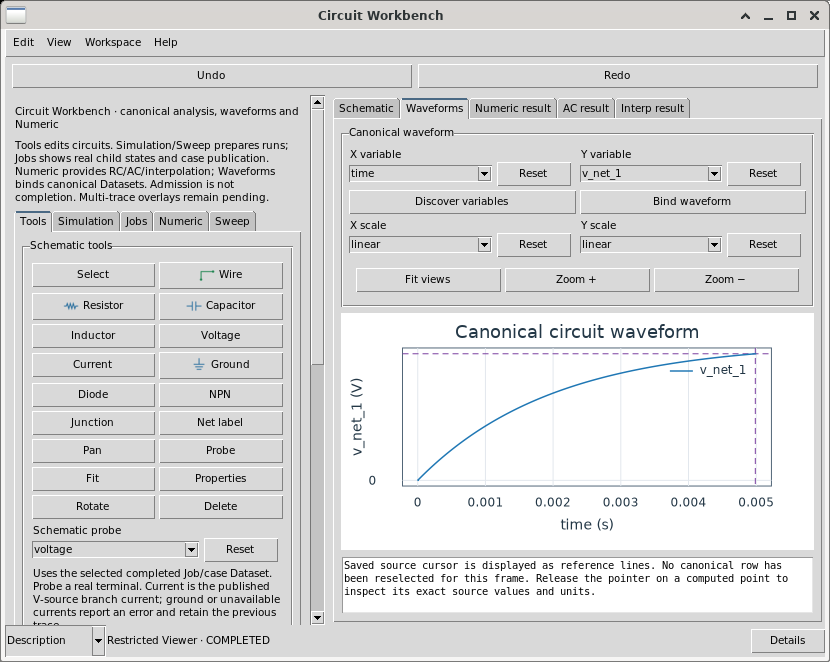

### Discover shared original icons through the approved tools

In **Icon Library → Add shared icon…**, choose a category and search by English
label, semantic ID or intended action. The dev111 source catalog declares 100
stock entries in five families: Selection & Navigation; Geometry & Editing;
Data, Plots & Analysis; Scientific Tools & Simulation; Documents & Workflow.
Each family has 20 declared entries. Counts from source are distinct from the
actual installed catalog and visual/GUI acceptance recorded by the release.

Select a row to inspect its source identity, license, intended action and origin,
with native 24-pixel Normal, Disabled, Hover and Selected samples. These samples
use the current theme; missing state-specific images retain normal native
fallback rather than implying four different stock icons. Opening/filtering the
picker reads metadata, and only the selected source is admitted for preview.
Preview and Cancel do not import resources or edit the design/Undo/Redo.

Choose **Add to project** to admit that exact source through the existing icon
owner and import one ordinary embedded resource. Then select an existing Builder
component/command target and use **Assign to component** as described above.
The category/license come from the distributed catalog and the source SHA is
checked again at admission. Duplicate bytes reuse the existing project icon.
The project limit remains 64 icons / 2 MiB; 100 stock choices do not import the
whole stock collection into every project. **Import** remains available for other
owned PNG/safe-SVG files. Assign a normal icon and optional state variants using
the existing typed controls; imported images become ordinary project resources.
The library includes electrical devices, selection/wiring/junction/probe tools,
Undo/Redo, Fit/Zoom and debugger controls. Preserve accessible action text and
tooltips, and inspect actual normal/disabled/selected states at the target size.

Restricted authors discover these same sources with this exact Builder request:

```json
{"operation":"icon","arguments":["catalog"]}
```

Read `builder.catalog.icons` for IDs, titles, category, license, admitted source
paths, SHA256, format and dimensions, plus optional `action` and `origin` metadata.
Use a returned path with the existing
five-argument `icon_import`, then apply typed component icon properties.
Discovery takes no path or extra argument and changes no design/Undo/Redo file;
the ordinary request provenance receipt is retained. It grants no filesystem
reader or new C++ capability. Invalid/missing/linked catalog assets fail clearly.

Builder retains its existing50-step Undo/Redo model. The complete persisted
history has a separate512MiB ceiling so a legal icon-rich design is not mistaken
for an oversized single design; each design remains bounded to4MiB. Normal
Builder inspection and Undo/Redo preserve every retained state. Before committing
an edit, CORE checks the design, history and response sizes; ordinary write
failures restore the original design/history files and report the error. There
is no crash-atomicity claim or manual history-deletion recovery step. Restricted
Builder response limits are16MiB at CORE/64MiB through the GUI request transport;
ordinary source/C++ limits and runtime SDK permissions remain unchanged.


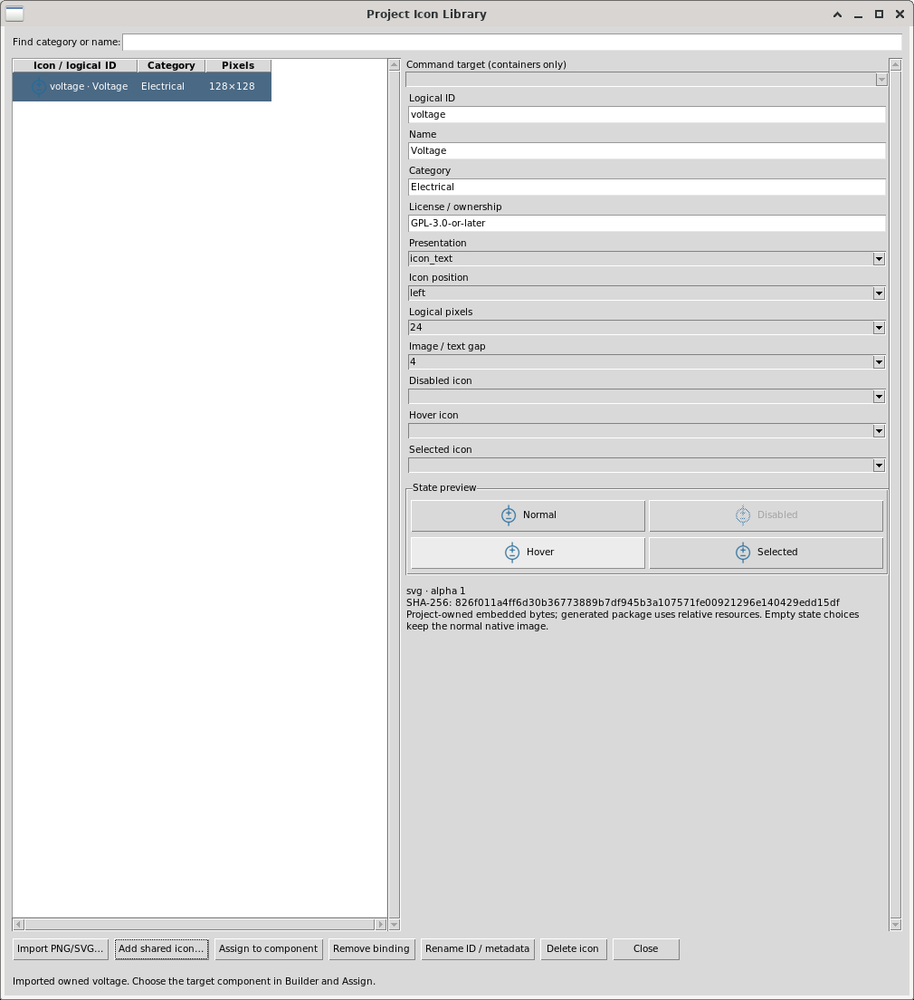


Safe SVG group paint is normalized before the existing bounded decoder, including
inherited fill/stroke and paint opacity; group opacity and transforms retain
their meaning. Original source bytes/SHA remain exact. Previously imported blank
PNGs are persisted resources: reimport the same source through ordinary Import
and replace its existing logical resource via the public icon owner, retaining
bindings. A repaint or theme change does not repair an already admitted PNG.

### Reviewed additive Workspace copies and validation scope

An exact-snapshot mismatch still refuses ordinary Open. For supported additive
presentation changes use Development **Develop → Review saved Workspace
upgrade…**, inspect **Review selected**, then **Create upgraded copy**. Review is
read-only; Apply creates a separate canonical Workspace with lineage. Close the
assigned Viewer before source-bound `workspace_review`, `workspace_upgrade` and
`workspace_open` requests. The full Development manual describes unchanged
source/profile/grants/ordinals, all retained History states, live review-token
lifetime, stale-source/resource failures and explicit managed archive side
effects. Arbitrary C++ evolution is not an automatic compatible upgrade.

### Save only the assigned Workspace through approved tools

After editing a restored Viewer, finish any compiled callback and pointer/pan
gesture, then pass this exact JSON object to `gui_test PROJECT`:

```json
{"operation":"workspace_save"}
```

There are **no extra fields**. Do not supply a target Workspace ID, title, notes,
path, serialized payload, widget, provider or foreign window. The source/Session-
bound Development owner calls the same public
`sessionWorkspaceViewerAction ... save` as the assigned Viewer's ordinary
Workspace menu. A declared normal Session Workspace lifecycle must already
exist; this operation does not create another persistence service or bypass its
normal confirmation, changed-source, stale-Workspace, History-branch and commit
checks. Busy execution, an unfinished pointer gesture, stale attachment/Session
or foreign target fails explicitly. No new C++ runtime capability is granted.

Inspect the returned `workspace_id` and canonical `workspace_stamp` (ID,
generation, revision and SHA), alongside actual values/bindings/domain state.
The stamp comes from the saved canonical Workspace, not from submitted author
content. To check persistence, close this assigned Viewer with the existing
`close` operation, use `workspace_open` with that returned canonical ID and wait
for the real compiled restored state. Verify exact source/Job/Dataset/Plot,
visibility, netlist cache, cursor, C++ and History identities; reopening reads
saved results rather than resimulating or submitting again. A Save failure is
not a completed commit; retain the error and recover through the normal owner.

### Inert manual bounds and exact illustrated export

Approved `save --file MANUAL.md` and `inspect --target MANUAL.md` allow at most
**256KiB** of inert UTF-8 without NUL. `handlers.cpp` and `project.json` source/
metadata transfers remain bounded to **64KiB**. Ordinary-file/no-link/project-
write guards and the existing admitted relative PNG rules remain unchanged.
Oversize, invalid encoding/NUL, links or arbitrary targets reject while retaining
the earlier saved guide. Normal export preserves exact guide bytes in installed
`MANUAL.md` and `source/MANUAL.md`; the inert guide does not grant runtime I/O or
execute source. The SDK contract adds `manual_limit_bytes=262144`, so its policy
bytes change even though runtime header/calls/grants are unchanged. The actual
formerly denied73976-byte author guide passed identical retry; final1.9 guide
74071 bytes and seven admitted assets were exported through the normal owner.

The illustrations above retain their genuine Debian capture/source provenance.
Independent `qa_plot_series04/INDEPENDENT_MULTITRACE_CORRECTION_QA` now passes the
empty-panel shared-X correction with native binary `17ce56ba`, exact source and
four Dataset identities, two sizes, occupied-panel denial, and fresh normal
factory restore of all50 History states with no science/converter/protocol calls.
The original failure report and earlier images remain historical evidence. That
is a scoped generic public-host PASS, not proof of an arbitrary authored Viewer.

Separately, the restricted Circuit author1.9 has adopted the declared panes,
netlist and series profile and used approved public Save/close/reopen on canonical
Workspace `idoc_0006`: three traces/two panels, cursor, C++ state,105/105 History,
netlist and original campaign/Jobs were retained. This actual author workflow is
distinct from the generic fixture correction. Independent current installed GUI,
remaining focus/layout cases and final release gates retain their own acceptance
scope. No screenshot or successful Save certifies all scientific, security or
release requirements.
