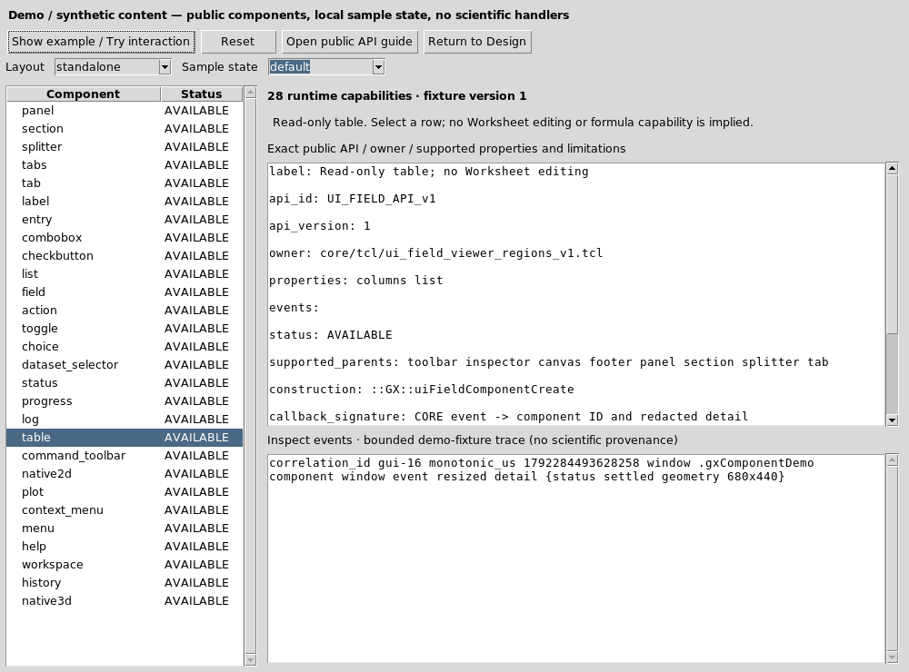
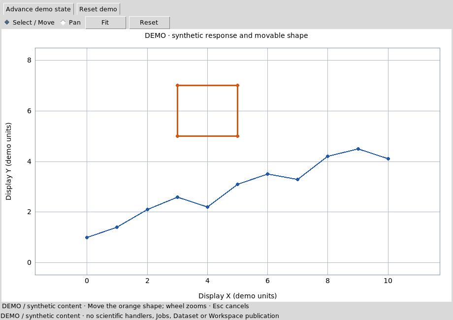

# Viewer Interface Builder

The Designer edits a versioned Viewer design. The separate Preview window uses
the real public CORE constructors. Choose a component, select a region or
container and Add. Select it in the hierarchy or layout map to edit properties
and grid constraints. Undo, Redo and Duplicate affect the design model.

Save/Open preserves component IDs, properties, hierarchy and action contracts.
Unconnected actions report `not_connected`; an empty graphics slot contains no
scientific result. API / owner shows the public construction contract. Analyze
inspects actual mounted objects, source bindings, focus, grab and scoped timers.
Unsupported capabilities remain explicit CORE gaps.

Drag hierarchy entries onto compatible containers, or drag layout-map elements
onto siblings to swap grid cells. A corner drag changes responsive minimum
dimensions with a 16 px snap. Properties provides precise grid, span, alignment,
padding and size constraints. Copy/Cut/Paste retains component subtrees; native
text fields keep their standard clipboard keys. Palette and map support scrolling.

File → Generate installable Viewer builds an ordinary Viewer module through the
existing Script Module Builder. Choose a separate source project and new package
folder. Generated assets can change; existing `handlers.tcl` bytes are preserved.
The generation report lists changed assets. Plugin Manager installs the resulting
ZIP through the normal owner; an existing package destination is never overwritten.
Cancel generation stops its owned worker group. Opening a generated Viewer does
not invoke its scientific action handlers.

Use Import Existing Viewer to choose a registered module/provider. A fully
declared design can be edited, saved and regenerated under a separate module ID.
Legacy manifests expose only what they declare: unrepresented custom inspectors
or science interfaces are reported as boundaries. A declaration/import status is
not a full fidelity PASS. Compare opens the original alongside Preview at matching
sizes; inspect structural and behavioral differences with the same safe fixture.
The original module is preserved.

Events shows correlated command/result traces with component/event glob filters
and a capture switch. Field values and scientific payloads are redacted. API /
owner includes the actual constructor, version, supported parents and limitations,
with a link to its CORE guide. Native3D uses the public v2 component host, with independent scene/camera/worker
lifetime. Add Native3D to Canvas to see a real display-only RAM cube. Its properties
control dimensions, projection, default camera, axes and orientation cube. Drag
orbits, Shift-drag pans, wheel zooms; Fit/Reset/Front/Top use native camera services.
The demo flag is explicit and survives Save/Open and package generation. Disable
it for an initially empty scientific source slot; bind through
`viewerGuiDesignNative3DSet` with a registered public module/provider. See
[NATIVE_3D_GUI_HOST_API_v2](../../../docs/api/NATIVE_3D_GUI_HOST_API_v2.md).

Automated Tests lets you select families, inspect the finite case list, run it,
rerun selected cases and export a new JSON receipt. Each case reports its actual
assertion and scope. Mount/readiness tests do not prove scientific correctness or
all navigation behavior. Record captures command/result transitions; Stop places
the inert scenario in the editable text area. Save/Open retains scenarios. Replay
uses queued Tk pointer events on actual mapped controls and bounded state waits;
unexpected results and dialog timeouts are FAIL. Independent official acceptance
uses real Debian X11 input. Completed in-memory runs are bounded; export evidence
before creating many further runs.

For explicit scientific handler testing, first install the generated module that
matches this design. Design → Connect installed test handlers asks for a marked
private test root containing `.gxtxt-gui-test-fixture` and the current private
Session. Only this explicit operation connects the installed handler factory;
each action still requires user invocation. Runtime replay is restricted to that
fixture. Disconnect returns to safe design mode. Import/Open/New disconnect custom
handlers automatically. These developer tests must use synthetic or copied private
sources, never an authoritative user Session.

Workspace and History controls use the existing owners. A stale Session or a
Workspace changed in another editor cannot be saved over silently. Graphics are
views of exact public sources; zoom, pan and fit do not publish a Dataset.

The Analyzers panel can measure two seconds of actual event-loop responsiveness
while you resize or navigate Preview. It reports native-owner counters and
process-wide memory/I/O observations with their attribution limits. Cancel stops
the finite measurement; closing Preview removes its monitor. Command timing is
the synchronous callback duration, separate from subsequent Jobs and paint.

Input fields can bind an explicit change contract from Events. Return followed
by FocusOut commits once. Grid and pack layouts preserve minimum sizes, spacing
and constraints; the parent must have room for a minimum. Drag the Preview's
native splitter to enlarge the inspector. Packed components use Move up/down;
direct cell swaps are for grid siblings. Workspace availability follows the
Viewer's presentation policy, independently from Analysis selection.

Importing a designed Viewer also captures its declared live source state. Save
and reopen the editable design before generating. Generation preserves an
existing local handwritten handler file; if absent, it seeds the file from the
installed designed Viewer's declared handler source. Other imported Viewers
require a separate module identity and explicit domain handler connections.

## Component Gallery and Synthetic Demonstrations

Open **Component Gallery / Demo** in the Designer toolbar or Design menu. The
Workspace mode selector distinguishes **Design**, **Demo** and **Runtime Test**.
Choose any of the28 current public capabilities; the Gallery shows its actual
API ID/version, constructor/owner, typed properties, events, legal parents and
limits. **Show example / Try interaction** opens real controls, not an image of
an interface. The instructions explain a meaningful action for that component.
**Reset** reconstructs deterministic local state. **Open public API guide** opens
its registered public documentation. Events are bounded synthetic receipts.

Choose standalone for a minimal legal example or composite for a laboratory
inspector composition. A tab always has a real tabs parent; menu and command
components use their legal Viewer shell. Sample state offers default, selected,
disabled, empty and invalid where meaningful: invalid is a typed numeric field
example, not a claim every component has an invalid state. Table is read-only;
Workspace/History are visibly inert owner-provided samples, with real save/Undo
commands disabled. Dataset selector has fixed demo choices and does not consult
scientific Datasets. Labels/progress/logs are illustrative, not measured results.

Try entry text with Return, boolean controls with Space, choices with arrows,
row selection, notebook tabs, a native splitter and synthetic toolbar/menu actions.
**Advance demo state** changes only the local counter/progress. A normal Preview
with an unconnected domain action still reports not_connected. The DEMO footer
always identifies display-only sample content. Return to Design closes the
fixture, retaining the exact model, revision, component IDs, dirty flag and Undo/
Redo; no demo values are silently saved into a project.

### Real Native2D interaction

Select Native2D and Show example with no Session open. The real native owner
shows axes, a curve, point markers and an orange closed shape. Select / Move:
drag a shape vertex and inspect actual object/device/world/phase receipts. Pan
uses a separate mode so moving the view does not change geometry. Try wheel
zoom, Fit, Escape to cancel an active move and Reset. Closing/switching mid-drag
releases the native scene and pending callbacks. Reopen starts at the same fixed
geometry. These demo units and movements do not edit any canonical Dataset.

Plot similarly uses a prepared RAM model through the actual public Plot v4/
native Cairo owner; wheel zoom, middle drag pan, double-click Fit and click hit
selection remain display operations. Protected Plot scientific code is unchanged.

### Embedded Native3D tutorial

Add **Native3D embedded viewport** to Canvas. Inspect the typed width/height,
projection, camera triples, world axes, orientation cube and explicit demo flag.
Preview renders a genuine native cube inside the declared slot. Drag orbit,
Shift-drag pan, wheel zoom, Fit/Reset/Front/Top and keyboard arrows use actual
camera services. A short click picks geometry and reports its real native layer/
point/cell receipt without publishing an edit. Two windows retain independent
camera/scene/worker lifetimes; close one and continue navigating the other.

Save the design, reopen it and use File → Generate installable Viewer with a
separate source project/output directory. Review the generated declaration and
API requirement NATIVE_3D_GUI_HOST_API_v2@2; handwritten handlers.tcl is preserved.
Install the ZIP with Plugin Manager and open the installed provider. The explicit
RAM scene renders through the same public host. Disable demo for an initially
empty scientific source slot; trusted clients bind registered public sources
with viewerGuiDesignNative3DSet. A changed Session/source blocks stale interaction
until explicit rebind. Missing render services show a visible recoverable error.

### Four complete examples and extension

The installed examples/ folder contains toolbar_inspector.gxtxt-viewer,
table_selection.gxtxt-viewer, native2d_interaction.gxtxt-viewer and
native3d_embedded.gxtxt-viewer, plus a public-API synthetic launcher and README.
Open each in Builder; run_demo.tcl shows its full transient sample composition.
General icon selection is not a public property in this release; no decorative
icon is passed off as supported installed-runtime parity.

The public Component Demo registry extends an existing real capability with a
bounded inert properties/instructions/states specification. It does not admit
author Tcl callbacks, private file loaders or another widget engine. See
VIEWER_COMPONENT_DEMO_API_v1 for the component-by-component inventory, owner,
contract and restrictions. Scientific runtime bindings, example content, layout
and demo state remain separate authorities.

