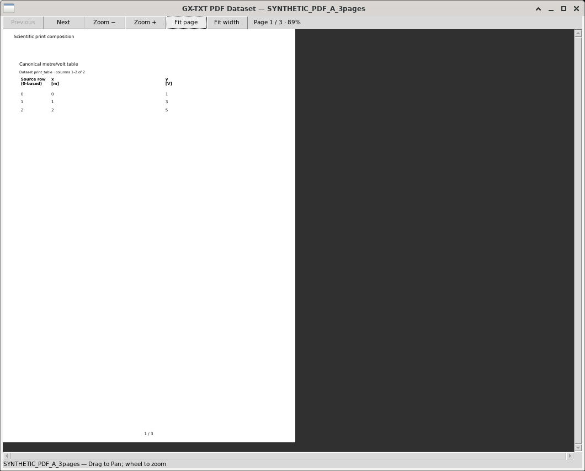
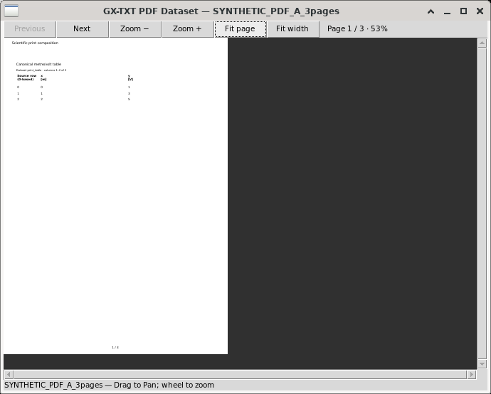
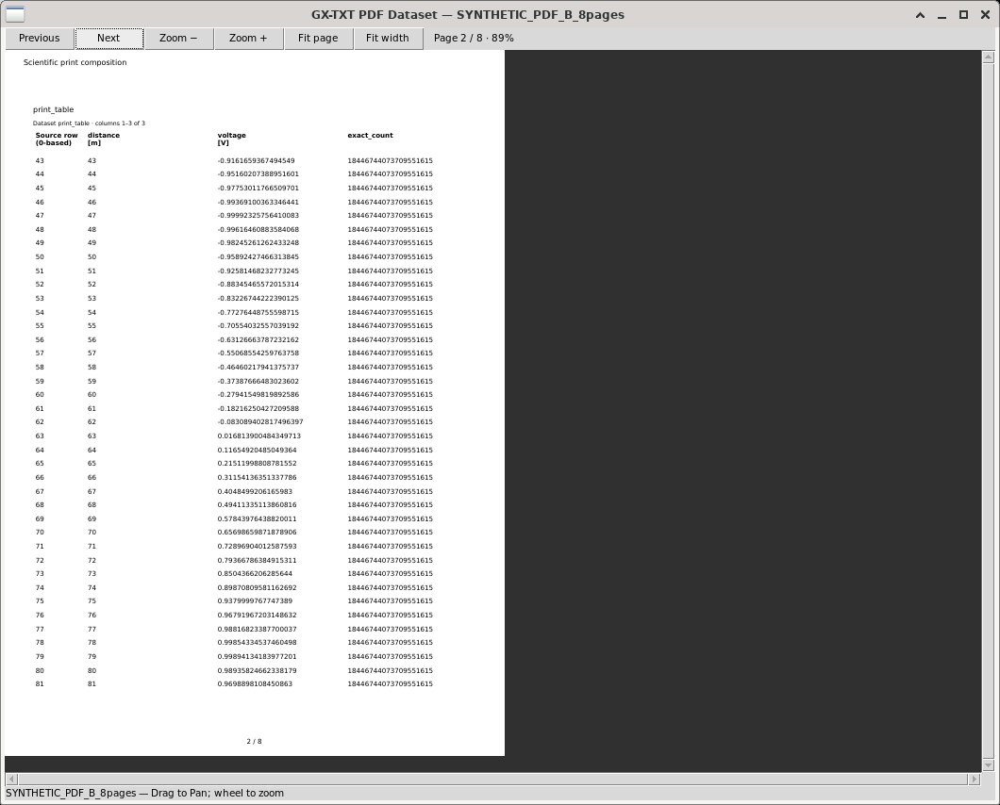

# PDF Reader

PDF Reader opens registered PDF Datasets in GX-TXT's existing read-only CORE
reader. Import a PDF through the normal acquisition workflow before using this
Viewer. OCR is not required.

## Choose and open a PDF

1. Open **Viewers → Documents → PDF**.
2. Choose a document in **PDF Dataset**, then select **Open PDF**.
3. Read it in the separate **GX-TXT PDF Dataset** window. Its title and bottom
   status identify the opened Dataset.
4. To switch documents, return to the launcher, choose the next PDF and select
   **Open PDF**. Selecting a name alone leaves the current reader unchanged.

The selector offers compatible registered `document.pdf` identities from the
current Session. HTML and raster-image Datasets do not appear. With no Session,
open a Session before selecting a PDF. With an empty selection, the launcher asks
you to choose a compatible Dataset. An empty Session explicitly shows
“No compatible canonical pdf Dataset is available in this Session.”

The folded-page-and-magnifier icon identifies this reading Viewer and its Open
PDF button. PDF OCR is a separate tool. The opened reader's Dataset title and
page status identify the document actually being displayed.

## Pages, zoom and scrolling

The reader's top row contains **Previous**, **Next**, **Zoom −**, **Zoom +**,
**Fit page**, **Fit width**, then the current page, total pages and zoom.
Previous is disabled on the first page; Next is disabled on the last page.

- **Fit page** shows the entire current page in the available canvas.
- **Fit width** enlarges the page to the available width. Use the vertical
  scrollbar to inspect the remaining height, particularly for dense tables.
- **Zoom + / Zoom −** increase or decrease magnification. The mouse wheel also
  changes zoom; it does not move between pages.
- Drag the page with the left mouse button to pan. Horizontal and vertical
  scrollbars expose content outside the visible area. With the page focused,
  arrow keys scroll horizontally or vertically.
- Resize the reader normally, then choose Fit page or Fit width if you want the
  page fitted to its new window. Resizing retains the page and zoom until you
  select another presentation command.

Navigation and zoom change the presentation, not the canonical PDF bytes.

These genuine native Debian screenshots were captured from installed0.2.0 and
admitted through the official manual-resource facility. Their original source
snapshots, capture identities and exact image bytes remain in the packaged
provenance. Later versions retain the five existing declared Viewer components
and append standard Help as component6. These images are not relabelled as later
Help tests. All displayed example data are explicitly synthetic.

## Close, change Session and reopen

Close the PDF reader normally with its window close control. Its launcher stays
available; select Open PDF to reopen the selected document. Closing the launcher
releases its associated reader through the existing CORE lifecycle owner.
Reopening the launcher starts with an empty selection.

Changing Session retires the associated reader and marks the old launcher
“Session changed; reopen this Viewer.” Reopen the launcher and choose a PDF from
the new Session. Dataset identities remain Session-specific even when two
Sessions contain identical PDF bytes.

If the source cannot be read as a PDF, the reader shows **Unable to read PDF**,
with no displayed page and navigation/zoom/Fit controls disabled. A source that
disappears is invalidated through the shared source watcher; the launcher shows
the missing-source diagnostic and clears its old binding. Restore or import the
intended source through the normal framework workflow, then explicitly reopen
it. An old page is not evidence that a failed new request succeeded.

Use **Help** or **F1** in the launcher to open this module's integrated manual in
GX-TXT's existing Documentation Browser. The guide includes the three genuine
images above.

## Read-only scope and limits

PDF Reader provides consultation: no PDF editing, annotation, OCR, source Save,
page manipulation, conversion or implicit Dataset publication. Imported source
bytes remain canonical. The reader uses the existing CORE PDF Media Viewer and
shared Poppler/PdfCanvas implementation for decoding, pages, navigation,
scrolling, temporary images and lifecycle.

The shared reader supports zoom from10–400%, active-page dimensions/rotation and
an eight-PNG/64-MiB cache budget. These are existing owner contracts. PDF Reader
adds no parallel decoder, renderer, cache, source store, scheduler or publication
service. It creates no scientific plots.

## Appendix — verification and provenance

This appendix records the tested implementation separately from the user
instructions. Version0.2.3 reconciles this guide and version metadata only.
Installed runtime behavior was tested on0.2.0 and the corrected0.2.2; the new
documentation package is not relabelled as an independently tested release.

The same restricted author used official Interface Builder and Development
Workspace operations throughout. The authored C++ uses only public
`Host.document_bind(4,3)`; the original five declared component ordinals remain
unchanged. Component6 is the existing standard Help component. Dataset, Session,
Resource, Media Viewer and Documentation owners retain their authority. No
CORE source was modified by the author.

| Assigned PDF consultation check | Retained observed result |
| --- | --- |
| Direct installed factory/catalog launch, Documents icon and no-Session state | Author and independent native QA passed |
| Compatible Session-specific PDF selection; HTML/raster exclusion; Empty prompt | Passed |
| Genuine three-page and eight-page PDFs, page navigation and boundary states | Author native checks passed; independent actual first-page identity confirmed |
| Button/wheel zoom, Fit page/width, arrows and drag pan | Author native checks passed and preserved |
| 680×520 and1050×820 reader sizing | Same author repeated the repaired native resize successfully; actual captures inspected |
| PDF A→B→A and Session A→B→A→Empty | Passed; canonical and rendered identities retained; natural expiry observed before guard/bind |
| Native reader/parent close and reopening | Author checks and independently sealed exact-child reaping passed |
| Invalid source and missing-source diagnostics | Independent real Poppler failure/disabled-controls and natural missing-source invalidation passed |
| Source preservation | Five original payload/full public records and two historical synthetic Print PDF sources unchanged |
| Help/F1 and three integrated image resources | Independent native F1 on installed0.2.2 opened the exact manual and images |
| Full application restart and cleanup | Independent fresh-profile restart/catalog/selector/Open passed; complete raw03/04 logs and actual exits clean |

The only deliberate file fault used one new, marked synthetic invalid PDF in the
independent QA Session. Its bytes, path, inode, mtime and complete public record
were restored exactly. No original good PDF or scientific Session was faulted.
Deliberate replacement of a valid PDF revision was not performed and is not
claimed as an additional test.

Historical failures remain preserved:

- Gaps001/002 required MAIN extensions to existing public authoring, Media
  ownership and official test facilities. Later installed native tests passed.
- Native-resize failure003 was fixed in the existing trusted test owner. The
  same author repeated the failing request successfully, retaining its first
  failure.
- The older retained process emitted eight ignored stdout BrokenPipe flush
  diagnostics. Individual messages could not be assigned to specific children.
  MAIN repaired the existing receipt-output owner; independent03/04 whole raw
  logs from process start, actual exit0 and exact root/child absence established
  the corrective cleanup result. The old diagnostics remain unchanged.
- Installed0.2.1 genuinely failed native F1 because this author omitted Help.
  CORE correctly respected that declaration. The same author appended Help6
  in0.2.2; independent native F1 then passed. This was independent QA, not
  author-operated F1.
- Older independent reader captures were partly occluded and excluded from
  whole-reader layout acceptance. Later genuine unobscured03/04 frames supplied
  that evidence without replacing the original images.

Runtime limitations and verified scientific source identities are described in the public sections above. Local development acceptance evidence is not part of the distributable user manual.
