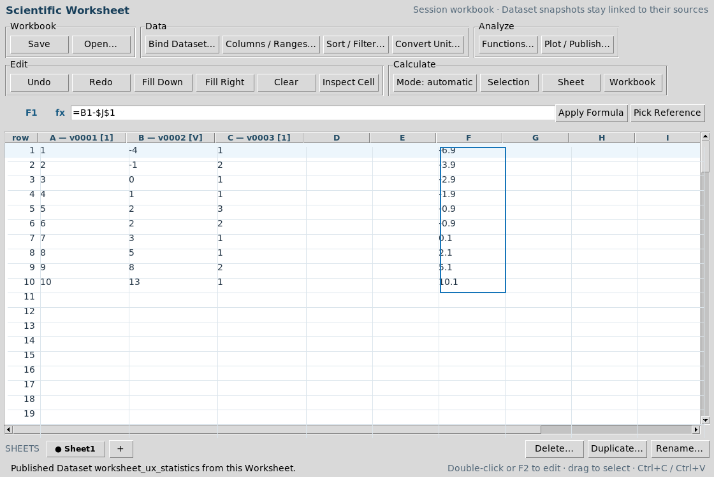
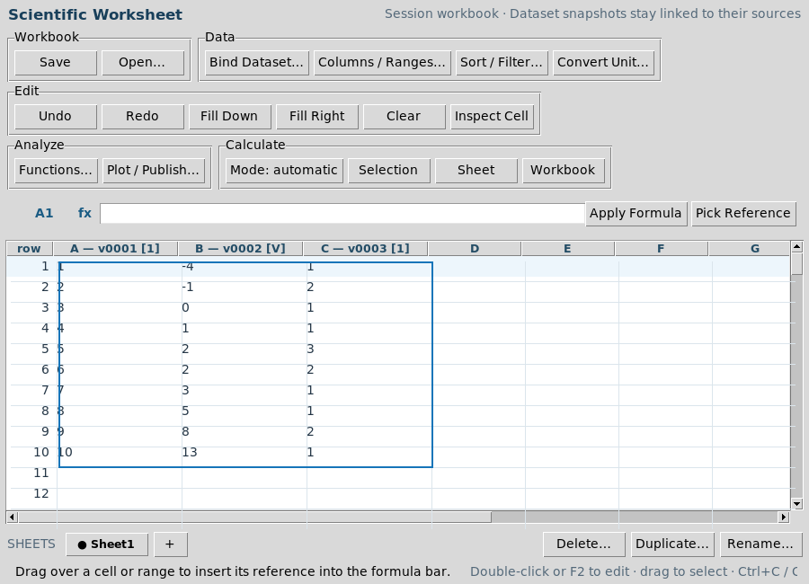

# Scientific Worksheet 1.2.0 — User guide

Scientific Worksheet is a saved calculation workbook inside a GX-TXT Session. It combines typed cells, scientific formulas, public mathematical operations, canonical Dataset snapshots, and Plot Dataset output. A bound Dataset is read into the workbook with its source identity; editing Worksheet cells never changes the source Dataset.

## Start, open, and save

1. Open a Session in GX-TXT, then choose **Viewers → Scientific Worksheet**. A new workbook opens with one sheet, **Sheet1**.
2. Enter values or bind a Session Dataset. The workbook title, formula bar, grid, sheet tabs, and status line remain visible while you work.
3. Choose **Workbook → Save** to create or update the Session Interactive Document. **Workbook → Open…** lists saved Worksheet documents in the current Session.
4. Closing the window does not save unsaved edits automatically. Use **Save** before closing or publishing a result.

The upper controls are grouped by purpose: **Workbook** for Save/Open, **Data** for binding and table preparation, **Analyze** for functions and Plot Dataset, **Edit** for cell actions, and **Calculate** for mode and recalculation scope. On a narrow window, Analyze and Calculate move to their own row. The action names and commands are the same in either layout.

## Read and edit the grid

The selection status summarizes at most 5,000 cells using the public Numeric
provider and CORE statistical interpretation. It includes finite scalar numbers,
reports their count, and omits text, errors and nonfinite/nonscalar values.
Mixed units require explicit conversion before aggregation; missing units stay
undeclared. Empty or oversized selections show an explanation. Calculation keeps
the interface responsive, and edits or reopened windows cannot receive an older
selection's result. Identical selections reuse the captured result.

Automatic calculation uses the supplied workbook's values, including when two
in-memory copies share the same document ID or revision. Changing any sheet
invalidates dependent cached results for that workbook. Manual mode continues
to retain calculated values until the requested recalculation action.

Column letters and row numbers identify cells such as **B4**. The active cell is shown in blue, and its full stored value or formula appears beside **fx**. A pale row highlight helps locate the active cell. Fine gridlines separate cells, including empty cells. Named columns and units appear in column headings.

- Click a cell to activate it. Double-click, press **F2**, or press **Enter** to edit directly. Press **Enter** to commit or **Escape** to cancel the direct editor.
- Type in the formula bar and select **Apply Formula** to commit the active cell. Plain numeric or text values are accepted; a formula begins with an equals sign.
- Use arrow keys, Tab/Shift+Tab, Home/End, Ctrl+Home/Ctrl+End, Page Up/Down, the mouse wheel, and the scrollbars to navigate. The grid renders a 200-row window while stored cells may extend to row 1,000,000 and column ZZ.
- Drag to select a rectangular range. Shift extends from the anchor; Ctrl-click adds another range. A blue outline marks the selected range. The status line reports its cell count, numeric count, sum, and mean for selections of up to 5,000 cells.
- **Inspect Cell** shows the computed value, unit, lineage, or a detailed error. **Clear** clears the selected range. **Undo** and **Redo** work on recent edits in the current editor window.

**Ctrl+C** copies a rectangular TSV selection. **Ctrl+V** pastes TSV starting at the active cell. Formulas copied inside Worksheet adjust their relative references once for the source-to-destination offset. Select an initial formula and its destination range, then choose **Fill Down** or **Fill Right**. Pasting ordinary external TSV does not reinterpret it as a Worksheet formula relocation.

## Sheets, columns, and ranges

Sheet tabs sit below the grid. The active tab is bold and marked with a dot. Select **+** to create a sheet; **Rename…**, **Duplicate…**, and **Delete…** act on the active sheet. Deletion asks for confirmation. Sheet names use identifiers such as Calibration_2. A cross-sheet reference uses Sheet1!A1. Renaming a sheet updates its references.

**Data → Columns / Ranges…** sets a column display name and unit or defines a named rectangular range. For example, name column B Voltage and define voltages as B1:B10; a formula can then use =numeric.mean(voltages) or =Voltage[2]. Drag a heading divider to adjust a column width. Sheet order, names, formulas, bindings, and presentation survive Save/Open.

## Formulas and calculation

References can be relative (A1), fixed ($A$1), or mixed (A$1, $A1). Copy and Fill shift only relative row or column parts. Formulas support arithmetic, comparisons, parentheses, ranges (A1:B10), named ranges, named columns, cross-sheet references, and formula-safe functions. Use **Pick Reference** when composing a formula: click or drag in the grid to insert a cell or range into the formula bar. **Ctrl+Space** completes a function, range, column, or sheet name when there is a unique match.

~~~text
=B1-$J$1
=numeric.mean(B1:B10)
=numeric.mad(B1:B10)
=Sheet1!A1+$B$2
=field(signal.convolution.linear(A1:A3,B1:B2),"value_real")
~~~

Scalar results occupy one cell. A vector spills downward and a matrix spills across rows and columns. A blocked destination reports #SPILL! without overwriting an occupied cell. Blank, boolean, text, numeric, missing, Dataset-bound, and derived cells remain distinct.

Statistical scalar formulas (mean, median, extrema, sum, population/sample
variance and standard deviation, RMS, quantile, covariance, correlation and MAD)
retain the shared CORE interpretation of the Numeric result. For example,
sample variance of voltage has unit V²; a single observation has an explicit
undefined variance. **Inspect Cell** displays its meaning and reason. Units
must agree within an aggregated vector or range, including undeclared units.
Arithmetic, cell references and spills retain the statistical inputs and source
Dataset/Variable identities. The inspector distinguishes those inputs from the
cell's final transformed value. Publication preserves the captured interpretation
and links it to output cells without repeating the numerical calculation.

Structured `field(numeric.statistics(B1:B10),"variance_sample")` and the
corresponding guided operation retain the same interpretation. Quantile vectors
keep their probability order; parameter uncertainty vectors keep each parameter's
own unit. Guided output stores its captured interpretation once with the saved
operation. Save/Open and publication reuse it; explicit operation recalculation
uses the current inputs. A manual cell edit replaces that cell's statistical claim.
Undefined or unavailable output remains explained by the captured reason.

PCA component summaries retain ordered component identities in one compact CORE
table; both formulas and guided outputs preserve the selected component through
spills, Save/Open and publication. A zero spectrum has undefined explained ratios,
shown as `NaN`; inspect the cell for the reason. Propagated uncertainty vectors and
covariance matrices retain positional output identities. Their physical output
units stay `unspecified` when the Worksheet inputs do not declare them; the
Jacobian's unit is not sufficient to identify heterogeneous output units.

Dataset statistics, weighted summaries and polynomial fits retain their recorded
Variable units and source lineage even when the operation uses Dataset IDs
instead of imported cells. Named Selections are resolved before execution;
publication retains their ID with the captured calculation. The shared typed
model path also applies named Selections to nonlinear fits.

Foundation and remaining explicit-model/unmapped output paths
are still being migrated during dev097 development; this coverage is not a claim
of complete Worksheet statistical acceptance. Existing arithmetic may leave a
derived unit undeclared. Inference that requires undeclared assumptions remains
unavailable, even when a numerical provider returns a candidate value.

**Calculate → Mode: automatic/manual** changes the calculation mode. Automatic recalculates after edits. Manual leaves cached results until **Selection**, **Sheet**, or **Workbook** recalculation is selected. Guided operation definitions retain their inputs, options, result field, and destination for recalculation. The calculation mode is saved with the workbook.

The formula parser accepts only its documented data grammar. It does not evaluate Tcl, Octave, Python, shell commands, callbacks, or macros. The vector, matrix, complex, record, empty, and field helpers construct data-only operands and inspect structured scientific results.

## Bind a Session Dataset

Choose **Data → Bind Dataset…**. The dialog displays the Session Dataset selector and its canonical variables with names, stable IDs, kinds, units, and roles. Select one or more variables with Ctrl/Shift; choose a first destination column, first row, optional Dataset Selection ID, and a row limit. Select **Bind Selected Variables**. The dialog also exposes **Manual column mapping…** for existing A=variable_id B=variable_id workflows.

The import reads public Table Stream chunks and is limited to **20,000 rows per binding**. Numeric and text variables may be bound together. Each bound cell keeps the source Dataset ID, variable ID, source-row ordinal, optional Selection ID, unit, and original source value. Binding creates a snapshot; bind again explicitly to refresh from a changed Dataset. The source bytes and canonical Dataset are unchanged.

**Data → Convert Unit…** converts selected numeric cells through a compatible public Unit Registry relationship. No formula or Dataset import silently converts units. Undefined, ambiguous, or nonlinear conversions are refused. Incompatible unit arithmetic reports #UNIT!; undefined derived units remain blank.

**Data → Sort / Filter…** sorts one or two columns, filters numeric or text values, shows all rows, and restores source order. These actions affect only the Worksheet snapshot. Source-row lineage moves with each value and remains available after restoring order.

## Find and apply scientific operations

Choose **Analyze → Functions…**. Search by operation name or subject, browse categories, and select an operation. The lower pane shows its public provider, signature, argument information, shape, units, result fields, Worksheet example, and whether it is a formula or guided operation. The visible result count updates as you search.

For a formula-safe operation, select **Insert into formula** and supply its arguments in the formula bar. For a guided operation, select **Apply…**. Enter cells, ranges, literals, options, or a provider-owned declarative model as requested. **Preview fields** evaluates the operation and lists available result fields. Choose a field and an output cell, then select **Apply to cells**. A vector or matrix field occupies a destination range, with collision checks. The Worksheet calls public Numeric, Signal, RF Network, or Magnetics providers; it implements no new mathematics.

For statistical operations with captured interpretation, repeated **Preview** and
**Apply** reuse the same result while the workbook and inputs are unchanged.
Editing either requires a fresh calculation. A Session change requires reopening
the dialog; a closed or replaced dialog cannot receive an earlier result. Closing
the dialog releases its preview. These guards do not change the saved operation's
explicit recalculation command.

The Numeric foundation dispatcher and configure_fft_threads process setting are not cell calculations. Individual foundation actions are listed separately. Callback mathematics are available only through provider-owned safe declarative models. A full operation inventory appears in Task 005's WORKSHEET_MATH_OPERATION_INVENTORY.tsv.

## Preview, retain, and publish

Choose **Analyze → Plot / Publish…**. Supply an X column, one or more Y columns, first and last row, and an output Dataset ID. A Z column enables a three-dimensional preview or retained graph where appropriate.

- **Preview Graph** creates a temporary Plot Dataset graph without publishing a Dataset.
- **Publish Dataset** creates a canonical Session Dataset. It becomes available to Dataset Preview, Analysis selectors, Table Stream, and other viewers.
- **Publish + Retain Graph** publishes the Dataset and saves a Plot Dataset graph that can be reopened later.

Save the workbook before publication. Published provenance includes the Worksheet document and revision, formulas, selected rows, units, source Dataset and variable identity, and row lineage. All rendering and retained graph state use public PLOT_DATASET_API_v3.

## Common errors and recovery

An invalid formula shows a syntax location; select **Inspect Cell** for the full diagnostic. #CIRC! means cells depend on each other in a cycle. #REF! means a referenced cell, sheet, or range is unavailable. #UNIT! indicates incompatible units or a conversion that cannot be safely defined. #SPILL! means a vector or matrix destination is occupied; clear it or choose another output cell. #VALUE! covers unsupported values, shapes, or operation arguments. The status line and error dialog identify the failing action, and the saved source/formula remains available for correction. Use Undo when an edit produced an unwanted result.

Very large sources should be bound in explicit intervals. The visible grid uses a 200-row window, a single bind action is limited to 20,000 rows, and a formula range or guided output is limited to 20,000 cells. Worksheet is a scientific workbook, not an office-suite formatter or arbitrary scripting environment.

## Worked examples

### Real statistics Session

Open demo_numeric_statistics_1.0.0 on a disposable copy. Bind statistics.source variables v0001, v0002, and v0003 into A:C for 10 rows. In **Functions**, select numeric.statistics, enter B1:B10, preview fields, choose mean, and apply at J1. The real-source mean is **2.9**. Enter =B1-$J$1 in F1, select F1:F10, and choose **Fill Down**. F10 uses =B10-$J$1 and evaluates to **10.1**. Preview A versus B in **Plot / Publish**, then save the workbook.

### Interpolation or regression source

Open copied interpolation-demo and bind interpolation.source X/Y variables into A:B. Use numeric.interpolate in the guided browser with source X, source Y, and a target range, then choose its yq result field. In copied linear-regression-example, bind linear.source X/Y into A:B, apply numeric.linear_regression, and place slope/intercept in cells. A fitted column can use fixed coefficient references such as =$J$2+$J$1*A1 followed by Fill Down.

### Mixed text and numeric Dataset

Open copied uvvis_mxene_quantitative_analysis. Bind mxene.concentration.family variables member_id, parameter_value, spectral_x, and spectral_y into A:D. Column A contains text; C retains its **nm** unit; every row retains its source ordinal. Sort or filter a Worksheet range, inspect lineage, then choose **Restore order**. Derived formulas and guided statistics can use the numeric columns without changing the source Dataset.

## Final production GUI images

**Wide layout on the copied statistics Session**

**Narrow layout with wrapped controls**

- [Dataset binding dialog](docs/images/bind_statistics_source.png)
- [Function Browser](docs/images/worksheet_function_browser.png)
- [Guided statistics dialog](docs/images/worksheet_guided_statistics.png)
- [Mixed text and numeric source](docs/images/worksheet_mixed_text_numeric.png)
- [Real Plot Dataset preview](docs/images/worksheet_real_plot.png)

## Integrated spectral powers and Welch summaries (dev097)

`numeric.power_level` expects already integrated, nonnegative spectral band
powers. Declare their actual column unit (for example `V^2`). The RMS reference
is a numeric magnitude in the derived RMS unit (`V` in this example). CORE keeps
power, RMS and dB meanings separate, and explains the undefined finite level at
zero power in the cell inspector. This function does not integrate a PSD or
establish sampling uncertainty. The captured result does not invent PSD provenance.

Ranges are vectors. Use `matrix(A1:B2,2,2)` for a rectangular input; values follow
Workbook row order. Guided and formula power fields preserve this shape and
record input row/column identities. Saved guided operations retain their CORE table
and undefined states through reopen and publication without repeating the calculation.
Formulas retain their established automatic or explicit recalculation behavior.

`numeric.welch_aggregate` takes summed normalized one-sided PSD and amplitude
vectors plus `window_count`, `frequency_step_hz` and `enbw_sum_hz`. The first bin
is DC. Declare both input units; incompatible PSD/amplitude units reject. CORE
supplies the units and interpretation of the scalar aggregate fields.

The provider adapter now converts row-ordered real and complex Workbook matrices
to the public column-major transport convention. This fixes transposed/misplaced
values for nonsymmetric matrices. Existing saved derived values are preserved;
explicit recalculation uses the corrected order. Scientific source data and
historical releases are not rewritten.

### Matrix summaries (dev097)

Guided `numeric.matrix_statistics` and `numeric.reduce_summary` preserve the
actual output orientation. Dimension 1 yields a row; dimension 2 yields a column.
Their shared input count is one scalar. Formula `field` results expose the whole
array at the anchor and scalar components in the adjacent spill cells. Source
units, squared variance units and undefined singleton sample spread come from
CORE; saved guided results and Dataset metadata retain those receipts. The cell
inspector explains unavailable values. Signal `statistical_contract` describes
an API and is excluded from Worksheet calculations.

### Signal summaries and physical units (dev097)

Signal basic quality, supplied-noise SNR, coherent harmonic/spectrum quality,
correlation peaks/delays, event periods, pulse metrics and window gains use the
public Signal contract and shared CORE interpretation. Formula `field` and guided
operations retain that meaning through cell inspection, save/open and Dataset
publication. A missing correlation sample rate exposes delay in seconds as
unavailable; it does not manufacture a finite time. Capturing a result does not
run the estimator again.

`complex(real, imaginary)` requires matching physical units and preserves them.
SNR requires matching signal/noise units. Correlation permits different units and
uses the CORE product or dimensionless normalization. Event and pulse time
coordinates must declare `s`; use explicit unit conversion for `ms`. Supplied
threshold/hysteresis units must match the measured signal. Sample-rate and
fundamental-frequency parameters accept bare values in their documented Hz unit
or values explicitly labelled Hz; convert kHz first. Window coefficients are
dimensionless. Undeclared signal units remain explicitly unspecified in CORE.

Four remaining foundation-statistics contracts remain development work.
Raw fields outside the captured CORE mapping
retain their existing behavior; a contributor receipt does not relabel them as
an interpreted statistical quantity.

### Captured spectral rows (dev097)

Periodogram, Welch PSD, amplitude spectral density, cross spectrum, coherence,
and H1/H2 frequency responses retain per-frequency CORE meaning and physical units.
A saved Worksheet captures the full result once in binary columns owned by its
existing Document. Unsaved Workbooks support compact results up to 8192 rows;
save the Workbook before requesting a larger spectrum.

Choose **First result row** (starting at 1) and **Number of rows** in the guided
dialog to select a bounded result window. A blank count selects the whole field,
subject to the Worksheet's 20000-cell spill limit. Formula
`field(result,"imag",16385,3)` selects three rows starting at result row 16385.
The existing two-argument `field` form selects the whole field. Shared scalar
facts such as sample rate remain scalars. The inspector reports original result
row identities, units and unavailable-value reasons from CORE.

The public Tcl call is `applyOperation book operation inputs options destination
field ?model? ?outputWindow?`. Its optional output window is
`{start ZERO_BASED_OFFSET count ROW_COUNT}`; persisted operations keep that window
beside the unchanged canonical field identifier. Existing calls retain their defaults.
Windows apply to captured statistical vector fields and accept 1–20000 rows.

Unchanged Preview and Apply share one captured calculation. Editing inputs or the
selected output during calculation prevents stale adoption. Saved guided results
reopen without an estimator call; published selected values carry the full captured
binding as provenance. Formulas recalculate normally and save their latest resource
references as provenance. Resource reads use the public CORE owner and bounded
pages; presentation caches clear on reopen and recalculation.

### Accumulated summaries (dev097)

A scalar result from `numeric.reduce_summary` or `numeric.reduce_accumulate` can
be passed as the first accumulation operand. For example,
`field(numeric.reduce_accumulate(numeric.reduce_summary(A1:A2),A3:A4),"mean")`
combines two blocks through the public Numeric owner. The guided dialog accepts
the same source expression or a reference to a cell holding the summary result.
`empty()` initializes a state. Explicit records need dimensionless `count` and
`sum`, `min`, `max` in the new observations' physical unit. Captured state facts,
identity and units are checked before calling Numeric. A non-scalar axis summary
cannot silently become one scalar state. Convert observations before summarizing.
Both source and accumulated receipts survive guided save/open and publication.

### Foundation location estimates (dev097)

Guided `numeric.foundation.statistics.confidence_interval` and
`numeric.foundation.statistics.robust_location` retain CORE units and meaning.
The former accepts `alpha`; the latter accepts `huber_constant`. In formulas,
options are the fourth operand, after explicit `empty()` placeholders, for
example `field(numeric.foundation.statistics.confidence_interval(A1:A10,
empty(),empty(),record("alpha",0.1)),"lower")`. The inspector explains singleton
undefined confidence limits and distinguishes a Huber scale from mean uncertainty.
Captured guided results persist and publish without re-running the estimator.

### Seeded foundation inference (dev097)

The foundation bootstrap/permutation actions accept an explicit integer `seed`
and `replicates` (at least 100); bootstrap also accepts `alpha`. Guided operations
and formula option records use the same public call. Permutation samples must
have matching physical units. Saved results retain the seed, method, source
counts and actual conventions. CORE explains why singleton groups or degenerate
bootstrap distributions cannot establish the requested inference. Publication
uses those captured receipts without another randomized run.

### Partial correlation and multiple testing (dev097)

`numeric.foundation.statistics.partial_correlation` takes two aligned measured
vectors and control columns. Their units may differ; the coefficient is
dimensionless. CORE records covariance rank and distinguishes ordinary partial
correlation from the descriptive pseudoinverse coefficient for singular inputs.
An invalid normalization appears as unavailable numeric content with an explicit
undefined reason in the cell inspector.

`numeric.foundation.statistics.multiple_testing` accepts dimensionless p-values.
In the guided dialog, enter a quoted method expression such as `"holm"` for the
`method` option. `adjusted_p` spills in original input order; `family_size` is one
shared scalar. In formulas use, for example,
`field(numeric.foundation.statistics.multiple_testing(D1:D6,empty(),empty(),
record("method","bh")),"adjusted_p")`. CORE retains method-specific FWER/FDR
assumptions and hypothesis positions through guided save/open and publication.
No second adjustment is performed during presentation or publication.

### Survival curves (dev097)

`numeric.foundation.statistics.survival_kaplan_meier` accepts observed coordinates
and dimensionless event indicators (one for an event, zero for censoring). Declare
the coordinate unit on its input column. The result includes `time`, `survival`,
`at_risk`, `events`, `censored` and the shared observation count `n`. Coordinates
with censoring only remain in the curve. CORE states the right-censoring and
independence assumptions; no confidence interval is supplied.

Save the Workbook to capture survival or multiplicity output in canonical binary
Document resources. The guided result-row controls and four-argument `field`
syntax select bounded rows using the same conventions as spectral results.
Saved guided values reopen and publish with their full captured binding without
another estimator call; formulas retain their normal recalculation behavior.
Unsaved compact curves/tables retain the 8192-row limit.

### Covariance diagnostics (dev097)

For `numeric.foundation.statistics.covariance_diagnostics`, construct a matrix
with observations in rows, for example `matrix(A1:B4,4,2)`. A vector input is
one variable. Select `covariance_real` or `covariance_imaginary` for the CORE
matrix component; `eigenvalues_real` and `eigenvalues_imaginary` expose the native
spectrum. Original raw provider fields remain available. Explicit components
preserve complex meaning without treating a whole complex matrix as its real part.

CORE retains matrix entry identities and product units through spills, guided
persistence and publication. Eigenvalues have squared units only for common-unit
variables; their ordering is a spectral position, not a variable-specific variance.
The inspector explains why a singleton has undefined sample covariance even
though the underlying provider returns a zero placeholder. These diagnostics do
not supply fit-parameter uncertainty or a statistical significance test.

### Clustering and regression results (dev097)

For `numeric.foundation.statistics.kmeans`, supply observation rows and explicit
`seed` and `clusters` options. `centroids` is a cluster-by-feature matrix;
`cluster_counts` and `within_ss` follow its row identities. `labels` are integer
identifiers in original observation order, not continuous measurements. Guided
row windows and the four-argument `field` syntax retain the original observation
position. The inspector shows the corresponding cluster identity. The native
provider supplies no selected-solution convergence status; requested starts do
not establish a global optimum.

The existing `robust_regression`, `logistic_regression` and `glm` actions take
a design matrix and response as their first two operands. Include any intercept
column explicitly. Robust residuals use the response column's physical unit.
Logistic responses are zero/one; GLM accepts binary logit or nonnegative integer
Poisson counts. These response columns must be dimensionless. CORE interprets
the actual method and family, iteration count, stopping flag and coefficient
components. Complex robust estimates retain explicit real/imaginary fields.
Unknown coefficient units remain unspecified instead of copying response units.

Select `probability` or `fitted_mean` for dimensionless response predictions,
or `residual`, `residual_real` and `residual_imaginary` for supported robust
residuals. Guided results save the original selected values and interpretation;
reopening or publishing them does not fit again. Formulas retain normal
recalculation behavior. The inspector includes CORE's definition of each scalar
diagnostic: satisfying the numerical stopping criterion does not establish
statistical identification, finite maximum likelihood or inferential coverage.
These foundation routines do not provide parameter covariance or intervals.
